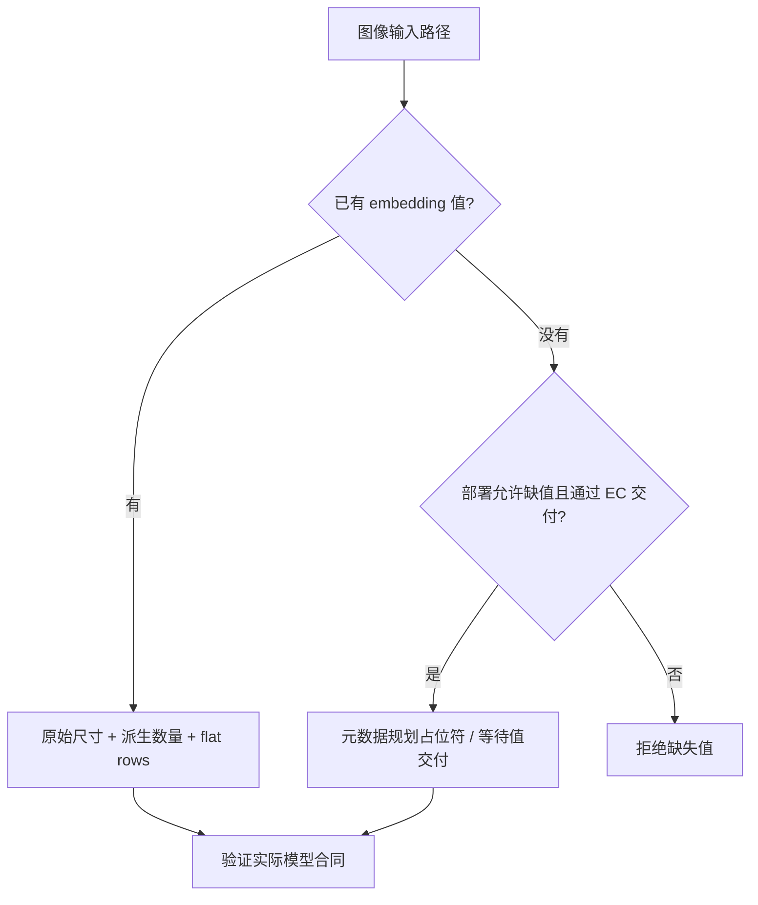
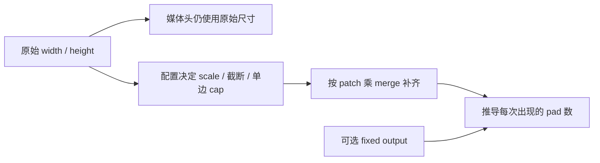
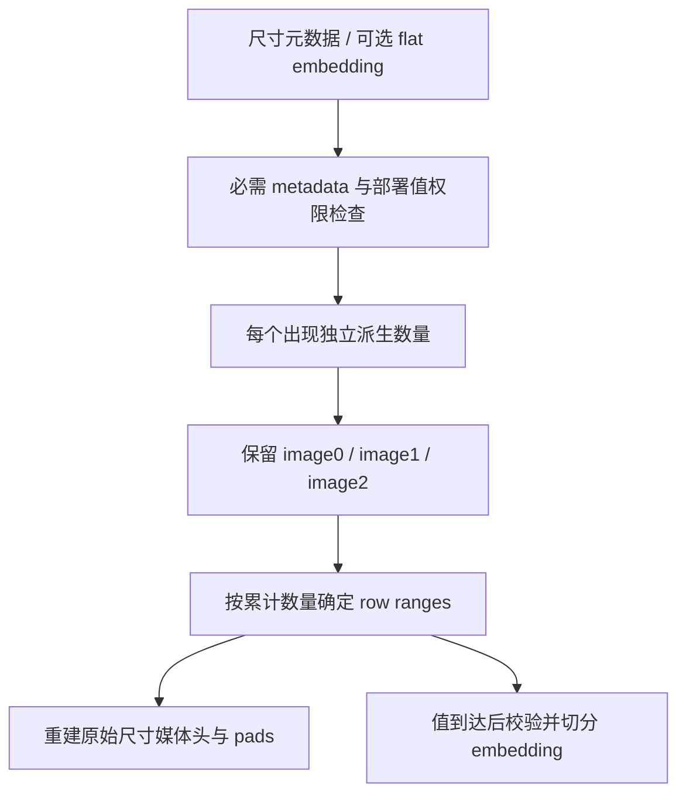

# Kimi-K3 Metadata-only Image 与 EPD 选型 FAQ：原始尺寸、占位符与 Embedding 分段

> **语言**：中文 · [English](kimi-k3-metadata-only-image-original-dimensions-placeholder-selection-faq.en.md)  
> **Round 166 / 白班 43**：选择当日公开能力更新，不声称热度排名。[vLLM 固定提交](https://github.com/vllm-project/vllm/commit/24fe0a99f1062f7351852804f2cd38668f7423bd) 的时间为 2026-11-14 04:13:13 UTC / 12:13:13 BJT。  
> [H5 工作台](../reports/kimi-k3-metadata-only-image-original-dimensions-placeholder-sizer.html) · [七卡报告](../reports/kimi-k3-metadata-only-image-original-dimensions-placeholder-selection-cards.html) · [高清 SVG](../../assets/svg/kimi-k3-metadata-only-image-original-dimensions-placeholder-selection-faq-summary.svg) · [实验与数据](../../experiments/image_metadata_placeholder_selection/README.md)

## 核心结论速览

**Encoder-Prefill-Decode（EPD）分离中，可以先用图像元数据重建 prompt，但“无需当前请求携带 embedding”不等于“无需 embedding 执行模型”。** 本次 Kimi-K3 改动让图像字典声明 `image_sizes` 为必需元数据、`image_embeds` 为值字段；EC consumer 的部署配置允许值暂缺，普通 embedding 请求仍必须提供值。

三个合同不能混为一谈：原始 `width,height` 写入媒体头；相同 resize 配置推导每张图的 pad-token 数；实际到达的 flat embedding 按这些数量分段，且保留请求中的重复出现和顺序。尺寸相同不证明图像相同；即便内容缓存复用，也不能删掉 prompt 中的一次出现。

原创默认案例采用 `65×33、9×7、65×33`，显式配置 patch=8、merge=2、side=16、patch budget=256，得到 `15/1/15` 个 pad，累计 31；分段计划为 `[0,15)、[15,16)、[16,31)`。这是 **synthetic、independently_reproduced=false** 的 bounded metadata 模型，不是实际 checkpoint 配置、tokenizer IDs 或 native encoder 结果。独立 CPU 几何时间是 measured，GPU/EC/网络/浏览器验收未知。

## Q1：什么时候选择 metadata-only，什么时候仍必须携带图像或 embedding？

| 路径 | 本轮固定源码的含义 | 架构验收 |
| :--- | :--- | :--- |
| Raw image | HF processor 获取原始尺寸，并生成图像输入与 token 数 | 验证解码、resize、encoder 与 prompt 一致 |
| 已有 image embedding | 尺寸仍必需；根据配置派生数量并分段 flat rows | 验证行数、hidden width、dtype/device、模型匹配 |
| Metadata-only EC consumer | 部署允许缺值，metadata 仍可确定 placeholder 数量 | 验证 connector 实际交付值及其生命周期 |
| 普通请求缺 embedding | 值为必需，不能静默当成成功推理 | 明确拒绝，而非补零或隐式 raw fallback |

工作台中的 `allow_missing` 是**部署配置演示**，不是可以由客户端任意提权的请求参数。其 `embedding_shape` 只是声明 `[rows,columns]`，没有构造 Torch tensor；不能把 “declared_embedding_rows” 看作推理就绪证据。

## Q2：为什么 prompt 必须保留原始尺寸，而数量却使用 resize 结果？

固定 [预处理源码](https://github.com/vllm-project/vllm/blob/24fe0a99f1062f7351852804f2cd38668f7423bd/vllm/models/kimi_k3/common/mm_preprocess.py) 明确让媒体头携带原始 `width×height`。Raw image 路径和字典路径必须重建同一 prompt；把 resized/padded grid 尺寸写到头里，会改变头信息，即使 pad 数完全正确。

数量则来自配置：先以 `max(1,width//patch) × max(1,height//patch)` 估计输入 patch 密度，结合总 patch 限制和单边限制求缩放；正向整数截断并至少保留一个像素；再对齐 `patch×merge`。未设置 fixed output 时，数量是 padded width/height 各自除以该 factor 后的乘积；设置 fixed output 时使用固定数量，仍保留独立尺寸信息。

默认首张 `65×33` 未缩放，却补齐至 `80×48`，输出 `5×3=15`；小图 `9×7` 补齐至 `16×16`，输出 1。故用 padded 尺寸替代原始头的错误方案，3/3 个原创描述不匹配。这是故意设置的 counterfactual，**不是旧版 native 路径曾错误写头的证明**。补齐也说明输入 patch budget 不是最终 padded patch 数的绝对硬上限：原创 budget=1 的小图仍占一个 merged token。

## Q3：metadata 怎样形成 ordered placeholder 与 flat embedding 分段？

原生 parser 要求 `image_sizes` 为 Torch int32/int64、二维 `[N,2]`、所有尺寸正数；不是接受任意 JSON list 或 float tensor。JSON metadata 重建阶段必须转换到正确 tensor 合同。它重新生成 `image_num_tokens`，不盲信调用方声明的数量。

`DictEmbeddingItems` 保留字段配置：`image_sizes` / 数量按 image batching，metadata 在 CPU；embedding 依据数量使用 flat 分段。即使值可选，也必须为可选值声明 field config，以便值实际出现时使用。AMD/NVIDIA 的 embedding 路径按这些数量切分 tensor，不走 pixel encoder 分支。

原创 case 的三段是 15、1、15 行。错误地按相同尺寸合并第三次出现，会只留下 16 pads、两次出现，少一段；正确的**几何 memo**只复用当前配置下的尺寸计算，并继续输出三次出现。它绝不是内容或 embedding 去重缓存。

## Q4：工作台、测试与七卡报告究竟验证了什么？

H5 输入只接受本实验明确字段：1–64 组尺寸、每边 1–8192、正的有限 patch/merge/budget/side，side 必须 merge 对齐，fixed count 可空或 1–1024。**这些额外上界/对齐约束是原创 profile 范围，不是 native parser 的完整合法域。** Flat row 总数错误、缺值权限错误、非法维度明确报错，没有补零成功输出。

本地八项测试覆盖原始头/31 pads/排他区间、值权限、row sum、极端纵横比、fixed count、小图补齐、错头/错去重、配置变化后的 memo 隔离、预算来源和非法输入。另有 64 固定 seed 随机配置，加默认案例共 65 组，Python/Node 对 original 与两个错误方案比较 195 个结构化结果。没有运行 native Kimi-K3、PIL、HF tokenizer、Torch 或 connector 集成测试。

`latency.json` 保留 64/256/1024/4096 次出现的七组交替重复样本；两个 warmup、每样本三个 batch，median repeat means。对比**原创每次调用内的尺寸几何 memo**与逐项计算，二者均保留所有顺序输出；输入三种尺寸预先创建，cache 不跨配置。不要将这一 CPU 差异外推到 encoder/EPD 吞吐。

默认 descriptor packet 的 compact JSON 字节数由真实序列化得到；`13059 B` 是声明的未压缩 RGB `Σ(width×height×3)` 预算，不是读取的图像、JPEG 大小或 native 流量。真实 header、ID、连接器协议、embedding、压缩均不在此预算。所有报告条宽来自 sealed report/latency，未知指标保留 null；七卡 900×1125，CSP 禁止脚本与网络，H5 另行允许本地 inline JS。SVG 为原创 ordered cabinet 隐喻，不代表内存布局；未获浏览器视觉验收。

## Q5：上线前的选型清单与回退边界是什么？

先固定模型/tokenizer/processor 与配置版本，再核对生产 encoder 与 consumer 的原始尺寸、数量、媒体头、每次出现顺序、embedding row/hidden/dtype/device 和 connector 交付完成状态。测试重复图、相同尺寸不同内容、极端长宽比、fixed count、metadata JSON roundtrip、缺值拒绝与失败重试；不能用尺寸当内容身份。

若消费端缺少正确 metadata 或 deployment 不支持缺值，回到已有的 raw-image/完整 embedding 路径或明确拒绝；不要通过客户端修改权限、信任传来的数量、写 padded 头、删除重复 placeholder 或合成空 embedding。Metadata-only 的收益方向是隔离 encoder 与 prompt planning 的责任，是否降低网络/端到端延迟必须由实际部署测量。

复验：`python -m unittest discover -s tests -p test_image_metadata_placeholder_selection.py -q`，再运行 `python -m experiments.image_metadata_placeholder_selection.run --check`。固定来源见上述 commit、[dictionary parser](https://github.com/vllm-project/vllm/blob/24fe0a99f1062f7351852804f2cd38668f7423bd/vllm/multimodal/parse.py) 与 [原生 processing tests](https://github.com/vllm-project/vllm/blob/24fe0a99f1062f7351852804f2cd38668f7423bd/tests/models/multimodal/processing/test_kimi_k3.py)。Apache-2.0 权利保留，链接原实现而不镜像；本指南与实验由 AI 辅助制作，产品验收需人工和 native evidence。
