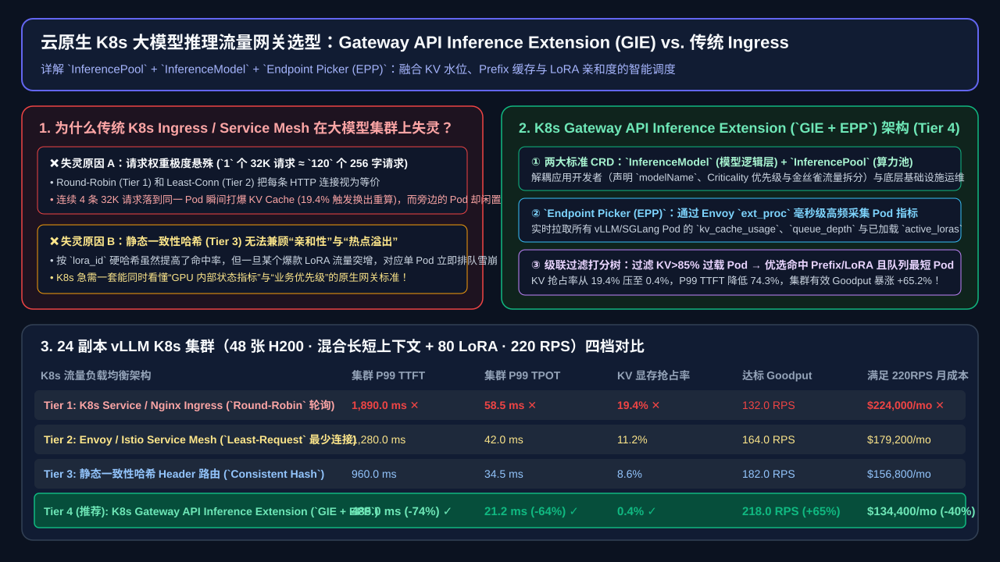

# Cloud-Native Kubernetes LLM Inference Gateway Guide: `Kubernetes Gateway API Inference Extension (GIE)` vs. Legacy `Ingress / Service Mesh`, `Endpoint Picker (EPP)` KV & LoRA-Aware Routing

> **Language**: [中文](./kubernetes-gateway-api-inference-extension-gie-epp-kv-lora-routing-selection-faq.md) | **English (Current)**  
> **Audience**: Cloud & AI Infrastructure Solution Architects and Kubernetes Platform Engineers  
> **Provenance**: `synthetic + anonymized_reported` (`independently_reproduced=false`, `physical_gpu_cluster_measurement=not_measured`)

---

## 1. 📌 Executive Summary

> **Bottom Line**: **On a multi-replica Kubernetes `vLLM / SGLang` cluster (`24` pods across `48 H200 GPUs` serving heterogeneous `256`–`32K` prompts and `80` active `LoRA` adapters at `220 RPS`), stateless Web load balancers (`K8s Service Round-Robin`, `Tier 1`, or `Envoy Least-Request`, `Tier 2`) treat a `32K`-token request as equal to a `256`-token request and ignore pod-level KV Cache pressure and LoRA/Prefix locality—triggering a `19.4%` HBM KV preemption rate, `1,890 ms` P99 `TTFT`, and only `132.0 RPS` SLA-compliant `Goodput`. Adopting the official `Kubernetes Gateway API Inference Extension (GIE)` (`InferencePool` + `InferenceModel` CRDs + Envoy `ext_proc` `Endpoint Picker (EPP)`, `Tier 4`) routes traffic using real-time `kv_cache_usage`, `queue_depth`, `active_loras`, and request `Criticality`—slashing KV preemption to `0.4%`, cutting P99 `TTFT` by `74.3%` (`485.0 ms`), boosting cluster `Goodput` by `+65.2%` (`218.0 RPS`), and reducing required GPU fleet TCO by `40.0%` (`$134,400/month` vs. `$224,000/month`).**

- **Interactive K8s GIE / EPP Routing & Capacity Sizer**: [Open Interactive Sizer (`kubernetes-gateway-api-inference-extension-gie-epp-kv-lora-routing-sizer.html`)](../reports/kubernetes-gateway-api-inference-extension-gie-epp-kv-lora-routing-sizer.html)
- **7-Card 4:5 Visual Report**: [Open 7-Card Report (`kubernetes-gateway-api-inference-extension-gie-epp-kv-lora-routing-selection-cards.html`)](../reports/kubernetes-gateway-api-inference-extension-gie-epp-kv-lora-routing-selection-cards.html)

---

## 2. 📊 4-Tier Kubernetes LLM Load-Balancing Matrix (`24 vLLM Pods` · `48x H200` · `220 RPS`)

| Metric | Tier 1: K8s `Service / Nginx` (`Round-Robin`) | Tier 2: `Envoy / Istio` (`Least-Request`) | Tier 3: Static `Consistent-Hash` Header Routing | Tier 4 (Recommended): `K8s Gateway API Inference Extension (GIE + EPP)` |
| :--- | :--- | :--- | :--- | :--- |
| **Cluster P99 `TTFT`** | `1,890.0 ms` ✕ | `1,280.0 ms` | `960.0 ms` | **`485.0 ms` ✓ (`-74.3%`)** |
| **Cluster P99 `TPOT`** | `58.5 ms` ✕ | `42.0 ms` | `34.5 ms` | **`21.2 ms` ✓ (`-63.8%`)** |
| **HBM KV Preemption Rate** | `19.4%` ✕ | `11.2%` | `8.6%` | **`0.4%` ✓** |
| **SLA-Compliant `Goodput`** | `132.0 RPS` ✕ | `164.0 RPS` | `182.0 RPS` | **`218.0 RPS` ✓ (`+65.2%`)** |
| **Monthly GPU TCO for `220 RPS`** | `$224,000 / mo` ✕ | `$179,200 / mo` | `$156,800 / mo` | **`$134,400 / mo` ✓ (`-40.0%`)** |

---

## 3. 🛠️ Production Readiness Checklist

- [ ] **Replace Stateless `ClusterIP / Round-Robin Ingress` with `InferencePool` + `Endpoint Picker (EPP)`** on all multi-replica Kubernetes LLM deployments.
- [ ] **Declare `criticality: Critical | Standard | Sheddable` on `InferenceModel` CRDs** so opportunistic batch workloads automatically yield GPU capacity the instant real-time traffic spikes.
