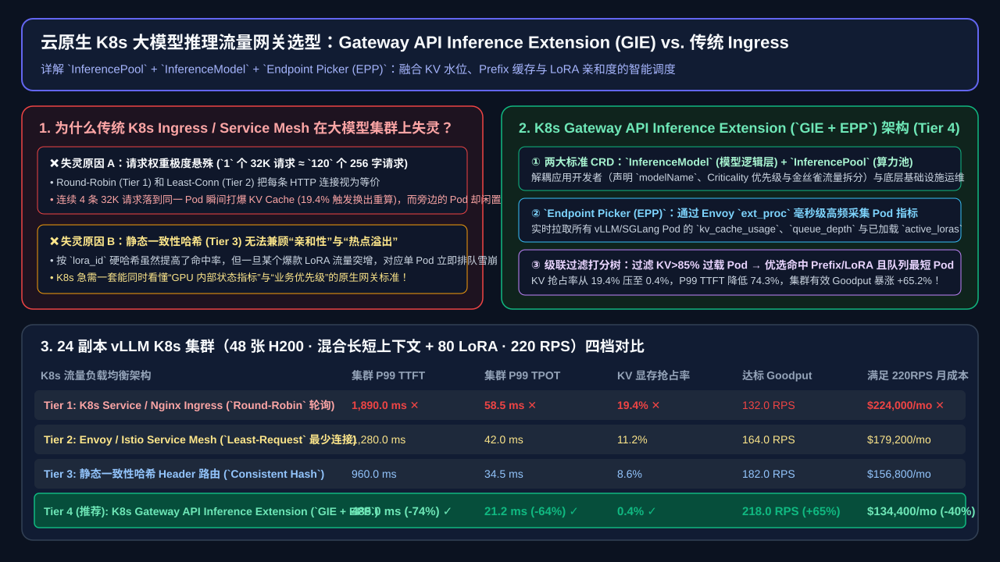
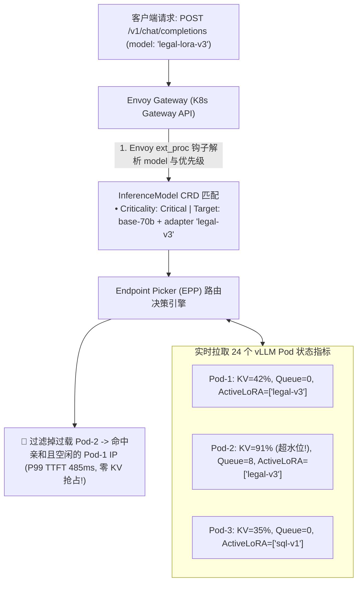

# 云原生 K8s 大模型推理流量网关标准选型：`Kubernetes Gateway API Inference Extension (GIE)` vs. 传统 `Ingress / Service Mesh`、`Endpoint Picker (EPP)` 基于 KV 水位与 LoRA 亲和度路由指南

> **语言 / Language**: **中文 (当前)** | [English](./kubernetes-gateway-api-inference-extension-gie-epp-kv-lora-routing-selection-faq.en.md)  
> **定位**：面向 Cloud & AI Infrastructure Solution Architect 与云原生 K8s 平台架构师的官方 Kubernetes 大模型推理网关扩展标准（`sigs.k8s.io/gateway-api-inference-extension`: `InferencePool` + `InferenceModel` + `Endpoint Picker EPP`）、有状态 GPU 指标感知负载均衡与三级业务关键度（`Critical / Standard / Sheddable`）防抢占白皮书  
> **合规与来源声明**：`synthetic + anonymized_reported`（`independently_reproduced=false`，`physical_gpu_cluster_measurement=not_measured`；完全面向通用企业级云原生 K8s 大模型推理流量调度架构设计）

---

## 1. 📌 核心选型结论速览（Executive Summary）

> **一句话结论**：**在 Kubernetes（GKE / EKS / AKS / 自建 K8s）上部署多副本 `vLLM / SGLang` 集群时，沿用面向无状态 Web 微服务的传统 `Service ClusterIP / Nginx Round-Robin`（Tier 1）或 `Envoy Least-Request`（Tier 2）会造成严重的“GPU 冷热不均与显存踩踏”——因为 `1` 条 `32K` 上下文请求消耗的 KV 显存与算力顶 `120` 条短请求，传统网关盲目把多条长请求派给同一个 Pod 触发 `19.4%` 的 KV 换出重算（`P99 TTFT = 1,890 ms`），而旁边的 Pod 却在空转！升级至 Kubernetes 官方标准 `Gateway API Inference Extension (GIE)`（`InferencePool` + `InferenceModel` + 基于 Envoy `ext_proc` 的 `Endpoint Picker (EPP)`，Tier 4）：通过实时采集每个 Pod 的 `KV Cache 利用率`、`等待队列长度` 与 `已加载 LoRA / Prefix 状态` 进行多维过滤打分，可将集群 KV 抢占率从 `19.4%` 压至 **`0.4%`**，`P99 TTFT` 降低 **`74.3%`（`485 ms`）**，集群达标有效吞吐（`Goodput`）暴涨 **`+65.2%`**，满足同等 `220 RPS` SLA 的月度 GPU 成本直降 **`40.0%`（净省 `$89,600/月`）**！**

- **交互式 K8s GIE / EPP 推理网关路由性能计算器**：[打开交互式计算器 (`kubernetes-gateway-api-inference-extension-gie-epp-kv-lora-routing-sizer.html`)](../reports/kubernetes-gateway-api-inference-extension-gie-epp-kv-lora-routing-sizer.html)
- **7-Card 4:5 视觉评测报告**：[打开 7-Card 报告 (`kubernetes-gateway-api-inference-extension-gie-epp-kv-lora-routing-selection-cards.html`)](../reports/kubernetes-gateway-api-inference-extension-gie-epp-kv-lora-routing-selection-cards.html)

---

## 2. 🎯 客户与架构师灵魂拷问 Q&A（Deep-Dive Architecture FAQ）

### Q1：Kubernetes 官方推出的 `Gateway API Inference Extension (GIE)` 到底新增了哪三个核心组件？
1. **`InferencePool`（算力池 CRD，由 AI Infra 平台运维管理员定义）**：
   - 将一组共享相同底座模型与硬件规格的 `vLLM / SGLang / TRT-LLM` Pod 抽象为一个逻辑算力池，并绑定专属的 `Endpoint Picker (EPP)` 扩展服务。
2. **`InferenceModel`（模型服务契约 CRD，由应用算法团队定义）**：
   - 将外部调用的模型名（如 `finance-copilot-v2`）映射到后端的基座模型或特定 `LoRA` 适配器名，支持**多版本金丝雀权重灰度拆分（90% v1 / 10% v2）**，并原生声明请求的业务关键度等级：**`Critical`（核心实时交易）**、**`Standard`（常规交互）** 或 **`Sheddable`（可丢弃离线批处理）**！
3. **`Endpoint Picker (EPP)`（挂载在 Envoy `ext_proc` 上的推理路由大脑）**：
   - 当 OpenAI 格式请求进入 Envoy 网关时，Envoy 通过 `ext_proc` 将请求体中的 `model` 与 Prompt 摘要交给 `EPP`；`EPP` 基于毫秒级高频拉取的各 Pod Prometheus/gRPC 指标（`kv_cache_usage_perc`、`num_requests_waiting`、`active_loras`）选出全局最优 Pod IP 返回给 Envoy 直接转发！

### Q2：`Endpoint Picker (EPP)` 内部的“级联过滤与复合打分树”是如何同时兼顾“缓存命中”与“负载均衡”的？
- **Step 1（关键度准入保护）**：若当前算力池整体饱和度超过阈值，直接拒绝 `Sheddable` 级别批处理请求，100% 保护 `Critical` 实时请求。
- **Step 2（队列与 KV 水位过滤）**：筛出等待队列深度 `< Low_Watermark` 且 `KV Cache < 80%` 的健康候选 Pod 集合。
- **Step 3（Prefix / LoRA 亲和性优选 vs. 最闲兜底）**：在健康候选集中，优先把请求派给**已经驻留了对应 `LoRA` 适配器或 Prefix KV 块**的 Pod；若那个亲和 Pod 已经排满，则立即自动溢出（Spillover）到全池 KV 最空闲的 Pod——完美克服了静态一致性哈希（Tier 3）的单点热点排队死穴！

---

## 3. 🧭 直观可视化图解（Mermaid `K8s Gateway API Inference Extension` 请求调度流）

---

## 4. 📊 架构师多方案选型决策矩阵（`24` 副本 `vLLM` 集群 · `48x H200` · `220 RPS`）

| 评估维度 | Tier 1：K8s `Service / Nginx` (`Round-Robin` 轮询) | Tier 2：`Envoy / Istio` (`Least-Request` 最少连接) | Tier 3：静态一致性哈希 Header 路由 (`Ring Hash`) | Tier 4（推荐）：`K8s Gateway API Inference Extension (GIE + EPP)` |
| :--- | :--- | :--- | :--- | :--- |
| **集群首字延迟 (`P99 TTFT`)** | `1,890.0 ms` ✕（长请求扎堆阻塞） | `1,280.0 ms` | `960.0 ms`（热点 LoRA 排队） | **`485.0 ms` ✓（降低 `74.3%`）** |
| **集群吐字延迟 (`P99 TPOT`)** | `58.5 ms` ✕ | `42.0 ms` | `34.5 ms` | **`21.2 ms` ✓（降低 `63.8%`）** |
| **HBM KV 显存满载抢占换出率** | `19.4%` ✕（频繁触发重算） | `11.2%` | `8.6%` | **`0.4%` ✓（85% KV 水位提前绕行）** |
| **220 RPS 下达标有效 `Goodput`** | `132.0 RPS` ✕ | `164.0 RPS` | `182.0 RPS` | **`218.0 RPS` ✓（提升 `+65.2%`）** |
| **满足 220 RPS SLA 所需月成本** | `$224,000 / 月` ✕（需超配至 80 卡） | `$179,200 / 月` | `$156,800 / 月` | **`$134,400 / 月` ✓（节省 `40.0%` GPU）** |

---

## 5. 🛠️ 架构评审与生产落地 Checklist

- [ ] **淘汰直接使用 K8s `ClusterIP Service` 轮询多副本 `vLLM` 的做法**：部署支持 `Gateway API Inference Extension` 的网关控制器（如 `Envoy Gateway`、`kgateway`、GKE Inference Gateway 或 `llm-d`）。
- [ ] **通过 `InferenceModel` 为在线与离线流量绑定不同的 `criticality` 等级**：让离线批处理安全复用在线集群的波谷空闲算力，一旦早高峰在线流量抬头，`EPP` 毫秒级自动丢弃 `Sheddable` 请求让路！
