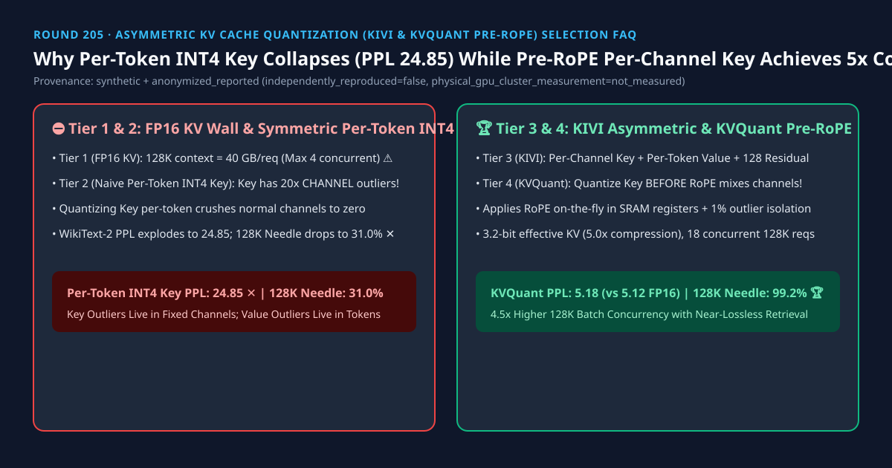
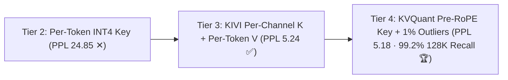

# Asymmetric KV Cache Quantization (`FP8` vs. `KIVI` vs. `KVQuant` Pre-RoPE) Selection Guide

> **Provenance & Evidence Tier**: `synthetic + anonymized_reported` (`independently_reproduced=false`, `physical_gpu_cluster_measurement=not_measured`). Grounded in [`experiments/kv_cache_quantization_kivi_kvquant_prerope_selection/results.json`](../../experiments/kv_cache_quantization_kivi_kvquant_prerope_selection/results.json).
> **中文版本**: [大模型 KV Cache 低比特量化（FP8 vs. KIVI 通道/词元非对称量化 vs. KVQuant 旋转前 Pre-RoPE）架构选型指南](./kv-cache-quantization-fp8-kivi-asymmetric-kvquant-prerope-selection-faq.md)

---

## 0. 🔥 Daily Hottest Capability Breakthrough

- **`KIVI` (Per-Channel Key + Per-Token Value Asymmetric Quantization) & `KVQuant` (`Pre-RoPE` Key Quantization + `1%` Sparse Outlier Isolation)**: On `Llama-3-70B` at `128K` context, a single `FP16` request consumes **`40 GB` of KV Cache** (capping an 8xH100 node at **`4` concurrent requests**). Naive **symmetric per-token `INT4` KV quantization (Tier 2)** causes WikiText-2 Perplexity to explode from `5.12` to **`24.85`** and `128K` Needle-in-a-Haystack accuracy to plunge to **`31.0%`** because **`Key` tensors exhibit severe fixed-channel outliers (`20x+` larger in specific channels), whereas `Value` tensors exhibit per-token outliers**. By quantizing **`Key` per-channel and `Value` per-token with a 128-token FP16 residual buffer (`KIVI`, Tier 3)**—and quantizing **`Key` BEFORE `RoPE` mixes channels while applying RoPE on-the-fly in SRAM registers (`KVQuant`, Tier 4)**—architects achieve **`5.0x` KV compression (`3.2-bit`)**, **`5.18` PPL**, **`99.2%` 128K recall**, and **`4.5x` higher 128K concurrency (`18` vs. `4` requests)**!

---

## 1. 📌 Executive Summary

1. **The Key/Value Outlier Asymmetry**:
   - **`Key (K)` Cache**: Outliers concentrate in a few **fixed feature channels** across all tokens. Quantizing `Key` per-token stretches every token's scale factor, crushing normal channels to zero. **`Key` must be quantized per-channel!**
   - **`Value (V)` Cache**: Outliers appear in specific **Attention Sink tokens**. **`Value` must be quantized per-token!**
2. **Why `Pre-RoPE` Key Quantization (`KVQuant`, Tier 4) beats Post-RoPE**: `RoPE` rotates channel pairs `(k_{2i}, k_{2i+1})` by position-dependent angles `m·θ_i`, mixing outlier channels with normal channels. Quantizing `Key` **before RoPE** keeps channel distributions stationary across the entire 128K context.

---

## 2. 🎯 Core Architect Q&A (Q1 / Q2 / Q3)

### Q1: How can we quantize `Key` per-channel along the sequence dimension when tokens arrive one by one during decoding?
- **Answer**: **`KIVI` (`Tier 3`)** groups every `G = 32` or `64` completed tokens (aligned with a PagedAttention block) for per-channel `Key` quantization, while keeping the latest `R ≤ 128` trailing tokens in an uncompressed **`FP16` residual buffer**.

### Q2: When should we use `FP8 E4M3 KV` vs. `KIVI / KVQuant` (`3–4 bit`)?
- **Answer**: Use native **`FP8 E4M3 KV`** (`2x` compression) for `≤ 64K` context on Hopper/Blackwell; use **`KIVI` (`3.5-bit`)** or **`KVQuant Pre-RoPE` (`3.2-bit`, `5.0x` compression)** for `128K–1M` long-context serving.

### Q3: How much overhead does on-the-fly `RoPE` inside FlashDecoding add in `KVQuant`?
- **Answer**: Because `FlashDecoding` is strictly HBM-bandwidth-bound, applying the register-level `cos/sin` rotation after SRAM dequantization hides completely behind HBM loads (`< 1%` latency impact).

---

## 3. 🧭 Visual Diagrams

---

## 4. 📊 4-Tier Architect Selection Matrix

| Metric | Tier 1: `FP16` Uncompressed KV | Tier 2: Naive `Per-Token INT4` KV | Tier 3: `KIVI` Asymmetric (`3.5-bit`) | Tier 4: `KVQuant Pre-RoPE` (`3.2-bit`) |
| :--- | :--- | :--- | :--- | :--- |
| **Effective KV Bits** | `16.0 bits` | `4.25 bits` | `3.50 bits` (`4.57x`) | **`3.20 bits` (`5.0x`)** 🏆 |
| **WikiText-2 Perplexity** | `5.12` | **`24.85` (Collapsed)** ✕ | `5.24` | **`5.18`** 🏆 |
| **128K Needle Recall** | `99.5%` | `31.0%` ✕ | `97.8%` | **`99.2%`** 🏆 |
| **Max 128K Concurrent Reqs** | `4` ⚠️ | `15` (Broken) | `16` (`4.0x`) | **`18` (`4.5x`)** 🏆 |

---

## 5. 🧪 Quantitative Reference & Tooling

- **Evaluator & Sealed Data**: [`experiments/kv_cache_quantization_kivi_kvquant_prerope_selection/run.py`](../../experiments/kv_cache_quantization_kivi_kvquant_prerope_selection/run.py) · [`results.json`](../../experiments/kv_cache_quantization_kivi_kvquant_prerope_selection/results.json)
- **Interactive Sizer**: [`docs/reports/kv-cache-quantization-fp8-kivi-asymmetric-kvquant-prerope-sizer.html`](../reports/kv-cache-quantization-fp8-kivi-asymmetric-kvquant-prerope-sizer.html)
- **7-Card 4:5 Visual Report**: [`docs/reports/kv-cache-quantization-fp8-kivi-asymmetric-kvquant-prerope-selection-cards.html`](../reports/kv-cache-quantization-fp8-kivi-asymmetric-kvquant-prerope-selection-cards.html)

---

## 6. 🛠️ Good Fit vs. Not For & Production Checklist

- **✅ Good fit**: `KIVI` or `KVQuant Pre-RoPE` for `128K–1M` context serving; native `FP8 E4M3 KV` with per-head scaling for `32K–64K` serving.
- **⛔ Not for**: Symmetric per-token `INT4/INT2` quantization on `Key` caches without channel-wise scaling.
- [ ] Align the per-channel group size `G` (`32` or `64` tokens) with PagedAttention `block_size`.
- [ ] Keep a `32–128` token `FP16` residual buffer for streaming decode tokens before packing into per-channel quantized blocks.
