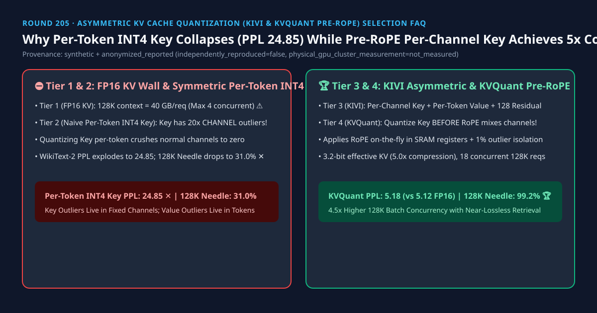
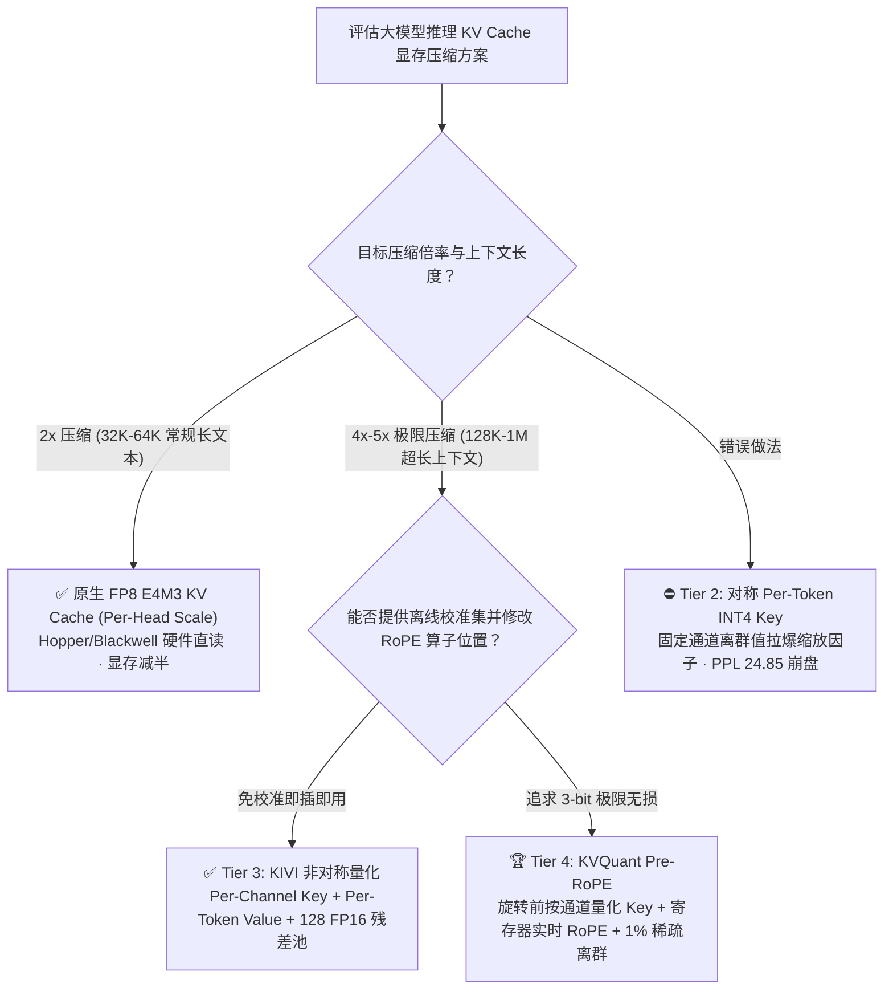
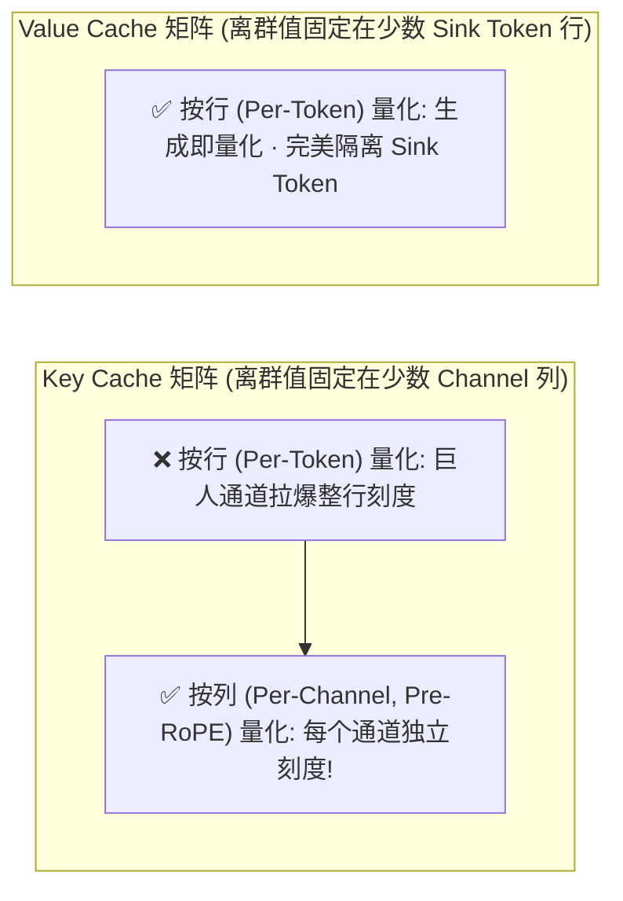
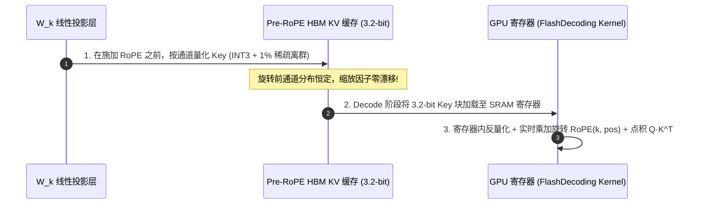

# 大模型 KV Cache 低比特量化（FP8 vs. KIVI 通道/词元非对称量化 vs. KVQuant 旋转前 Pre-RoPE）架构选型指南

> **Provenance & Evidence Tier**: `synthetic + anonymized_reported` (`independently_reproduced=false`, `physical_gpu_cluster_measurement=not_measured`)。定量数据锚定于 [`experiments/kv_cache_quantization_kivi_kvquant_prerope_selection/results.json`](../../experiments/kv_cache_quantization_kivi_kvquant_prerope_selection/results.json)。
> **English Version**: [Asymmetric KV Cache Quantization (`FP8` vs. `KIVI` vs. `KVQuant` Pre-RoPE) Selection Guide](./kv-cache-quantization-fp8-kivi-asymmetric-kvquant-prerope-selection-faq.en.md)

---

## 0. 🔥 今日领域最热门能力突破追踪（Daily Hottest Breakthrough）

- **`KIVI`（Key 按通道 Per-Channel + Value 按词元 Per-Token 非对称量化）与 `KVQuant`（旋转位置编码前 `Pre-RoPE` Key 量化 + `1%` 稀疏离群隔离）彻底攻克 `3~4 bit` 超长上下文 KV 显存墙**：在 `Llama-3-70B` 跑 `128K` 长上下文时，单条请求的 `FP16` KV Cache 就要吞掉 **`40 GB` 显存**（8 卡 H100 节点最多只能并发 **`4` 条请求**）。如果直接套用传统的**对称按 Token（Per-Token）`INT4` 量化（Tier 2）**，模型困惑度（Perplexity）会从 `5.12` 暴涨至 **`24.85`**，`128K` 大海捞针准确率暴跌至 **`31.0%`**！底层根因在于 Transformer 的物理分布存在剧烈的**“K/V 离群值非对称性”**：**`Key` 矩阵的巨型离群值（比均值大 20 倍以上）集中在少数固定的特征通道（Channel）上，而 `Value` 矩阵的离群值则按词元（Token）分布**！通过采用 **`KIVI` 非对称量化（Key 按通道量化 + Value 按 Token 量化 + 128 词元 FP16 滑动残差池，Tier 3）** 以及 **`KVQuant`（在 `RoPE` 旋转搅乱通道之前存储并按通道量化 `Pre-RoPE Key`，在 FlashDecoding 寄存器内实时施加 RoPE，Tier 4）**，在 **`3.2-bit`（压缩 `5.0` 倍）** 下实现 **`5.18` PPL（几近无损）**、**`99.2%` 128K 大海捞针召回率**，并将单节点 128K 并发上限提升 **`4.5` 倍（`4 条 -> 18 条`）**！

---

## 1. 📌 核心结论速览（Executive Summary — 3 分钟看懂）

1. **为什么对 `Key` Cache 按 Token 做 `INT4 / INT2` 量化会瞬间把模型搞傻？**
   - **通俗大白话 + 第一性原理**：把一个 Token 的 `128` 维 `Key` 向量比作 128 个并排站立的人，其中 **第 7 号和第 42 号通道永远是身高 20 米的巨人（固定通道离群值 Channel Outliers）**，其余 126 人都是 1.7 米的正常人。如果按 **Token（横着一排人共用一把尺子）** 做 4-bit 量化（只有 16 个刻度），尺子的最大刻度必须迁就 20 米的巨人（每格代表 `1.25 米`），结果那 126 个正常人全部被四舍五入压成了同一个刻度（精度彻底归零）！相反，如果对 **`Key` 按通道（竖着同一通道的历史 Token 共用一把尺子，Per-Channel）** 量化，第 7 号巨人通道单独用巨人尺子，126 个正常通道各自用精细尺子，精度瞬间完美保留！
2. **为什么 `KVQuant`（Tier 4）还要把 `Key` 的量化提前到 `RoPE`（旋转位置编码）之前？**
   - 因为 `RoPE` 会根据每个 Token 的位置 `m`，把相邻通道 `(k_{2i}, k_{2i+1})` 按角度 `m·θ_i` 旋转混合——这相当于随着位置往前走，一会儿把“20 米巨人”转到偶数通道，一会儿转到奇数通道，破坏了通道分布的平稳性！**在 `RoPE` 之前存储并量化 `Pre-RoPE Key`**，每个通道的分布在整个 128K 长度上恒定不变；解码读取时，在 GPU 寄存器里反量化后顺手做一次乘加旋转（开销几乎为 0），精度直逼原生 `FP16`！

---

## 2. 🎯 客户与架构师灵魂拷问 Q&A（Q1 / Q2 / Q3）

### Q1：在解码（Decode）阶段 Token 是一个个生成的，怎么对 `Key` 做跨 Token 的“按通道（Per-Channel）”量化？
- **答**：这正是 **`KIVI` 残差缓冲区（Residual Buffer，Tier 3）** 的精妙设计：把每 `G = 32` 或 `64` 个历史 Token 切成一个块（正好对齐 vLLM PagedAttention 的 Page Block！）。最新生成的、还不满一个块的末尾 `R ≤ 128` 个 Token 保留在 **`FP16` 残差池**中（占总长度不到 `0.1%`）；每凑满 32 个 Token，就在块内沿序列方向计算一次 `Key` 的 Per-Channel 缩放因子并打包为 `INT4 / INT2`，完美兼容流式自回归生成！

### Q2：什么时候用标准的 `FP8 E4M3 KV Cache`，什么时候上 `KIVI / KVQuant`（`INT4 / INT3`）？
- **答**：
  - **上下文 `≤ 32K–64K` 且运行在 Hopper/Blackwell 上**：首选 vLLM / TensorRT-LLM 原生 **`FP8 E4M3 KV Cache`（配合 Per-Head 校准缩放因子）**，显存减半（`2x` 压缩），硬件指令原生加速。
  - **超长上下文 `128K–1M` 或长程 Agent 轨迹缓存（KV 显存占比 `> 70%`）**：`FP8` 仅 2 倍压缩仍不够用，应启用 **`KIVI`（免校准即插即用 `INT4/INT2`）** 或 **`KVQuant Pre-RoPE`（带离线通道校准 + `1%` 稀疏离群隔离，压缩 `4.5x~5.0x`）**。

### Q3：为什么 `Value` Cache 不能按通道量化，而必须按 Token（Per-Token）量化？
- **答**：因为注意力计算的第二步是 `Output = Attention_Weights @ V`，即对不同 Token 的 `Value` 向量做加权求和；且 `Value` 的离群值集中在特定的 `Attention Sink` 词元（首 Token 或句号 Token）上。对 `Value` 按 Token 量化既能让每个生成步立即量化落盘，又能隔离 Sink 词元的幅值冲击。

---

## 3. 🧭 直观可视化图解（Mermaid 决策树 + K/V 离群分布图 + Pre-RoPE 时序图）

### 3.1 架构师 KV Cache 量化选型决策树

### 3.2 `Key` 通道离群 vs. `Value` 词元离群与 `KIVI / KVQuant` 量化方向对比

### 3.3 `KVQuant Pre-RoPE` 写入与 FlashDecoding 寄存器内实时旋转时序图

---

## 4. 📊 架构师选型决策矩阵（4-Tier Selection Matrix）

| 评估维度 | Tier 1: 原生 `FP16` KV 基线 | Tier 2: 对称 `Per-Token INT4` KV | Tier 3: `KIVI` 非对称量化 (3.5-bit) | Tier 4: `KVQuant Pre-RoPE` (3.2-bit) |
| :--- | :--- | :--- | :--- | :--- |
| **`Key / Value` 量化粒度** | 16-bit 未压缩 | Key/Value 均按 Token ✕ | **Key 按通道 + Value 按 Token** ✅ | **Pre-RoPE Key 按通道 + 1% 离群 + Value 按 Token** 🏆 |
| **等效每元素位宽** | `16.0 bits` | `4.25 bits` | `3.50 bits` (`4.57x` 压缩) | **`3.20 bits` (`5.0x` 压缩)** 🏆 |
| **WikiText-2 困惑度 (PPL)** | `5.12` | **`24.85` (精度崩盘)** ✕ | `5.24` (+0.12) | **`5.18` (+0.06 几近无损)** 🏆 |
| **128K 大海捞针准确率** | `99.5%` | `31.0%` ✕ | `97.8%` | **`99.2%`** 🏆 |
| **8xH100 128K 最大并发请求** | `4` 条 ⚠️ | `15` 条 (不可用) | `16` 条 (`4.0x`) | **`18` 条 (`4.5x`)** 🏆 |

---

## 5. 🧪 定量算例与工具链（Interactive Sizer & 7-Card Visual Report）

- **实验脚本与密封数据**：[`experiments/kv_cache_quantization_kivi_kvquant_prerope_selection/run.py`](../../experiments/kv_cache_quantization_kivi_kvquant_prerope_selection/run.py) · [`results.json`](../../experiments/kv_cache_quantization_kivi_kvquant_prerope_selection/results.json)
- **交互式 KV 量化定容计算器**：[`docs/reports/kv-cache-quantization-fp8-kivi-asymmetric-kvquant-prerope-sizer.html`](../reports/kv-cache-quantization-fp8-kivi-asymmetric-kvquant-prerope-sizer.html)
- **7-Card 4:5 视觉评测卡片报告**：[`docs/reports/kv-cache-quantization-fp8-kivi-asymmetric-kvquant-prerope-selection-cards.html`](../reports/kv-cache-quantization-fp8-kivi-asymmetric-kvquant-prerope-selection-cards.html)

---

## 6. 🛠️ Good Fit vs. Not For & 生产环境快速核验清单（Checklist）

### ✅ Good Fit vs. ⛔ Not For

| 维度 | ✅ Good Fit（强烈推荐） | ⛔ Not For（严禁误用） |
| :--- | :--- | :--- |
| **`128K–1M` 超长上下文推理与 RAG** | 使用 `KIVI`（Per-Channel K + Per-Token V + FP16 残差块）或 `KVQuant Pre-RoPE` 将 KV 显存压缩 `4.5x~5.0x` | 对 `Key` Cache 强行使用无通道缩放的对称 Per-Token `INT4/INT2` 量化，导致长文本检索彻底失效 |
| **PagedAttention 块大小对齐** | 将 `KIVI` 的按通道分组长度 `G`（如 `32` 或 `64`）与 PagedAttention 的 `block_size` 严格对齐，避免跨页碎片 | 将分组大小设为与 Page Block 不整除的数值，导致每次换页出现未填满的量化空洞 |

### 生产环境上线核验清单（Pre-Flight Checklist）

- [ ] **严禁在 `≤ 4-bit` 下对 `Key` Cache 使用纯 Per-Token 缩放**：确认推理内核对 `Key` 启用了 Per-Channel 缩放因子（或 `Pre-RoPE` 静态通道校准缩放）。
- [ ] **核验流式残差池（Residual Buffer）长度配置**：在 `KIVI` 模式下，确认末尾 `R = 32 ~ 128` 个最新生成的 Token 保持 `FP16/BF16` 精度，满块后再后台打包为 `INT4/INT2`。
- [ ] **核验 `128K` 多针大海捞针（Multi-Needle NIAH）回归测试**：上线任何 `< 8-bit` KV Cache 量化前，必须跑通 `128K` 深度大海捞针评测且召回率衰减 `< 1.0%`。
