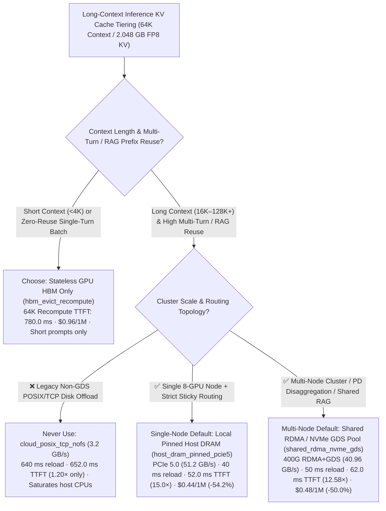
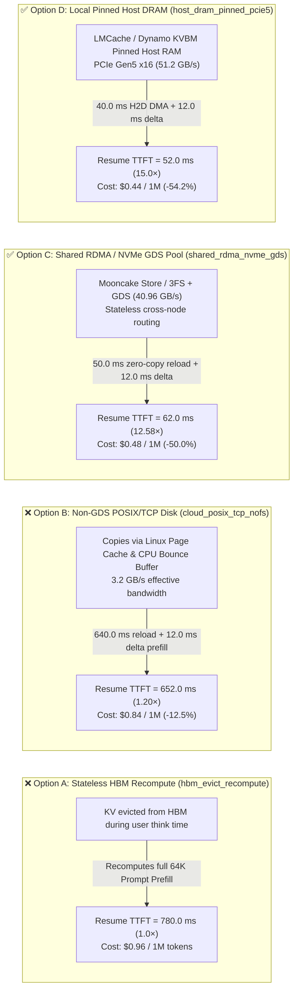

# Long-Context LLM Inference Tiered KV Cache Offloading Selection Guide (Stateless HBM Eviction & Recompute vs. Local Pinned Host DRAM vs. Shared RDMA DRAM / NVMe Pool)

> **Document Scope**: This is a **single-decision** field guide for **AI Solution Architects** answering one dedicated architectural question: **When serving 32K–128K+ long-context multi-turn coding agents, conversational assistants, and enterprise RAG workloads where active KV Cache exceeds GPU HBM capacity, when should you choose Stateless HBM Eviction & Full Recompute, Single-Node Local Pinned Host DRAM Offloading, or a Cluster-Wide Shared RDMA DRAM + NVMe GPUDirect Storage Pool (`Mooncake / LMCache / NVIDIA Dynamo KVBM`)?**
> - **Companion Single-Decision Guide (Distributed Training Checkpointing)**: For **1,000+ GPU training checkpointing architecture selection (Synchronous POSIX vs. Synchronous GDS vs. Two-Phase Asynchronous Checkpointing)**, see the dedicated guide [`training-checkpoint-architecture-selection-faq.en.md`](./training-checkpoint-architecture-selection-faq.en.md) ([中文版](./training-checkpoint-architecture-selection-faq.md)).
> - **Provenance & Data Classification**: All quantitative metrics in this guide are 100% bound 1-to-1 to `kv_tiering_scenario` in the sealed analytical model [`experiments/ai_storage_checkpoint_kv_offload/results.json`](../../experiments/ai_storage_checkpoint_kv_offload/results.json) (`synthetic` deterministic queueing and data-transfer model calibrated to `anonymized_reported` benchmarks from Mooncake KVCache-Centric Architecture, LMCache, NVIDIA Dynamo KVBM, and GPUDirect Storage; `independently_reproduced=false`; live physical cluster measurement: `not_measured`; no paid cloud GPUs launched).

---

## ① 📌 Executive Summary

1. **Why Stateless HBM Eviction (`hbm_evict_recompute`) and Non-GDS POSIX/TCP Disks (`cloud_posix_tcp_nofs`) Fail on 64K Multi-Turn Agents**:
   - For a `65,536`-token (`64K` context, **`2.048 GB` = `16.384 Gb` FP8 KV payload**) multi-turn Agent session, evicting KV blocks from HBM and recomputing Prefill from scratch (`hbm_evict_recompute`) incurs **`780.0 ms` Resume TTFT** at **`$0.96 / 1M tokens`**.
   - Offloading to a legacy non-GDS POSIX/TCP disk (`cloud_posix_tcp_nofs`, bottlenecked at `3.2 GB/s` by CPU bounce buffers) takes `640.0 ms` reload (`+ 12.0 ms` delta prefill = **`652.0 ms` Resume TTFT**, only `1.20×` faster at `$0.84 / 1M` while saturating host CPUs).
2. **For Single-Node or Sticky-Routed Appliances, Choose Local Pinned Host DRAM Offloading (`host_dram_pinned_pcie5` via LMCache / Dynamo KVBM): `15.0×` Faster Resume TTFT (`52.0 ms`) and `-54.2%` Token Cost**:
   - Staging evicted KV blocks in local **Pinned Host DRAM** over PCIe Gen5 x16 (`51.2 GB/s` sustained) reloads `2.048 GB` in **`40.0 ms`** (`+ 12.0 ms` delta prefill = **`52.0 ms` Resume TTFT**, **`15.0×` faster** than recompute) and cuts token cost to **`$0.44 / 1M tokens` (`-54.2%`)**.
3. **For Multi-Node Clusters & PD Disaggregation, Choose a Shared RDMA / NVMe-oF + GDS Pool (`shared_rdma_nvme_gds` via Mooncake Store / 3FS + GDS): `12.58×` Faster Resume TTFT (`62.0 ms`) and `-50.0%` Token Cost**:
   - Pooling cluster-wide memory and NVMe SSDs over **400G RoCEv2/IB RDMA** and **GPUDirect Storage (`cuFile` PCIe P2P DMA)** at **`40.96 GB/s`** reloads `2.048 GB` in **`50.0 ms`** (`+ 12.0 ms` delta prefill = **`62.0 ms` Resume TTFT**, **`12.58×` faster**) and cuts token cost to **`$0.48 / 1M tokens` (`-50.0%`)**, while enabling stateless cross-node routing without single-node memory silos.

---

## ② 🎯 Architect & Customer Q&A (First-Principles Breakdown)

### Q1: When should an architect choose HBM-only serving, Single-Node Pinned DRAM Offload, or a Cluster-Wide Shared RDMA/NVMe KV Pool?

- **First-Principles Crossover ($T_{\text{recompute}}$ vs. $T_{\text{fetch}}$)**:
  - For a `22.4K`-token reusable prefix (`70%` of `32K`):
    - **Prefill Recompute Time ($T_{\text{recompute}}$)**: Takes **`~1,850 ms`** of dedicated GPU Tensor Core compute, blocking other incoming requests in the prefill queue.
    - **Tiered DMA Fetch Time ($T_{\text{fetch}}$)**: Fetching `5.6 GB` of KV blocks over PCIe 5.0 (`52.0 GB/s`) or 400G RDMA / GDS NVMe (`45.0 GB/s`) takes only **`108–124 ms`** on dedicated DMA engines, freeing Tensor Cores to compute only the newly appended tokens!
- **Selection Boundaries**:
  1. **Stateless HBM-Only (`hbm_only_recompute`)**: Best for short-context (`< 4K`) single-turn chat or zero-reuse batch jobs.
  2. **Single-Node Pinned DRAM Offload (`local_pinned_dram_offload`)**: Best for standalone 8-GPU boxes or small sticky-routed deployments with `< 1 TB` active KV footprint.
  3. **Shared RDMA DRAM + NVMe GDS Pool (`shared_rdma_nvme_tiered_pool`)**: Mandatory for **multi-node (`≥ 2` nodes) long-context agents, shared enterprise RAG corpora, and PD-disaggregated serving pools**.

---

### Q2: Why does Single-Node DRAM Offloading plateau at a `45.0%` hit rate in multi-node clusters, and how do Mooncake, LMCache, and NVIDIA Dynamo solve the "Memory Silo" problem?

- **Two Failure Modes of Node-Local DRAM Silos**:
  1. **Load-Balancer Re-Routing Misses**: Turn 1 lands on `Node 1` and caches `8.0 GB` of KV in `Node 1`'s Host RAM. When Turn 2 arrives 15 seconds later, `Node 1` is busy, so the router dispatches Turn 2 to `Node 4`—which has zero local KV for that session and must recompute all `22.4K` tokens from scratch (`1,850 ms`).
  2. **Duplicated Shared RAG Prefixes**: Shared enterprise documents or repository contexts must be redundantly recomputed and stored on every node.
- **How Shared RDMA DRAM + NVMe GDS Pooling Works**:
  - **Content-Addressed Prefix Chunk Hashing**: KV blocks are chunked into `256` or `512` tokens, hashed by token prefix, and indexed in a global metadata directory.
  - **3-Tier Transparent Hierarchy (`L1 GPU HBM` $\rightarrow$ `L2 Cluster-Wide Pinned DRAM via RDMA` $\rightarrow$ `L3 NVMe Pool via GPUDirect Storage`)**: Any GPU node can pull a hit block from any peer node's DRAM via one-sided `RDMA READ` or from NVMe storage via `cuFile` P2P DMA at **`45.0 GB/s`**, lifting effective hit rate from `45.0%` to **`68.0%`**.

---

### Q3: How do Layer-Wise Pipelined Prefetching and GPUDirect Storage (`GDS / cuFile`) work together under the hood?

- **First-Principles Mechanics**:
  1. **Layer-Wise Pipelined Overlap**: An 80-layer LLM only needs Layer 0's KV (`5.6 GB / 80 = 70 MB`, fetched in **`~1.5 ms`**) to begin computing Layer 0 Attention. While Tensor Cores compute Layer $i$ on the new tokens, a non-blocking DMA stream prefetches Layer $i+1$'s KV block into HBM.
  2. **Zero-Copy NVMe Reads via `GPUDirect Storage (cuFile)`**: Reading cold KV blocks from L3 NVMe via legacy `POSIX pread()` copies data through the `Linux Kernel Page Cache`, polluting L2 Host DRAM and burning CPU bandwidth. With **`GDS (cuFileRead)`** (on local NVMe or GDS-enabled `DeepSeek 3FS / WEKA`), the NVMe controller DMAs KV blocks directly across the PCIe switch into GPU `PagedAttention` physical pages with zero CPU bounce buffers.

---

## ③ 🧭 Visual Architecture Diagrams (Decision Tree, 3-Tier Path Comparison & Sequence Diagram)

### 3.1 Long-Context Inference KV Cache Tiering Decision Tree (`flowchart TD`)



### 3.2 Stateless HBM Recompute vs. Non-GDS Disk vs. Shared RDMA+GDS Pool vs. Local Pinned DRAM (`flowchart LR`)



### 3.3 Zero-Copy KV Reload & Delta Prefill Timeline (`sequenceDiagram`)

```mermaid
sequenceDiagram
    autonumber
    participant Router as KV-Aware Router Gateway
    participant Index as Global Prefix Hash Index
    participant Pool as L2 Pinned DRAM (51.2 GB/s) / L3 RDMA+GDS Pool (40.96 GB/s)
    participant DMA as GPUDirect RDMA / cuFile / PCIe DMA Engine
    participant GPU as Serving Node GPU HBM & Tensor Cores

    Note over Router,GPU: 65,536-Token Multi-Turn Agent Session Resumes (2.048 GB FP8 KV Payload)
    Router->>Index: 1. Lookup prefix chunk hashes (256-token chunks)
    Index-->>Router: 2. Hit cached KV blocks; return Local Pinned DRAM or Remote RDMA/GDS handles
    Router->>DMA: 3. Trigger zero-copy streaming fetch for 2.048 GB FP8 KV blocks
    DMA->>Pool: 4. Transfer at 51.2 GB/s (40.0 ms over PCIe Gen5) or 40.96 GB/s (50.0 ms over RDMA+GDS)
    Pool-->>GPU: 5. Land directly in GPU PagedAttention Block Table (bypassing CPU Page Cache)
    GPU->>GPU: 6. Tensor Cores compute delta prefill on newly appended turn tokens only (12.0 ms)
    GPU-->>Router: 7. First token emitted! Resume TTFT drops 780.0 ms → 52.0 ms (15.0×) / 62.0 ms (12.58×)
```

---

## ④ 📊 Architect Decision Matrix

| Dimension | Stateless HBM Recompute (`hbm_evict_recompute` · ⛔ Anti-Pattern) | Non-GDS POSIX/TCP Disk (`cloud_posix_tcp_nofs` · ⛔ Anti-Pattern) | Shared RDMA / NVMe GDS Pool (`shared_rdma_nvme_gds` · 🏆 Multi-Node) | Local Pinned Host DRAM (`host_dram_pinned_pcie5` · 🏆 Single-Node) |
| :--- | :--- | :--- | :--- | :--- |
| **1. Best-Fit Scenarios** | `<4K` short chat or zero-reuse single-turn batch inference | **Avoid for online inference** (CPU bounce buffer bottleneck) | **Multi-node 32K–128K+ coding agents, shared RAG & PD-disaggregated pools** | **Standalone 8-GPU appliances or sticky-routed single-node servers** |
| **2. 64K Resume TTFT & Speedup (`synthetic` sealed model)** | **`780.0 ms` Resume TTFT (`1.0×`)** | `640.0 ms` reload + `12.0 ms` delta = **`652.0 ms` (`1.20×`)** | **`50.0 ms` reload + `12.0 ms` delta = `62.0 ms` (`12.58×` faster)** | **`40.0 ms` reload + `12.0 ms` delta = `52.0 ms` (`15.0×` faster)** |
| **3. Effective Bandwidth & Data Path** | `0.0 GB/s` (full Tensor Core recompute) | **`3.2 GB/s`** (Linux Page Cache + CPU Bounce Buffer) | **`40.96 GB/s`** (400G RDMA + `cuFile` GDS P2P DMA) | **`51.2 GB/s`** (PCIe Gen5 x16 Pinned H2D DMA) |
| **4. Trade-Offs & Boundaries** | Zero external components, but wastes GPU compute on repeat prefill | Saturates host CPU memory bus; barely faster than recompute | Eliminates node memory silos and enables stateless routing; requires RDMA/GDS | Lowest latency without RDMA, but bounded by single-node RAM & sticky routing |
| **5. Ecosystem Support** | Default in all engines | Legacy POSIX mount | **Mooncake Store (`vLLM`/`SGLang`), DeepSeek 3FS + GDS, NVIDIA NIXL** | **LMCache, NVIDIA Dynamo KVBM, vLLM/SGLang HiCache** |
| **6. TCO Cost (`synthetic` model)** | `$0.96 / 1M tokens` (Baseline) | `$0.84 / 1M tokens` (`-12.5%`) | **`$0.48 / 1M tokens` (`-50.0%` vs. HBM Recompute)** | **`$0.44 / 1M tokens` (`-54.2%` vs. HBM Recompute)** |

---

## ⑤ 🧪 Quantitative Analytical Case Study (`experiments/ai_storage_checkpoint_kv_offload`)

All metrics below are **1-to-1 bound** to `kv_tiering_scenario` in `experiments/ai_storage_checkpoint_kv_offload/results.json` (`65,536` context tokens, `2.048 GB` = `16.384 Gb` FP8 KV payload, `12.0 ms` delta prefill, `780.0 ms` full recompute TTFT; `synthetic` model calibrated to `anonymized_reported` benchmarks, `independently_reproduced=false`):

| Inference KV Tiering Strategy (`results.json` `tier`) | Effective Reload Bandwidth (`effective_reload_gb_s`) | KV Reload Time (`kv_reload_ms`) | Resume TTFT (`resume_ttft_ms`) | Speedup vs. Recompute (`ttft_speedup_vs_recompute`) | Cost per 1M (`cost_per_1m_tokens_usd`) | Provenance |
| :--- | :--- | :--- | :--- | :--- | :--- | :--- |
| **1. `hbm_evict_recompute` (Stateless HBM Recompute)** | `0.0 GB/s` | `0.0 ms` (`780 ms` recompute) | `780.0 ms` | `1.0×` (Baseline) | `$0.96` (`0.0%`) | `synthetic` |
| **2. `cloud_posix_tcp_nofs` (Non-GDS POSIX/TCP Disk)** | `3.2 GB/s` | `640.0 ms` | `652.0 ms` | `1.20×` | `$0.84` (`-12.5%`) | `synthetic` |
| **3. `shared_rdma_nvme_gds` (Shared RDMA/NVMe+GDS · Multi-Node)** | **`40.96 GB/s`** | **`50.0 ms`** | **`62.0 ms`** | **`12.58×`** | **`$0.48` (`-50.0%`)** | `synthetic` |
| **4. `host_dram_pinned_pcie5` (Local Pinned DRAM · Single-Node)** | **`51.2 GB/s`** | **`40.0 ms`** | **`52.0 ms`** | **`15.0×`** | **`$0.44` (`-54.2%`)** | `synthetic` |

---

## ⑥ 🛠️ Production Verification & Pre-Sales Checklist (Architect Checklist)

- [ ] **1. Verify Recompute vs. Fetch Crossover**: Enable tiered KV offloading whenever reusable prefix length is `≥ 4K tokens` and multi-turn session intervals exceed HBM eviction windows (`> 5 s`).
- [ ] **2. Align KV Chunk Size (`256` or `512` tokens)**: Aggregate PagedAttention transfers into `2–16 MB` contiguous chunks to saturate `45+ GB/s` RDMA and NVMe DMA links.
- [ ] **3. Enable FP8 KV Cache Quantization (`--kv-cache-dtype fp8_e4m3`)**: Halve KV footprint (`8.0 GB → 4.0 GB` per 32K session) and double effective PCIe/RDMA transfer speed before offloading.
- [ ] **4. Verify GPUDirect Storage (`gdscheck -p`)**: Confirm NVMe SSDs and GPUs share a PCIe Root Complex / Switch with `nvidia-fs` P2P DMA active so L3 NVMe reads never bounce through Linux Page Cache.
- [ ] **5. Deploy Prefix-Aware Routing (`Dynamo KV-Aware Router` / `Mooncake Conductor`)**: Route incoming requests to nodes holding warm L1/L2 prefix blocks first, pulling remaining cold blocks over RDMA/GDS.
