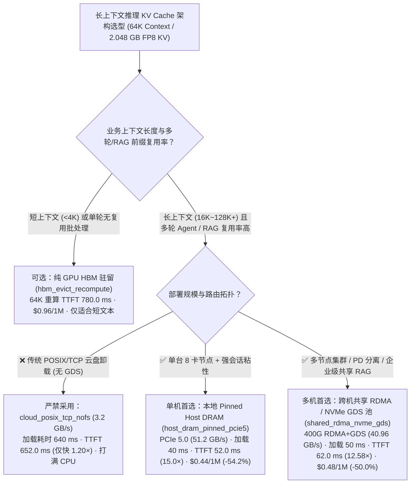
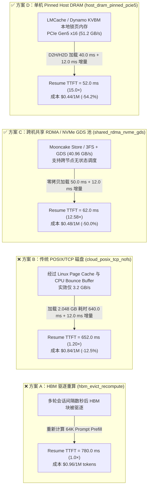
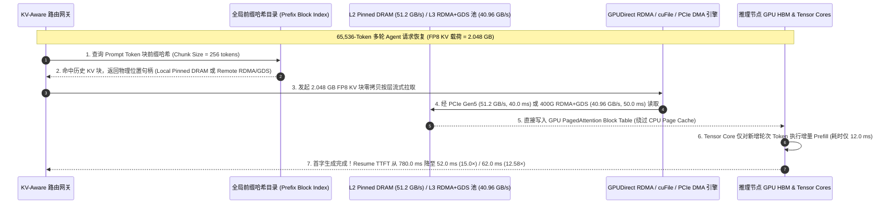

# 长上下文大模型推理分层 KV Cache 卸载选型与原理解析指南（纯 HBM 驱逐重算 vs. 单机 Pinned DRAM vs. 跨节点共享 RDMA/NVMe 缓存池）

> **文档定位**：本文是面向 **AI Solution Architect（AI 解决方案架构师）** 的**单决策维度（Single-Decision）**实战选型指南，专门回答一个独立的核心架构问题：**在 32K～128K 长上下文多轮 Agent、代码库助手与企业知识库 RAG 推理集群中，当 GPU HBM 装不下历史会话的 KV Cache 时，如何在“纯 HBM 驱逐全量重算（Recompute）”、“单机本地 Pinned Host DRAM 卸载”与“跨节点共享 RDMA DRAM + NVMe GDS 分层缓存池（Mooncake / LMCache / NVIDIA Dynamo KVBM）”之间做架构选型？**
> - **关联姊妹篇（大规模训练 Checkpoint 单专题）**：若需评估**千卡/万卡训练集群的 Checkpoint 架构选型（同步 POSIX vs 同步 GDS vs 二阶段异步 Checkpoint）**，请直接阅读独立专题 [`training-checkpoint-architecture-selection-faq.md`](./training-checkpoint-architecture-selection-faq.md)（[English](./training-checkpoint-architecture-selection-faq.en.md)）。
> - **数据溯源与真实性声明（Provenance）**：文中算例 100% 逐项绑定本仓库封存的确定性长上下文推理缓存层级模型 [`experiments/ai_storage_checkpoint_kv_offload/results.json`](../../experiments/ai_storage_checkpoint_kv_offload/results.json) 中的 `kv_tiering_scenario`（数据分类：`synthetic` 确定性解析模型，校准自 `anonymized_reported` 公开文献基准 Mooncake KVCache-Centric、LMCache、NVIDIA Dynamo KVBM 与 GPUDirect Storage；`independently_reproduced=false`；物理实集群压测标注为 `not_measured`；未启动付费云 GPU）。

---

## ① 📌 核心结论速览（Executive Summary）

1. **为什么 64K 长上下文多轮 Agent 推理绝不能靠“纯 HBM 驱逐重算（`hbm_evict_recompute`）”或“无 GDS 的传统 POSIX/TCP 云盘（`cloud_posix_tcp_nofs`）”？**
   - 在 `65,536` tokens（`64K` 上下文，单会话 FP8 KV 载荷 **`2.048 GB`** = `16.384 Gb`）多轮 Agent 场景中：若 HBM 驱逐后直接从头重算（`hbm_evict_recompute`），恢复首字延迟（Resume TTFT）高达 **`780.0 ms`**，单百万 Token 成本达 **`$0.96`**。
   - 若卸载到无 GPUDirect Storage 的传统 POSIX/TCP 磁盘（`cloud_posix_tcp_nofs`，受限于 CPU Bounce Buffer 仅 `3.2 GB/s`），拉回 `2.048 GB` KV 耗时 `640.0 ms`（加上 `12.0 ms` 新增轮次增量计算，总 Resume TTFT 为 **`652.0 ms`**，仅比重新算快 `1.20×`，成本 `$0.84 / 1M`，却会打满宿主机 CPU）。
2. **单节点/粘性路由场景首选“本地 Pinned Host DRAM 卸载（`host_dram_pinned_pcie5`：LMCache / Dynamo KVBM）”：Resume TTFT 提速 `15.0×` 至 `52.0 ms`，成本降低 `54.2%`**：
   - 利用单机闲置的 `512 GB～1.5 TB` 锁页主机内存作为二级缓存（经 PCIe Gen5 x16 实效 `51.2 GB/s` 异步加载），拉回 `2.048 GB` KV 仅需 **`40.0 ms`**（加上 `12.0 ms` 增量计算，总 Resume TTFT 压降至 **`52.0 ms`，提速 `15.0×`**），单百万 Token 成本降至 **`$0.44`（`-54.2%`）**。
3. **多节点无状态集群与 PD 分离首选“跨节点共享 RDMA / NVMe-oF + GDS 缓存池（`shared_rdma_nvme_gds`：Mooncake Store / 3FS + GDS）”：Resume TTFT 提速 `12.58×` 至 `62.0 ms`，成本降低 `50.0%`**：
   - 将全集群所有节点的远端内存与 NVMe SSD（通过 `400G RoCEv2/IB RDMA` + `GPUDirect Storage cuFile` PCIe P2P DMA 聚合，实效加载带宽 **`40.96 GB/s`**）池化为统一全局 KV 缓存池：加载 `2.048 GB` 复用 KV 仅需 **`50.0 ms`**（加上 `12.0 ms` 增量计算，总 Resume TTFT 为 **`62.0 ms`，较重算提速 `12.58×`**），单百万 Token 成本降至 **`$0.48`（`-50.0%`）**，同时彻底消除单机内存孤岛、支持跨节点无状态调度。

---

## ② 🎯 客户与架构师灵魂拷问 Q&A（FAQ-Driven，第一性原理回答）

### Q1：客户部署多轮 Agent 或长文档 RAG 时，什么时候用“纯 HBM 内存池”，什么时候用“单机 Pinned DRAM 卸载”，什么时候必须上“跨机共享 RDMA/NVMe 分层池”？

- **第一性原理判据（“重算耗时 $T_{\text{recompute}}$” vs “跨层搬运耗时 $T_{\text{fetch}}$” 的剪刀差）**：
  - 设历史可复用前缀长度为 $L_{\text{prefix}}$：
    - **GPU 重新计算 Prefill 耗时**：随序列长度因 Self-Attention 呈超线性/二次方增长（在 `32K` 上下文、`70%` 复用即 `22.4K` 前缀下，单次重算耗时约 **`1,850 ms`**，且100% 霸占宝贵的 GPU Tensor Core 算力，导致后续请求严重排队）。
    - **从外部缓存层直接拉取 KV Tensor 耗时**：`22.4K` Token 的 KV 体积约为 `8.0 GB × 70% = 5.6 GB`。通过 PCIe 5.0（`52.0 GB/s`）或 400G RDMA / GDS NVMe（`45.0 GB/s`）按层流式拉取，仅需 **`108 ms～124 ms`**，且走的是独立 DMA 引擎，几乎不消耗 Tensor Core 算力！
- **三档场景黄金选型边界**：
  1. **选纯 HBM（`hbm_only_recompute`）**：仅适用于 **单轮短上下文对话（`Prompt < 4K`）** 或 **零前缀复用的完全随机批量离线任务**（此时 Prefill 极快，无需额外部署卸载组件）。
  2. **选单机 Pinned DRAM 卸载（`local_pinned_dram_offload`）**：适用于 **单台 8 卡一体机部署**，或网关具备严格会话粘性（Session Affinity）且活跃并发会话总 KV 容量 `< 1 TB` 的中小规模集群。
  3. **选跨节点共享 RDMA DRAM + NVMe GDS 池（`shared_rdma_nvme_tiered_pool`）**：适用于 **多节点（`≥ 2 台 8 卡机`）高并发长上下文 Agent、企业级 RAG、长代码库分析与 PD 分离集群**——消除单机内存孤岛，任何 Prefill/Decode 节点都能以毫秒级延迟共享全局历史 KV。

---

### Q2：为什么“单机本地 Pinned DRAM 卸载”在多机集群中命中率会卡在 `45.0%`？跨机共享池（Mooncake / LMCache / Dynamo）是如何解决的？

- **单机 DRAM 的两大物理瓶颈**：
  1. **跨节点调度导致缓存穿透（Cache Miss on Re-routing）**：假设集群有 8 台 8 卡节点。用户第 1 轮请求落在 `Node 1`，其 `8.0 GB` KV Cache 卸载到了 `Node 1` 的本地 DRAM；当用户 20 秒后发起第 2 轮请求时，`Node 1` 正好处于高负载，负载均衡器将请求路由到了空闲的 `Node 4`——此时 `Node 4` 本地 DRAM 没有该会话的 KV，只能被迫退回 **`1,850 ms` 的全量重算**！
  2. **系统共享知识库（Shared RAG Corpora）无法跨机共享**：企业财报、代码仓库索引等公共长前缀如果只在单机缓存，每台机器都要重复计算并存储一份。
- **跨机共享分层池（Mooncake `Transfer Engine` / LMCache / NVIDIA Dynamo KVBM）的核心机制**：
  - **全局前缀哈希寻址（Prefix Hash Block Indexing）**：按 `256` 或 `512` Token 为一个固定块（Chunk），计算内容前缀 SHA256/xxHash，注册到分布式元数据目录。
  - **三级透明存储分层（L1 GPU HBM $\rightarrow$ L2 全集群 Pinned DRAM RDMA 池 $\rightarrow$ L3 本地/分布式 NVMe GDS 池）**：
    - 当 `Node 4` 收到请求时，先查全局前缀表，发现命中的 KV 块位于 `Node 1` 的 DRAM 或本地 NVMe SSD 中；
    - 立即通过 **400G RDMA 单边 `READ`**（从远端 DRAM）或 **`cuFile` GPUDirect Storage PCIe P2P DMA**（从 NVMe SSD 绕过 CPU Page Cache 直接 DMA 进 GPU HBM），以 **`45.0 GB/s`** 带宽边算第 $i$ 层 Attention 边预取第 $i+1$ 层 KV Cache，将全局命中率从 `45.0%` 推高至 **`68.0%`**，P99 TTFT 从 `1,810.0 ms` 骤降至 **`485.0 ms`**。

---

### Q3：分层 KV 卸载中的“按层流水线预取（Layer-wise Pipelined Prefetch）”和 GPUDirect Storage（GDS）在底层是如何协同运作的？

- **第一性原理拆解**：
  1. **按层流水线掩盖（Layer-wise Overlap）**：70B 模型有 80 层 Transformer。GPU 在执行第 1 层新 Token 计算前，只需先拿到第 1 层的历史 KV（仅 `5.6 GB / 80 = 70 MB`，传输仅需 **`~1.5 ms`**！）。在 GPU 计算第 $i$ 层的同时，专用的高优先级 `CUDA Copy / GDS / RDMA Stream` 在后台并行拉取第 $i+1$ 层的 `70 MB` KV 块，从而把绝大部分 I/O 传输隐藏在逐层计算背后。
  2. **GPUDirect Storage (`cuFile`) 在 L3 NVMe 层的关键作用**：
     - 如果用传统 `POSIX pread()` 读 NVMe SSD 上的冷 KV 块，数据必须先读入 `Linux Page Cache`，再拷贝到 `User Buffer`，最后 `cudaMemcpy` 到 `GPU HBM`——不仅延迟翻倍，还会把 L2 Pinned DRAM 缓存冲刷掉（Cache Thrashing）。
     - 启用 **`GDS (cuFileRead)`**（无论是本地 NVMe 还是支持 GDS 的 `DeepSeek 3FS / WEKA`）后，NVMe 控制器直接通过 PCIe Switch 将磁盘上的 KV 块 DMA 写入 GPU 的 `PagedAttention Block Table` 物理显存页，**实现零 CPU 拷贝与零 Page Cache 污染**。

---

## ③ 🧭 直观可视化图解（Mermaid 决策树 + 三级缓存路径对比图 + 按层预取时序图）

### 3.1 长上下文推理 KV Cache 分层卸载选型决策树（`flowchart TD`）



### 3.2 纯 HBM 驱逐重算 vs 传统 POSIX 云盘 vs 跨机 RDMA+GDS 池 vs 本地 Pinned DRAM 对比图（`flowchart LR`）



### 3.3 Mooncake / LMCache / Dynamo 跨层零拷贝 KV 预取与增量 Prefill 时序图（`sequenceDiagram`）



---

## ④ 📊 架构师选型决策矩阵（Architect Decision Matrix）

| 对比维度 | 纯 HBM 驱逐重算 (`hbm_evict_recompute` · ⛔ 长文反模式) | 传统 POSIX/TCP 磁盘卸载 (`cloud_posix_tcp_nofs` · ⛔ 反模式) | 跨机共享 RDMA / NVMe GDS 池 (`shared_rdma_nvme_gds` · 🏆 多机推荐) | 本地 Pinned Host DRAM (`host_dram_pinned_pcie5` · 🏆 单机推荐) |
| :--- | :--- | :--- | :--- | :--- |
| **1. 核心适用场景** | `<4K` 短对话、单轮无前缀复用的批量离线推理 | **不推荐用于在线推理**（CPU 拷贝太慢） | **多节点 32K～128K+ 多轮 Agent、共享 RAG 与 PD 分离集群** | **单机 8 卡一体机、强会话粘性长上下文服务** |
| **2. 64K 恢复首字延迟与提速（封存 `synthetic` 算例）** | Resume TTFT **`780.0 ms` (`1.0×`)** | 加载 `640.0 ms` + 增量 `12.0 ms` = **`652.0 ms` (`1.20×`)** | **加载 `50.0 ms` + 增量 `12.0 ms` = `62.0 ms` (`12.58×` 提速)** | **加载 `40.0 ms` + 增量 `12.0 ms` = `52.0 ms` (`15.0×` 提速)** |
| **3. 实效加载带宽与传输通路** | `0.0 GB/s`（消耗 Tensor Core 全量重算） | **`3.2 GB/s`**（Linux Page Cache + CPU Bounce Buffer） | **`40.96 GB/s`**（400G RDMA + `cuFile` GDS P2P DMA） | **`51.2 GB/s`**（PCIe Gen5 x16 Pinned H2D DMA） |
| **4. 优劣势与容灾边界** | 零外部依赖，但长上下文下 GPU 算力浪费在重复 Prefill | 打满宿主机 CPU 内存带宽，仅比重新计算快 `1.20×` | 消除跨机内存孤岛、支持无状态调度；需配置 RDMA 与 GDS | 延迟最低、无需 RDMA；但受限于单机 DRAM 容量与路由粘性 |
| **5. 生态开放度** | 所有推理引擎默认模式 | 常规文件系统挂载 | **Mooncake Store (`vLLM`/`SGLang`)、DeepSeek 3FS + GDS、NVIDIA NIXL** | **LMCache、NVIDIA Dynamo KVBM、vLLM/SGLang HiCache** |
| **6. 综合 TCO 成本（封存算例）** | `$0.96 / 1M tokens` (Baseline) | `$0.84 / 1M tokens` (`-12.5%`) | **`$0.48 / 1M tokens`（较重算降本 `-50.0%`）** | **`$0.44 / 1M tokens`（较重算降本 `-54.2%`）** |

---

## ⑤ 🧪 简明定量算例与 Benchmark 洞察（`experiments/ai_storage_checkpoint_kv_offload`）

以下数据 **100% 逐项绑定** 本仓库封存的确定性算例 `experiments/ai_storage_checkpoint_kv_offload/results.json` 中的 `kv_tiering_scenario`（`65,536` 上下文 Token，单会话 FP8 KV 载荷 `2.048 GB` = `16.384 Gb`，增量 Prefill 耗时 `12.0 ms`，全量重算耗时 `780.0 ms`；分类为 `synthetic`，校准自 `anonymized_reported`，`independently_reproduced=false`）：

| 推理 KV 缓存层级方案 (`results.json` `tier`) | 实效加载带宽 (`effective_reload_gb_s`) | KV 加载耗时 (`kv_reload_ms`) | 恢复首字延迟 (`resume_ttft_ms`) | 较重算提速倍数 (`ttft_speedup_vs_recompute`) | 单百万 Token 成本 (`cost_per_1m_tokens_usd`) | 数据属性 (`provenance`) |
| :--- | :--- | :--- | :--- | :--- | :--- | :--- |
| **1. `hbm_evict_recompute`（纯 HBM 驱逐全量重算）** | `0.0 GB/s` | `0.0 ms` (重算 `780 ms`) | `780.0 ms` | `1.0×` (Baseline) | `$0.96` (`0.0%`) | `synthetic` |
| **2. `cloud_posix_tcp_nofs`（无 GDS 传统 POSIX/TCP 云盘）** | `3.2 GB/s` | `640.0 ms` | `652.0 ms` | `1.20×` | `$0.84` (`-12.5%`) | `synthetic` |
| **3. `shared_rdma_nvme_gds`（跨机共享 RDMA/NVMe+GDS · 推荐）** | **`40.96 GB/s`** | **`50.0 ms`** | **`62.0 ms`** | **`12.58×`** | **`$0.48` (`-50.0%`)** | `synthetic` |
| **4. `host_dram_pinned_pcie5`（本地 Pinned DRAM · 单机最快）** | **`51.2 GB/s`** | **`40.0 ms`** | **`52.0 ms`** | **`15.0×`** | **`$0.44` (`-54.2%`)** | `synthetic` |

> **可复现核验命令**：
> ```powershell
> python experiments\ai_storage_checkpoint_kv_offload\run.py --check
> python -m unittest tests\test_ai_storage_checkpoint_kv_offload.py -v
> ```

---

## ⑥ 🛠️ 附录：生产环境快速核验与售前打单清单（Architect Checklist）

- [ ] **1. 测算重算 vs 搬运盈亏平衡点**：当业务平均复用前缀 `≥ 4K Tokens` 且多轮会话间隔超过 HBM 驻留窗口（通常 `> 5 秒`）时，必须开启二级/三级 KV 缓存卸载。
- [ ] **2. 对齐 PagedAttention 块粒度（Chunk Size = 256 / 512 tokens）**：切勿按单个 Token 发起碎小的 RDMA / NVMe 读取；必须将 KV Cache 打包为 `2～16 MB` 的连续块，跑满 `45+ GB/s` 的顺序 DMA 带宽。
- [ ] **3. 开启 FP8 KV Cache 量化（`--kv-cache-dtype fp8_e4m3`）**：在卸载前先将 KV Cache 从 BF16 压缩为 FP8，直接将单会话 `32K` KV 体积减半、PCIe/RDMA 传输速度再翻 `2×`。
- [ ] **4. 验证 GPUDirect Storage (`nvidia-fs` / `cuFile`) 零拷贝状态**：在启用 L3 NVMe 卸载时，运行 `gdscheck -p` 确认 NVMe SSD 与 GPU 挂在同一 PCIe Root Complex / Switch 下并走 `P2P DMA`，避免回退到 Linux Page Cache 冲刷 L2 DRAM。
- [ ] **5. 配合 KV-Aware 智能路由网关（Dynamo Router / Mooncake Conductor）**：路由层优先将请求调度至已持有高命中前缀块的节点，未命中部分再通过跨机 RDMA 拉取，最大化 L1/L2 命中率。
