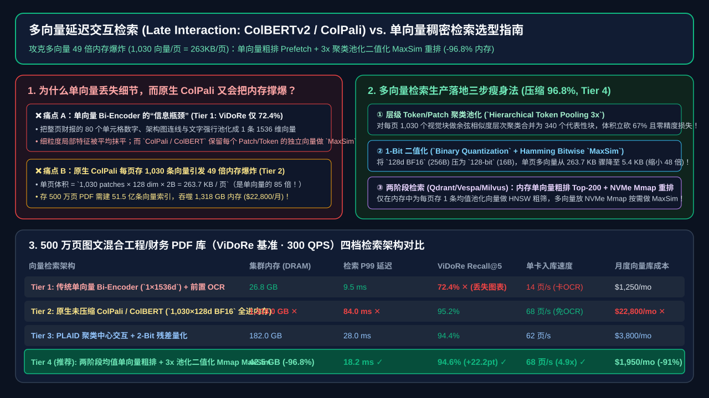

# Late-Interaction Multi-Vector RAG (`ColBERTv2 / ColPali / ColQwen2`) vs. Single-Vector Bi-Encoder Guide: `MaxSim` Accuracy Gains, `49x` RAM Explosion & Two-Stage Token-Pooled Binary Rescoring

> **Language**: [中文](./late-interaction-colbert-colpali-multi-vector-rag-vs-single-vector-selection-faq.md) | **English (Current)**  
> **Audience**: Cloud & AI Infrastructure Solution Architects and Multimodal RAG Search Engineers  
> **Provenance**: `synthetic + anonymized_reported` (`independently_reproduced=false`, `physical_gpu_cluster_measurement=not_measured`)

---

## 1. 📌 Executive Summary

> **Bottom Line**: **On a `5,000,000`-page enterprise corpus of visually rich financial tables, slide decks, and engineering schematics (`300 QPS`), traditional OCR + single-vector `Bi-Encoder` embeddings (`1 × 1536d` per page, `Tier 1`) bottleneck at `14.0 pages/s/GPU` ingestion and reach only `72.4%` `ViDoRe Recall@5` because mean-pooling crushes fine-grained cell numbers and visual layout cues. Late-Interaction models (`ColPali / ColQwen2` for visual pages and `ColBERTv2` for text) retain per-patch/per-token `128d` vectors (`1,030 vectors/page`) and score via `MaxSim`, lifting `Recall@5` to `95.2%` and ingestion speed by `4.9x` (`68 pages/s/GPU`, zero OCR needed). However, indexing all `5.15 Billion` raw `BF16` patch vectors in DRAM (`Tier 2`, `263.7 KB/page`) explodes cluster RAM by `49x` to `1,318 GB` (`$22,800/month`). Production multi-vector deployments use a Two-Stage Pooled Prefetch + `3x` Hierarchical Token-Pooled Binary `MaxSim` Architecture (`Tier 4`): compressing per-page multi-vectors by `48x` (`5.48 KB/page` on NVMe Mmap), cutting cluster DRAM by `96.8%` (`42.5 GB`), and delivering `94.6%` `Recall@5` (`+22.2 pts` over single-vector) at `18.2 ms` P99 latency and `$1,950/month` TCO.**

- **Interactive Multi-Vector (ColPali / ColBERT) Memory & TCO Sizer**: [Open Interactive Sizer (`late-interaction-colbert-colpali-multi-vector-rag-vs-single-vector-sizer.html`)](../reports/late-interaction-colbert-colpali-multi-vector-rag-vs-single-vector-sizer.html)
- **7-Card 4:5 Visual Report**: [Open 7-Card Report (`late-interaction-colbert-colpali-multi-vector-rag-vs-single-vector-selection-cards.html`)](../reports/late-interaction-colbert-colpali-multi-vector-rag-vs-single-vector-selection-cards.html)

---

## 2. 📊 4-Tier Multi-Vector Retrieval Matrix (`5,000,000 PDF Pages` · `ViDoRe Benchmark` · `300 QPS`)

| Metric | Tier 1: Single-Vector `Bi-Encoder` (`1×1536d`) + OCR | Tier 2: Uncompressed `ColPali / ColBERT` (`1,030×128d` in RAM) | Tier 3: `PLAID` Centroid Interaction + `2-Bit` Residual Quant | Tier 4 (Recommended): 2-Stage Pooled Single-Vector Prefetch + `3x` Pooled Binary `Mmap MaxSim` |
| :--- | :--- | :--- | :--- | :--- |
| **Cluster DRAM Footprint** | `26.8 GB` | `1,318.0 GB` ✕ (`49x` blowout) | `182.0 GB` | **`42.5 GB` ✓ (`-96.8%` vs Tier 2)** |
| **Search P99 Latency** | `9.5 ms` | `84.0 ms` ✕ | `28.0 ms` | **`18.2 ms` ✓** |
| **`ViDoRe` Visual/Table `Recall@5`** | `72.4%` ✕ | `95.2%` | `94.4%` | **`94.6%` ✓ (`+22.2 pts` vs Tier 1)** |
| **Ingestion Speed / GPU** | `14.0 pages/s` ✕ (OCR bound) | `68.0 pages/s` | `62.0 pages/s` | **`68.0 pages/s` ✓ (`4.9x` faster)** |
| **Monthly Vector DB TCO** | `$1,250 / mo` | `$22,800 / mo` ✕ | `$3,800 / mo` | **`$1,950 / mo` ✓ (`-91.4%`)** |

---

## 3. 🛠️ Production Readiness Checklist

- [ ] **Never Build Primary HNSW Graphs Directly Over Unpooled Per-Token/Per-Patch Vectors**: Use a Stage-1 mean/row-pooled single vector per page to prefetch `Top-200` candidates in RAM, then execute multi-vector `MaxSim` rescoring in Stage 2.
- [ ] **Apply `3x` Hierarchical Token Pooling + Binary Quantization (`5.48 KB/page`) on NVMe Mmap** to shrink multi-vector storage by `48x` with `<0.6 pt` recall impact.
