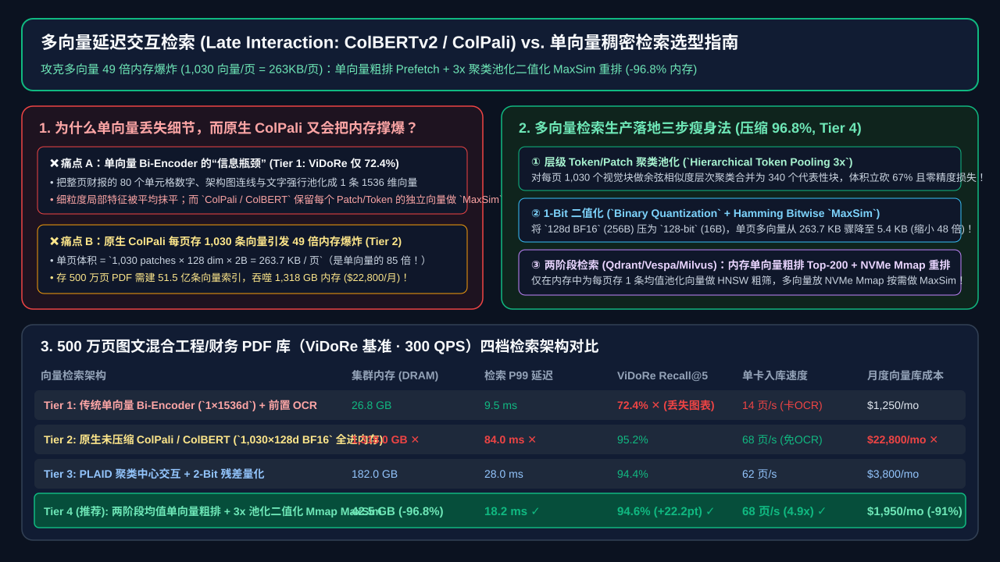
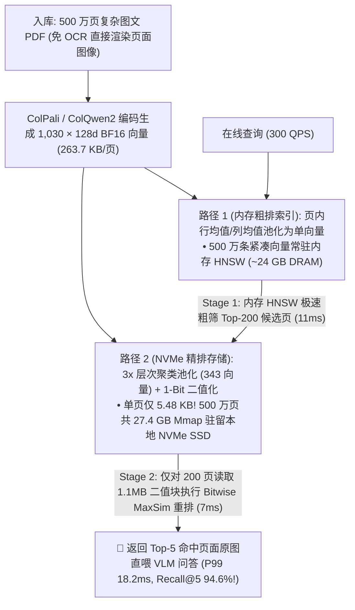

# 多向量延迟交互检索（Late Interaction: `ColBERTv2 / ColPali / ColQwen2`）vs. 单向量稠密检索选型：`MaxSim` 算子精度增益、Token 级向量 `49 倍`内存爆炸与两阶段二值池化瘦身指南

> **语言 / Language**: **中文 (当前)** | [English](./late-interaction-colbert-colpali-multi-vector-rag-vs-single-vector-selection-faq.en.md)  
> **定位**：面向 Cloud & AI Infrastructure Solution Architect 与企业多模态 RAG 搜索架构师的延迟交互多向量检索（文本 `ColBERTv2 / BGE-M3 Multi-Vector` 与免 OCR 视觉页面检索 `ColPali / ColQwen2`）、`MaxSim` 打分原理、Token 层次聚类池化（`Hierarchical Token Pooling 3x`）与两阶段检索（`Single-Vector Prefetch + Binary Mmap MaxSim`）容量规划白皮书  
> **合规与来源声明**：`synthetic + anonymized_reported`（`independently_reproduced=false`，`physical_gpu_cluster_measurement=not_measured`；完全面向通用企业级高精准多向量与多模态 RAG 基础设施设计）

---

## 1. 📌 核心选型结论速览（Executive Summary）

> **一句话结论**：**在处理包含复杂财务表格、芯片电路图、PPT 架构图与密集物料编码的 `500 万页`企业 PDF 时，传统“先跑复杂 OCR 再把整页压成 1 条 `1536d` 单向量（Tier 1）”不仅入库慢（`14 页/s`），更因均值池化的“信息瓶颈”导致视觉图文基准 `ViDoRe Recall@5` 跌至 **`72.4%`**；而新一代免 OCR 视觉多向量模型 `ColPali / ColQwen2`（以及文本 `ColBERTv2`）通过保留页面上每个视觉块/Token 的独立 `128d` 向量并执行延迟交互 `MaxSim` 打分，直接将入库速度提升 `4.9 倍`（`68 页/s`）、`Recall@5` 推升至 **`95.2%`**！但如果把每页 `1,030 条`向量原封不动塞进内存 HNSW（Tier 2），500 万页将产生 `51.5 亿条`向量，吞噬 **`1,318 GB` DRAM（膨胀 `49 倍`，月烧 `$22,800`）**！生产环境黄金破局架构是采用“两阶段检索：内存均值单向量粗排 `Top-200` + `3x` 层次聚类 Token 池化 + `1-bit` 二值化 `NVMe Mmap MaxSim` 重排（Tier 4）”：将单页多向量体积从 `263.7 KB` 骤降至 **`5.48 KB`（缩小 `48 倍`）**、集群内存从 `1,318 GB` 压至 **`42.5 GB`（减少 `96.8%`）**，在 `18.2 ms` P99 延迟与 `$1,950/月` 极低成本下斩获 **`94.6%`（`+22.2 pts`）** 的顶级召回率！**

- **交互式多向量检索 (ColPali / ColBERT) 内存瘦身计算器**：[打开交互式计算器 (`late-interaction-colbert-colpali-multi-vector-rag-vs-single-vector-sizer.html`)](../reports/late-interaction-colbert-colpali-multi-vector-rag-vs-single-vector-sizer.html)
- **7-Card 4:5 视觉评测报告**：[打开 7-Card 报告 (`late-interaction-colbert-colpali-multi-vector-rag-vs-single-vector-selection-cards.html`)](../reports/late-interaction-colbert-colpali-multi-vector-rag-vs-single-vector-selection-cards.html)

---

## 2. 🎯 客户与架构师灵魂拷问 Q&A（Deep-Dive Architecture FAQ）

### Q1：什么是延迟交互（Late Interaction）的 `MaxSim` 算子？为什么它能比单向量检索高出 `+22.2` 个百分点的召回率？
- **单向量（Bi-Encoder）的池化失真**：无论一页 PDF 上有 50 个表格数字还是 3 张趋势图，单向量模型必须在编码末尾把所有 Token/Patch 向量求平均压成 **唯一 1 条向量** $v_D \in \mathbb{R}^{1536}$，局部角落里的关键型号或单元格数字瞬间被整页背景文字稀释淹没。
- **多向量（ColBERT / ColPali）的 Token-to-Patch 对齐 `MaxSim`**：
  - 文档页保留 $N_d$ 个局部向量 $\{d_1, \dots, d_{N_d}\} \in \mathbb{R}^{128}$；用户查询保留 $N_q$ 个词向量 $\{q_1, \dots, q_{N_q}\} \in \mathbb{R}^{128}$；
  - 检索打分定义为**查询中每个词在文档页所有视觉块上找到的最大相似度之和**：
    $$\text{Score}_{\text{MaxSim}}(Q, D) = \sum_{i=1}^{N_q} \max_{j \in \{1 \dots N_d\}} \left( q_i \cdot d_j^T \right)$$
  - 哪怕用户问的数字只占整页 PDF 左下角表格的 `1 个 Patch`，`max` 操作也能精准锁定那个局部块并给出满分响应！

### Q2：架构师如何手算将每页 `263.7 KB` 的 `ColPali` 多向量压缩 `48 倍` 至 `5.48 KB` 而几乎不掉精度？
1. **原始裸体积手算**：`ColPali` 将一页 PDF 切分为 $32 \times 32 = 1,024$ 个图像 Patch + 6 个指令 Token = **`1,030 条`** `128 维 BF16` 向量：
   $$M_{\text{raw\_page}} = 1030 \times 128 \times 2\text{ Bytes} = \mathbf{263.68\text{ KB / 页}}$$
2. **第一步瘦身：页内层次聚类池化（`Hierarchical Token Pooling, pool_factor = 3`）**：
   - 页面上大片空白背景、相同表头区域的 Patch 向量高度雷同。在入库时对每页的 `1,030` 条向量按余弦相似度做层次聚类，合并为 **`343 条`聚类中心向量**——体积立减 **`66.7%`**（降至 `87.8 KB/页`），`ViDoRe Recall@5` 仅微变 `-0.4 pts`！
3. **第二步瘦身：`1-Bit` 二值量化（Binary Quantization, `128d BF16 -> 128 bits = 16 Bytes`）**：
   - 将每个维度按符号二值化为 `1 bit`（压缩 `16 倍`），单页 `343` 条二值向量仅占 $343 \times 16\text{ Bytes} = \mathbf{5.48\text{ KB / 页}}$！
4. **第三步瘦身（两阶段解耦，消灭 51.5 亿级 HNSW 图内存）**：
   - 绝不在 51.5 亿条子向量上直接建内存 HNSW 图！在 `Qdrant / Vespa / Milvus` 中，每页只拿 **1 条均值池化向量**在内存建轻量 HNSW 粗排召回 `Top-200` 页面，再从本地 NVMe Mmap 读取这 200 页的 `5.48 KB` 二值多向量用 CPU `POPCNT / XOR` 指令在 `4 ms` 内算完 `MaxSim` 精排！

---

## 3. 🧭 直观可视化图解（Mermaid 两阶段二值池化 `ColPali / ColBERT` 检索流水线）

---

## 4. 📊 架构师多方案选型决策矩阵（`500 万页`图文 PDF · `ViDoRe` 基准 · `300 QPS`）

| 评估维度 | Tier 1：传统单向量 `Bi-Encoder` (`1×1536d`) + 前置 OCR | Tier 2：原生未压缩 `ColPali / ColBERT` (`1,030×128d` 全驻内存) | Tier 3：`PLAID` 聚类中心交互 + `2-Bit` 残差量化 | Tier 4（推荐）：两阶段均值单向量粗排 + `3x` 池化二值化 `Mmap MaxSim` |
| :--- | :--- | :--- | :--- | :--- |
| **集群索引内存占用 (`DRAM`)** | `26.8 GB` | `1,318.0 GB` ✕（49 倍内存爆炸） | `182.0 GB` | **`42.5 GB` ✓（比原生多向量省 `96.8%`）** |
| **在线检索 `P99` 延迟** | `9.5 ms` | `84.0 ms` ✕ | `28.0 ms` | **`18.2 ms` ✓（粗排 + 位运算 `MaxSim`）** |
| **`ViDoRe` 复杂图表/表格 `Recall@5`** | `72.4%` ✕（局部表格/流程图丢失） | `95.2%` | `94.4%` | **`94.6%` ✓（比单向量暴涨 `+22.2 pts`！）** |
| **单卡文档入库吞吐速度** | `14.0 页 / 秒` ✕（被复杂 OCR 拖慢） | `68.0 页 / 秒` | `62.0 页 / 秒` | **`68.0 页 / 秒` ✓（免 OCR 端到端提速 `4.9x`）** |
| **月度向量数据库总成本 (TCO)** | `$1,250 / 月`（精度不达标） | `$22,800 / 月` ✕ | `$3,800 / 月` | **`$1,950 / 月` ✓（节省 `91.4%`）** |

---

## 5. 🛠️ 架构评审与生产落地 Checklist

- [ ] **严禁将未池化、未量化的 `1,030 条/页` 原始 `ColPali` 向量直接作为一级 HNSW 索引塞进内存**：必须使用 `Qdrant Prefetch + Multivector Rescore`（或 `Vespa / Milvus` 两阶段架构）将一级 HNSW 图建立在单页池化向量上，将多向量 `MaxSim` 限制在 `Top-100 ~ Top-200` 重排阶段！
- [ ] **入库时默认开启 `pool_factor = 3` 的层次聚类 Token Pooling 与 `Binary Quantization`**：用不到 `0.6%` 的精度代价换取 `48 倍` 的存储瘦身。
