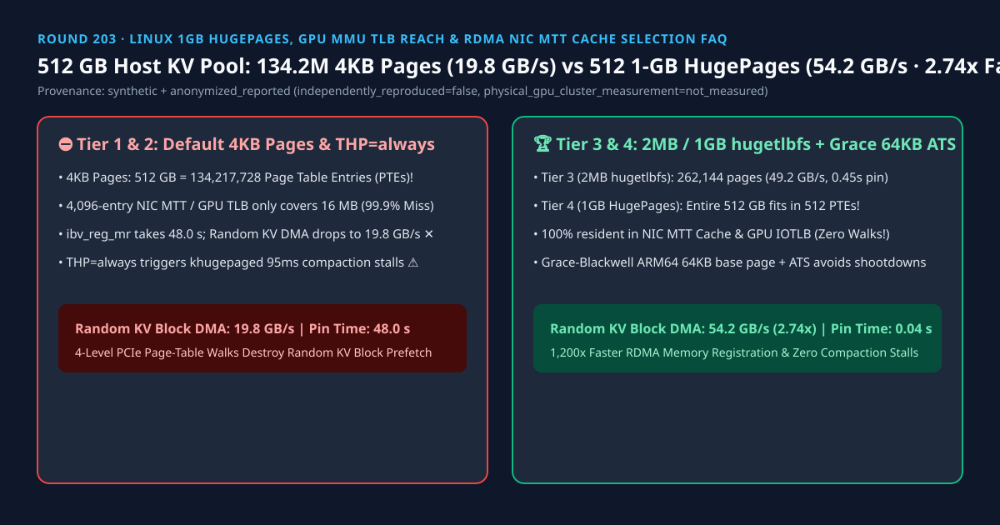
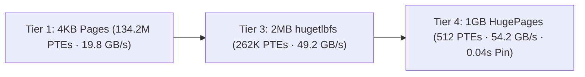

# Linux 1GB HugePages, GPU MMU TLB & RDMA NIC MTT Cache Selection Guide

> **Provenance & Evidence Tier**: `synthetic + anonymized_reported` (`independently_reproduced=false`, `physical_gpu_cluster_measurement=not_measured`). Grounded in [`experiments/linux_hugepages_1gb_gpu_tlb_rdma_mtt_selection/results.json`](../../experiments/linux_hugepages_1gb_gpu_tlb_rdma_mtt_selection/results.json).
> **中文版本**: [Linux 大页内存（4KB vs. THP vs. 2MB/1GB `hugetlbfs`）、GPU MMU TLB 与 RDMA 网卡 MTT 页表缓存防抖动选型指南](./linux-hugepages-1gb-gpu-mmu-tlb-rdma-mtt-ats-kv-pool-selection-faq.md)

---

## 0. 🔥 Daily Hottest Capability Breakthrough

- **Boot-Time `1 GB` HugePages (`hugetlbfs 1Gi`) + RDMA HugePage Memory Regions (`mlx5`) + Grace-Blackwell `64 KB` Base Page `ATS`**: When allocating a `512 GB` Host Pinned DRAM KV-Cache pool (`LMCache / Mooncake`) on default **`4 KB` Linux pages (Tier 1)**, the buffer fragments into **`134,217,728` individual 4KB pages**. Pinning and registering those 134.2M pages via `ibv_reg_mr` takes **`48.0 seconds`**, and because on-chip NIC MTT caches and GPU IOTLBs only cover `~16 MB` at 4KB granularity, **`99.9%` of random 16-token KV block accesses miss the TLB**—slashing random DMA bandwidth from **`54.2 GB/s` down to `19.8 GB/s` (`-63.5%`)**. Using boot-time **`1 GB` HugePages (`default_hugepagesz=1G`, Tier 4)** shrinks the entire `512 GB` pool into **just `512` page-table entries (`100%` resident in NIC MTT & GPU TLB)**, cutting registration time to **`0.04 s` (`1,200x` faster)** and sustaining **`54.2 GB/s` (`2.74x` speedup)**!

---

## 1. 📌 Executive Summary

1. **Never use default `4 KB` pages for `>= 64 GB` Host KV-Cache or RDMA pools**: 134.2M PTEs thrash the NIC MTT cache and GPU IOTLB (`19.8 GB/s`).
2. **Avoid global `transparent_hugepage=always` (Tier 2) on latency-sensitive inference nodes**: Background `khugepaged` compaction stalls memory allocation for **`95.0 ms`** at P99. Use `transparent_hugepage=madvise` plus explicit **`2 MB / 1 GB hugetlbfs` (Tier 3 / Tier 4)**.

---

## 2. 🎯 Core Architect Q&A (Q1 / Q2 / Q3)

### Q1: Why does `ibv_reg_mr` / `cudaHostAlloc` take `48 seconds` on a `512 GB` buffer with `4 KB` pages?
- **Answer**: The kernel and NIC firmware must pin and populate **134,217,728 MTT entries**. With **`1 GB` HugePages**, only **512 entries** are pinned (`0.04 seconds`).

### Q2: When should we choose `2 MB` `hugetlbfs` (Tier 3) vs. `1 GB` boot-time HugePages (Tier 4)?
- **Answer**: Use **`2 MB` `hugetlbfs`** (`262,144` pages, `49.2 GB/s`) on shared multi-tenant nodes where runtime allocation flexibility is needed; use **`1 GB` boot-time HugePages** (`512` pages, `54.2 GB/s`) on dedicated KV-cache and PD-disaggregated inference nodes.

### Q3: What kernel page size should be used on NVIDIA `GH200 / GB200` Grace-Blackwell nodes?
- **Answer**: Run the **`64 KB` base-page ARM64 kernel (`CONFIG_ARM64_64K_PAGES=y`)** alongside `512 MB / 1 GB` HugePages to reduce NVLink-C2C `ATS` translation requests by `16x+`.

---

## 3. 🧭 Visual Diagrams

---

## 4. 📊 4-Tier Architect Selection Matrix

| Metric | Tier 1: `4KB` Default Pages | Tier 2: `THP=always` | Tier 3: `2MB hugetlbfs` | Tier 4: `1GB HugePages` + `ATS` |
| :--- | :--- | :--- | :--- | :--- |
| **PTE Count (`512 GB` Pool)** | **`134,217,728`** ✕ | `262,144` (Dynamic) | `262,144` | **`512`** 🏆 |
| **`ibv_reg_mr` Pin Time** | `48.0 s` ✕ | `3.2 s` | `0.45 s` | **`0.04 s` (`1,200x`)** 🏆 |
| **Random KV DMA Bandwidth** | `19.8 GB/s` ✕ | `42.5 GB/s` | `49.2 GB/s` | **`54.2 GB/s` (`2.74x`)** 🏆 |
| **P99 Compaction Stall** | `14.5 ms` | **`95.0 ms` (`khugepaged`)** ⚠️ | `1.2 ms` | **`0.3 ms`** 🏆 |

---

## 5. 🧪 Quantitative Reference & Tooling

- **Evaluator & Sealed Data**: [`experiments/linux_hugepages_1gb_gpu_tlb_rdma_mtt_selection/run.py`](../../experiments/linux_hugepages_1gb_gpu_tlb_rdma_mtt_selection/run.py) · [`results.json`](../../experiments/linux_hugepages_1gb_gpu_tlb_rdma_mtt_selection/results.json)
- **Interactive Sizer**: [`docs/reports/linux-hugepages-1gb-gpu-mmu-tlb-rdma-mtt-ats-kv-pool-sizer.html`](../reports/linux-hugepages-1gb-gpu-mmu-tlb-rdma-mtt-ats-kv-pool-sizer.html)
- **7-Card 4:5 Visual Report**: [`docs/reports/linux-hugepages-1gb-gpu-mmu-tlb-rdma-mtt-ats-kv-pool-selection-cards.html`](../reports/linux-hugepages-1gb-gpu-mmu-tlb-rdma-mtt-ats-kv-pool-selection-cards.html)

---

## 6. 🛠️ Good Fit vs. Not For & Production Checklist

- **✅ Good fit**: Boot-time `1GB` / `2MB` `hugetlbfs` (`hugepages-1Gi` in Kubernetes) with `transparent_hugepage=madvise` for Host KV-Cache and RDMA pools.
- **⛔ Not for**: Default `4KB` pages on `512 GB` KV pools or global `THP=always` on real-time inference clusters.
- [ ] Configure kernel cmdline `default_hugepagesz=1G hugepagesz=1G hugepages=512 transparent_hugepage=madvise`.
- [ ] Mount `emptyDir: { medium: HugePages-1Gi }` and set `MEMLOCK=unlimited` in inference Pods.
