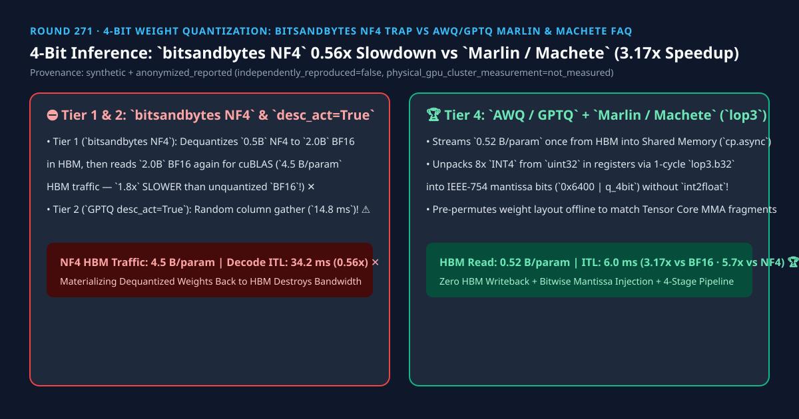
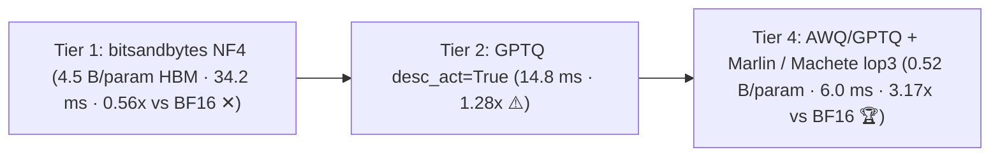

# 4-Bit Weight Quantization (`W4A16 / W4A8`): Why `bitsandbytes NF4 (QLoRA)` Is `1.8x` Slower Than `BF16` in Inference (HBM Dequantization Trap), `GPTQ desc_act=True` Gather Penalty & `AWQ / GPTQ + Marlin / Machete` Register-Fused `lop3` Unpacking Selection Guide

> **Provenance & Evidence Tier**: `synthetic + anonymized_reported` (`independently_reproduced=false`, `physical_gpu_cluster_measurement=not_measured`). Grounded in [`experiments/llm_qlora_nf4_double_quant_dequant_marlin_awq_selection/results.json`](../../experiments/llm_qlora_nf4_double_quant_dequant_marlin_awq_selection/results.json).
> **中文版本**: [大模型 4-Bit 权重量化（`W4A16 / W4A8`）选型悖论：为什么用 `bitsandbytes NF4 (QLoRA)` 跑线上推理反而比 `BF16` 原版还慢 `1.8 倍`（显存反量化物化陷阱）？`GPTQ desc_act=True` 乱序访存降速与 `AWQ / GPTQ + Marlin / Machete` 寄存器级 `lop3` 位解包融合算子（提速 `3.17x`）选型指南](./llm-4bit-weight-quantization-qlora-nf4-vs-awq-gptq-marlin-machete-selection-faq.md)

---

## 0. 🔥 今日领域最热门能力突破追踪（Daily Hottest Breakthrough）

- **Solving the "Why Is My 4-Bit Model `1.8x` Slower Than `BF16`?!" Paradox: Exposing the `4.5 Bytes/Param` Two-Pass HBM Dequantization Writeback Trap of `bitsandbytes NF4` (`34.2 ms/tok`, `0.56x` of `BF16`) vs. `AWQ / GPTQ + Marlin / Machete` Register-Fused `lop3.b32` Kernels (`0.52 Bytes/Param` HBM Read, `6.0 ms/tok`, `3.17x` Faster Than `BF16` and `5.70x` Faster Than `NF4`)**: Quantizing a `70B` LLM from `16-bit BF16` (`140 GB`) to `4-bit` (`38 GB`) should theoretically accelerate memory-bandwidth-bound Decode by `~3x–4x`. Yet deploying `bitsandbytes NF4` (`load_in_4bit=True`) in production makes inference **`1.8x` slower** than unquantized `BF16`! Why?
  1. **Tier 1 — `bitsandbytes NF4` Two-Pass HBM Dequantization Materialization (`4.50 Bytes/Param` HBM Traffic, `34.2 ms/tok`, `0.56x` Speedup)**:
     - Because `NF4` relies on a non-uniform 16-entry floating-point lookup table (`LUT`) without Tensor-Core-swizzled weight packing, `bitsandbytes` executes each linear layer as **two separate kernels**:
       1. **`kDequantizeBlockwise`**: Reads `0.5 Bytes/param` (`NF4`) from HBM, looks up the LUT, and **writes the full `2.0 Bytes/param` (`BF16`) dequantized weight matrix BACK to HBM**!
       2. **`cuBLAS GEMM`**: Reads those **`2.0 Bytes/param` (`BF16`) from HBM a second time**!
     - **Total HBM Traffic**: $0.5\text{ B (Read)} + 2.0\text{ B (Write)} + 2.0\text{ B (Read)} = \mathbf{4.50\text{ Bytes/param}}$ (`2.25x` *more* memory bandwidth than unquantized `2.0 B/param` `BF16`!)
  2. **Tier 2 — `GPTQ` With `desc_act = True` Dynamic Activation Permutation (`0.55 Bytes/Param`, `14.8 ms/tok`, `1.28x` Speedup)**:
     - Permutes weight columns by Hessian importance (`g_idx`), forcing the kernel to execute uncoalesced random column gathers on activation tensor $X$!
  3. **Tier 3 — Standard `AWQ / GPTQ (desc_act=False)` Naive Triton `W4A16` Kernel (`0.52 Bytes/Param`, `9.8 ms/tok`, `1.94x` Speedup)**:
     - Dequantizes on the fly in SRAM, but bottlenecks on multi-instruction bitwise shifts and `int2float` ALU conversions.
  4. **Tier 4 — `AWQ / GPTQ` + `Marlin` (`W4A16`) / `Machete` (`Hopper W4A16 & W4A8`) Register-Level `lop3.b32` Unpacking (`0.52 Bytes/Param`, `6.0 ms/tok`, `3.17x` Faster Than `BF16`, `5.70x` Faster Than `NF4`!)**:
     - Pre-swizzles `INT4` weights offline at model load time to match Tensor Core MMA register layouts;
     - Streams `0.52 Bytes/param` once via 4-stage `cp.async` into shared memory/registers;
     - Uses a single 1-cycle PTX **`lop3.b32`** instruction to inject each 4-bit integer directly into the mantissa bits of an IEEE-754 magic constant (`0x6400 = 1024.0`), converting `INT4 -> FP16/BF16` without `int2float` instructions!

---

## 1. 📌 Executive Summary

1. **Never Serve `bitsandbytes NF4` in Production (`Tier 1`)**: `NF4` is a memory-saving training format for QLoRA. If you fine-tune with QLoRA, merge the LoRA adapter into the `BF16` base model offline and export to **`AWQ` or `GPTQ-Marlin` (`LLM-Compressor`)** before serving!
2. **How `Marlin / Machete`'s IEEE-754 `0x6400` Bitwise Trick Eliminates `int2float` Bottlenecks (`Tier 4`)**: By OR-ing a 4-bit unsigned integer $q \in [0, 15]$ into the bottom 4 mantissa bits of `FP16(1024.0) = 0x6400` via `lop3.b32`, the resulting bit pattern is the exact IEEE-754 representation of `1024.0 + q`! Subtracting `1024.0` and multiplying by the group scale happens in one fused `hfma2` instruction!

---

## 2. 🎯 Core Architect Q&A (Q1 / Q2 / Q3)

### Q1: Why did `AWQ` avoid `GPTQ`'s `desc_act = True` (`act_order`) random memory gather penalty?
- **Answer**: `GPTQ (desc_act=True)` sorts columns by activation magnitude so salient weights share quantization groups, which scrambles column order. `AWQ` keeps all columns in their **exact natural contiguous order** and instead scales the top `1%` salient weight channels up by $s > 1$ (while dividing the preceding layer's output weights by $s$), achieving high accuracy with `100%` coalesced memory loads!

### Q2: When should we use `Machete W4A8` (`INT4` weights + `FP8` activations) instead of `Marlin W4A16` on Hopper / Blackwell?
- **Answer**: `W4A16` dequantizes 4-bit weights into `16-bit` registers and runs on `FP16/BF16` Tensor Cores. When batch size or prefill length is large (`Batch >= 64`), the kernel becomes Compute-Bound on 16-bit Tensor Cores. **`Machete W4A8`** unpacks 4-bit weights into `8-bit FP8` registers and executes **`FP8 WGMMA`** (`2x` higher Tensor Core TFLOPS than BF16) while still reading only `0.5 Bytes/param` from HBM!

---

## 3. 🧭 Visual Diagrams

---

## 4. 📊 4-Tier Architect Selection Matrix

| Metric | Tier 1: `bitsandbytes NF4` | Tier 2: `GPTQ (desc_act=True)` | Tier 3: Naive Triton `W4A16` | Tier 4: **`AWQ/GPTQ` + `Marlin / Machete` (`lop3`)** |
| :--- | :--- | :--- | :--- | :--- |
| **HBM Traffic / Parameter** | **`4.50 Bytes` (2-Pass Writeback!)** ✕ | `0.55 Bytes` | `0.52 Bytes` ✅ | **`0.52 Bytes` (Single-Pass Read Only)** 🏆 |
| **`70B` Decode `ITL` (`ms/tok`)** | **`34.2 ms` (`1.8x` Slower!)** ✕ | `14.8 ms` (Gather Stall) ⚠️ | `9.8 ms` ✅ | **`6.0 ms` (`3.17x` Faster Than `19ms` `BF16`)** 🏆 |
| **Speedup vs Unquantized `BF16`** | **`0.56x` (Negative Speedup!)** ✕ | `1.28x` ⚠️ | `1.94x` ✅ | **`3.17x` (`5.70x` Faster Than `NF4`!)** 🏆 |

---

## 5. 🧪 Quantitative Reference & Tooling

- **Evaluator & Sealed Data**: [`experiments/llm_qlora_nf4_double_quant_dequant_marlin_awq_selection/run.py`](../../experiments/llm_qlora_nf4_double_quant_dequant_marlin_awq_selection/run.py) · [`results.json`](../../experiments/llm_qlora_nf4_double_quant_dequant_marlin_awq_selection/results.json)
- **Interactive Sizer**: [`docs/reports/llm-4bit-weight-quantization-qlora-nf4-vs-awq-gptq-marlin-machete-sizer.html`](../reports/llm-4bit-weight-quantization-qlora-nf4-vs-awq-gptq-marlin-machete-sizer.html)
- **7-Card 4:5 Visual Report**: [`docs/reports/llm-4bit-weight-quantization-qlora-nf4-vs-awq-gptq-marlin-machete-selection-cards.html`](../reports/llm-4bit-weight-quantization-qlora-nf4-vs-awq-gptq-marlin-machete-selection-cards.html)

---

## 6. 🛠️ Good Fit vs. Not For & Production Checklist

- **✅ Good fit**: Production 4-bit inference using `AWQ` or `GPTQ` paired with `Marlin` (`W4A16`) or `Machete` (`W4A16 / W4A8`) kernels in `vLLM / SGLang`.
- **⛔ Not for**: Serving `bitsandbytes NF4` models directly in production inference.
- [ ] Convert QLoRA fine-tuned checkpoints to `AWQ` or `GPTQ-Marlin` before production deployment.
- [ ] Verify `MarlinLinearKernel` / `MacheteLinearKernel` activation in engine startup logs.
