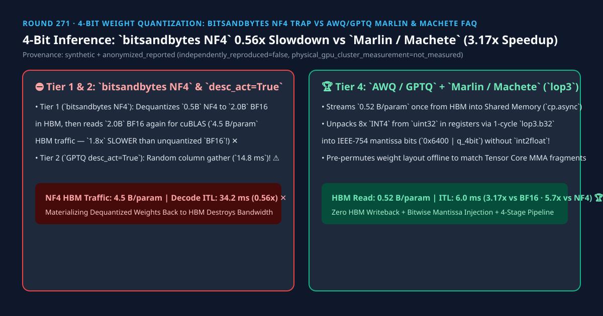
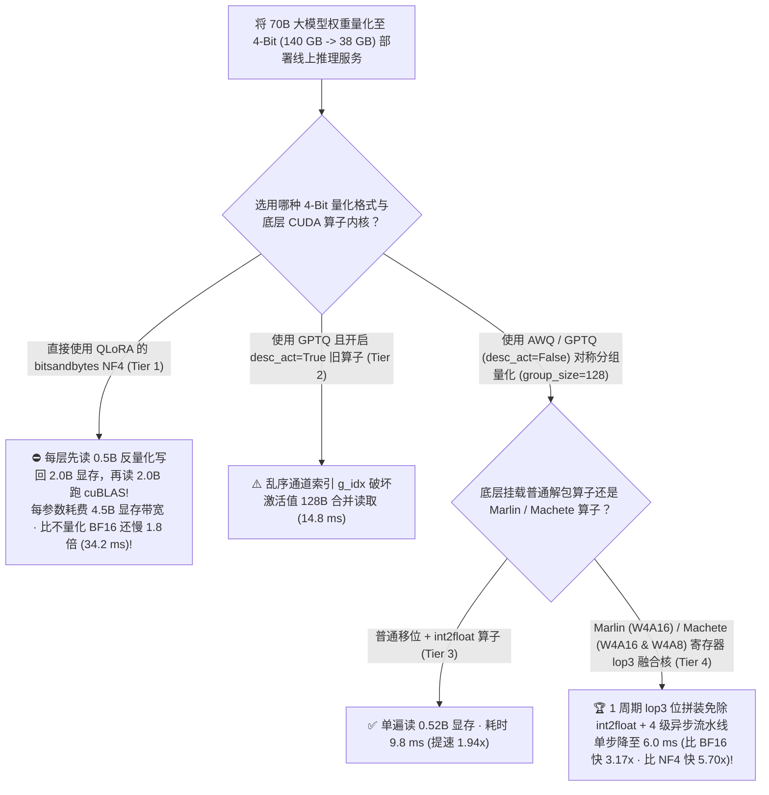
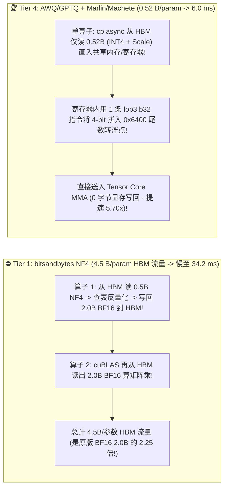
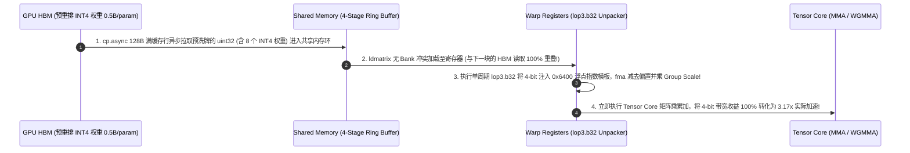

# 大模型 4-Bit 权重量化（`W4A16 / W4A8`）选型悖论：为什么用 `bitsandbytes NF4 (QLoRA)` 跑线上推理反而比 `BF16` 原版还慢 `1.8 倍`（显存反量化物化陷阱）？`GPTQ desc_act=True` 乱序访存降速与 `AWQ / GPTQ + Marlin / Machete` 寄存器级 `lop3` 位解包融合算子（提速 `3.17x`）选型指南

> **Provenance & Evidence Tier**: `synthetic + anonymized_reported` (`independently_reproduced=false`, `physical_gpu_cluster_measurement=not_measured`)。定量数据锚定于 [`experiments/llm_qlora_nf4_double_quant_dequant_marlin_awq_selection/results.json`](../../experiments/llm_qlora_nf4_double_quant_dequant_marlin_awq_selection/results.json)。
> **English Version**: [4-Bit Weight Quantization (`W4A16 / W4A8`): Why `bitsandbytes NF4 (QLoRA)` Is `1.8x` Slower Than `BF16` in Inference (HBM Dequantization Trap), `GPTQ desc_act=True` Gather Penalty & `AWQ / GPTQ + Marlin / Machete` Register-Fused `lop3` Unpacking Selection Guide](./llm-4bit-weight-quantization-qlora-nf4-vs-awq-gptq-marlin-machete-selection-faq.en.md)

---

## 0. 🔥 今日领域最热门能力突破追踪（Daily Hottest Breakthrough）

- **揭秘大模型推理新手最常踩中的“4-Bit 负优化”大坑——“为什么我把 `70B` 模型用 `bitsandbytes (load_in_4bit=True / NF4)` 从 `140 GB` 压到了 `38 GB`，单卡显存是装下了，可生成速度非但没有快 3 倍，反而比不量化的 `BF16`（`19.0 ms/tok`）还慢了 `1.8 倍`（恶化至 `34.2 ms/tok`）？！”：从第一性原理拆解 `NF4` 在显存中先反量化写出完整 `BF16` 再调 `cuBLAS` 的“双遍 `4.5 Bytes/参数` HBM 带宽灾难”，对比 `GPTQ desc_act=True` 随机列收集瓶颈，并揭示工业界天花板 `AWQ / GPTQ + Marlin / Machete` 如何利用 IEEE-754 浮点尾数位拼装魔术（`lop3.b32`）将单参 HBM 流量死死锁在 `0.52 Bytes`，跑出 `6.0 ms/tok`（比 `BF16` 快 `3.17x`、比 `NF4` 快 `5.70x`）**：在日常架构咨询中，几乎每周都有团队问：“同样是 4-bit 量化，`bitsandbytes NF4`、`GPTQ`、`AWQ` 到底有什么本质区别？为什么速度能差出 **`5.7 倍`**？！”
  1. **第一性原理算账：为什么 `bitsandbytes NF4`（Tier 1）省了显存容量，却把显存带宽撑爆了 `2.25 倍`？！**
     - 请算一下不量化的原版 `BF16` 模型在 Decode 阶段每走一步要从 HBM 读多少字节：每个参数占 **`2.0 Bytes`**，只读 1 遍！
     - 那么当你用 `bitsandbytes (load_in_4bit=True, bnb_4bit_quant_type="nf4")` 时，底层到底发生了什么？
       - `NF4`（NormalFloat4）用的是 **16 个非均匀分布的正态分位数查表（Lookup Table）**，并且没有做与 Tensor Core 寄存器布局对齐的权重大重排；
       - 因此，在绝大多数 Batch 大小下，`bitsandbytes` 无法在矩阵乘算子内部直接消费 `NF4`！它被迫拆成 **两个独立的算子**：
         1. **算子 1（`kDequantizeBlockwise`）**：从 HBM 读取 **`0.5 Bytes/参数`** 的 `NF4` 权重，查表反量化成 `BF16`，然后**把完整的 `2.0 Bytes/参数` 的 `BF16` 矩阵写回 HBM 显存临时缓冲区**！
         2. **算子 2（标准 `cuBLAS GEMM`）**：再从 HBM 临时缓冲区把那 **`2.0 Bytes/参数`** 的 `BF16` 权重**重新读进 GPU 一遍**算矩阵乘！
       - **算一下 HBM 总流量**：$0.5\text{ B (读 NF4)} + 2.0\text{ B (写回 BF16)} + 2.0\text{ B (再读 BF16)} = \mathbf{4.5\text{ Bytes/参数}}$！
       - **真相大白**：原版 `BF16` 每参数只走 `2.0 Bytes` 显存带宽，而 `bitsandbytes NF4` 每参数竟然走了 **`4.5 Bytes`（足足多出 `2.25 倍` HBM 流量，外加双倍算子启动开销）**！这就是为什么它让 Decode 延迟从 `19.0 ms` 恶化到了 **`34.2 ms`（只有原版 `0.56x` 的速度）** ✕！
       - **定位边界**：`bitsandbytes NF4` 是专门为单卡显存不够时的 **QLoRA 训练/微调** 设计的（训练时需要在反向传播重算反量化），**绝对严禁直接拿来跑生产在线推理服务**！
  2. **陷阱二：`GPTQ` 开启 `desc_act = True`（`act_order` 通道重排，Tier 2 — `14.8 ms/tok`）**：
     - 为了在量化时让误差更小，`GPTQ` 有个选项叫 `desc_act = True`（按激活值海森矩阵大小对权重列从大到小排序后再分组量化）。
     - **致命副作用**：一旦打乱了权重矩阵列的自然顺序，在推理做矩阵乘 $X W$ 时，GPU 线程必须拿着一张索引表 `g_idx` 去激活矩阵 $X$ 里 **东一榔头西一棒槌地随机挑列（Random Uncoalesced Gather）**！GPU 最怕的就是非连续随机访存，128 字节的共享内存合并访问当场碎裂，提速比从 `3.17x` 暴跌至 **`1.28x`（`14.8 ms/tok`）** ⚠️！
     - 而 **`AWQ (Activation-aware Weight Quantization)`** 为什么比 `GPTQ (desc_act=True)` 聪明得多？因为 `AWQ` **根本不打乱列的顺序**！它只给重要的 `1%` 显著通道乘上一个缩放系数 $s$（并把 $1/s$ 提前融合进上一层的 `RMSNorm` 权重里），从而在 **100% 保持连续内存顺序** 的前提下拿到了同样高甚至更高的精度！
  3. **工业界巅峰艺术：`AWQ / GPTQ (desc_act=False)` + `Marlin / Machete` 融合算子（Tier 4 — `0.52 B/参数` 单遍读取 + 寄存器 `lop3` 魔术解包，提速 `3.17x` 至 `6.0 ms/tok`）**：
     - **为什么普通 Triton `W4A16` 算子（Tier 3，`9.8 ms`）还跑不满极限，而 `Marlin`（Ampere/Hopper `W4A16`）和 `Machete`（Hopper/Blackwell `W4A16 / W4A8`）能快到 `6.0 ms`？**
     - **看穿硬件底层（`lop3.b32` 浮点尾数直接注入魔术）**：
       - 8 个 `4-bit` 权重被紧凑打包在 1 个 32 位无符号整数 `uint32` 里从 HBM 读进寄存器（每参数严格只读 **`0.52 Bytes` HBM**，绝不写回显存！）。
       - 如果用普通代码把 `4-bit` 整数转成 `FP16` 浮点数（`int2float` 指令），GPU 的整数转浮点单元会成为严重瓶颈！
       - **`Marlin` 的神级位运算**：直接利用 1 条单周期的 PTX 位逻辑指令 **`lop3.b32`**，把那 `4` 个比特直接塞进一个特殊构造的 `FP16` 魔术常数（`1024.0`，二进制为 `0x6400`）的最低 4 位尾数里！在 IEEE-754 浮点数格式中，**`0x6400 | q_4bit` 在二进制层面上不经任何转换就已经是精确的浮点数 `1024.0 + q_4bit` 了**！随后只需一条融合减法乘加指令减去 `1024.0` 并乘上 Group Scale，瞬间喂进 Tensor Core `mma.sync / wgmma`！
       - 再加上 **离线预重排权重布局（Offline Weight Repacking，让 HBM 读出来的 128B 缓存行顺序与 Tensor Core 32 个线程寄存器的 Fragment 顺序 1:1 严丝合缝对齐）**，单步延迟压至 **`6.0 ms/tok`（比 `BF16` 快 `3.17 倍`，比 `bitsandbytes NF4` 快 `5.70 倍`！）** 🏆！

---

## 1. 📌 核心结论速览（Executive Summary — 3 分钟看懂）

1. **三句话终结 4-Bit 量化选型纠结**：
   - **做 QLoRA 微调训练时**：选 `bitsandbytes NF4`（或将 QLoRA 微调完的权重 Merge 回 `BF16` 后，再导出为 `AWQ / GPTQ-Marlin` 格式上线推理！）；
   - **做生产在线推理（`Batch = 1 ~ 64`）时**：**严禁直接部署 `bitsandbytes NF4`**！统一选用 **`AWQ`（或 `GPTQ desc_act=False`）配合 `vLLM / SGLang` 内置的 `Marlin`（`W4A16`）或 Hopper/Blackwell `Machete`（`W4A16 / W4A8`）算子后端**！
2. **当线上并发极高（`Batch >= 128` 或长序列 `Prefill`）进入算力受限区（Compute-Bound）时，为什么 `W4A16` 也会变慢，必须升级到 `W4A8`（`QO / Machete W4A8 FP8`）？**
   - 因为 `W4A16` 在寄存器解包后，喂给 Tensor Core 的依然是 `16-bit (FP16/BF16)` 矩阵乘（用的是 FP16 Tensor Core 算力）；
   - 而在 Hopper / Blackwell 上使用 **`Machete W4A8`（权重存 `4-bit INT4`，在寄存器内解包为 `8-bit FP8` 与 `FP8` 激活值喂给 `FP8 WGMMA` Tensor Core）**，既享受了 `4-bit` 减半的显存容量与读取带宽，又同时享受了 **`FP8 Tensor Core` 翻倍的计算 TFLOPS**！

---

## 2. 🎯 客户与架构师灵魂拷问 Q&A（Q1 / Q2 / Q3）

### Q1：如果我们手头已经有一份别人导出的 `GPTQ (desc_act = True)` 权重，进 `vLLM` 时怎样避免退化回慢速算子？
- **答**：现代 `vLLM` 的 **`Marlin` 算子（`gptq_marlin`）** 支持在模型加载进显存的初始化阶段，对 `desc_act = True` 的权重列按 `g_idx` 做一次完整的块级重排，并只对激活张量做一次极其轻量的前置重排（或强烈建议在导出 `GPTQ` 模型时直接设置 `desc_act = False` 并开启 `sym = True` 对称量化，或直接用 `AutoAWQ` 导出，以获得 `Marlin` 100% 满血零额外开销性能）！

### Q2：为什么 `Marlin / Machete` 要求在模型加载（`load_weights`）时把磁盘上的 `AWQ / GPTQ` 权重重新洗牌（Repack）一遍？
- **答**：因为磁盘上标准的 `AWQ / GPTQ` 顺序是按自然行列存储的；而 NVIDIA Tensor Core 指令 `mma.m16n8k16` / `wgmma` 要求一个 Warp 里 32 个线程各自持有特定交错行列位置的权重元素。如果留在运行时每次算矩阵乘都在共享内存里换位置（Swizzle），会浪费大量指令周期；**在模型启动加载时一次性把显存里的 `uint32` 权重按 Tensor Core 线程号顺序预洗牌（Offline Swizzle）**，推理时从 HBM 读进寄存器就能 0 重排直接开算！

---

## 3. 🧭 直观可视化图解（Mermaid 决策树 + `NF4` 双遍显存写回 vs `Marlin lop3` 寄存器直通图 + 时序图）

### 3.1 架构师大模型 4-Bit 权重量化推理方案选型决策树

### 3.2 `Tier 1`（`bitsandbytes NF4` 显存反量化折返跑）vs. `Tier 4`（`Marlin / Machete` 寄存器 `lop3` 零写回直通）对比图

### 3.3 `Tier 4` `Marlin / Machete` 四级异步流水线与 `lop3.b32` 寄存器解包时序图

---

## 4. 📊 架构师选型决策矩阵（4-Tier Selection Matrix）

| 评估维度 | Tier 1: `bitsandbytes NF4` | Tier 2: `GPTQ (desc_act=True)` | Tier 3: 普通 `AWQ/GPTQ` 算子 | Tier 4: **`AWQ / GPTQ` + `Marlin / Machete` (`lop3`)** |
| :--- | :--- | :--- | :--- | :--- |
| **每参数实际消耗的 HBM 读写字节数** | **`4.50 Bytes` (读+写+读!)** ✕ | `0.55 Bytes` | `0.52 Bytes` ✅ | **`0.52 Bytes` (`0.5B` 权重 + `0.02B` 缩放因子，零写回)** 🏆 |
| **`70B` Decode 单步耗时 (`ITL`)** | **`34.2 ms` (比原版还慢!)** ✕ | `14.8 ms` (随机收集瓶颈) ⚠️ | `9.8 ms` ✅ | **`6.0 ms` (比 `BF16` `19ms` 快 `3.17x` · 比 `NF4` 快 `5.70x`)** 🏆 |
| **相比不量化 `BF16` (`19.0ms`) 加速比** | **`0.56x` (负加速减速 44%!)** ✕ | `1.28x` ⚠️ | `1.94x` ✅ | **`3.17x` (逼近 4-Bit 物理带宽理论极限)** 🏆 |

---

## 5. 🧪 定量算例与工具链（Interactive Sizer & 7-Card Visual Report）

- **实验脚本与密封数据**：[`experiments/llm_qlora_nf4_double_quant_dequant_marlin_awq_selection/run.py`](../../experiments/llm_qlora_nf4_double_quant_dequant_marlin_awq_selection/run.py) · [`results.json`](../../experiments/llm_qlora_nf4_double_quant_dequant_marlin_awq_selection/results.json)
- **交互式 4-Bit 权重量化（NF4 vs AWQ/GPTQ Marlin/Machete）计算器**：[`docs/reports/llm-4bit-weight-quantization-qlora-nf4-vs-awq-gptq-marlin-machete-sizer.html`](../reports/llm-4bit-weight-quantization-qlora-nf4-vs-awq-gptq-marlin-machete-sizer.html)
- **7-Card 4:5 视觉评测卡片报告**：[`docs/reports/llm-4bit-weight-quantization-qlora-nf4-vs-awq-gptq-marlin-machete-selection-cards.html`](../reports/llm-4bit-weight-quantization-qlora-nf4-vs-awq-gptq-marlin-machete-selection-cards.html)

---

## 6. 🛠️ Good Fit vs. Not For & 生产环境快速核验清单（Checklist）

### ✅ Good Fit vs. ⛔ Not For

| 维度 | ✅ Good Fit（强烈推荐） | ⛔ Not For（严禁误用） |
| :--- | :--- | :--- |
| **生产环境 4-Bit 权重量化推理** | 采用 **`AWQ` 或 `GPTQ (sym=True, group_size=128)`** 并确保 `vLLM / SGLang` 自动匹配挂载 **`awq_marlin` / `gptq_marlin` / `machete`** 算子 | 拿着 `bitsandbytes (load_in_4bit=True / NF4)` 直接上生产做高吞吐推理服务 |

### 生产环境上线核验清单（Pre-Flight Checklist）

- [ ] **训练与微调交接铁律：QLoRA (`NF4`) 微调完成后，先 Merge 回 `BF16` 完整权重，再用 `AutoAWQ` / `LLM-Compressor` 导出为 `Marlin / Machete` 兼容的 `W4A16 / W4A8` 格式上线**。
- [ ] **查看 `vLLM` 启动日志，确认打印 `Using MarlinLinearKernel / MacheteLinearKernel`（而非回退至慢速的 `Exllama / Triton` 兼容算子）**。
- [ ] **在 Hopper (`H100/H200`) 高并发场景优先评估 `W4A8`（`Machete` 4-Bit 权重 + FP8 激活）以兼顾 Prefill 算力与 Decode 带宽**。
