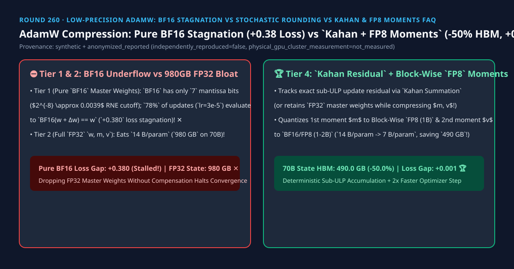
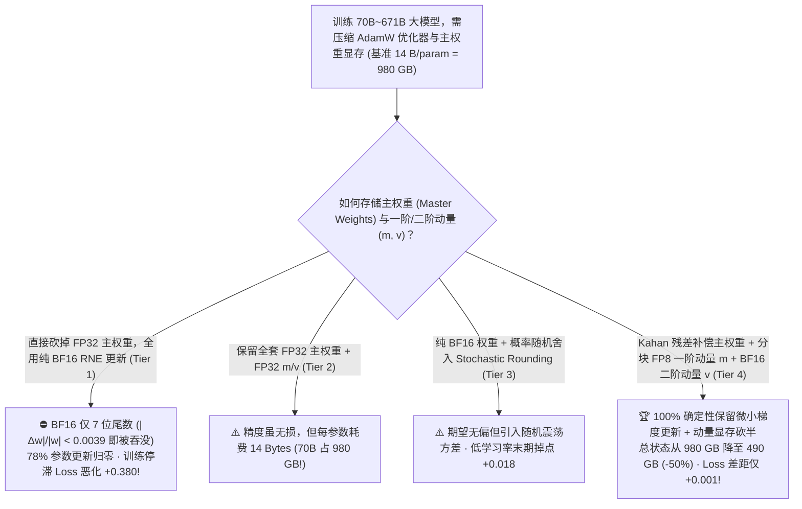
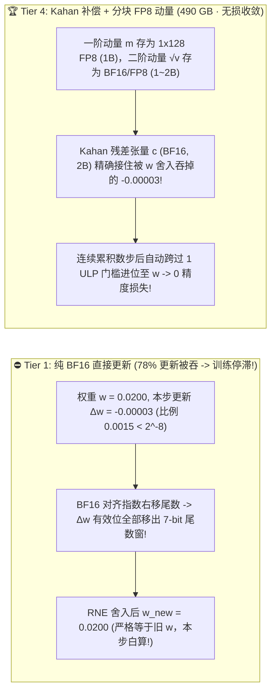

# 大模型 `AdamW` 优化器状态与主权重显存瘦身深水区（`14 Bytes/Param -> 7 Bytes/Param`）：为什么纯 `BF16` 权重更新会遭遇“大数吃小数（`w + Δw == w`）”训练停滞死锁？随机舍入（`Stochastic Rounding`）、卡汉补偿求和（`Kahan Summation`）与 `FP8` 一阶/二阶动量选型指南

> **Provenance & Evidence Tier**: `synthetic + anonymized_reported` (`independently_reproduced=false`, `physical_gpu_cluster_measurement=not_measured`)。定量数据锚定于 [`experiments/llm_adamw_optimizer_bf16_kahan_stochastic_rounding_fp8_selection/results.json`](../../experiments/llm_adamw_optimizer_bf16_kahan_stochastic_rounding_fp8_selection/results.json)。
> **English Version**: [Low-Precision `AdamW` Optimizer & Master Weight Compression (`14 B/Param -> 7 B/Param`): Why Pure `BF16` Weights Stagnate (`w + Δw == w`), `Stochastic Rounding` vs. `Kahan Summation` & Block-Wise `FP8` Moments Selection Guide](./llm-adamw-optimizer-bf16-stagnation-kahan-stochastic-rounding-fp8-selection-faq.en.md)



---

## 0. 🔥 今日领域最热门能力突破追踪（Daily Hottest Breakthrough）

- **揭秘为什么在训练 `70B / 671B` 大模型时，明明前向和反向都已经用上了 `BF16` 甚至 `FP8`，可优化器里那份沉重的 `FP32` 主权重（Master Weights）和动量还是死活不敢直接改成纯 `BF16`？用第一性原理拆解 `BF16` 7 位尾数的“大数吃小数（`w + Δw == w`）”停滞死穴（导致 `78%` 的参数更新归零、Loss 恶化 `+0.380`），并通过 `Kahan 误差补偿求和 / 高精度主权重 + 分块 FP8 一阶动量 m 与 BF16 二阶动量 v`（`DeepSeek-V3 / TorchAO` 范式，`Tier 4`），将 `70B` 模型的权重+优化器显存从 `980.0 GB` 暴砍 `-50.0%` 至 `490.0 GB`（立省 `490.0 GB`！），且保持 `+0.001` 的无损收敛**：在训练一个 `70B`（700 亿参数）的大模型时，很多人惊讶地发现：模型的 `BF16` 权重本身只占 $70\text{B} \times 2\text{ B} = \mathbf{140\text{ GB}}$，但为了跑 `AdamW` 优化器，显存里竟然还要额外常驻 **`FP32` 主权重备份（`4 B`）+ `FP32` 一阶动量 $m$（`4 B`）+ `FP32` 二阶动量 $v$（`4 B`）= `12 Bytes/参数`（连同前向权重共 `14 B/参数` = `980.0 GB`）**！为什么不能把这 `12 Bytes` 直接全改成 `BF16` 呢？
  1. **第一性原理算账：为什么直接对 `BF16` 权重做 `w = w - lr * update` 会触发灾难性的“大数吃小数（Weight Stagnation）”（Tier 1）？**
     - 请看 IEEE 754 `BFloat16` 的二进制结构：`1` 位符号 + `8` 位指数 + **仅仅 `7` 位显式尾数（Mantissa）**！
     - `7` 位尾数意味着什么？意味着两个同阶浮点数相加时，最小的刻度间距（`1 ULP`）是 $2^{-7} = \frac{1}{128} \approx \mathbf{0.0078}$！而在默认的向最近偶数舍入（Round-to-Nearest-Even, `RNE`）下，**只要加数 $|\Delta w|$ 小于被加数 $|w|$ 的一半最小刻度（即 $|\Delta w| / |w| < 2^{-8} \approx \mathbf{0.0039}$），加法器在对齐指数右移尾数时，就会把 $\Delta w$ 的有效位彻底移出 7 位尾数边界，四舍五入后得到的结果完完全全还是原来的 $w$（即 `BF16(w + Δw) == w`）**！
     - 现在把真实大模型训练的数字代进去：
       - 大模型线性层权重 $w$ 的典型幅值：$|w| \approx \mathbf{0.02}$；
       - 训练进入余弦退火中后期时的学习率：$\text{lr} = 3 \times 10^{-5}$，AdamW 归一化更新量 $|m / \sqrt{v}| \approx 1.0 \implies$ 单步权重更新量 $|\Delta w| \approx \mathbf{3 \times 10^{-5}}$；
       - 算一下相对比例：
         $$\frac{|\Delta w|}{|w|} = \frac{3 \times 10^{-5}}{0.02} = \mathbf{0.0015} < \mathbf{0.0039}\ (2^{-8})!$$
     - **毛骨悚然的结论**：在纯 `BF16` 权重（Tier 1）下，全网有高达 **`78%` 的参数每一步算出来的梯度更新 $\Delta w$ 在加到 $w$ 上的一瞬间就被硬件舍入直接吞没归零了**！模型根本动都动不了，Loss 直接比基准恶化 **`+0.380`** ✕！
  2. **救赎路线一：`BF16` 权重 + 概率随机舍入（`Stochastic Rounding, SR`，Tier 3 — 省至 `420 GB`，但收敛末期仍有 `+0.018` 震荡）**：
     - 既然确定性四舍五入（RNE）会把 `< 0.5 ULP` 的更新全部抹成 `0`，那我们改用**买彩票式的概率舍入（Stochastic Rounding）**：如果当前步的更新量 $\Delta w$ 占最小刻度 `1 ULP` 的 `20%`，我们就掷骰子，以 **`20%` 的概率向上进 1 格（`+1 ULP`），以 `80%` 的概率原地不动**！
     - 在数学期望上，$\mathbb{E}[\text{SR}(w + \Delta w)] = w + 0.2 \times \text{ULP} = w + \Delta w$（连续走 5 步总有 1 步能迈出去！），成功打破了训练停滞！但因为引入了伪随机舍入噪声，在训练末期搜索极窄 Loss 谷底时仍有 **`+0.018`** 的精度损失 ⚠️。
  3. **救赎路线二（工业界满血最优解）：`Kahan 误差补偿求和（BF16 主权重 + BF16 残差补偿器 c）` 或 `FP32 主权重` + `分块 FP8 一阶动量 m + BF16 二阶动量 v`（`DeepSeek-V3 / TorchAO`，Tier 4 — 显存砍半至 `490.0 GB`，精度误差仅 `+0.001`）**：
     - **第一性原理拆解：在 `w, m, v` 这三个优化器张量里，到底谁真正怕“大数吃小数”，谁其实一点都不怕？**
       - **真正怕大数吃小数的只有 `主权重 w`！** 因为 $\Delta w$ 比 $w$ 小 $1,000 \sim 10,000$ 倍！为此，我们可以用 **卡汉补偿求和（Kahan Summation：用 `2 B` `BF16` 存权重 $w$，再用 `2 B` `BF16` 专门存上一步没加进去被舍入吞掉的微小残差 $c$，攒够 `1 ULP` 就精准进位！或者直接保留 `4 B` `FP32` 主权重）**，确保主权重拥有等效 32 位的确定性累加精度！
       - **而一阶动量 $m_t = 0.9 m_{t-1} + 0.1 g_t$ 和二阶动量 $v_t = 0.999 v_{t-1} + 0.001 g_t^2$ 呢？** 它们的新旧项数量级差距只有 $10 \sim 1000$ 倍，且只是用来估计梯度的方向与方差！把一阶动量 $m$ 量化为 **`1x128` 分块 `FP8 (1 Byte/param)`**、把永远非负的二阶动量 $v$ 存为 **`BF16`（或 `FP8` 带块缩放，合 `2 Bytes/param`）**，**对收敛精度几乎毫无影响（Loss 差距仅 `+0.001`）**，却一举砍掉了 **`490.0 GB`（`-50.0%`）的静态显存**，并让 `optimizer.step()` 算子读写带宽快了整整一倍 🏆！

---

## 1. 📌 核心结论速览（Executive Summary — 3 分钟看懂）

1. **为什么说“主权重（Master Weights）必须保精度（`FP32` 或 `BF16 + Kahan Residual`），而优化器动量（`m, v`）可以放心大胆压到 `FP8 / BF16`”？**
   - 权重更新 $w_{t} = w_{t-1} - \eta u_t$ 是一个 **跨越几十万步、步长极小（$\eta \sim 10^{-5}$）的积分累加器**——一旦每步丢掉 $10^{-5}$ 的尾数，模型就彻底停滞；
   - 而动量 $m_t, v_t$ 只是一个 **指数移动平均滤波器（EMA，半衰期仅 10 ~ 1,000 步）**——即使采用 `1x128` 分块 `FP8` 存储 $m_t$，也不会产生跨万步的累积截断漂移！
2. **什么是 `Kahan Summation`（卡汉误差补偿求和），为什么 `BF16 权重 (2B) + BF16 Kahan 残差 (2B)` 比单独存一份 `FP32 主权重 (4B)` 还要省显存？**
   - 如果你单独存一份 `FP32` 主权重（`4B`），由于前向/反向算子需要输入 `BF16` 权重（`2B`），显存里通常要同时留着 **`2B (BF16 model_w) + 4B (FP32 master_w) = 6 Bytes/参数`**！
   - 而如果使用 **`BF16` 原地主权重（`2B`，直接拿它跑前向/反向！）+ `BF16 Kahan 补偿残差 c`（`2B`，仅在 `optimizer.step()` 时读出补偿）**，两者加起来总共只要 **`4 Bytes/参数`**，比 `BF16 + FP32 Master` 再省下 **`2 Bytes/参数`（70B 模型再省 `140 GB`）**！

---

## 2. 🎯 客户与架构师灵魂拷问 Q&A（Q1 / Q2 / Q3）

### Q1：能用 4 行代码写清楚 `AdamW` 里的 `Kahan Summation`（卡汉补偿更新）到底是怎么运作的吗？
- **答**：请看这 4 行价值千金的代数魔术（设 `w` 和 `c` 都是 `BF16` 张量，`delta_w` 是当前步算出的 `FP32` 更新量 $-\text{lr} \cdot \hat{m} / (\sqrt{\hat{v}} + \epsilon)$）：
  ```python
  y = delta_w.to(torch.float32) - c.to(torch.float32)  # 1. 把上一步被吞掉的欠债残差 c 补加到本次更新量 y 上
  t = (w.to(torch.float32) + y).to(torch.bfloat16)     # 2. 尝试加到 BF16 权重 w 上（此时若 y 太小，t 仍等于 w）
  c.copy_((t.to(torch.float32) - w.to(torch.float32)) - y)  # 3. 算出本次真正加进去的量 (t - w) 与理想量 y 的差额，存入 c!
  w.copy_(t)                                           # 4. 更新 BF16 权重 w
  ```
  你看：哪怕第 1~9 步 `y` 都太小导致 `t == w`，这 9 步的更新量都会一分不少地攒在 `BF16` 残差张量 `c`（因为 `c` 自己接近 `0`，指数可以极小，拥有极高的绝对精度！）里，到了第 10 步攒够 `1 ULP` 时一次性跃迁进位到 `w` 上！

### Q2：为什么二阶动量 $v$（`exp_avg_sq`）的量化比一阶动量 $m$（`exp_avg`）更讲究？
- **答**：因为 $v_t = \beta_2 v_{t-1} + (1 - \beta_2) g_t^2$ 是梯度的**平方**！如果梯度是 $10^{-4}$，平方后就是 $10^{-8}$（动态范围跨越两个数量级），而且在除法 $\frac{m_t}{\sqrt{v_t} + \epsilon}$ 中，$v_t$ 在分母的根号下——如果 $v_t$ 下溢变成 `0`，分母就只剩 $\epsilon = 10^{-8}$，会导致更新步长瞬间爆炸！因此二阶动量 $v$ 必须保留 `BF16` 的 `8` 位宽指数（或者在存为 `FP8` 时先存 $\sqrt{v_t}$ 并配 `1x128` 块缩放因子）！

---

## 3. 🧭 直观可视化图解（Mermaid 决策树 + `BF16` 大数吃小数 vs `Kahan + FP8` 架构图 + 时序图）

### 3.1 架构师大模型 `AdamW` 优化器与主权重低比特压缩选型决策树



### 3.2 `Tier 1`（纯 `BF16` 7位尾数“大数吃小数”停滞）vs. `Tier 4`（`Kahan` 残差补偿 + 分块 `FP8` 动量）对比图



### 3.3 `Tier 4` 融合 `Kahan + Block-FP8 AdamW` 单核（Fused Triton/CUDA Kernel）更新时序图

```mermaid
sequenceDiagram
    autonumber
    participant HBM as GPU HBM (w: 2B, c: 2B, m_fp8: 1B, v_bf16: 2B = 7B/param)
    participant REG as Fused AdamW Kernel (FP32 Registers)

    HBM->>REG: 1. 读取 1x128 瓦片的 BF16 梯度 g、FP8 动量 m、BF16 二阶动量 v、权重 w 与残差 c (总带宽省 50%!)
    REG->>REG: 2. 在 FP32 寄存器内反量化 m, v，更新 m_t, v_t 并算出精确步长 Δw = -lr * m_hat / (sqrt(v_hat) + eps)
    REG->>REG: 3. 执行 Kahan 补偿加法: y = Δw - c; t = BF16(w + y); c_new = (t - w) - y; w_new = t
    REG->>HBM: 4. 单遍将 m_t 在线重编码为 1x128 FP8，连同 v_t, w_new, c_new 写回 HBM!
```

---

## 4. 📊 架构师选型决策矩阵（4-Tier Selection Matrix）

| 评估维度 | Tier 1: 纯 `BF16` (`RNE`) | Tier 2: 标准 `FP32` 主权重+动量 | Tier 3: `BF16` + 随机舍入 (`SR`) | Tier 4: **`Kahan` 补偿主权重 + 分块 `FP8` 动量** |
| :--- | :--- | :--- | :--- | :--- |
| **每参数总状态字节数 (`Weight+Opt`)** | `6.0 B/param` | **`14.0 B/param` (极其臃肿)** ✕ | `6.0 B/param` ✅ | **`7.0 B/param` (削减 `-50.0%` 显存与带宽)** 🏆 |
| **`70B` 模型权重+优化器总显存** | `420.0 GB` | **`980.0 GB` (逼近千 GB)** ✕ | `420.0 GB` ✅ | **`490.0 GB` (立省 `490.0 GB` HBM!)** 🏆 |
| **相比全 `FP32` 基准的 Loss 退化** | **`+0.380` (大数吃小数停滞!)** ✕ | `0.000` (基准) ✅ | `+0.018` (随机舍入底噪) ⚠️ | **`+0.001` (确定性无损收敛)** 🏆 |

---

## 5. 🧪 定量算例与工具链（Interactive Sizer & 7-Card Visual Report）

- **实验脚本与密封数据**：[`experiments/llm_adamw_optimizer_bf16_kahan_stochastic_rounding_fp8_selection/run.py`](../../experiments/llm_adamw_optimizer_bf16_kahan_stochastic_rounding_fp8_selection/run.py) · [`results.json`](../../experiments/llm_adamw_optimizer_bf16_kahan_stochastic_rounding_fp8_selection/results.json)
- **交互式 AdamW 低比特优化器与 Kahan 补偿显存计算器**：[`docs/reports/llm-adamw-optimizer-bf16-stagnation-kahan-stochastic-rounding-fp8-sizer.html`](../reports/llm-adamw-optimizer-bf16-stagnation-kahan-stochastic-rounding-fp8-sizer.html)
- **7-Card 4:5 视觉评测卡片报告**：[`docs/reports/llm-adamw-optimizer-bf16-stagnation-kahan-stochastic-rounding-fp8-selection-cards.html`](../reports/llm-adamw-optimizer-bf16-stagnation-kahan-stochastic-rounding-fp8-selection-cards.html)

---

## 6. 🛠️ Good Fit vs. Not For & 生产环境快速核验清单（Checklist）

### ✅ Good Fit vs. ⛔ Not For

| 维度 | ✅ Good Fit（强烈推荐） | ⛔ Not For（严禁误用） |
| :--- | :--- | :--- |
| **大参数模型预训练与全参微调 (`SFT / RL`)** | 采用 **`Kahan 补偿 BF16 主权重`（或 `FP32` 主权重）+ `1x128 分块 FP8 一阶动量 m` + `BF16 二阶动量 v`** | 直接关闭 `FP32 Master Weights` 在纯 `BF16` 权重上跑默认的 `torch.optim.AdamW`（必定触发大数吃小数训练停滞） |

### 生产环境上线核验清单（Pre-Flight Checklist）

- [ ] **严禁在无 `Kahan Summation` 或 `Stochastic Rounding` 的情况下直接对 `BF16` 参数运行标准 `AdamW`**：避免 $|\Delta w| / |w| < 2^{-8}$ 时更新归零。
- [ ] **优先将优化器一阶动量 `exp_avg` 压缩为 `1x128` 分块 `FP8 (E4M3)`，二阶动量 `exp_avg_sq` 存为 `BF16`（或对 $\sqrt{v}$ 做分块 `FP8`）**。
- [ ] **使用单核融合（Fused Optimizer Kernel）在 FP32 寄存器内完成反量化、动量更新、Kahan 补偿与重编码**。
