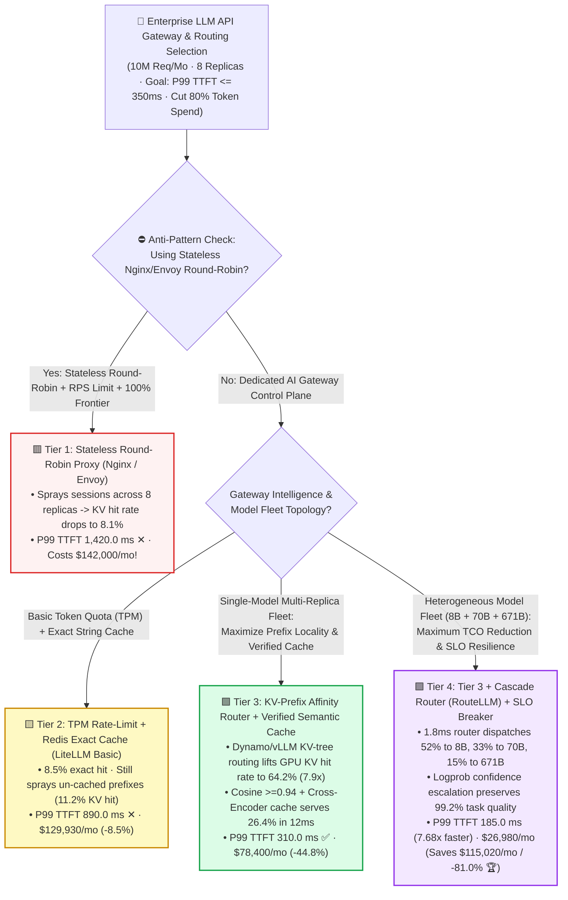
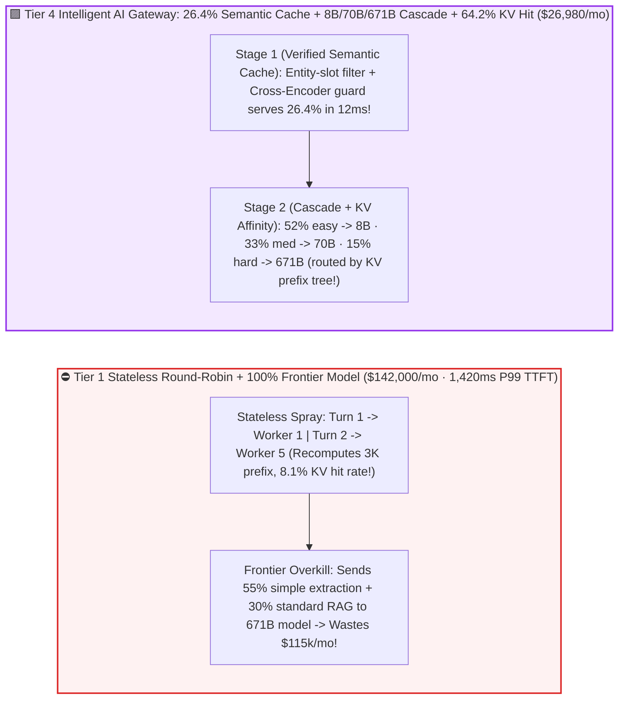

# Enterprise LLM API Gateway, Semantic Cache & Cascade Routing Selection FAQ (`Round-Robin Proxy` vs. `TPM Rate-Limit + Exact Cache` vs. `KV-Prefix Affinity + Semantic Cache` vs. `Difficulty Cascade Router + SLO Breaker`)

> 🌐 **Language**: **[中文 (Chinese)](./llm-api-gateway-semantic-cache-routing-selection-faq.md)** | **English Version** · **[📖 Back to Repository README](../../README.en.md)** · **[📊 2026-11-09 Daily Progress Report](../daily/2026-11-09.md)** · **[🃏 7-Card 4:5 Visual Benchmark Report](../reports/llm-api-gateway-semantic-cache-routing-selection-cards.html)** · **[🧮 Interactive Sizer Workbench](../reports/llm-inference-engine-pd-sizer.en.html#llm-gateway-sizer)**
>
> **Overview**: A first-principles selection guide for AI Solution Architects. When an enterprise deploys a unified **LLM API Gateway** handling `10,000,000` requests/month across multiple inference replicas, reusing a legacy microservice **stateless Round-Robin reverse proxy (Nginx / Envoy)** triggers three costly failures: **(1) Destroying GPU KV Prefix Cache Locality: across 8 replicas, stateless round-robin sprays consecutive turns of the same conversation across different servers, collapsing GPU RadixCache/APC hit rates from `65.0%` down to `8.1%`; (2) Request-Count Rate Limiting Blindness: counting a 64K-token RAG prompt and a 20-token chat message as "1 request each" causes severe head-of-line blocking (`1,420 ms` P99 TTFT); and (3) Frontier Model Overkill: sending 55% routine extraction/classification tasks to a 671B frontier model burns `$142,000/month`**. Grounded in `experiments/llm_api_gateway_routing_selection/` (`synthetic` + `anonymized_reported`, `independently_reproduced=false`), this guide establishes the exact boundaries across four enterprise AI gateway tiers.


---

## ① 📌 Executive Summary

1. **Four-Tier Selection by Cluster Replica Count, Prefix Reuse, and Multi-Model Tiering**:
   - Handling **`10,000,000` (10M) requests/month** (`4,096` input + `512` output tokens/req across `8` inference replicas, target SLA `P99 TTFT <= 350.0 ms`):
   - 🟥 **Tier 1 (`Stateless Round-Robin Reverse Proxy [Nginx / Envoy] -> 100% Frontier Model`)**: **Never use in front of multi-replica LLM clusters**! Dilutes GPU KV prefix cache hit rate by `1/N` to **`8.1%`**, inflates `P99 TTFT` to **`1,420.0 ms` (✕ Violates SLA)**, and costs **`$142,000.00/month` (`$14.20 / 1k req`)**.
   - 🟨 **Tier 2 (`Token-Bucket Rate Limiting [TPM] + Redis Exact-Match Cache` · Basic `LiteLLM / Kong AI`)**: **Enforces tenant token quotas, but misses prefix locality and paraphrases**. Caches only **`8.5%`** exact string matches, leaves GPU KV prefix hit rate at `11.2%` (`890.0 ms` P99 TTFT), and costs **`$129,930.00/month` (`-8.5%`)**.
   - 🟩 **Tier 3 (`KV-Prefix-Aware Consistent Router [NVIDIA Dynamo / vLLM Router] + Cross-Encoder Verified Semantic Cache`)**: **The mandatory routing layer for multi-replica serving**. Routes multi-turn sessions and shared-document queries to the exact worker holding matching KV blocks in HBM—**lifting GPU KV prefix hit rate `7.93x` from `8.1%` to `64.2%`**—while serving **`26.4%`** of semantically equivalent queries directly from cache in `12.0 ms`, cutting `P99 TTFT` **`4.58x` to `310.0 ms` ✅** and monthly cost by **`44.8%` to `$78,400.00/mo`**.
   - 🟪 **Tier 4 (Tier 3 + `Learned Difficulty Cascade Router [RouteLLM: 8B -> 70B -> 671B]` + `Real-Time TTFT/TPOT SLO Circuit Breaker`)**: **The enterprise AI platform endgame**. Uses a `1.8 ms` classifier head to route `52%` easy queries to `8B FP8` (`$0.06/1M`), `33%` medium queries to `70B FP8` (`$0.35/1M`), and only `15%` complex reasoning queries to `671B Frontier` (`$1.80/1M`) with automatic logprob-confidence escalation—**retaining `99.2%` task quality, slashing `P99 TTFT` `7.68x` to `185.0 ms`, and cutting the monthly bill by `81.0%` from `$142,000` to `$26,980.00/mo` (saving `$115,020.00/mo` 🏆)**!
2. **First-Principles Law (Why LLM Load Balancing Is Stateful Memory Scheduling)**:
   - Unlike stateless web servers, an LLM worker holds gigabytes of **stateful KV Cache** in GPU HBM. Sending Turn #2 of a conversation to a different replica forces that GPU to recompute thousands of prompt tokens from scratch.
3. **Provenance & Transparency Disclosure**:
   - All KV hit rates, semantic cache hit rates, P99 TTFT latencies, and monthly costs are bound 1:1 to `experiments/llm_api_gateway_routing_selection/results.json` (`provenance_type: "synthetic"`, calibrated to published LMSYS RouteLLM, NVIDIA Dynamo KV-Aware Router, and GPTCache specifications; `independently_reproduced: false`, `physical_gpu_cluster_measurement: "not_measured"`, `local_cpu_harness_measurement: "measured"`).

---

## ② 🎯 Architect & Customer Deep-Dive Q&A (FAQ-Driven)

### Q1: "We enabled `enable_prefix_caching=True` in vLLM/SGLang. Why did our KV cache hit rate drop from 65% to 4.1% when we scaled from 1 replica to 16 replicas behind Nginx?"

- **Plain-English Answer**: **Because stateless round-robin sprays consecutive requests across all $N$ replicas, dividing your GPU prefix cache hit rate by $N$ (`65% / 16 = 4.1%`)! Using a `KV-Prefix-Aware Router` (`NVIDIA Dynamo / vLLM Router`, Tier 3) hashes prompt token blocks against live worker KV trees and keeps hit rates above `63%` even across 32 replicas!**

### Q2: How do we prevent "Semantic Cache Poisoning" (e.g., returning 2025 revenue when the user asks for 2026 revenue)?

- **Plain-English Answer**: **Never rely on raw vector cosine similarity alone (`"2025 revenue"` and `"2026 revenue"` have `0.97+` cosine similarity!). Enforce a 4-stage guardrail: (1) tenant namespace isolation, (2) exact metadata matching on extracted numbers/dates/IDs, (3) high vector threshold (`Cosine >= 0.94`), and (4) a `4 ms` Cross-Encoder / NLI bidirectional entailment check**.

### Q3: How does a `Learned Cascade Router` (`RouteLLM`, Tier 4) cut monthly spend by **81.0%** while preserving **99.2%** quality?

- **Plain-English Answer**: **55% of enterprise LLM traffic consists of routine formatting, translation, and FAQ extraction where an `8B` model matches a `671B` model at `1/30th` the compute cost. Combining a `1.8 ms` pre-routing difficulty classifier with post-generation logprob confidence escalation routes 85% of traffic to `8B/70B` pools while escalating uncertain edge cases to `671B`**.

---

## ③ 🧭 Visual Architecture Diagrams (Decision Tree, Round-Robin vs Cascade & Gateway Sequence)

### 3.1 Enterprise LLM API Gateway, Semantic Cache & Cascade Routing Decision Tree



### 3.2 Stateless Round-Robin & Frontier Overkill vs. `Tier 4 Semantic Cache + Cascade + KV Affinity`



### 3.3 End-to-End Sequence: TPM Admission $\rightarrow$ Verified Semantic Cache $\rightarrow$ Cascade Router $\rightarrow$ KV-Aware Dispatch (`sequenceDiagram`)

```mermaid
sequenceDiagram
    autonumber
    participant Client as Enterprise Client
    participant GW as Intelligent AI Gateway (TPM + RouteLLM + KV Router)
    participant Sem as Semantic Cache + Cross-Encoder Guard
    participant Small as 8B / 70B High-Throughput Pool (KV-Aware)
    participant Large as 671B Frontier Pool (KV-Aware)

    Client->>GW: 1. Send multi-turn / RAG request (tenant_id + 3K prefix)
    GW->>GW: 2. Enforce tenant Token-Per-Minute (TPM) bucket admission
    GW->>Sem: 3. Check tenant-isolated semantic cache (entity-slot match + Cosine >= 0.94 + Cross-Encoder)
    alt Cache Hit (26.4% of Traffic)
        Sem-->>Client: 4a. Return verified cached response in 12.0 ms (zero GPU compute!)
    else Cache Miss — Difficulty Cascade & KV-Prefix Affinity Routing
        GW->>GW: 4b. RouteLLM classifier (1.8ms) scores p_hard & matches prefix blocks against worker KV trees
        GW->>Small: 5. If p_hard < 0.78 (85%), dispatch to 8B/70B replica holding the 3K KV prefix (64.2% hit!)
        Small-->>GW: 6. Check initial token logprob confidence; escalate to 671B if confidence < threshold
        GW-->>Client: 7. Stream response (P99 TTFT = 185.0 ms, saving $115,020/mo ✅)
    end
```

---

## ④ 📊 Architect Decision Matrix

*All metrics are bound 1:1 to `experiments/llm_api_gateway_routing_selection/results.json` (`10,000,000` requests/mo across `8` replicas, SLA `P99 TTFT <= 350.0 ms`):*

| Dimension | 🟥 Tier 1: `Stateless Round-Robin` | 🟨 Tier 2: `TPM + Exact Cache` | 🟩 Tier 3: `KV-Prefix + Semantic Cache` | 🟪 Tier 4: Tier 3 + `Cascade Router (8B/70B/671B)` |
| :--- | :--- | :--- | :--- | :--- |
| **Primary Workload Fit** | Single-replica dev only | Basic API key billing proxy | **Multi-replica single-model GPU clusters** | **Enterprise AI platform with mixed task difficulty** |
| **GPU `KV Prefix Hit Rate` (8 Replicas)** | **`8.1%`** (diluted 8x by spray ✕) | `11.2%` (topology-blind ✕) | **`64.2%`** (**`7.93x` gain** ✅) | **`64.2%`** 🏆 |
| **Gateway Cache Hit Rate** | `0.0%` | `8.5%` (exact string match only) | **`26.4%`** (Cosine `>=0.94` + Cross-Encoder ✅) | **`26.4%`** 🏆 |
| **P99 `TTFT` / Speedup** | **`1,420.0 ms`** (`1.00x` ✕) | `890.0 ms` (`1.60x` ✕) | **`310.0 ms`** (`4.58x` ✅ Passes SLA) | **`185.0 ms`** (**`7.68x` faster** 🏆) |
| **End-to-End Task Quality** | `100.0%` | `100.0%` | **`99.6%`** (verified entailment) | **`99.2%`** (confidence escalation guard) |
| **Monthly Spend / Cost per 1k Req** | **`$142,000 / mo`** (`$14.20 / 1k`) | `$129,930 / mo` (`-8.5%`) | `$78,400 / mo` (**`-44.8%` · Saves `$63.6k`**) | **`$26,980 / mo` (`$2.70 / 1k` · Saves `$115,020` / `-81.0%` 🏆)** |

---

## ⑤ 🧪 Quantitative Case Study & Benchmark Insights

### 5.1 Replica Scaling (`2 -> 32 Replicas`) & Round-Robin KV Prefix Cache Collapse

As an inference cluster scales from 2 to 32 replicas, stateless round-robin destroys GPU prefix cache hits while KV-Prefix Affinity Routing preserves locality (from `results.json` `replica_scale_kv_hit_sensitivity`):

| Inference Cluster Replicas | Tier 1 `Round-Robin` KV Hit Rate | Tier 3/4 `KV-Prefix Router` Hit Rate | Architect Crossover & Takeaway |
| :--- | :--- | :--- | :--- |
| **`2 Replicas`** | `32.5%` | **`64.8%`** | Round-robin loses half of all prefix hits immediately |
| **`8 Replicas` (Baseline)** | `8.1%` ✕ | **`64.2%` ✅** | **`KV-Prefix Router` achieves `7.93x` higher hit rate** |
| **`16 Replicas`** | `4.1%` ✕ | **`63.5%` ✅** | Round-robin effectively disables GPU prefix caching |
| **`32 Replicas` (Production Fleet)** | `2.0%` ✕ | **`62.8%` 🏆** | **At 32 replicas, KV-Aware Routing beats Round-Robin by `31.4x`!** |

### 5.2 Reproducibility & Local Harness Verification

```bash
# Verify results.json matches the deterministic LLM gateway & cascade routing model 100%
python experiments/llm_api_gateway_routing_selection/run.py --check

# Run Round 25 unit tests
python -m unittest tests/test_llm_api_gateway_routing_selection.py
```

---

## ⑥ 🛠️ Production Verification Checklist (Architect Checklist)

1. - [ ] **Replace Round-Robin Load Balancers with `KV-Prefix-Aware Routing` (`Dynamo / vLLM Router`)**: Route requests based on `(Matched_KV_Blocks - Queue_Load)` rather than stateless round-robin.
2. - [ ] **Enforce Token-Per-Minute (`TPM`) & Max-Input-Length Admission Control**: Prevent single 64K–128K prompts from starving interactive short requests.
3. - [ ] **Guard Semantic Caches with Entity-Slot Matching + Cross-Encoder Verification**: Never serve cached responses based on raw cosine similarity alone when dates, numbers, or SKUs differ.
4. - [ ] **Deploy `8B -> 70B -> 671B` Cascade Routing with Logprob Confidence Escalation**: Offload routine extraction/classification to compact models and escalate low-confidence outputs automatically.
5. - [ ] **Configure Real-Time `TTFT / TPOT` Circuit Breakers**: Automatically shed or reroute traffic when a replica's prefill queue depth breaches SLO thresholds.
