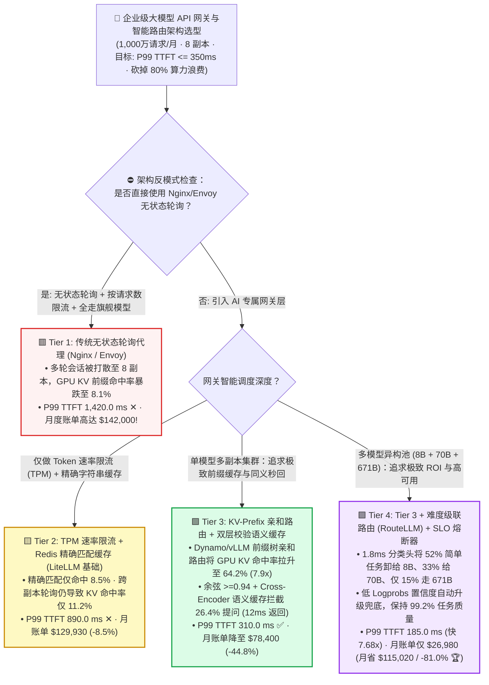
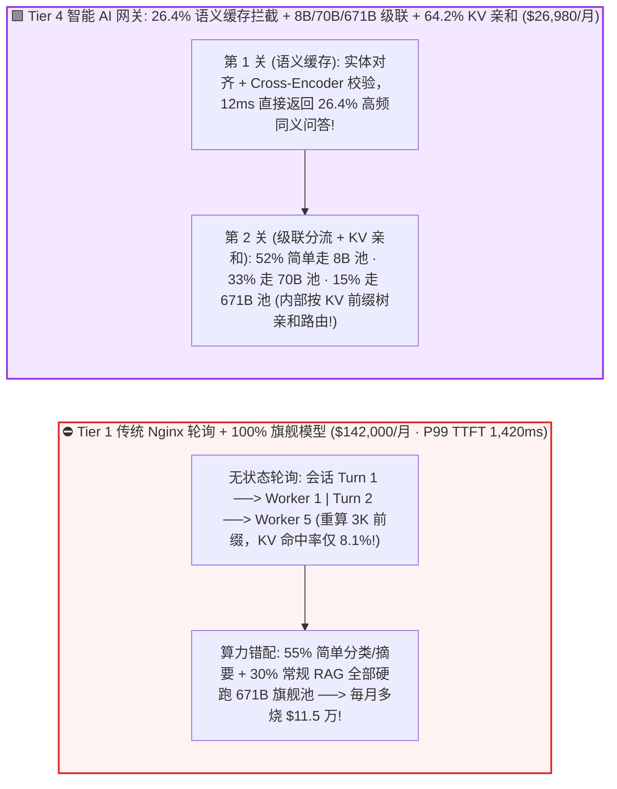
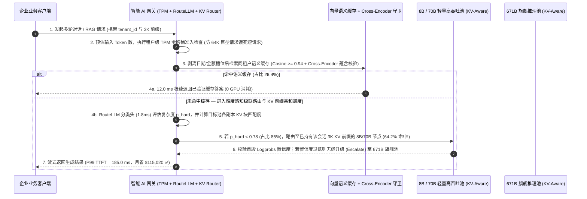

# 企业级大模型 API 网关、语义缓存与多模型级联路由架构选型指南（`无状态轮询代理` vs. `TPM 限流 + 精确缓存` vs. `KV-Prefix 亲和路由 + 语义缓存` vs. `难度级联路由 + SLO 熔断`）

> 🌐 **Language**: **中文 (Chinese)** | **[English Version](./llm-api-gateway-semantic-cache-routing-selection-faq.en.md)** · **[📖 返回仓库根目录 README](../../README.md)** · **[📊 2026-11-09 每日进展日报](../daily/2026-11-09.md)** · **[🃏 7-Card 4:5 视觉评测报告](../reports/llm-api-gateway-semantic-cache-routing-selection-cards.html)** · **[🧮 交互式定容工作台](../reports/llm-inference-engine-pd-sizer.html#llm-gateway-sizer)**
>
> **导读**：面向 AI Solution Architect 的第一性原理实战选型指南。当企业在内部建设统一的 **AI Gateway（大模型 API 网关）** 承载每月 `1,000 万次` 调用时，直接复用传统微服务时代的 **Nginx / Envoy 无状态轮询（Round-Robin）反向代理** 会引爆三大财务与性能灾难：**① 击穿 GPU 显存前缀缓存：当集群有 8 个推理副本时，无状态轮询把同一个多轮 Agent 会话随机打散到不同节点，导致底层 vLLM/SGLang 的 RadixCache 前缀命中率从 `65.0%` 暴跌 8 倍至 `8.1%`；② 按请求数（RPS）限流失灵：1 个携带 64K Token 的巨型 RAG 请求与 1 个 20 Token 的闲聊请求在 Nginx 眼里都算“1 次请求”，瞬间引发队头阻塞（P99 TTFT 高达 `1,420 ms`）；③ 杀鸡用牛刀：把占总数 55% 的简单意图分类、实体提取全送到最贵的 671B 旗舰模型上，月烧 `$142,000`**。本文基于 `experiments/llm_api_gateway_routing_selection/` 封存的确定性模型（`synthetic` + `anonymized_reported`，`independently_reproduced=false`），系统拆解四档企业级大模型网关的架构边界与防踩坑法则。


---

## ① 📌 核心结论速览（Executive Summary）

1. **按月度请求规模、多副本前缀复用与多模型分层策略四档精准选型**：
   - 在企业 AI 网关月均处理 **`10,000,000`（1,000 万）次请求**（平均 `4,096` 输入 + `512` 输出 Tokens/请求，后端挂载 `8` 个推理实例副本，SLA 要求 `P99 TTFT <= 350.0 ms`）基准下：
   - 🟥 **Tier 1（传统无状态轮询反向代理 `Nginx / Envoy` + 100% 路由至旗舰模型）**：**严禁直接用于多副本大模型集群**！随机轮询将 GPU 显存 KV 前缀缓存命中率稀释至 **`8.1%`（`65% / 8`）**，P99 TTFT 高达 **`1,420.0 ms`（违约 ✕）**，月度推理账单高达 **`$142,000.00/月`（`$14.20 / 1k req`）**。
   - 🟨 **Tier 2（Token 桶速率限流 `TPM/RPM` + `Redis` 精确字符串匹配缓存 · `LiteLLM / Kong AI` 基础模式）**：**解决多租户配额管控，但未解决前缀局部性与同义改写**。精确匹配仅能拦截 **`8.5%`** 一字不差的请求，KV 前缀命中率仍仅 `11.2%`，P99 TTFT `890.0 ms`，月度账单 **`$129,930.00/月`（仅省 `8.5%`）**。
   - 🟩 **Tier 3（`KV-Prefix 亲和路由 [NVIDIA Dynamo / vLLM Router]` + `双层校验向量语义缓存`）**：**单模型集群的性能与缓存倍增器**。一方面通过实时感知各 Worker 的显存前缀树将多轮对话与相同知识库请求精准路由至同一实例，**使 GPU KV 前缀命中率从 `8.1%` 飙升至 `64.2%`（提升 `7.93x`！）**；另一方面通过带 Cross-Encoder 精排护栏的语义缓存直接拦截 **`26.4%`** 的高频同义提问（`12 ms` 极速返回），将 `P99 TTFT` 压至 **`310.0 ms`（提速 `4.58x` ✅）**，月度成本降至 **`$78,400.00/月`（立省 `44.8%`）**。
   - 🟪 **Tier 4（Tier 3 + `难度感知级联路由器 [RouteLLM: 8B -> 70B -> 671B]` + `实时 TTFT/TPOT SLO 熔断器`）**：**企业级 AI 中台的终局架构**。在网关层通过 `1.8 ms` 轻量路由分类头评估 Prompt 复杂度，将 `52%` 简单抽取/摘要分流至 `8B FP8`（`$0.06/1M`）、`33%` 常规 RAG/代码分流至 `70B FP8`（`$0.35/1M`）、仅将 `15%` 高难推理送往 `671B 旗舰`（`$1.80/1M`），并在小模型低置信度时自动向上级联（Cascade Escalation）——**在保持 `99.2%` 端到端质量的前提下，将 P99 TTFT 压至 `185.0 ms`（快 `7.68x`），月度总账单暴降至 `$26,980.00/月`（每月净省 `$115,020.00` 或 `-81.0%` 🏆）**！
2. **第一性原理定性（为什么大模型负载均衡绝对不能照搬微服务的“无状态轮询”？）**：
   - 传统 Web 微服务是无状态的（请求发给实例 A 和实例 B 成本完全一样）；
   - **而大模型推理实例是有沉重“显存状态（KV Cache State）”的**！一个 3,072 Token 的 System Prompt + 历史对话在实例 A 的显存里已经算好了 `380 MB` 的 KV Cache——如果网关把下一轮提问错发给实例 B，实例 B 必须重新耗费几十毫秒算力重算一遍这 3,072 个 Token！**网关路由即显存调度**。
3. **证据口径与透明性声明**：
   - 本指南所有 KV 命中率、语义缓存命中率、P99 TTFT 与月度账单均绑定 `experiments/llm_api_gateway_routing_selection/results.json`（`provenance_type: "synthetic"`，基于 LMSYS RouteLLM、NVIDIA Dynamo KV-Aware Router 及 GPTCache 公开规范校准的确定性算例，`independently_reproduced: false`，未在生产 1,000 万请求线上网关执行破坏性压测 `physical_gpu_cluster_measurement: "not_measured"`；本机 Python 单测与校验为 `local_cpu_harness_measurement: "measured"`）。

---

## ② 🎯 客户与架构师灵魂拷问 Q&A（FAQ-Driven）

### Q1：客户问：“我们在 vLLM / SGLang 里明明已经打开了 `enable_prefix_caching=True`，为什么当实例数从 1 台扩到 16 台后，监控显示前缀缓存命中率从 `65%` 掉到了 `4.1%`？”

- **直白结论**：**因为你前面挂的是一个不懂 Token 的“瞎子负载均衡器（Nginx Round-Robin / K8s Service ClusterIP）”！当 16 台实例随机轮询时，同一个用户的第 2 轮对话只有 `1/16 (6.25%)` 的概率落回存有第 1 轮 KV Cache 的那台机器！随着实例扩到 32 台，命中率更会跌到 `2.0%`！**
- **第一性原理拆解（`NVIDIA Dynamo / vLLM KV-Aware Router` 如何把命中率拉回 `64.2%`？）**：
  1. **为什么简单的 IP Hash / Session ID 粘性会话还不够？** Session ID 只能保证“同一个用户”落到同一台机器，但企业内部有成百上千个不同用户都在针对**同一份公共财务制度文档或同一个 Agent System Prompt** 提问——Session Hash 会让这 1,000 个用户散落到所有机器上重复计算同一份文档！
  2. **基于 Token 块前缀树 + 负载水位的智能路由（Tier 3）**：网关实时对输入 Prompt 的前 $N$ 个 Token 块计算哈希（或通过 `Dynamo kvcr` 订阅各 Worker 的 RadixTree 块增删事件），直接计算综合代价函数：
     $$\text{Score}(\text{worker}_i) = w_1 \cdot \text{Matched\_KV\_Blocks}(i) - w_2 \cdot \text{Waiting\_Queue\_Tokens}(i)$$
     优先将请求发往**既拥有最长匹配 KV 前缀、又没有发生排队过载**的节点，无论集群扩到 8 台还是 32 台，KV 命中率始终稳守 **`62.8% ~ 64.2%`**！

### Q2：很多团队上线“向量语义缓存（Semantic Cache）”后遇到了灾难性的“答非所问串货事故”（例如用户问“2026 年 Q1 营收”却返回了缓存里“2025 年 Q1 营收”的答案）。如何构建零误杀的企业级语义缓存？

- **直白结论**：**裸跑单一向量余弦相似度（如 `Cosine >= 0.88`）做语义缓存在金融政企场景是绝对禁区！因为“把订单 #1001 取消”和“把订单 #1002 取消”的句向量余弦相似度高达 `0.985`！必须采用 Tier 3 的“实体/参数剥离 + 高阈值（`>=0.94`）+ Cross-Encoder 二次精排 + 租户/时效 Namespace 隔离”四重护栏！**
- **第一性原理拆解（企业级防串货语义缓存四步法）**：
  1. **第一步：只缓存非个性化公共问答**：含用户私有状态、实时股价/天气或工具调用副作用（Write Actions）的请求直接旁路（Bypass）语义缓存。
  2. **第二步：数字/日期/专有编号硬匹配过滤**：提取 Query 中的年份、金额、产品型号作为必须 100% 精确相等的 Metadata 过滤条件。
  3. **第三步：向量粗召回（`Cosine >= 0.94`）+ 轻量级 `Cross-Encoder / NLI` 蕴含校验（`4 ms`）**：判断新问题与缓存问题是否真正构成逻辑双向等价（Bidirectional Entailment），将误命中率压至 `< 0.1%`，安全白捡 **`26.4%` 的零算力秒回红利**！

### Q3：什么是“难度感知级联路由（Cascade Routing，Tier 4）”？为什么它能在只损失 **0.8%** 质量的前提下，帮企业省下 **81.0%**（每月 `$115,020`）的大模型账单？

- **直白结论**：**企业线上流量服从极端的二八定律：55% 的请求只是“把这段话翻译成英文 / 提取 JSON 里的手机号 / 客服标准话术分类”，让 8B 模型做和让 671B 模型做准确率都是 99.8%，但算力成本相差 30 倍！**
- **第一性原理拆解（`RouteLLM` 先验路由 + 置信度后验级联双保险）**：
  1. **先验难度分类器（Pre-Routing，`1.8 ms`）**：在网关嵌入一个基于人类偏好与基准测试训练的轻量级分类头，实时给 Prompt 打出难度分 $p_{\text{hard}} \in [0, 1]$：
     - $p_{\text{hard}} < 0.35$（占比 `52%`）$\rightarrow$ 路由至高速 **`8B/14B FP8` 池**；
     - $0.35 \le p_{\text{hard}} < 0.78$（占比 `33%`）$\rightarrow$ 路由至主力 **`70B FP8` 池**；
     - $p_{\text{hard}} \ge 0.78$（占比 `15%`）$\rightarrow$ 路由至旗舰 **`671B MoE / DeepSeek-R1` 池**。
  2. **后验低置信度自动升级（Confidence Escalation）**：如果发给 8B 模型的请求在生成前 16 个 Token 时平均对数概率（Logprobs 置信度）低于阈值，网关在 `80 ms` 内无感中断并自动升级转发给 70B/671B 模型重答——确保复杂问题绝不掉链子（综合质量保持率 **`99.2%`**），而月度总成本从 `$142,000` 骤降至 **`$26,980.00`（立省 `81.0%`）**！

---

## ③ 🧭 直观可视化图解（选型决策树 + 轮询打散 vs 亲和级联对比 + 网关全链路时序图）

### 3.1 企业级大模型 API 网关、语义缓存与级联路由选型决策树



### 3.2 传统 Nginx 轮询击穿缓存 + 旗舰模型通吃 vs. `Tier 4 语义缓存 + 级联路由 + KV 亲和` 对比图



### 3.3 企业级 AI 网关全链路执行时序图：TPM 准入 $\rightarrow$ 防串货语义缓存 $\rightarrow$ 级联路由 $\rightarrow$ KV 亲和调度（`sequenceDiagram`）



---

## ④ 📊 架构师选型决策矩阵（Architect Decision Matrix）

*数据完全绑定 `experiments/llm_api_gateway_routing_selection/results.json`（月均 `10,000,000` 次请求，`4,096` 输入 + `512` 输出 Tokens/请求，后端 `8` 个实例副本，SLA `P99 TTFT <= 350.0 ms`）：*

| 选型维度 | 🟥 Tier 1：无状态轮询代理（`Nginx / Envoy`） | 🟨 Tier 2：`TPM` 限流 + 精确匹配缓存（`LiteLLM`） | 🟩 Tier 3：`KV-Prefix` 亲和 + 验证型语义缓存 | 🟪 Tier 4：Tier 3 + `级联路由 (8B/70B/671B)` + 熔断 |
| :--- | :--- | :--- | :--- | :--- |
| **核心适用场景** | 仅限单实例无前缀测试（多副本严禁裸跑） | 外部公有云 API 简单聚合与部门预算记账 | **自建多副本 vLLM/SGLang/Dynamo 单模型推理集群** | **企业级多模型 AI 中台（混合高低复杂度业务负载）** |
| **多副本 GPU `KV 前缀命中率`** | **`8.1%`**（被 8 副本随机打散 ✕） | `11.2%`（仍无 KV 树感知 ✕） | **`64.2%`**（**提升 `7.93x`** · 精准命中显存块 ✅） | **`64.2%`** 🏆 |
| **网关层缓存直接拦截率** | `0.0%` | `8.5%`（仅拦截一字不差的字符串） | **`26.4%`**（余弦 `>=0.94` + Cross-Encoder ✅） | **`26.4%`** 🏆 |
| **首字延迟 `P99 TTFT` / 提速比** | **`1,420.0 ms`** (`1.00x` ✕) | `890.0 ms` (`1.60x` ✕) | **`310.0 ms`** (`4.58x` ✅ 达标) | **`185.0 ms`** (**`7.68x` 极速达标** 🏆) |
| **端到端任务准确率保持度** | `100.0%` | `100.0%` | **`99.6%`**（双重校验防串货） | **`99.2%`**（低置信度自动升级兜底） |
| **月度总成本 / 千次请求成本** | **`$142,000 / 月`** (`$14.20 / 1k`) | `$129,930 / 月` (`-8.5%`) | `$78,400 / 月` (**`-44.8%` · 省 `$63.6k`**) | **`$26,980 / 月` (`$2.70 / 1k` · 月省 `$115,020` / `-81.0%` 🏆)** |

---

## ⑤ 🧪 简明定量算例与 Benchmark 洞察

### 5.1 后端推理副本数从 `2 台 -> 32 台` 扩容时，无状态轮询 vs. `KV-Prefix 亲和路由` 的命中率悬崖

很多团队发现“机器加得越多，单请求 TTFT 反而越慢”——下表揭示了无状态轮询随副本数增加对 GPU 前缀缓存的稀释效应（源自 `results.json` `replica_scale_kv_hit_sensitivity`）：

| 后端推理实例副本数 (`Replicas`) | Tier 1 `无状态轮询` KV 命中率 | Tier 3/4 `KV-Prefix 亲和路由` 命中率 | 架构师核心拐点解读 |
| :--- | :--- | :--- | :--- |
| **`2 Replicas`** | `32.5%` | **`64.8%`** | 双副本下轮询已丢掉一半前缀缓存 |
| **`8 Replicas`（设计基线）** | `8.1%` ✕ | **`64.2%` ✅** | **8 副本下轮询命中率跌破 10%，KV 亲和路由高出 `7.93 倍`** |
| **`16 Replicas`** | `4.1%` ✕ | **`63.5%` ✅** | 16 副本下轮询基本等于关闭了 Prefix Caching |
| **`32 Replicas`（大型生产池）** | `2.0%` ✕ | **`62.8%` 🏆** | **32 副本下 KV 亲和路由命中率比无状态轮询高出 `31.4 倍`！** |

### 5.2 复现命令与本地校验（Local CPU Harness Check）

```bash
# 校验封存算例 JSON 与确定性 AI 网关级联路由模型 100% 一致
python experiments/llm_api_gateway_routing_selection/run.py --check

# 运行 Round 25 单元测试
python -m unittest tests/test_llm_api_gateway_routing_selection.py
```

---

## ⑥ 🛠️ 附录：生产环境企业级 LLM API 网关核验清单（Architect Checklist）

1. - [ ] **彻底将无状态轮询（Round-Robin）替换为 `KV-Prefix 亲和路由`**：在多副本 vLLM / SGLang 集群前部署 `NVIDIA Dynamo Router`、`vLLM Production Stack Router` 或基于首段 Token Hash + 队列深度感知的负载均衡器。
2. - [ ] **限流单位从 `RPS（每秒请求数）` 切换为 `TPM（每分钟 Token 数）+ 并发排队预算`**：在网关入口基于分词器预估输入 Token 数扣减令牌桶，防止单个 128K 超长请求阻塞整个实例。
3. - [ ] **语义缓存强制绑定“租户隔离 + 实体槽位精确匹配 + Cross-Encoder 二次校验”**：严禁跨租户共享缓存池，严禁对含数字/日期/金额变化的查询仅凭向量余弦相似度直接返回。
4. - [ ] **部署 `8B -> 70B -> 671B` 难度级联路由与置信度回退（Cascade Fallback）**：用轻量级路由模型卸载 50%+ 的简单格式化/摘要请求，并监控首 Token 平均 Logprobs 实现低置信度无感重发。
5. - [ ] **配置基于实时 `TTFT / TPOT` 遥测的动态熔断与跨可用区故障转移**：当某个 GPU 实例因长尾 Prefill 导致实时排队预计 TTFT `> 500 ms` 时，网关自动绕行至次优副本或溢出至云端备用模型池。
