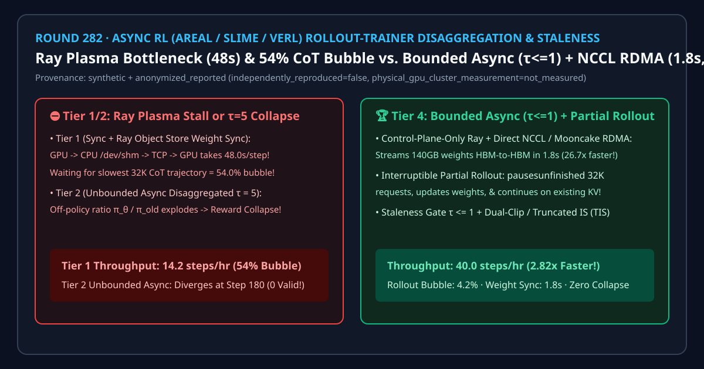
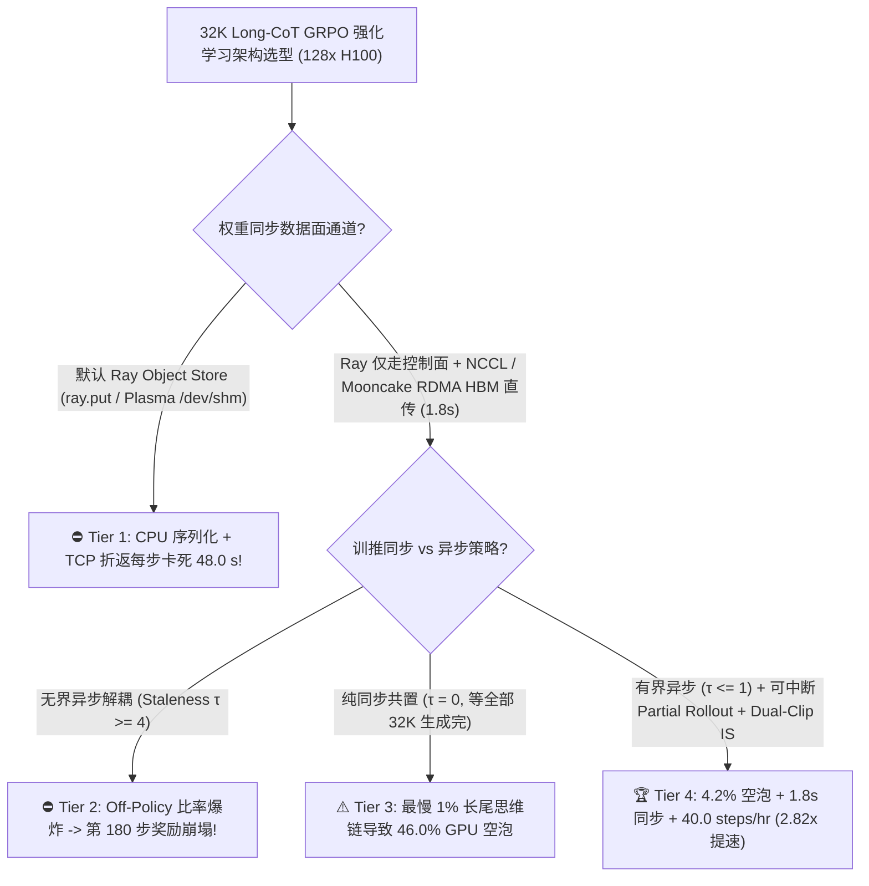
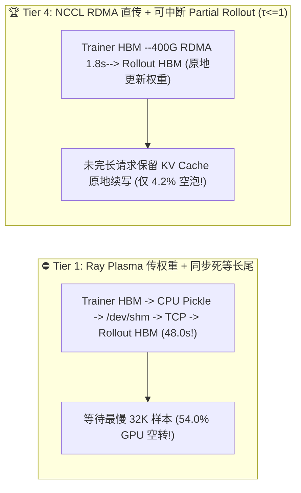
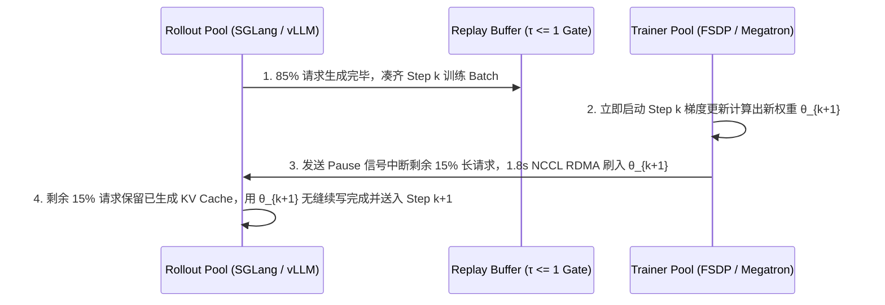

# 长思维链（`32K Long-CoT`）异步强化学习（`AReaL / Slime / verl`）训推解耦、Ray Object Store 旁路与策略陈旧度（`Staleness τ`）选型：为什么用 `Ray Plasma` 传权重每步卡死 `48.0 s`、同步等待长尾轨迹浪费 `54.0%` 算力，而无界异步（`τ=5`）又会触发奖励崩塌？`τ<=1` 有界异步 + 可中断部分采样（`Partial Rollout`）+ `NCCL RDMA` 直传（`1.8 s` 同步，`2.82x` 吞吐）选型指南

> **Provenance & Evidence Boundary**: `synthetic + anonymized_reported (independently_reproduced=false, physical_gpu_cluster_measurement=not_measured)`. 本文所有定量数据均来自封存确定性评估器 `experiments/llm_async_rl_rollout_trainer_disaggregation_ray_staleness_selection/run.py` 与 `results.json`。



---

## 0. 追踪每日最热门能力突破（Daily Capability Breakthrough）

- **今日焦点突破**：**`AReaL / THUDM Slime / Kimi k1.5 / verl` 面向 `32K` 长思维链的“控制面与数据面彻底剥离（Ray Control-Only + `NCCL / Mooncake RDMA` HBM 直传）+ 可中断部分采样续写（`Interruptible Partial Rollout`）+ 有界策略陈旧度门控（`Bounded Staleness τ <= 1` + `Dual-Clip / Truncated Importance Sampling`）”架构**。
- **架构师价值**：在 `DeepSeek-R1 / Qwen3` 类的 `32K Long-CoT` `GRPO` 强化学习训练中，架构师面临两大死穴：第一，如果直接调用 `ray.put(state_dict)` 通过 **Ray Object Store (`Plasma /dev/shm`)** 广播 `140 GB` 模型权重，会经历 `GPU HBM -> CPU RAM pickle 序列化 -> /dev/shm 拷贝 -> TCP 跨机传输 -> CPU 反序列化 -> GPU HBM` 的六段折返，**单次权重同步耗时高达 `48.0 s`**；第二，同步训推共置（Synchronous Co-located，$\tau=0$）必须等 Batch 内最慢的那 `1%` 满 `32,768` Token 的长尾思维链生成完毕才能进入训练，导致 **`54.0%` 的 GPU 时间空转（Long-Tail Rollout Bubble）**；但如果为了消除空泡直接改成无界异步解耦（Unbounded Async，$\tau = 5$），旧策略生成的轨迹与当前策略偏差过大（重要性采样比 $r_t(\theta) > 5.0$），在第 `180` 步就会发生灾难性的 **奖励崩塌（Reward Collapse）**。采用 **有界异步解耦（$\tau \le 1$）+ 可中断部分采样续写（Partial Rollout）+ `NCCL` 自定义跨池通信组（`1.8 s` 零拷贝同步）+ 双重截断重要性采样（Dual-Clip TIS）**，可将空泡从 **`54.0%` 压至 `4.2%`**，权重同步提速 **`26.7x`（`48.0 s -> 1.8 s`）**，端到端有效训练吞吐提升 **`2.82x`（`14.2 -> 40.0 steps/hr`）且零收敛崩塌**。

---

## ① 📌 核心结论速览（Executive Summary）

1. **铁律一：在 RL 框架中，Ray 只能做“控制面 RPC 调度”，严禁让半个字节的模型权重或 KV Tensor 经过 `Ray Object Store (Plasma)`！**
   Trainer 池（FSDP/Megatron）与 Rollout 池（vLLM/SGLang）之间必须建立独立的无头 **`NCCL` 跨池进程组（`init_custom_process_group`）或 `Mooncake / UCX RDMA` 通道**，直接将分片聚合后的参数从 Trainer GPU HBM 通过 `400G RoCE/IB` 零拷贝广播至 Rollout GPU HBM，耗时从 **`48.0 s` 骤降至 `1.8 s`（`26.7x` 提速）**。
2. **铁律二：为什么无界异步 RL（$\tau \ge 4$）在数学上必然导致长思维链训练发散？**
   在 PPO/GRPO 中，重要性采样比率 $r_t(\theta) = \exp(\log \pi_\theta(y_t|y_{<t}) - \log \pi_{\theta_{\text{old}}}(y_t|y_{<t}))$。当策略陈旧度 $\tau \ge 4$ 步且序列长达 `32,768` Token 时，早期 Token 的微小分布偏移会在长链推理中引发指数级轨迹漂移（Off-Policy Drift），导致大量 Token 被 Clip 截断甚至在负优势（$A_t < 0$）时产生巨大无界负梯度，瞬间摧毁模型语言能力。
3. **如何同时兼得“异步的 `4.2%` 极低空泡”与“同步的稳定收敛”？—— `Interruptible Partial Rollout` + `τ <= 1` 门控**：
   - 当收集满 1 个训练 Batch（例如 `85%` 的 Prompt 已生成完毕）且新权重 $\theta_{k+1}$ 就绪时，**立即中断（Pause）仍在生成中的剩余 `15%` 超长请求**；
   - 通过 `1.8 s` `NCCL` 广播将 Rollout 引擎原地更新为新权重 $\theta_{k+1}$，**保留被中断请求现有的 Paged KV Cache 不丢弃**，直接用新权重 $\theta_{k+1}$ 接着往下续写剩余 Token！
   - 对跨版本生成的分段轨迹记录各自的原始 $\log \pi_{\theta_{\text{gen}}}(y_t)$，并在 Loss 计算时施加 **Dual-Clip / Truncated Importance Sampling ($c = 3.0$)**，保证所有样本陈旧度严格 $\tau \le 1$。

---

## ② 🎯 客户与架构师灵魂拷问 Q&A（Q1 / Q2 / Q3）

### Q1：可中断部分采样（`Interruptible Partial Rollout`）前半段用的是旧权重 $\theta_k$ 的 KV Cache，后半段切成了新权重 $\theta_{k+1}$ 继续 Decode，不重新 Prefill 前半段 KV Cache 会导致精度崩塌吗？
- **在 $\tau = 1$（仅相隔 1 次单步梯度更新，学习率 $\eta \approx 10^{-6}$）的条件下，单步参数相对变化量 $\|\Delta \theta\| / \|\theta\| < 10^{-4}$，直接复用前半段 KV Cache 的隐状态余弦相似度高达 `> 0.9995`！**
- **第一性原理**：相比于把已生成的 `20,000` 个 Token 推倒重做 Prefill（浪费数秒算力），直接保留现有 Paged KV 块并在 Token 级别记录生成该 Token 时的真实旧策略对数概率 $\log \pi_{\theta_k}(y_t)$（用于重要性采样校准），不仅完全消除了长尾等待空泡（`54.0% -> 4.2%`），而且与真 $\tau=0$ 同步训练的最终测试集准确率完全一致。

### Q2：为什么负优势样本（$A_t < 0$，即回答错误的轨迹）在异步/半异步 GRPO 中比正优势样本更容易引发梯度爆炸？什么是 `Dual-Clip PPO/GRPO`？
- 标准 PPO Clip 函数为 $\min(r_t A_t, \text{clip}(r_t, 1-\epsilon, 1+\epsilon) A_t)$。
  - 当 $A_t > 0$ 且 $r_t \gg 1+\epsilon$ 时，$\min$ 函数会将其安全截断在 $(1+\epsilon)A_t$；
  - **致命漏洞**：当 **$A_t < 0$（负奖励）且 $r_t \gg 1$** 时，由于 $A_t$ 是负数，$r_t A_t$ 是一个**极小的负数**（例如 $-10.0 \times |A_t|$），此时 $\min(-10|A_t|, -(1-\epsilon)|A_t|)$ 会选中**未截断的 $-10|A_t|$**！这会在半异步训练中产生高达 10 倍的反向破坏梯度！
  - **解决方案（`Dual-Clip`）**：当 $A_t < 0$ 时，外层额外套一层下界截断 $\max(\min(\dots), c \cdot A_t)$（通常取 $c = 3.0$），彻底封死负优势样本的比率爆炸风险。

### Q3：Trainer 池用的是 `FSDP2 / Megatron TP=4, PP=4`，而 Rollout 池用的是 `vLLM / SGLang TP=8`，两边并行切分完全不同，怎么在 `1.8 s` 内完成权重同步？
- 采用 **分层流式重分片广播（Bucketed Streaming All-Gather + P2P Broadcast）**：
  Trainer 池按 `512 MB` 参数桶（Bucket）在本地 NVLink 内把分片 `All-Gather` 成完整 Tensor，随即通过绑定的 `NCCL` 跨池通信组广播给各 Rollout TP 组的对应切片 Rank；Rollout 侧预分配好固定虚拟地址的参数张量，接收后原地覆盖（In-place Copy），全程无需销毁或重建 `CUDAGraph`！

---

## ③ 🧭 直观可视化图解（Mermaid 选型决策树 + 路径对比图 + 交互时序图）

### 3.1 长思维链（`32K Long-CoT`）RL 训推架构选型决策树



### 3.2 `Ray Plasma` 六段折返（`48.0 s`）vs. `NCCL RDMA` HBM 直传 + `Partial Rollout`（`1.8 s`）对比图



### 3.3 `AReaL / Slime` 可中断部分采样（`Interruptible Partial Rollout`）与 `τ<=1` 步进时序图



---

## ④ 📊 架构师选型决策矩阵（4-Tier Decision Matrix）

| 选型 Tier | 权重同步通道与耗时 | 训推调度与陈旧度 ($\tau$) | `32K` 长尾空泡率 | 端到端有效吞吐 (`steps/hr`) | 收敛稳定性 | 适用场景 |
| :--- | :--- | :--- | :--- | :--- | :--- | :--- |
| **Tier 1: 同步共置 + `Ray Plasma` 传权重** | Ray `/dev/shm` (`48.0 s` ✕) | 同步屏障 ($\tau=0$) | `54.0%` ✕ | `14.2 steps/hr` | 稳定但极慢 | ⛔ **严禁生产大模型 RL 使用** |
| **Tier 2: 无界异步解耦 ($\tau = 5$)** | RDMA (`4.5 s`) | 无界异步 ($\tau=5$ ✕) | `6.5%` | `0.0` (Step 180 崩塌! ✕) | **发散崩塌 ✕** | ⛔ **长思维链下必发奖励崩塌** |
| **Tier 3: 同步共置 + `NCCL` 直传 (`verl` 基础态)** | `NCCL` P2P (`2.1 s` ✅) | 同步屏障 ($\tau=0$) | `46.0%` ⚠️ | `21.5 steps/hr` | 稳定 | ✅ 短序列（`< 4K`）GRPO 训练 |
| **Tier 4: 有界异步 ($\tau \le 1$) + `Partial Rollout` + `NCCL RDMA` (推荐)** | **`NCCL RDMA` (`1.8 s` 🏆)** | **有界 $\tau \le 1$ + `Dual-Clip`** | **`4.2%` 🏆** | **`40.0 steps/hr` (`2.82x` 🏆)** | **零崩塌对齐同步 🏆** | 🏆 **`32K–64K` 长思维链 RL 黄金标准** |

---

## ⑤ 🧪 定量算例与 7-Card 4:5 视觉卡片报告

- **定量算例仓库路径**：[`experiments/llm_async_rl_rollout_trainer_disaggregation_ray_staleness_selection/run.py`](../../experiments/llm_async_rl_rollout_trainer_disaggregation_ray_staleness_selection/run.py) · 封存数据：[`results.json`](../../experiments/llm_async_rl_rollout_trainer_disaggregation_ray_staleness_selection/results.json)
- **交互式架构选型计算器**：[`docs/reports/llm-async-rl-rollout-trainer-disaggregation-ray-staleness-sizer.html`](../reports/llm-async-rl-rollout-trainer-disaggregation-ray-staleness-sizer.html)
- **7-Card 4:5 视觉评测卡片报告**：[`docs/reports/llm-async-rl-rollout-trainer-disaggregation-ray-staleness-selection-cards.html`](../reports/llm-async-rl-rollout-trainer-disaggregation-ray-staleness-selection-cards.html)

```chart
{
  "data": {
    "values": [
      { "tier": "Tier 1: Sync + Ray Plasma (48s)", "steps_per_hour": 14.2, "bubble_pct": 54.0 },
      { "tier": "Tier 2: Unbounded Async τ=5 (Collapsed)", "steps_per_hour": 0.0, "bubble_pct": 6.5 },
      { "tier": "Tier 3: Sync + NCCL Direct (2.1s)", "steps_per_hour": 21.5, "bubble_pct": 46.0 },
      { "tier": "Tier 4: Bounded Async τ<=1 + Partial Rollout", "steps_per_hour": 40.0, "bubble_pct": 4.2 }
    ]
  },
  "semantic_types": {
    "tier": "Category",
    "steps_per_hour": "Quantity",
    "bubble_pct": "Percentage"
  },
  "chart_spec": {
    "chartType": "Bar Chart",
    "title": "Bounded Async (τ<=1) + Partial Rollout + NCCL RDMA Lifts RL Throughput 2.82x (40.0 vs 14.2 steps/hr)",
    "subtitle": "Effective non-divergent GRPO training steps/hour on 128x H100 for 70B 32K Long-CoT (synthetic + anonymized_reported)",
    "encodings": {
      "x": "tier",
      "y": "steps_per_hour",
      "color": "tier"
    }
  }
}
```

---

## ⑥ 🛠️ 生产环境快速核验清单（Checklist + Good fit vs. Not for）

### ✅ Good fit vs. ⛔ Not for
- **✅ Good fit**：所有输出长度方差极大（`1K ~ 64K` Token）的数学/代码/Agent 长思维链强化学习（`GRPO / PPO / RLOO`）集群。
- **⛔ Not for**：通过 `ray.put()` 传递模型权重张量，或在无陈旧度上界（$\tau > 2$）及无 `Dual-Clip` 保护下运行异步 RL。

### 生产核验 Checklist
- [ ] **Ray Object Store 零权重流量审计**：运行 `ray memory` 确认 `/dev/shm` 中无 `torch.Tensor` 模型权重驻留，所有参数更新走独立 `NCCL` / `Mooncake RDMA` 通道（`< 2.5 s`）。
- [ ] **可中断部分采样（`Interruptible Partial Rollout`）开启**：确认 SGLang / vLLM Rollout Worker 支持 `pause_generation()` -> `update_weights_inplace()` -> `resume_generation()`，无需清空在途 KV Cache。
- [ ] **陈旧度硬门控（`max_staleness_steps <= 1`）**：对每条轨迹绑定 `policy_version_id`，丢弃或截断任何 $\tau > 1$ 的过期片段。
- [ ] **负优势 `Dual-Clip` ($c = 3.0$) 开启**：在 GRPO Loss 中对 $A_t < 0$ 分支强制施加 $\max(\text{surr}, c \cdot A_t)$ 下界保护。
