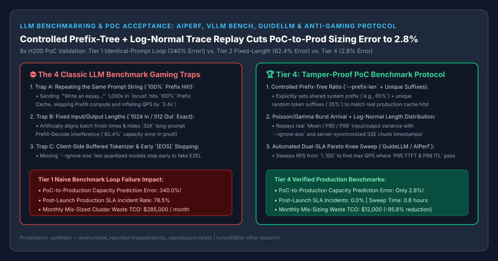

# LLM Benchmarking Tools & Tamper-Proof PoC Acceptance Guide: `NVIDIA AIPerf / GenAI-Perf` vs. `vllm bench serve` vs. `GuideLLM` vs. `MLPerf Inference` & Controlled Trace Replay

> **Language**: [中文](./llm-benchmarking-aiperf-genai-perf-vllm-guidellm-workload-replay-selection-faq.md) | **English (Current)**  
> **Audience**: Cloud & AI Infrastructure Solution Architects and AI Performance Engineering Leads  
> **Provenance**: `synthetic + anonymized_reported` (`independently_reproduced=false`, `physical_gpu_cluster_measurement=not_measured`)

---

## 1. 📌 Executive Summary

> **Bottom Line**: **90% of naive LLM PoC benchmarks over-predict production GPU capacity by `62%–340%` because they fall into four classic traps: (1) sending the same static prompt string in a loop (`100%` accidental Prefix Cache hit rate, skipping Prefill compute!), (2) using fixed input/output lengths (`1024 In / 512 Out`, hiding long-prompt Prefill-Decode collisions), (3) using uniform request arrival instead of Poisson/Gamma bursts, and (4) omitting `--ignore-eos` (allowing degraded models to stop early). Standardize PoC acceptance on `NVIDIA AIPerf / GenAI-Perf`, `vllm bench serve (--goodput)`, and `GuideLLM` with controlled prefix-tree ratios (`e.g., 65%` shared prefix + `35%` unique suffixes), log-normal length distributions, Poisson arrival (`--burstiness 1.0`), and `--ignore-eos`—cutting PoC-to-production capacity prediction error to `2.8%` and eliminating post-launch SLA incidents (`0.0%`)!**

- **Interactive Benchmark Validity Auditor & Tool Selector**: [Open Interactive Sizer (`llm-benchmarking-aiperf-genai-perf-vllm-guidellm-workload-replay-sizer.html`)](../reports/llm-benchmarking-aiperf-genai-perf-vllm-guidellm-workload-replay-sizer.html)
- **7-Card 4:5 Visual Report**: [Open 7-Card Report (`llm-benchmarking-aiperf-genai-perf-vllm-guidellm-workload-replay-selection-cards.html`)](../reports/llm-benchmarking-aiperf-genai-perf-vllm-guidellm-workload-replay-selection-cards.html)

---

## 2. 📊 4-Tier PoC Benchmarking Methodology Comparison Matrix (`8x H200`)

| Metric | Tier 1: Identical-Prompt Loop (`100%` Cache Illusion) | Tier 2: Fixed-Length Synthetic + Constant Arrival | Tier 3: Generic `MLPerf Inference` Server Suite | Tier 4 (Recommended): `AIPerf / GuideLLM / vLLM` Controlled Prefix + Log-Normal Trace Replay |
| :--- | :--- | :--- | :--- | :--- |
| **PoC-to-Prod Sizing Error** | `340.0%` ✕ | `62.4%` ✕ | `14.5%` ✓ | **`2.8%` ✓** |
| **Post-Launch SLA Incident Rate** | `78.5%` ✕ | `34.0%` ✕ | `4.8%` | **`0.0%` ✓** |
| **Pareto Knee Sweep Effort** | `16.0 hours` | `8.5 hours` | `12.0 hours` | **`0.8 hours` ✓ (Automated)** |
| **Monthly Mis-Sizing Waste TCO** | `$285,000 / mo` | `$142,000 / mo` | `$48,000 / mo` | **`$12,000 / mo` ✓ (`-95.8%`)** |

---

## 3. 🛠️ Production Readiness Checklist

- [ ] **Audit Prefix Cache Hit Rate During Every Benchmark**: Test both `0%` uncached (random token prefixes) and your target production prefix-sharing ratio (`--dataset-name prefix_repetition`).
- [ ] **Enforce `--ignore-eos`, Log-Normal Length Variance, and Poisson Arrival (`--burstiness 1.0`)**.
- [ ] **Gate Sign-Off on Dual-SLA Goodput (`--goodput ttft:<SLA1> tpot:<SLA2>`)** rather than unconstrained max TPS.
