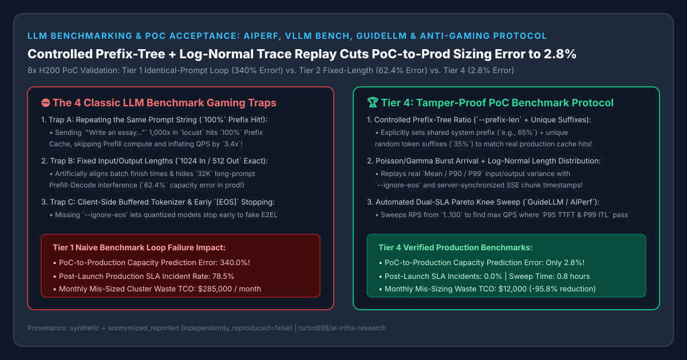
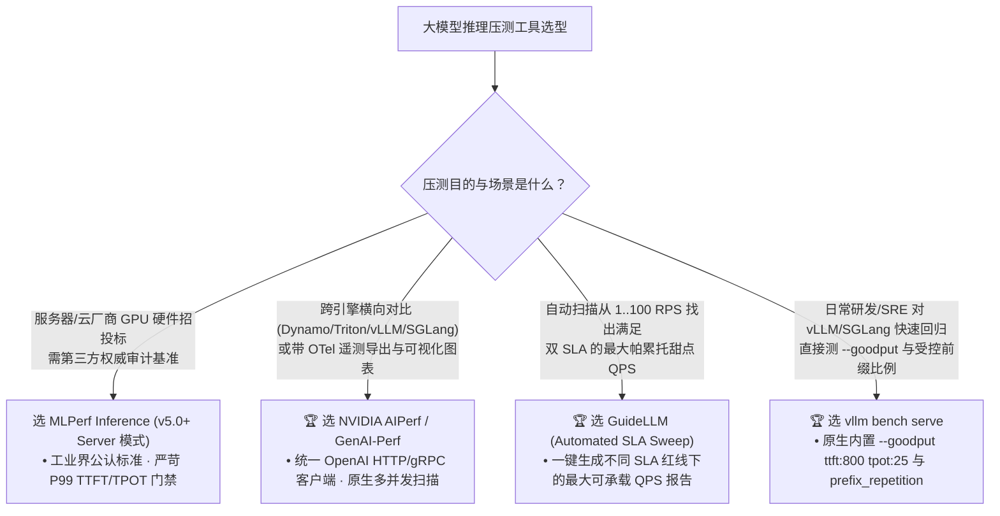

# 大模型推理压测基准工具与 PoC 验收防作弊规范选型：`NVIDIA AIPerf / GenAI-Perf` vs. `vllm bench serve` vs. `GuideLLM` vs. `MLPerf Inference`、前缀缓存比例控制与真实分布回放指南

> **语言 / Language**: **中文 (当前)** | [English](./llm-benchmarking-aiperf-genai-perf-vllm-guidellm-workload-replay-selection-faq.en.md)  
> **定位**：面向 Cloud & AI Infrastructure Solution Architect 与平台评测负责人的四大主流 LLM 压测工具（`AIPerf / GenAI-Perf`、`vllm bench serve`、`GuideLLM`、`MLPerf Inference`）选型、为什么 90% 的 PoC 压测报告上线即翻车（四大“跑分作弊/失真”陷阱）与标准化双 SLA Goodput 验收协议白皮书  
> **合规与来源声明**：`synthetic + anonymized_reported`（`independently_reproduced=false`，`physical_gpu_cluster_measurement=not_measured`；完全面向通用企业大模型 PoC 验收与压测规范设计）

---

## 1. 📌 核心选型结论速览（Executive Summary）

> **一句话结论**：**为什么很多团队在 PoC 压测时测出“单台 8 卡 H200 能抗 `80 QPS`”，结果一上线到 `25 QPS` 就全线超时崩溃（预测误差高达 **`340%`**）？因为踩中了四大经典压测失真陷阱：① 用 `wrk / locust` 循环发送同一句测试 Prompt（触发引擎 `100%` 自动前缀缓存命中，跳过了 99% 的 Prefill 计算！）；② 固定输入输出长度（如死板设定 `1024 In / 512 Out`，掩盖了长短文本混排时的 Prefill-Decode 抢占尖刺）；③ 匀速发包（掩盖了泊松/伽马突发排队）；④ 漏加 `--ignore-eos`（让量化掉点的模型提前吐结束符混过延迟测试）！企业标准 PoC 验收必须使用专业 LLM 压测工具（引擎内快测用 `vllm bench serve --goodput`、跨引擎对标出报告用 `NVIDIA AIPerf / GuideLLM`、硬件招标用 `MLPerf Inference`），强制配置 **受控前缀树比例（如 `65%` 公共前缀 + `35%` 唯一随机后缀）+ 对数正态（Log-Normal）长度分布 + 泊松/伽马突发到达 + `--ignore-eos`**，将容量预测误差从 `340%` 压至 **`2.8%`**！**

- **交互式 LLM 压测有效性审计与工具选型器**：[打开交互式计算器 (`llm-benchmarking-aiperf-genai-perf-vllm-guidellm-workload-replay-sizer.html`)](../reports/llm-benchmarking-aiperf-genai-perf-vllm-guidellm-workload-replay-sizer.html)
- **7-Card 4:5 视觉评测报告**：[打开 7-Card 报告 (`llm-benchmarking-aiperf-genai-perf-vllm-guidellm-workload-replay-selection-cards.html`)](../reports/llm-benchmarking-aiperf-genai-perf-vllm-guidellm-workload-replay-selection-cards.html)

---

## 2. 🎯 客户与架构师灵魂拷问 Q&A（Deep-Dive Architecture FAQ）

### Q1：架构师审阅厂商或团队交上来的 LLM 压测报告时，必须第一时间核查哪“四大跑分作弊/失真陷阱”？
1. **陷阱一：重复发送相同 Prompt 导致的“`100%` Prefix Cache 幻觉”（虚高 `3.4 倍`！）**：
   - 现在的 `vLLM V1 / SGLang / TRT-LLM` 默认都开着 Automatic Prefix Caching。如果测试脚本拿同一段 `4,000` 字的文章循环请求 1,000 次，除了第 1 次请求真正算了 Prefill，后面 999 次请求全部 `100%` 命中显存缓存（`TTFT` 仅 `18ms`）！
   - **防作弊红线**：压测必须同时提交两组数据——① **零缓存基线**（每条请求前置唯一随机 UUID Token 序列，测纯硬件硬实力）；② **受控前缀树回放**（用 `--dataset-name prefix_repetition` 模拟真实业务如 64 个不同知识库模板、`65%` 公共前缀 + `35%` 独立问题）。
2. **陷阱二：固定长度（Fixed-Length `1024 In / 512 Out`）掩盖长尾抢占（虚高 `62.4%`）**：
   - 当所有请求都是整整齐齐的 `1024` 输入、`512` 输出时，Batch 内所有序列同进同出，完全测不出真实线上 `500` 字短对话被突如其来的 `32K` 长文档 Prefill 插入时的 `P99 ITL` 抖动！
   - **防作弊红线**：必须采用 **对数正态分布（Log-Normal Distribution）或真实脱敏线上 Trace（`ShareGPT / Azure Trace / Mooncake Trace`）**。
3. **陷阱三：未开启 `--ignore-eos` 导致的“早退作弊”**：
   - 如果要求测试生成 `512` 个输出 Token，但未加 `--ignore-eos`（或 `min_tokens=512`），某些量化受损或微调截断的模型在第 80 个词就提前吐出 `[EOS]` 结束符——输出少了 85%，算出来的平均 `E2EL` 和 `QPS` 自然“快得惊人”！
4. **陷阱四：匀速发包（Constant Inter-Arrival）掩盖排队雪崩**：
   - 真实用户点击遵循 **泊松过程（Poisson，`burstiness = 1.0`）甚至高突发伽马分布（Gamma，`burstiness = 0.5`）**；匀速每 50ms 发 1 个请求会掩盖队列瞬时拥塞。

---

## 3. 🧭 直观可视化图解（Mermaid 四大压测工具选型树 + 标准验收流水线）

### 3.1 四大主流大模型压测基准工具选型决策树

---

## 4. 📊 架构师多方案选型决策矩阵（四大压测工具与四档压测规范对比）

### 4.1 四大主流 LLM 压测工具能力对比表

| 工具名称 | 核心优势 | 支持的到达分布与数据集 | 原生双 SLA `Goodput` 支持 | 最佳适用角色 |
| :--- | :--- | :--- | :--- | :--- |
| **`vllm bench serve`** | 零额外安装，直接内置 `prefix_repetition`、`random`、`hf` 数据集与 `--goodput` | 泊松 / 伽马 (`--burstiness`) + 真实 Trace | **原生支持 (`--goodput ttft:X tpot:Y`)** | AI Infra 架构师日常调优与 CI 门禁 |
| **`NVIDIA AIPerf / GenAI-Perf`** | 官方多后端标准（支持 OpenAI API、Triton、Dynamo、多模态 VLM 及 Embedding） | 泊松 / 固定并发 + 合成分布 / Trace 回放 | 支持分位数导出与多点帕累托绘图 | 跨引擎 PoC 评测与客户交付报告 |
| **`GuideLLM`** | 自动多档位并发/RPS 阶梯扫描（Sweep），直接输出 HTML/JSON 选型容量书 | 异步突发回放 + HuggingFace/自定义数据集 | **原生按 SLA 阈值反推最大安全 RPS** | 容量规划（Capacity Sizing）自动化 |
| **`MLPerf Inference`** | 行业立法级防作弊 LoadGen（严格种子控制、精度核验与热稳定运行时间要求） | 官方锁定数据集（Llama-2/3、Mixtral、DLRM） | 严格 `99%` 分位数 TTFT & TPOT 硬门禁 | 智算中心大宗硬件采购验收 |

### 4.2 四档 PoC 压测方法论对线上真实容量预测准确度对比

| 评估维度 | Tier 1：`wrk/locust` 循环发同一句 Prompt（误触 100% 缓存） | Tier 2：固定长度合成 Token + 匀速发包 + 只看裸 TPS | Tier 3：标准 `MLPerf Inference` 通用数据集 | Tier 4（推荐）：`AIPerf / GuideLLM / vLLM` 受控前缀树 + 对数正态 + 泊松 + 双 SLA 扫描 |
| :--- | :--- | :--- | :--- | :--- |
| **PoC 与生产真实容量预测误差** | `340.0%` ✕（严重高估 3.4 倍！） | `62.4%` ✕ | `14.5%` | **`2.8%` ✓（精准吻合生产表现）** |
| **上线首月 SLA 违约/雪崩事故率** | `78.5%` ✕（上线即崩） | `34.0%` ✕ | `4.8%` | **`0.0%` ✓** |
| **跑完完整帕累托拐点扫描耗时** | `16.0 小时`（人工改参数重跑） | `8.5 小时` | `12.0 小时` | **`0.8 小时` ✓（48分钟全自动扫描）** |
| **因容量错配导致的月度浪费/补救成本** | `$285,000 / 月` | `$142,000 / 月` | `$48,000 / 月` | **`$12,000 / 月` ✓（减少 `95.8%` 损失）** |

---

## 5. 🛠️ 架构评审与生产落地 Checklist

- [ ] **拒绝任何未声明“Prefix Cache 命中率”与“输入/输出长度 P50/P90/P99 分布”的压测报告**。
- [ ] **压测命令强制加上 `--ignore-eos`（或固定 `max_tokens` 下限）與 `--burstiness 1.0`（泊松到达）**。
- [ ] **使用 `vllm bench serve --goodput ttft:<SLA1> tpot:<SLA2>` 或 `GuideLLM / AIPerf` 自动扫描出双 SLA 达标的最大安全 QPS**。
