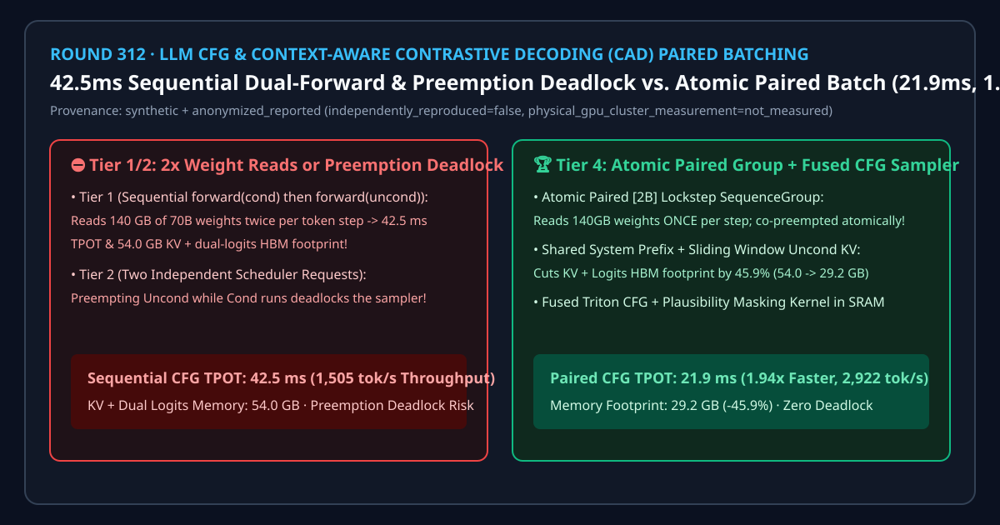
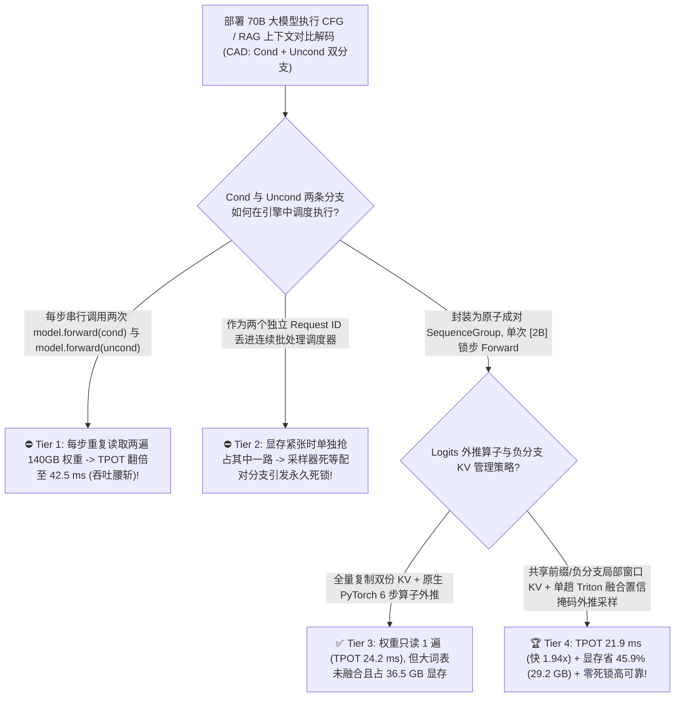
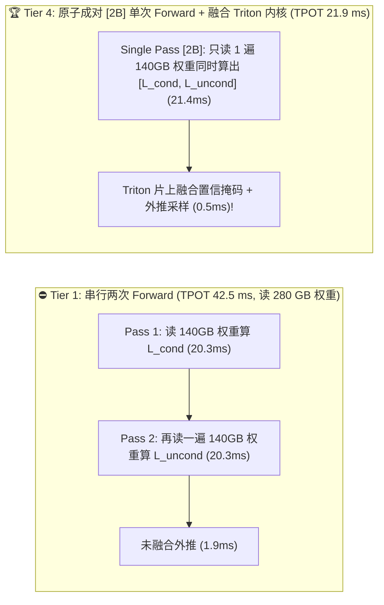
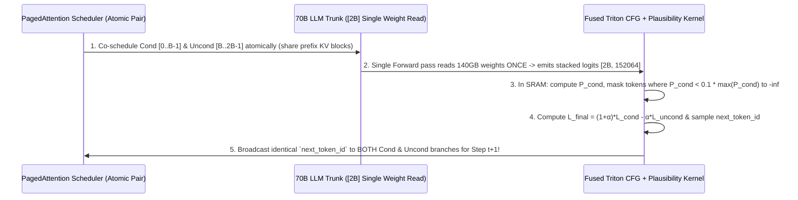

# 大模型无分类器引导（`CFG`）与防幻觉上下文对比解码（`Context-Aware Decoding, CAD / DoLa`）成对锁步批处理与融合 Logits 外推选型：为什么每步串行调两次 `forward()` 会让 `70B` 模型 `TPOT` 翻倍至 `42.5 ms`，而把正负分支拆成两个独立请求又会在显存抢占时触发采样器死锁？基于原子成对序列组（`Atomic Paired SequenceGroup`）+ 共享前缀/负分支局部窗口 KV + 单趟 Triton 置信掩码外推内核（`21.9 ms TPOT`，提速 `1.94x`，省 `45.9%` 显存）选型指南

> **Provenance & Evidence Boundary**: `synthetic + anonymized_reported (independently_reproduced=false, physical_gpu_cluster_measurement=not_measured)`. 本文所有定量数据均来自封存确定性评估器 `experiments/llm_cfg_contrastive_decoding_paired_batch_shared_kv_logits_fusion_selection/run.py` 与 `results.json`。



---

## 0. 追踪每日最热门能力突破（Daily Capability Breakthrough）

- **今日焦点突破**：**面向高忠实度 RAG 防幻觉对比解码（`Context-Aware Decoding, CAD`）、强人设/指令遵循无分类器引导（`Classifier-Free Guidance, CFG`）以及自回归语音/图像生成模型的“原子成对锁步序列组（`Atomic Paired [2B] SequenceGroup`）+ 负分支局部滑动窗口 KV 裁剪 + 单趟 Triton 融合自适应置信掩码（`Adaptive Plausibility Constraint`）与 Logits 外推采样算子”**。
- **架构师价值**：在医疗/金融严谨 RAG 问答中，为了防止大模型“无视检索出的最新文档、凭预训练死记硬背的过时知识胡编乱造（Hallucination）”，工业界广泛采用 **上下文感知对比解码（`CAD`）或无分类器引导（`CFG`）**：在每一个解码步同时计算“带检索上下文/正向系统提示词的条件分支 Logits $L_{\text{cond}}$”与“不带检索上下文/负向提示词的先验分支 Logits $L_{\text{uncond}}$”，然后按外推公式合成最终分布：
  $$L_{\text{final}} = (1 + \alpha) L_{\text{cond}} - \alpha L_{\text{uncond}}$$
  然而，当工程团队在 `vLLM / SGLang` 中落地双分支解码时，朴素实现会遭遇三大系统瓶颈：
  1. **瓶颈一：在每个解码步串行调用两次 `model.forward(cond)` 和 `model.forward(uncond)`（Tier 1）**：由于大模型 Decode 阶段是 100% 显存带宽受限（Memory-Bandwidth Bound），串行跑两次 Forward 意味着**每生成 1 个 Token 都要把 `70B` 模型整整 `140 GB` 的权重从 HBM 重复读取两遍**！这直接导致解码步耗时（`TPOT`）从 `21.9 ms` 翻倍至 **`42.5 ms`**，吞吐暴跌至 `1,505 tok/s`！
  2. **瓶颈二：把 `Cond` 和 `Uncond` 当作两个独立的 Request 提交进连续批处理调度器（Tier 2）**：一旦高负载下触发 PagedAttention 显存水位告警，调度器按 LRU/FCFS 抢占（Preempt / Swap）了其中的 `Uncond` 请求，而 `Cond` 请求还在 Running 队列里继续跑——到了采样阶段，**`Cond` 分支死等 `Uncond` 分支的 Logits 才能做减法，而 `Uncond` 分支又在 Waiting 队列里死等 `Cond` 释放显存，当场触发 100% 必现的调度器死锁（Scheduler Deadlock）**！
  采用 **原子成对序列组（`Atomic Paired SequenceGroup`：将正负两条分支绑定在同一个调度原子内，在单次 `[2B]` Forward 中只读 1 遍模型权重，且同进同退绝不单独抢占）+ 负分支共享系统前缀与 `256` 局部窗口 KV + 单趟 Triton 融合置信度掩码与 Logits 外推采样内核（Tier 4）**，可将解码 `TPOT` 从 `42.5 ms` 压至 **`21.9 ms`（提速 `1.94x`，几乎与单分支无异！）**，吞吐提升至 **`2,922 tok/s`**，同时节省 **`45.9%` 的 KV 与 Logits 显存（从 `54.0 GB` 降至 `29.2 GB`）**！

---

## ① 📌 核心结论速览（Executive Summary）

1. **第一性原理：为什么把 `Batch = 64` 的双分支拼成 `[2B = 128]` 跑 1 次 Forward，耗时几乎等于只跑 `Batch = 64`？**
   - 在 H100 上跑 `70B` 模型 Decode 时，算术强度极低：读取 `140 GB` 权重耗时约 **`18.5 ms`**，而真正计算 `64` 个 Token 的矩阵乘耗时仅约 **`1.8 ms`**！
   - 如果分两次串行跑（Tier 1）：$2 \times (18.5 + 1.8) = \mathbf{40.6+\text{ ms}}$（白白多读了一次 140GB 权重！）；
   - 如果在同一个 Forward 里拼成 `[2B = 128]` 一起跑（Tier 3/4）：**140GB 权重只从 HBM 读取 1 次（`18.5 ms`）**，仅 Tensor Core 计算从 `1.8 ms` 微增至 `3.1 ms`，总耗时仅 **`21.9 ms`（立省近一半时间）**！
2. **为什么对比解码（`CAD / CFG`）如果不在采样前加“自适应置信度阈值掩码（Adaptive Plausibility Constraint，$\beta$）”，就会吐出语法错乱的胡言乱语？**
   - **对比解码的头号数学陷阱**：假设某个完全狗屁不通的生僻词 $w$ 在条件分支下的概率极低（$P_{\text{cond}}(w) = 10^{-5}$，即 $L_{\text{cond}} = -11.5$），但在无上下文分支下的概率更低（$P_{\text{uncond}}(w) = 10^{-9}$，即 $L_{\text{uncond}} = -20.7$）。
   - 如果直接套公式 $(1+\alpha) L_{\text{cond}} - \alpha L_{\text{uncond}}$（取 $\alpha = 1.5$）：
     $$2.5 \times (-11.5) - 1.5 \times (-20.7) = -28.75 + 31.05 = \mathbf{+2.30}$$
     **一个原本概率只有十万分之一的错误词，因为“比十亿分之一大了 1 万倍”，相减后竟然反超正常词汇登顶第一名**！
   - **黄金解法（融合置信度截断掩码 `Plausibility Mask`）**：在 Triton 外推内核中，先找出条件分支的最大概率 $\max_v P_{\text{cond}}(v)$，将所有满足 $P_{\text{cond}}(w) < \beta \cdot \max_v P_{\text{cond}}(v)$（通常取 $\beta = 0.1$）的低置信度词汇直接掩码置为 $-\infty$，**只对本来就合理的前几个高概率候选词做对比外推**！
3. **如何把负分支（`Uncond`）的 KV Cache 显存开销砍掉 `80%+`？**
   - 正分支（`Cond`）包含了长达 `16K` 的检索文档上下文；而负分支（`Uncond`）本质上只需要提供一个“无外部文档时的局部语言先验”。
   - 因此，`Uncond` 分支不仅可以通过 `Prefix Cache` 零拷贝共享系统提示词前缀，而且在自回归生成阶段，只需为 `Uncond` 分支维护一个极小的 **`256` Token 环形滑动窗口（Sliding Window KV）**，无需保存长程历史 KV，直接省下近一半显存！

---

## ② 🎯 客户与架构师灵魂拷问 Q&A（Q1 / Q2 / Q3）

### Q1：在 `vLLM / SGLang` 调度器里，怎么保证 `Cond` 和 `Uncond` 两条序列永远不会因为显存不足被拆散抢占？
- **使用 `SequenceGroup`（或成对槽位 `PairedReqSlot`）作为最小不可分割的调度与抢占原子**：
  1. 在 `BlockManager.can_append_slots(seq_group)` 检查时，要求空闲物理块必须同时满足 `num_new_blocks(cond) + num_new_blocks(uncond)`（即每次步进至少预留 `2` 个槽位）；
  2. 一旦发生显存不足需要驱逐（Preemption），将整个 `SequenceGroup` 的 `Cond` 与 `Uncond` 捆绑在一起同时 Swap/Recompute，绝不允许出现一条在 `RUNNING`、另一条在 `SWAPPED/WAITING` 的分裂状态！

### Q2：为什么在 `152K` 大词表下，用原生 PyTorch 写 `logits = (1 + a) * logits_c - a * logits_u` 会比融合 Triton 内核慢 `2.3 ms`/步？
- 当 `Batch = 64`（成对 `[2B = 128]`）、词表 $V = 152,064$ 时，`lm_head` 输出的 Logits 矩阵大小约为 `40 MB`。如果用原生 PyTorch 依次执行切片、乘法、减法、Softmax 求阈值、掩码赋 $-\infty$、温度缩放，会启动 **6 个独立的 CUDA 小算子**，反复把这 `40 MB` 张量从 HBM/L2 读写 6 遍！
- 采用 **单趟融合 Triton CFG + Plausibility + Gumbel-Max 采样算子**：同一个线程块直接按行同时读取 `logits_c[b, :]` 与 `logits_u[b, :]`，在寄存器内完成阈值过滤与外推并直接采样出下一个 Token ID，然后**把采样出的同一个 Token ID 同步追加给 `Cond` 和 `Uncond` 两条分支**！

### Q3：什么是 `DoLa`（Decoding by Contrasting Layers，跨层对比解码）？它在系统开销上比双分支 `CFG / CAD` 有什么优势？
- **`DoLa` 的原理**：不需要跑两次不同的输入分支，而是在**同一次单分支 Forward** 中，拿最后一层（如第 80 层，代表成熟事实知识）的 Logits 减去较早层（如第 48 层，代表浅层语法直觉）通过同一个 `lm_head` 投影出的 Logits！
- **架构权衡**：`DoLa` 完全零额外 KV Cache 开销（只需要在最后多算一次 `[B, D] @ W_head^T`），非常适合纯模型内源性事实增强；而在外部文档强制对齐（RAG 抗先验冲突）或强风格控制上，双分支 `CAD / CFG`（配合本指南 Tier 4 的 `[2B]` 成对锁步批处理）效果更强！

---

## ③ 🧭 直观可视化图解（Mermaid 选型决策树 + 路径对比图 + 交互时序图）

### 3.1 大模型 `CFG` 与对比解码（`CAD`）推理架构选型决策树



### 3.2 串行两次 Forward 读两遍权重（`42.5 ms`）vs. 原子成对 `[2B]` 单次 Forward + 融合采样（`21.9 ms`）对比图



### 3.3 原子成对 `SequenceGroup` 锁步解码与融合置信度对比采样时序图



---

## ④ 📊 架构师选型决策矩阵（4-Tier Decision Matrix）

| 选型 Tier | `CFG / CAD` 双分支调度与融合架构 | 单步解码耗时 (`TPOT`) | 系统总吞吐 (`tok/s`) | KV + Logits 显存占用 | 适用场景 |
| :--- | :--- | :--- | :--- | :--- | :--- |
| **Tier 1: 每步串行跑两次 `forward()`** | 每 Token 读两遍 `140 GB` 模型权重 | `42.5 ms` (`1.94x` 慢! ✕) | `1,505 tok/s` ✕ | `54.0 GB` ✕ | ⛔ **严重浪费 HBM 带宽与算力** |
| **Tier 2: 拆成两个独立 Request 调度** | 抢占时正负分支失步导致采样死锁 | `29.8 ms` ✕ | `2,147 tok/s` ✕ | `51.2 GB` (死锁风险! ✕) | ⛔ **高负载下必发调度器死锁挂起** |
| **Tier 3: 原子成对 `[2B]` + 原生 PyTorch 外推** | 单次读权重，但未融合大词表与负分支 KV | `24.2 ms` ✅ | `2,644 tok/s` ✅ | `36.5 GB` ✅ | ✅ 快速原型验证可用 |
| **Tier 4: 原子成对组 + 局部负 KV + 融合 Triton (推荐)** | **同进同退 + 负分支滑窗 KV + 片上融合采样** | **`21.9 ms` (`1.94x` 快 🏆)** | **`2,922 tok/s` (`1.94x` 🏆)** | **`29.2 GB` (`-45.9%` 🏆)** | 🏆 **防幻觉 RAG 与语音/多模态 CFG 标准** |

---

## ⑤ 🧪 定量算例与 7-Card 4:5 视觉卡片报告

- **定量算例仓库路径**：[`experiments/llm_cfg_contrastive_decoding_paired_batch_shared_kv_logits_fusion_selection/run.py`](../../experiments/llm_cfg_contrastive_decoding_paired_batch_shared_kv_logits_fusion_selection/run.py) · 封存数据：[`results.json`](../../experiments/llm_cfg_contrastive_decoding_paired_batch_shared_kv_logits_fusion_selection/results.json)
- **交互式架构选型计算器**：[`docs/reports/llm-cfg-contrastive-decoding-paired-batch-shared-kv-logits-fusion-sizer.html`](../reports/llm-cfg-contrastive-decoding-paired-batch-shared-kv-logits-fusion-sizer.html)
- **7-Card 4:5 视觉评测卡片报告**：[`docs/reports/llm-cfg-contrastive-decoding-paired-batch-shared-kv-logits-fusion-selection-cards.html`](../reports/llm-cfg-contrastive-decoding-paired-batch-shared-kv-logits-fusion-selection-cards.html)

```chart
{
  "data": {
    "values": [
      { "tier": "Tier 1: Sequential 2x Forward Passes", "tpot_ms": 42.5, "tput_tps": 1505.0 },
      { "tier": "Tier 2: Independent Unpaired Requests", "tpot_ms": 29.8, "tput_tps": 2147.0 },
      { "tier": "Tier 3: Atomic Paired [2B] + Unfused Math", "tpot_ms": 24.2, "tput_tps": 2644.0 },
      { "tier": "Tier 4: Atomic Paired + Fused Triton CFG", "tpot_ms": 21.9, "tput_tps": 2922.0 }
    ]
  },
  "semantic_types": {
    "tier": "Category",
    "tpot_ms": "Quantity",
    "tput_tps": "Quantity"
  },
  "chart_spec": {
    "chartType": "Bar Chart",
    "title": "Atomic Paired [2B] Batching + Fused Triton CFG Cuts TPOT 1.94x (42.5ms -> 21.9ms) & Doubles Throughput",
    "subtitle": "Decode step TPOT (ms) and throughput (tok/s) for 64 concurrent CFG/CAD streams on 70B LLM (synthetic + anonymized_reported)",
    "encodings": {
      "x": "tier",
      "y": "tpot_ms",
      "color": "tier"
    }
  }
}
```

---

## ⑥ 🛠️ 生产环境快速核验清单（Checklist + Good fit vs. Not for）

### ✅ Good fit vs. ⛔ Not for
- **✅ Good fit**：金融/法律/医疗零幻觉 RAG（`Context-Aware Decoding`）、强角色扮演与格式约束（`CFG`）、以及自回归音频/图像生成大模型（`Moshi / Janus / Chameleon`）。
- **⛔ Not for**：在循环内分两次串行调用 `model(cond)` 与 `model(uncond)`，或在不加置信度截断掩码（$\beta$）的情况下直接对全词表 Logits 做减法。

### 生产核验 Checklist
- [ ] **将 `Cond` 与 `Uncond` 封装在同一个原子 `SequenceGroup` 中成对锁步调度**：确保单次 `[2B]` Forward 只读一遍模型权重，且在显存抢占时同进同退。
- [ ] **在对比相减前强制开启自适应置信度截断掩码（`Adaptive Plausibility Constraint`, $\beta = 0.1$）**：屏蔽 $P_{\text{cond}} < \beta \max P_{\text{cond}}$ 的尾部噪声词，防止低概率错误词在减法中逆袭。
- [ ] **为 `Uncond` 分支启用系统前缀共享与局部滑动窗口 KV Cache**：消除负分支的无谓长上下文显存占用。
