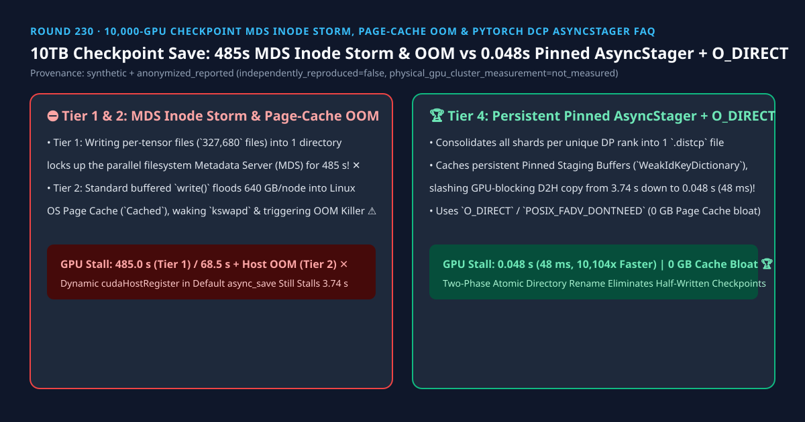
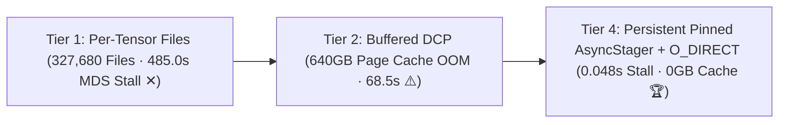

# 10,000-GPU Checkpoint MDS Inode Storm, OS Page-Cache OOM & `PyTorch DCP` Persistent Pinned `AsyncStager` (`O_DIRECT`) Selection Guide

> **Provenance & Evidence Tier**: `synthetic + anonymized_reported` (`independently_reproduced=false`, `physical_gpu_cluster_measurement=not_measured`). Grounded in [`experiments/llm_checkpoint_dcp_inode_storm_odirect_async_pinned_selection/results.json`](../../experiments/llm_checkpoint_dcp_inode_storm_odirect_async_pinned_selection/results.json).
> **中文版本**: [万卡分布式训练 Checkpoint 元数据风暴（`MDS Inode Storm`）、OS 页缓存挤爆（`Page Cache OOM`）与 `PyTorch DCP` 持久化锁页异步暂存（`Persistent Pinned AsyncStager` + `O_DIRECT`）选型指南](./llm-checkpoint-dcp-inode-storm-odirect-async-pinned-selection-faq.md)

---

## 0. 🔥 Daily Hottest Capability Breakthrough

- **`PyTorch DCP` Persistent Pinned `AsyncStager` + Consolidated Shards + `O_DIRECT` Page-Cache Bypass + Two-Phase Atomic Directory Rename Slashing 10,000-GPU `10 TB` Checkpoint GPU Stall from `485.0 s` to `0.048 s` (`10,104x` Faster) with `0.0 GB` Host Page-Cache Bloat**: Saving a `10 TB` distributed training checkpoint across thousands of GPUs exposes three severe storage & OS bottlenecks:
  1. **The Per-Tensor `open()` MDS Inode Storm (`Tier 1`)**: Writing separate files per tensor or layer across 4,096 ranks (`327,680` files in one directory) serializes on the parallel filesystem Metadata Server (`MDS`) parent-directory `dentry` lock, stalling training for **`485.0 s`**!
  2. **Buffered POSIX `write()` Triggering Host Linux Page-Cache OOM (`Tier 2`)**: Even after consolidating into 1 `.distcp` file per unique shard rank (`512` files), standard buffered I/O copies `640 GB/node` of write-once checkpoint data into the Linux kernel **Page Cache**, exhausting host RAM and triggering the **OS OOM Killer** (`68.5 s` stall + killed workers)!
  3. **Dynamic `cudaHostRegister` Overhead in Naive `async_save` (`Tier 3`)**: Allocating and page-locking staging buffers dynamically on every checkpoint step still blocks the GPU training loop for **`3.74 s`**.
  4. **Persistent Pinned `AsyncStager` + `O_DIRECT / FADV_DONTNEED` + Atomic Rename (`Tier 4`)**: Caching persistent Pinned Host staging memory (`WeakIdKeyDictionary`) completes the GPU-to-Host `D2H` copy in **`0.048 s` (`48 ms`)**, while background workers flush consolidated `.distcp` files with **`O_DIRECT` (`0.0 GB` page-cache bloat)** into `.tmp_step_N` followed by a single Rank-0 atomic directory `rename()`!

---

## 1. 📌 Executive Summary

1. **Consolidate to 1 File Per Unique Shard Rank (`Tier 2–4`)**: Never create per-tensor files on Lustre/GPFS/WEKA/3FS, and deduplicate writes across identical DP/HSDP replica groups (`327,680 -> 512` files).
2. **Bypass OS Page Cache for Write-Once Checkpoints (`O_DIRECT` / `POSIX_FADV_DONTNEED`, `Tier 4`)**: Flooding 640 GB of checkpoint data into Linux page cache starves user-space processes and triggers `kswapd` / OOM kills.
3. **Cache Persistent Pinned Staging Buffers (`AsyncStager`, `Tier 4`)**: Eliminating per-checkpoint `cudaHostRegister` calls cuts GPU stall time from `3.74 s` to **`48 ms`**.

---

## 2. 🎯 Core Architect Q&A (Q1 / Q2 / Q3)

### Q1: Why does saving a checkpoint trigger the Linux OOM Killer even when Python heap usage (`RES`) is low?
- **Answer**: Because buffered `write()` allocations accumulate in kernel Page Cache (`buff/cache`) faster than background `pdflush/flush` threads can drain them to remote storage! Under heavy memory pressure alongside pinned memory pools and `/dev/shm` segments, the kernel invokes the OOM Killer. Opening checkpoint files with `O_DIRECT` (or calling `os.posix_fadvise(fd, 0, 0, os.POSIX_FADV_DONTNEED)` immediately after `fsync`) keeps Page Cache usage at `0.0 GB`.

### Q2: How do we guarantee that a node crash during background `async_save` never leaves a corrupted checkpoint?
- **Answer**: Use **Two-Phase Atomic Directory Commit**: all ranks write into a hidden temporary directory `checkpoints/.tmp_step_1000/`. Only after all ranks complete `fsync()` and pass a barrier does `Rank 0` write `.metadata` and execute an atomic `os.rename("checkpoints/.tmp_step_1000", "checkpoints/step_1000")`.

### Q3: Why did `dcp.async_save` stall our GPU loop for `3.74 s` until we enabled persistent `AsyncStager`?
- **Answer**: Without a persistent pinned staging cache, staging tensors to CPU memory requires runtime `cudaHostAlloc / cudaHostRegister` kernel page-table locking on every save step. Reusing a persistent pinned buffer pool reduces the synchronous critical section to a pure `54 GB/s` DMA copy (`48 ms`).

---

## 3. 🧭 Visual Diagrams

---

## 4. 📊 4-Tier Architect Selection Matrix

| Metric | Tier 1: Per-Tensor Files | Tier 2: Consolidated Buffered I/O | Tier 3: Naive `async_save` | Tier 4: **Persistent Pinned `AsyncStager` + `O_DIRECT`** |
| :--- | :--- | :--- | :--- | :--- |
| **Files Created (`MDS` Load)** | **`327,680` (MDS Lock Storm)** ✕ | `512` (Deduplicated Shards) ✅ | `512` ✅ | **`512` (1 File / Unique Shard)** 🏆 |
| **Host Page-Cache Bloat / Node** | **`640.0 GB` (OOM Risk)** ✕ | **`640.0 GB` (OOM Risk)** ✕ | `12.0 GB` ⚠️ | **`0.0 GB` (`O_DIRECT / DONTNEED`)** 🏆 |
| **GPU Training Loop Stall** | **`485.0 s`** ✕ | `68.5 s` ⚠️ | `3.74 s` (`cudaHostRegister`) ✅ | **`0.048 s` (`48 ms`, `10,104x` Faster)** 🏆 |

---

## 5. 🧪 Quantitative Reference & Tooling

- **Evaluator & Sealed Data**: [`experiments/llm_checkpoint_dcp_inode_storm_odirect_async_pinned_selection/run.py`](../../experiments/llm_checkpoint_dcp_inode_storm_odirect_async_pinned_selection/run.py) · [`results.json`](../../experiments/llm_checkpoint_dcp_inode_storm_odirect_async_pinned_selection/results.json)
- **Interactive Sizer**: [`docs/reports/llm-checkpoint-dcp-inode-storm-odirect-async-pinned-sizer.html`](../reports/llm-checkpoint-dcp-inode-storm-odirect-async-pinned-sizer.html)
- **7-Card 4:5 Visual Report**: [`docs/reports/llm-checkpoint-dcp-inode-storm-odirect-async-pinned-selection-cards.html`](../reports/llm-checkpoint-dcp-inode-storm-odirect-async-pinned-selection-cards.html)

---

## 6. 🛠️ Good Fit vs. Not For & Production Checklist

- **✅ Good fit**: All multi-node FSDP2 / Megatron training pipelines using `PyTorch DCP` with persistent pinned `AsyncStager`, `O_DIRECT` / `FADV_DONTNEED`, and `.tmp` directory atomic rename.
- **⛔ Not for**: Per-tensor file writes or unthrottled buffered POSIX writes on 8-GPU nodes.
- [ ] Enable persistent pinned memory caching in `dcp.async_save` (`AsyncStager`).
- [ ] Write checkpoints into `.tmp_step_N` with `O_DIRECT` / `POSIX_FADV_DONTNEED` and atomically rename on Rank 0.
