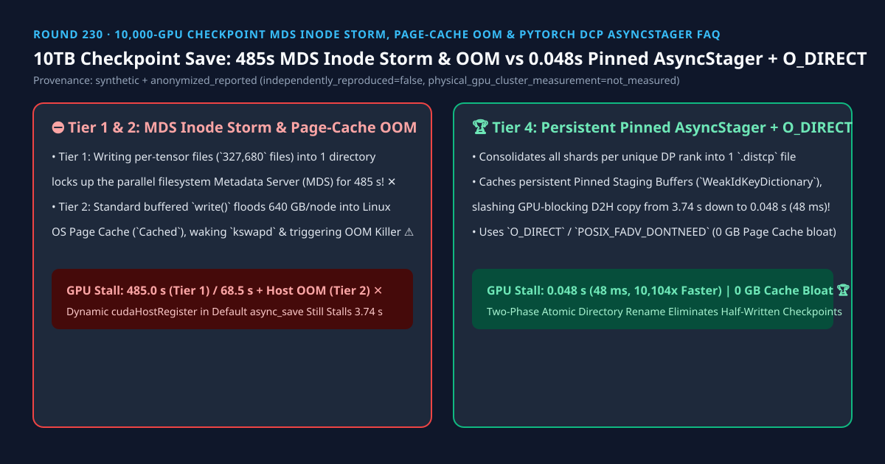
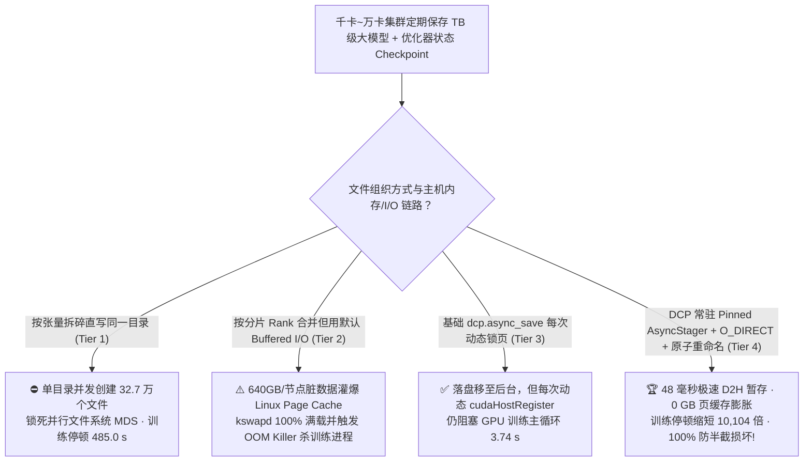
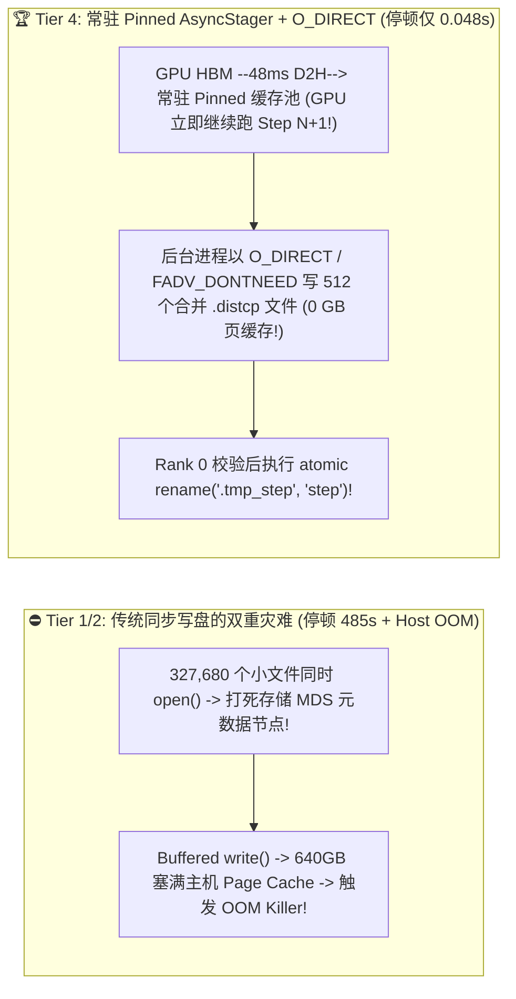
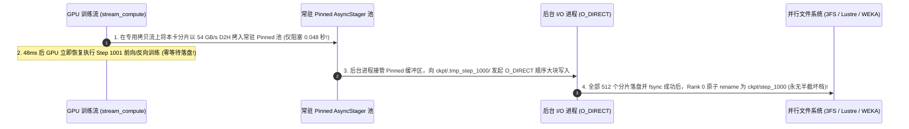

# 万卡分布式训练 Checkpoint 元数据风暴（`MDS Inode Storm`）、OS 页缓存挤爆（`Page Cache OOM`）与 `PyTorch DCP` 持久化锁页异步暂存（`Persistent Pinned AsyncStager` + `O_DIRECT`）选型指南

> **Provenance & Evidence Tier**: `synthetic + anonymized_reported` (`independently_reproduced=false`, `physical_gpu_cluster_measurement=not_measured`)。定量数据锚定于 [`experiments/llm_checkpoint_dcp_inode_storm_odirect_async_pinned_selection/results.json`](../../experiments/llm_checkpoint_dcp_inode_storm_odirect_async_pinned_selection/results.json)。
> **English Version**: [10,000-GPU Checkpoint MDS Inode Storm, OS Page-Cache OOM & `PyTorch DCP` Persistent Pinned `AsyncStager` (`O_DIRECT`) Selection Guide](./llm-checkpoint-dcp-inode-storm-odirect-async-pinned-selection-faq.en.md)

---

## 0. 🔥 今日领域最热门能力突破追踪（Daily Hottest Breakthrough）

- **`PyTorch DCP (Distributed Checkpoint)` 持久化锁页暂存池（`Persistent Pinned AsyncStager`）+ 单分片合并文件 + `O_DIRECT` 绕过内核页缓存 + 两阶段原子重命名，将万卡集群 `10 TB` Checkpoint 保存的 GPU 训练停顿从 `485.0 s` 压缩至 `0.048 s`（`48 毫秒`，提速 `10,104` 倍），且主机 Page Cache 膨胀降为 `0.0 GB`**：在 4,096 卡至 10,000 卡集群上每隔 30 分钟保存一次 `10 TB` 的大模型完整状态（BF16 参数 + FP32 主权重 + FP32 AdamW 一阶/二阶动量）时，为什么很多团队上了高速并行文件系统（Lustre / GPFS / WEKA / 3FS），保存一次 Checkpoint 还是会卡死几分钟、甚至把宿主机写到 **Host OOM 杀进程**？
  1. **灾难一（未合并小文件引发并行文件系统 `MDS Inode 锁风暴`，Tier 1）**：如果按参数张量或细粒度分片各自调 `open(O_CREAT)` 写入同一个目录（例如 `4,096 Ranks × 80 层 = 327,680` 个文件），所有节点同时争抢并行文件系统 **元数据服务器（MDS）** 上同一个父目录的 `dentry` 互斥锁，存储带宽还没跑起来，光在 `open()` 系统调用上就排队卡死了 **`485.0 s`**！
  2. **灾难二（标准 Buffered `write()` 塞爆 Linux `Page Cache` 触发宿主机 OOM Killer，Tier 2）**：即便使用 `PyTorch DCP` 将每个唯一分片 Rank 合并为 1 个大文件（共 `512` 个 `.distcp` 文件），默认的 POSIX 缓冲写（Buffered I/O）会把单机 8 张卡写出的 **`640 GB` 数据全部先缓存在宿主机 Linux 内核的 `Page Cache (buff/cache)` 内存里**！这会瞬间吃光宿主机剩余物理内存，导致内核 `kswapd0` 线程飙到 `100% CPU`，甚至触发 **Linux OOM Killer 当场误杀正在运行的训练主进程或 DataLoader 子进程**（卡顿 `68.5 s`）！
  3. **灾难三（默认 `dcp.async_save` 每次动态调 `cudaHostRegister` 锁页卡顿 `3.74 s`，Tier 3）**：开启基础异步保存后，如果每次保存都临时分配 CPU 内存并调用 `cudaHostRegister` 锁页，内核页表锁定依然会让 GPU 主线程停顿 **`3.74 s`**！
  4. **终极无感方案（持久化锁页 `AsyncStager` + `O_DIRECT / FADV_DONTNEED` + 两阶段原子目录重命名，Tier 4）**：通过 `WeakIdKeyDictionary` 跨步复用常驻 Pinned Host 暂存池，将 `GPU -> CPU` 暂存阻塞从 `3.74 s` 压降至 **`0.048 s`（仅 `48 ms`）**；后台写进程开启 **`O_DIRECT`（或写完立即调 `posix_fadvise(POSIX_FADV_DONTNEED)`）** 实现 **`0.0 GB` 页缓存残留**，并在全部 `.distcp` 落盘后由 `Rank 0` 执行单次原子 `rename("step_1000.tmp", "step_1000")` 提交！

---

## 1. 📌 核心结论速览（Executive Summary — 3 分钟看懂）

1. **为什么写磁盘文件（Checkpoint）会把服务器的 CPU 内存（RAM）撑爆并触发 OOM Killer？**
   - **通俗大白话 + 第一性原理**：Linux 内核有一个传承几十年的默认习惯——当你调用普通的 `write()` 写文件时，内核**并不是直接把数据写进硬盘**，而是先在主机内存里切出一大块叫 **`Page Cache（页缓存）`** 的地方把你的数据存下来，再慢慢往远端存储刷（Write-back）。
   - 在普通 Web 服务器上这能加速读写；但在 8 卡 H100 服务器上，一次 Checkpoint 就要写出 **`640 GB`** 的“只写一次、短期绝不会再读”的巨型数据！如果走普通缓冲写（Tier 2），这 `640 GB` 数据就像洪水一样瞬间灌满主机 RAM，把正在干活的 Python 训练进程和 DataLoader 逼到墙角，触发内核 OOM Killer 乱砍进程！
   - **正解（`O_DIRECT` + `POSIX_FADV_DONTNEED`，Tier 4）**：明确告诉 Linux 内核：“这是归档大象流，**直接走 DMA 写进网卡/NVMe，一字节都不要留在系统 Page Cache 里**！”
2. **如何防止保存 Checkpoint 写到一半节点宕机，留下一堆损坏的“半截残骸文件”导致恢复训练失败？**
   - **永远不要直接往最终目录 `ckpt/step_1000/` 里写文件！**
   - 必须采用 **两阶段原子目录提交（Two-Phase Atomic Directory Commit）**：
     1. 所有 Rank 先往临时目录 `ckpt/.tmp_step_1000/` 写入各自的 `__<rank>_0.distcp`；
     2. 汇总校验所有分片写入长度与 CRC 无误后，由 `Rank 0` 写出 `.metadata` 并调用一次 **`os.rename("ckpt/.tmp_step_1000", "ckpt/step_1000")`**（在 POSIX 文件系统中，同文件系统内的目录 `rename` 是微秒级原子操作），最后才更新 `latest_checkpointed_iteration.txt`！

---

## 2. 🎯 客户与架构师灵魂拷问 Q&A（Q1 / Q2 / Q3）

### Q1：在 `HSDP`（机内 FSDP 分片 + 跨机 DP 复制）或 `3D 并行` 中，4,096 张卡需要全部 4,096 张卡都去写并行文件系统吗？
- **答**：**绝对不需要！** 如果你的 4,096 卡集群由 `8` 个完全相同的 `512` 卡 FSDP 副本组（Replica Groups）组成，那么第 `0` 组 512 张卡手里的权重+优化器分片，与第 `1 ~ 7` 组手里的分片是 **100% 一模一样的**！
  - 在 `Tier 4` 中，只需让 **`Replica Group 0` 的 512 张卡**（或者将 512 个分片均匀分散在 8 个副本组的不同机器上，每台机器只让 1 张卡写盘！）执行落盘。这样不仅把集群总写入数据量和 MDS 文件数直接减少 **8 倍（从 `4,096` 个文件减至 `512` 个文件）**，而且把每台服务器上的磁盘写入压力砍掉了 **`87.5%`**！

### Q2：为什么 PyTorch `dcp.async_save` 默认第 1 次和后续每一步快慢差异巨大，如何开启持久化锁页暂存池（`AsyncStager`）？
- **答**：在早期版本或未开启缓存的 `async_save` 中，每次保存都会为每个 Parameter 新申请一块 CPU 内存并调 `cudaHostRegister` 锁定物理页（耗时 `3.74 s`）。通过在 `DefaultStager(StagerConfig(use_pinned_memory=True, use_shared_memory=True))` 中启用基于 `WeakIdKeyDictionary` 的**持久化锁页内存缓存**，第一轮分配好之后，后续所有 Checkpoint Step 直接以 `54 GB/s` 满速执行异步 `cudaMemcpyAsync D2H`，GPU 只需在复制流上等待 **`0.048 s`（`48 ms`）** 即可立刻开始下一步训练！

### Q3：如果后台线程还在往并行文件系统慢吞吞地写第 `1000` 步的 Checkpoint，主线程已经飞快跑到了第 `1050` 步要存下一个 Checkpoint 了，会发生踩踏吗？
- **答**：`dcp.async_save` 会返回一个 `AsyncSaveResponse / Future` 句柄。在发起第 `1050` 步保存前，框架会先调用 `prev_checkpoint_future.result()` 确认上一轮后台落盘已完成，从而安全复用同一块常驻 Pinned Staging Buffer，绝不会发生内存覆盖或双倍内存爆炸。

---

## 3. 🧭 直观可视化图解（Mermaid 决策树 + MDS/PageCache 陷阱 vs 异步 O_DIRECT 图 + 时序图）

### 3.1 架构师万卡训练 Checkpoint 存储与异步暂存选型决策树

### 3.2 `Tier 1/2`（MDS 锁风暴 + Page Cache OOM）vs. `Tier 4`（常驻 Pinned 池 + `O_DIRECT` + 副本去重写）

### 3.3 `Tier 4` `48 ms` 极速 GPU 暂存与后台两阶段原子提交时序图

---

## 4. 📊 架构师选型决策矩阵（4-Tier Selection Matrix）

| 评估维度 | Tier 1: 逐张量多文件直写 | Tier 2: 合并文件 + 默认 `Buffered I/O` | Tier 3: 基础 `async_save` (动态锁页) | Tier 4: **常驻 Pinned `AsyncStager` + `O_DIRECT` + 原子提交** |
| :--- | :--- | :--- | :--- | :--- |
| **单次保存创建文件数 (`MDS` 压力)** | **`327,680 个` (锁死 MDS)** ✕ | `512 个` (按唯一分片合并) ✅ | `512 个` ✅ | **`512 个` (副本去重 + 单 Rank 单文件)** 🏆 |
| **单节点 `Page Cache` 内存膨胀** | **`640.0 GB` (触发 OOM)** ✕ | **`640.0 GB` (触发 OOM)** ✕ | `12.0 GB` ⚠️ | **`0.0 GB` (`O_DIRECT / DONTNEED` 零驻留)** 🏆 |
| **GPU 训练主循环阻塞时间** | **`485.0 s` (`8.1 分钟`)** ✕ | `68.5 s` ⚠️ | `3.74 s` (卡在 `cudaHostRegister`) ✅ | **`0.048 s` (`48 毫秒`，快 `10,104x`)** 🏆 |

---

## 5. 🧪 定量算例与工具链（Interactive Sizer & 7-Card Visual Report）

- **实验脚本与密封数据**：[`experiments/llm_checkpoint_dcp_inode_storm_odirect_async_pinned_selection/run.py`](../../experiments/llm_checkpoint_dcp_inode_storm_odirect_async_pinned_selection/run.py) · [`results.json`](../../experiments/llm_checkpoint_dcp_inode_storm_odirect_async_pinned_selection/results.json)
- **交互式万卡 Checkpoint 异步暂存计算器**：[`docs/reports/llm-checkpoint-dcp-inode-storm-odirect-async-pinned-sizer.html`](../reports/llm-checkpoint-dcp-inode-storm-odirect-async-pinned-sizer.html)
- **7-Card 4:5 视觉评测卡片报告**：[`docs/reports/llm-checkpoint-dcp-inode-storm-odirect-async-pinned-selection-cards.html`](../reports/llm-checkpoint-dcp-inode-storm-odirect-async-pinned-selection-cards.html)

---

## 6. 🛠️ Good Fit vs. Not For & 生产环境快速核验清单（Checklist）

### ✅ Good Fit vs. ⛔ Not For

| 维度 | ✅ Good Fit（强烈推荐） | ⛔ Not For（严禁误用） |
| :--- | :--- | :--- |
| **万卡大模型 Checkpoint 管线** | 采用 **`PyTorch DCP` (`dcp.async_save`) + 持久化 Pinned `AsyncStager` + 跨 DP 副本去重写 + `O_DIRECT / FADV_DONTNEED` + `.tmp` 目录原子 `rename`** | 每个 Rank 各自调 `torch.save()` 写海量小文件，或使用普通 Buffered I/O 把几百 GB 权重刷进主机 Page Cache |

### 生产环境上线核验清单（Pre-Flight Checklist）

- [ ] **核验保存 Checkpoint 期间宿主机 `free -g` 的 `buff/cache` 不发生百 GB 级暴涨**：确保存储写入已开启 `O_DIRECT` 或写后立即调用 `os.posix_fadvise(fd, 0, 0, os.POSIX_FADV_DONTNEED)`。
- [ ] **核验采用 `.tmp_step_N` 临时目录 + `Rank 0` 原子 `os.rename` 两阶段提交**：杜绝节点中途掉电留下的损坏 Checkpoint 污染自动恢复逻辑。
- [ ] **核验 `HSDP / DDP` 副本组之间已开启去重写入**：同一份分片权重全网只由 1 个代表 Rank 写入并行文件系统。
