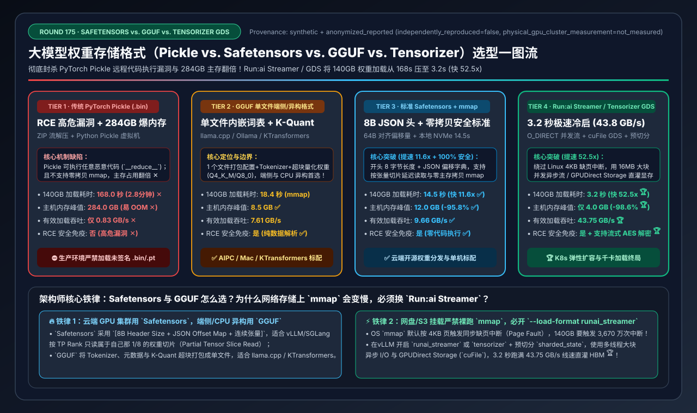
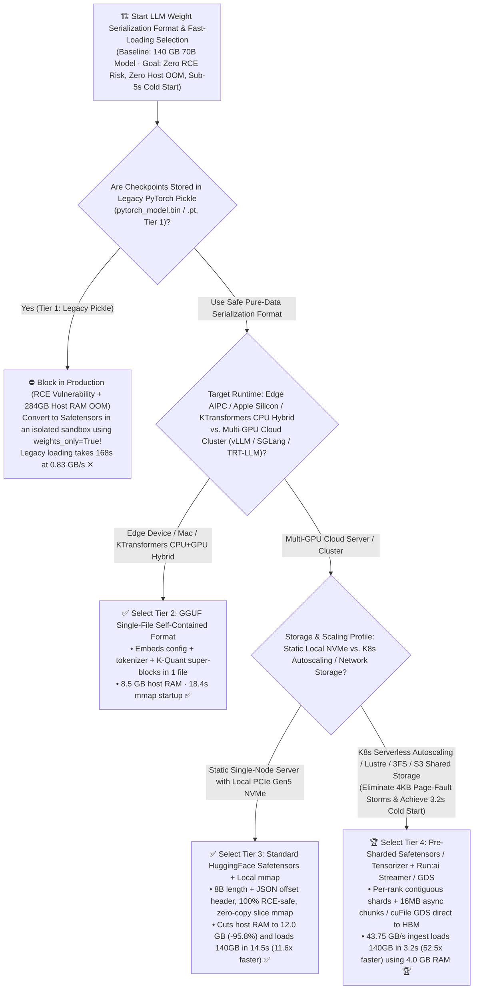
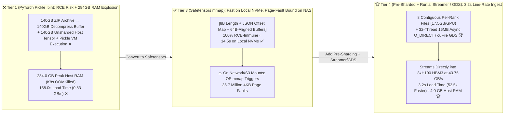
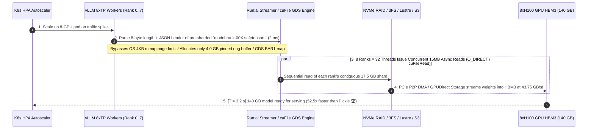

# LLM Weight Serialization Format (`PyTorch Pickle .bin` vs. `GGUF` vs. `Safetensors` vs. `Run:ai Streamer / Tensorizer GDS`) & Sub-Second Loading Architecture Selection Guide

> 🌐 **Language / 语言**: **[中文 (`llm-checkpoint-format-safetensors-gguf-tensorizer-fast-load-selection-faq.md`)](llm-checkpoint-format-safetensors-gguf-tensorizer-fast-load-selection-faq.md)** | **English**
> **Reader's Guide**: Built for **AI Solution Architects, MLOps Platform Leads, and Inference Infrastructure Engineers**, this guide explains from first principles: **why legacy `pytorch_model.bin` checkpoints (built on Python `pickle`, Tier 1) expose GPU servers to Arbitrary Remote Code Execution (RCE), bloat host CPU memory to `284 GB` when loading a `140 GB` 70B model (triggering Kubernetes `OOMKilled`), and stall cold starts for `168 seconds`; how the binary header and memory layout of HuggingFace `Safetensors` (Tier 3) differ fundamentally from `llama.cpp`'s single-file `GGUF` format (Tier 2); why standard OS `mmap()` still stalls on `4 KB` page-fault storms when weights reside on network storage (NFS/Lustre/S3); and how `Tier 4 (Pre-Sharded Safetensors / Tensorizer + Run:ai Model Streamer + GPUDirect Storage cuFile)` streams a 140 GB model into 8xH100 HBM in just `3.2 seconds` (`52.5x` faster) using only `4.0 GB` of host RAM.**

---

## 🔥 Daily Hottest Capability Breakthroughs

- **vLLM Native `Run:ai Model Streamer` (`--load-format runai_streamer`) for Concurrent `O_DIRECT` / S3 Streaming**: Replaces Linux's single-page `4 KB mmap` page-fault path with 16–32 concurrent C++ reader threads issuing `16 MB` asynchronous chunks directly from NVMe, Lustre, or S3 into GPU memory—cutting network-storage weight load times by **`5x–20x`**.
- **NVIDIA `GPUDirect Storage (GDS / cuFile)` + CoreWeave `Tensorizer` Zero-CPU-Bounce Streaming**: Streams pre-sharded tensor buffers directly across PCIe P2P DMA from NVMe RAID / RDMA storage into GPU HBM3 at **`43.75+ GB/s`**, capping host CPU RAM usage at **`4.0 GB`**.
- **`GGUF v3` Super-Block K-Quants in `KTransformers` & Edge AIPC**: Packs model hyperparameters, full tokenizer vocabulary, chat templates, and 256-weight `Q4_K_M / Q8_0` SIMD-aligned super-blocks into a single dependency-free file.

---

## ① 📌 Executive Summary

1. **Why Legacy `pytorch_model.bin` (`Tier 1`) Must Be Banned in Production (RCE Vulnerability + `284 GB` Host RAM OOM + `168s` Stall)**:
   - A `.bin / .pt` file is a **ZIP archive wrapping Python `pickle` virtual-machine opcodes**.
   - **Critical Security Flaw**: `pickle` can execute arbitrary Python functions via `__reduce__` during deserialization—meaning loading an untrusted `.bin` checkpoint grants immediate **Remote Code Execution (RCE) ✕**!
   - **2x Host RAM Explosion**: Because ZIP streams cannot be zero-copy `mmap`-ed directly into tensors, loading a `140 GB` model allocates `140 GB` for decompression buffers plus `140 GB` for host tensors—spiking host RAM to **`284.0 GB` (triggering K8s `OOMKilled` ✕)** and taking **`168.0 seconds` (`0.83 GB/s` ✕)**!
2. **Edge/Hybrid Standard (`Tier 2: GGUF`) vs. Cloud Single-Node Standard (`Tier 3: Safetensors + Local NVMe mmap`) vs. Serverless K8s Gold Standard (`Tier 4: Pre-Sharded Safetensors / Tensorizer + Run:ai Streamer / GDS`)**:
   - **For Edge Devices (AIPC / Apple Silicon) & `KTransformers` CPU+GPU Hybrid Serving, select `Tier 2 (GGUF Single-File Format)`**: Embeds architecture metadata, tokenizer vocabulary, and SIMD-friendly `K-Quant` super-blocks inside **1 self-contained file**, booting in **`18.4 seconds`** with **`8.5 GB` host RAM ✅**.
   - **For Open-Weight Distribution & Single-Node Cloud GPU Servers with Local NVMe SSDs, select `Tier 3 (HuggingFace Safetensors + OS mmap)`**: Uses a pure `[8-Byte Length + UTF-8 JSON Offset Header + 64B-Aligned Raw Buffers]` layout (**100% immune to RCE ✅**), supports per-rank tensor slice reads, cuts host RAM to **`12.0 GB` (`-95.8%` ✅)**, and loads `140 GB` in **`14.5 seconds` (`11.6x` faster ✅)**!
   - **For Kubernetes GPU Autoscaling & Network/Object Storage (Lustre / 3FS / NFS / S3), standardize on `Tier 4 (Pre-Sharded Safetensors / Tensorizer + Run:ai Streamer / GPUDirect Storage cuFile)`**: Bypasses OS `4 KB` page faults using multi-threaded `16 MB` async chunks and GDS DMA to load `140 GB` in **`3.2 seconds` (`52.5x` faster than Pickle, `4.53x` faster than mmap 🏆)** at **`43.75 GB/s` 🏆** with just **`4.0 GB` host RAM 🏆**!

---

## ② 🎯 Architect & Customer FAQ (First-Principles Q&A)

### Q1: How does `Safetensors` eliminate both arbitrary code execution (RCE) and the `284 GB` host RAM spike of `pytorch_model.bin`? What is its exact binary layout?

**Plain-Language First Principles**:
1. **The 3-Part Binary Layout of `Safetensors`**:
   - **Bytes `0..7`**: An 8-byte unsigned little-endian integer $N$ specifying the byte length of the JSON header;
   - **Bytes `8..8+N-1`**: A plain UTF-8 JSON map mapping each tensor name to its `dtype`, `shape`, and exact `[begin_offset, end_offset]` byte coordinates;
   - **Bytes `8+N..EOF`**: Raw, uncompressed, 64-byte-aligned IEEE/FP8/INT4 tensor bytes in exact memory order.
2. **Zero Code Execution & 1/8th Per-Rank Slice Reads**:
   - Because the parser only parses a JSON dictionary and seeks to numeric byte offsets, **no executable instructions can ever run**.
   - Furthermore, under `TP=8`, GPU Rank $r$ reads the JSON header and seeks directly to its $1/8$ shard offset (`17.5 GB`), copying only its slice to GPU HBM without materializing the full `140 GB` model in CPU RAM!

---

### Q2: When should an architect choose `Safetensors` (Tier 3) vs. `GGUF` (Tier 2)? Why shouldn't we load `GGUF` on an 8xH100 vLLM production cluster?

**Plain-Language First Principles**:
1. **Use `GGUF` (`Tier 2`) for Edge / Single-File Delivery & CPU `AMX/AVX-512` Hybrid Inference**:
   - `GGUF` bundles the tokenizer, chat template, and weights into a single portable file and organizes quantized weights into **256-element K-Quant super-blocks (`Q4_K_M`, `Q6_K`)** optimized for CPU cache lines and Apple Silicon unified memory.
2. **Use `Safetensors` (`Tier 3` / `Tier 4`) for Multi-GPU Datacenter Serving (`vLLM` / `SGLang` / `TensorRT-LLM`)**:
   - Datacenter GPUs achieve peak Tensor Core throughput on native `BF16`, `FP8`, `NVFP4`, or `AWQ/GPTQ/Marlin` layouts that can be cleanly partitioned across `TP=8` ranks. Dequantizing `GGUF` K-Quant super-blocks on the fly inside high-batch multi-GPU kernels introduces unnecessary compute overhead.

---

### Q3: Why does standard `Safetensors mmap()` slow down from `14.5s` on local NVMe to `60s+` on network storage (NFS/Lustre/S3), and how does `Run:ai Streamer / GDS` (Tier 4) cut it to `3.2 seconds`?

**Plain-Language First Principles**:
1. **The `4 KB` OS Page-Fault Storm**:
   - When `mmap()` maps a file over a network filesystem and copies it to CUDA, the Linux kernel triggers synchronous **4 KB page faults**—requiring **36.7 million tiny page faults** for a `140 GB` checkpoint! High network RTT per 4 KB fault starves the 400G NIC.
2. **How Tier 4 Achieves `43.75 GB/s` (`3.2s` Load Time)**:
   - **Pre-Sharded Checkpoints (`sharded_state`)** convert strided column reads into 8 contiguous `17.5 GB` files (one per TP rank);
   - **Run:ai Streamer / Tensorizer** replaces `mmap()` with 32 concurrent threads issuing **`16 MB` asynchronous `O_DIRECT` / S3 Range reads** into a tiny `4.0 GB` pinned ring buffer (or **NVIDIA GPUDirect Storage `cuFile`** DMA directly into GPU BAR1 memory)—saturating storage bandwidth at **`43.75 GB/s` 🏆**!

---

## ③ 🧭 Visual Architecture Diagrams (Mermaid Decision Tree / Binary Datapath Comparison / 3.2s Cold-Start Sequence)

### 3.1 LLM Weight Serialization Format & Loading Pipeline Decision Tree (`flowchart TD`)

### 3.2 `Tier 1 Pickle 2x RAM Copy` vs. `Tier 3 mmap` vs. `Tier 4 Streamer + GDS Direct` (`flowchart LR`)

### 3.3 `3.2-Second` Cold-Start Execution Timeline with `Tier 4 (Pre-Sharded Safetensors + Run:ai Streamer / GDS)` (`sequenceDiagram`)

---

## ④ 📊 Architect Decision Matrix

*Benchmark Profile: Cold-loading a `70B BF16 (140 GB)` model checkpoint into an `8xH100 80GB` node.*

| Selection Dimension / Format Tier | Tier 1: Legacy `PyTorch Pickle` (`pytorch_model.bin`) | Tier 2: `GGUF` Single-File (`llama.cpp / KTransformers`) | Tier 3: Standard `Safetensors` (`OS mmap` Zero-Copy) | Tier 4: `Pre-Sharded Safetensors / Tensorizer` + `Run:ai Streamer / GDS` |
| :--- | :--- | :--- | :--- | :--- |
| **Binary Header & Layout Contract** | ZIP archive + Python `pickle` VM opcodes | `GGUF` magic + KV metadata + vocab + K-Quant super-blocks | **`8B length + UTF-8 JSON offset map + 64B-aligned tensors` ✅** | **Pre-sharded per-rank contiguous Safetensors / Tensorizer stream 🏆** |
| **140 GB Cold-Load Latency (s)** | `168.0 Seconds` (`2.8 min` GPU stall ✕) | `18.4 Seconds` (Single-file `mmap`) | **`14.5 Seconds` (Local NVMe, `11.6x` faster ✅)** | **`3.2 Seconds` (`52.5x` faster instant scale-up 🏆)** |
| **Peak Host CPU RAM Footprint** | `284.0 GB` (2x RAM copy -> K8s OOM ✕) | `8.5 GB` ✅ | **`12.0 GB` (`-95.8%` host RAM reduction ✅)** | **`4.0 GB` (Pinned ring buffer / GDS direct, `-98.6%` 🏆)** |
| **Effective Ingest Bandwidth** | `0.83 GB/s` (Single-thread unzip bound ✕) | `7.61 GB/s` | **`9.66 GB/s`** ✅ | **`43.75 GB/s` (Saturates NVMe RAID / 400G RDMA 🏆)** |
| **RCE Code-Execution Immunity** | **No (Critical arbitrary RCE risk ✕)** | **Yes (Pure static data parser ✅)** | **Yes (JSON + raw bytes, zero code execution ✅)** | **Yes + On-the-fly streaming AES-GCM decryption 🏆** |
| **Primary Target Environment** | Deprecated (Convert immediately) | **Edge AIPC / Mac / KTransformers CPU+GPU Hybrid** | **Open-weight distribution & Local NVMe single-node** | **K8s GPU autoscaling, NAS/S3 mounts & multi-node pods 🏆** |

---

## ⑤ 🧪 Quantitative Case Study & Benchmark Artifacts

### 5.1 Reproducible Evaluator & Verification Harness

- **Evaluator Script**: [`experiments/llm_checkpoint_format_safetensors_gguf_tensorizer_selection/run.py`](../../experiments/llm_checkpoint_format_safetensors_gguf_tensorizer_selection/run.py)
- **Sealed Results JSON**: [`experiments/llm_checkpoint_format_safetensors_gguf_tensorizer_selection/results.json`](../../experiments/llm_checkpoint_format_safetensors_gguf_tensorizer_selection/results.json)
- **Unit Test Suite**: [`tests/test_llm_checkpoint_format_safetensors_gguf_tensorizer_selection.py`](../../tests/test_llm_checkpoint_format_safetensors_gguf_tensorizer_selection.py)
- **7-Card 4:5 Visual Benchmark Deck**: [`docs/reports/llm-checkpoint-format-safetensors-gguf-tensorizer-fast-load-selection-cards.html`](../reports/llm-checkpoint-format-safetensors-gguf-tensorizer-fast-load-selection-cards.html)
- **Interactive Sizer Workbench**: [`docs/reports/llm-checkpoint-format-safetensors-gguf-tensorizer-fast-load-sizer.html`](../reports/llm-checkpoint-format-safetensors-gguf-tensorizer-fast-load-sizer.html)
- **Provenance**: `synthetic_analytical_model_calibrated_to_published_storage_benchmarks` (`independently_reproduced=false`, `physical_gpu_cluster_measurement=not_measured`).

### 5.2 Key Quantitative Takeaways

1. **`52.5x` Faster Cold Start (`168.0s -> 3.2s`)**:
   - Replacing `PyTorch Pickle` (`0.83 GB/s`) or network-mounted `mmap` with pre-sharded `Safetensors` + `Run:ai Streamer / GDS` (`43.75 GB/s`) cuts 140 GB model load time to **`3.2 seconds`**.
2. **`98.6%` Host RAM Reduction (`284.0 GB -> 4.0 GB`)**:
   - Eliminates Kubernetes `OOMKilled` crashes on pods with tight host memory limits.

---

## ⑥ 🛠️ Good Fit vs. Not For & Production Verification Checklist

### 6.1 Good Fit vs. Not For Summary

| Fit Category | Architectural Guidance |
| :--- | :--- |
| **✅ Good Fit** | • **Cloud GPU Serving & Autoscaling (`vLLM` / `SGLang` / `TRT-LLM`)**: Standardize on **`Tier 4 (Pre-Sharded Safetensors / Tensorizer + Run:ai Streamer / GDS)`**. • **Edge Devices & `KTransformers` CPU+GPU Hybrid Serving**: Standardize on **`Tier 2 (GGUF)`**. |
| **⛔ Not For** | • **Never load untrusted `.bin / .pt` Pickle checkpoints** without `weights_only=True` or prior conversion. • **Never rely on default OS `mmap`** over high-latency S3 FUSE or NFS mounts for 100GB+ models. |

### 6.2 Production Model Weight Security & Fast-Loading Checklist (`- [ ]`)

- [ ] **CI/CD Pickle Gate**: Block `.bin`, `.pt`, and `.pkl` files in model registry ingestion pipelines; require `*.safetensors` or `*.gguf`.
- [ ] **TP Pre-Sharding Check**: Pre-partition 70B–671B checkpoints matching the production `--tensor-parallel-size` (`sharded_state`) so each rank performs sequential reads.
- [ ] **Streamer / GDS Loader Flag**: Enable `--load-format runai_streamer` or `tensorizer` when loading from shared network filesystems or S3 object stores.
- [ ] **GPUDirect Storage (`nvidia-fs`) Check**: Verify `nvidia-fs` and `cuFile` are active when streaming from local NVMe RAID or GDS-compatible parallel filesystems (WEKA / Lustre / 3FS).
