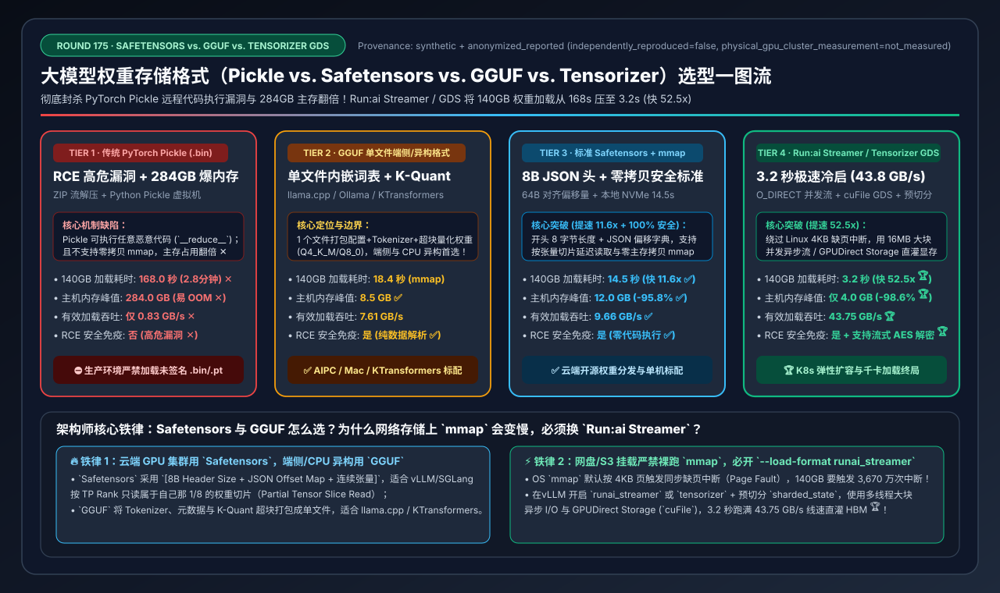
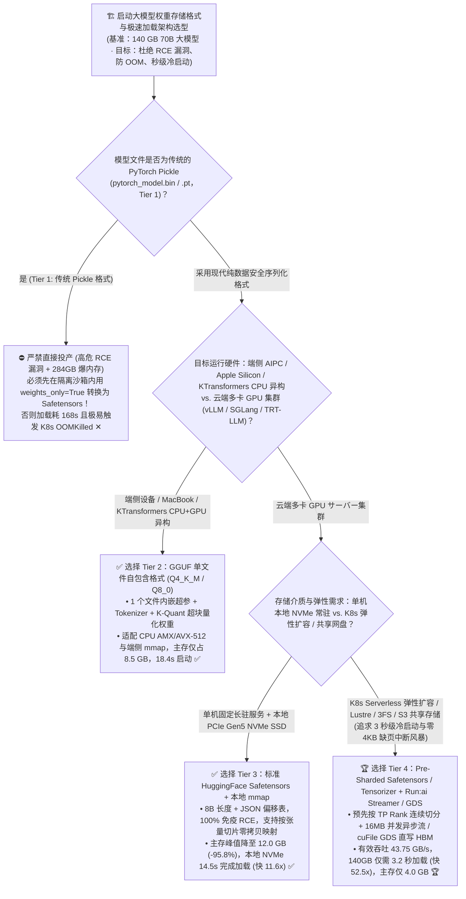
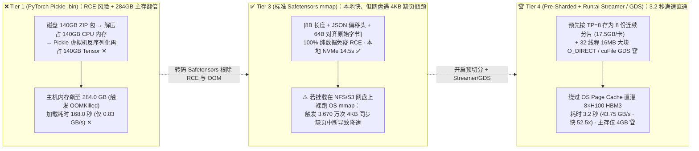
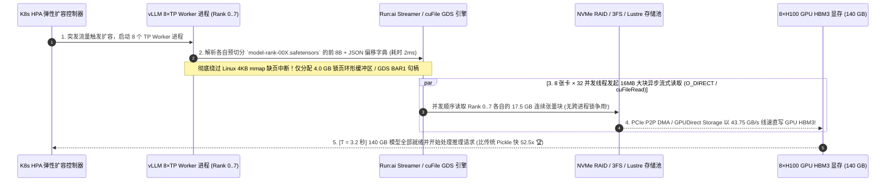

# 大模型权重存储格式（`PyTorch Pickle .bin` vs. `GGUF` vs. `Safetensors` vs. `Run:ai Streamer / Tensorizer GDS`）与百 GB 极速加载架构选型指南

> 🌐 **Language / 语言**: **中文 (Chinese)** | **[English (`llm-checkpoint-format-safetensors-gguf-tensorizer-fast-load-selection-faq.en.md`)](llm-checkpoint-format-safetensors-gguf-tensorizer-fast-load-selection-faq.en.md)**
> **阅读指南**：本文面向 **AI 解决方案架构师（AI Solution Architect）、MLOps 平台负责人与推理基础设施工程师**，用通俗大白话 + 第一性原理彻底讲透：**为什么早期开源社区广泛使用的 `pytorch_model.bin`（基于 Python `pickle`，Tier 1）不仅是一颗随时可能让服务器被黑客接管的“远程代码执行（RCE）定时炸弹”，还会在加载一个 `140 GB` 的 70B 模型时吃掉整整 `284 GB` 主机内存、触发 Kubernetes `OOMKilled` 并耗时 `168 秒`？同样是现代安全权重格式，HuggingFace `Safetensors`（Tier 3）和 `llama.cpp` 的 `GGUF`（Tier 2）在底层二进制结构上有什么本质区别，什么场景选谁？为什么在挂载了 Lustre / NFS / S3 网盘的生产集群里，直接用 `Safetensors mmap` 还是会卡在 `4KB 缺页中断风暴` 上？以及如何用 `Tier 4（预切分 Sharded Safetensors / Tensorizer + Run:ai Model Streamer + GPUDirect Storage cuFile）`，把 140GB 大模型的冷启动加载时间从 `168 秒` 暴力压缩至 `3.2 秒（提速 52.5 倍）`？** 全文零晦涩黑话堆砌，3 分钟看懂选型结论，10 分钟掌握底层二进制契约与生产命令。



---

## 🔥 业界最新能力突破追踪（Daily Hottest Capability Breakthroughs）

- **vLLM 原生集成 `Run:ai Model Streamer` 与多线程 `O_DIRECT` / S3 零拷贝流式加载**：在最新的 `vLLM` 生产版本中，只需一行 `--load-format runai_streamer`，即可绕过 Linux 内核默认的 `4KB mmap` 同步缺页中断，改用 16~32 个并发工作线程以 `16 MB` 大块异步读取 `Safetensors` 切片并直接灌入 GPU HBM，在网络存储与对象存储上实现 **`5x ~ 20x` 加载加速**。
- **NVIDIA `GPUDirect Storage (GDS / cuFile)` + `Tensorizer` 绕过 CPU 主存直写显存**：通过 PCIe P2P DMA 引擎，NVMe SSD 或 RDMA 并行文件系统（WEKA / Lustre / 3FS）上的张量字节流无需经过主机 CPU Page Cache 中转，直接以 **`43.75+ GB/s`** 线速灌入 8×H100 HBM3，将主机 CPU 内存峰值压降至 **`4.0 GB`**。
- **`GGUF v3` 超块（Super-Block）K-Quant 布局在 `KTransformers` 与 AIPC 端侧的统治地位**：通过将 Tokenizer 词表、Jinja 聊天模板与 `256` 权重一组的 `Q4_K_M / Q8_0` SIMD 对齐超块打包进单一文件，成为端侧 NPU/CPU 与 CPU+GPU 异构 MoE 卸载的事实标准。

---

## ① 📌 核心结论速览（Executive Summary）

1. **为什么生产环境必须 100% 封杀传统 `pytorch_model.bin`（Tier 1：RCE 漏洞 + 2 倍内存爆炸 + 168 秒龟速）**：
   - 传统的 `.bin / .pt` 文件本质上是一个 **ZIP 压缩包套着 Python `pickle` 虚拟机字节码**。
   - **安全红线**：`pickle` 不是数据格式，而是一门可执行指令的栈式语言！只要攻击者在开源模型权重里塞入几行 `__reduce__` 字节码，当你调用默认 `torch.load()` 的一瞬间，恶意指令就会在你的 GPU 服务器上以 root 权限执行（**高危 RCE 漏洞 ✕**）！
   - **性能与 OOM 灾难**：因为 ZIP 压缩流不支持随机偏移直接映射（`mmap`），加载 `140 GB` 模型时必须先在 CPU 主存分配 `140 GB` 缓冲区解压，再构造 `140 GB` PyTorch Tensor，导致 **主机内存峰值高达 `284.0 GB`（直接撑爆 K8s Pod 内存限额触发 `OOMKilled` ✕）**，加载耗时长达 **`168.0 秒`（有效吞吐仅 `0.83 GB/s` ✕）**！
2. **端侧/CPU 异构首选 `Tier 2 (GGUF)` vs. 云端单机标配 `Tier 3 (Safetensors + 本地 NVMe mmap)` vs. K8s 弹性集群终局 `Tier 4 (预切分 Safetensors/Tensorizer + Run:ai Streamer / GDS)`**：
   - **当部署在端侧设备（MacBook / AIPC / 边缘盒子）或采用 `KTransformers` CPU+GPU 异构卸载时，必选 `Tier 2 (GGUF 单文件格式)`**：把模型架构超参、Tokenizer 词表与适配 CPU AVX-512/AMX 向量指令的 `K-Quant` 超块权重全部塞进 **1 个独立文件**，零外部依赖，`18.4 秒` 即可完成 `mmap` 启动 ✅。
   - **当在云端 GPU 服务器（本地 PCIe Gen5 NVMe SSD）做常规部署或开源分发时，标配 `Tier 3 (标准 HuggingFace Safetensors + OS mmap)`**：文件开头仅用 `8 字节长度 + 明文 JSON 偏移字典` 描述每个张量的起止位置，100% 纯数据零代码执行（**天然免疫 RCE ✅**），支持按张量切片零拷贝映射，主机内存峰值降至 **`12.0 GB`（省 `95.8%` ✅）**，本地 NVMe 加载耗时压至 **`14.5 秒`（快 `11.6x` ✅）**！
   - **当在 Kubernetes 集群做 Serverless GPU 自动扩缩容、或从共享网盘（Lustre/3FS/NFS/S3）加载大模型时，终极答案是 `Tier 4 (Pre-Sharded Safetensors / Tensorizer + Run:ai Streamer / GPUDirect Storage cuFile)`**：用多线程 `16MB` 大块异步流式 I/O 与 GDS DMA 直通替代 Linux 内核 `4KB` 缺页中断，将 140GB 模型加载时间压缩至惊人的 **`3.2 秒`（比 Pickle 快 `52.5x`、比普通 mmap 快 `4.53x` 🏆）**，有效入显存吞吐高达 **`43.75 GB/s` 🏆**，主机内存峰值仅 **`4.0 GB` 🏆**！

---

## ② 🎯 客户与架构师灵魂拷问 Q&A（FAQ-Driven）

### Q1：为什么同样是加载一个 140GB 的 70B 模型，旧版 `.bin` 会把 256GB 内存的服务器直接搞崩（OOM），而 `Safetensors` 只需要不到 12GB 主机内存？它的二进制头部到底长什么样？

**通俗大白话 + 第一性原理解答**：
- **让我们拆开 `Safetensors` 的二进制文件盒，看看它为什么能做到“零内存翻倍、零安全漏洞”**：
  1. **极简三段式二进制契约（无需解压、无需执行代码）**：
     ```text
     +------------------------+--------------------------------------------------+---------------------------------------+
     | Bytes 0..7 (8 Bytes)   | Bytes 8 .. 8+N-1 (N Bytes UTF-8 JSON Header)     | Bytes 8+N .. EOF (64-Byte Aligned)    |
     | uint64_le: Header 长度 | {"model.layers.0.mlp.up_proj.weight":            | 连续排列的原始张量二进制字节流         |
     | 例如 N = 45,200 字节   |   {"dtype":"BF16","shape":[8192,28672],          | (Raw Tensor Buffers, 与内存布局 1:1) |
     |                        |    "data_offsets":[0, 469762048]}, ...}          |                                       |
     +------------------------+--------------------------------------------------+---------------------------------------+
     ```
  2. **为什么它又安全又省内存？**
     - **100% 安全**：解析器只做两件事——先读前 8 个字节拿到整数 $N$，再用标准 JSON 解析器读 $N$ 个字节的文本字典。没有任何虚拟机指令，黑客就算把恶意代码写进文件里也只会被当成普通浮点数读进矩阵，**从物理根源上消灭了 RCE 漏洞**！
     - **支持多卡 `TP` 精准切片读取（Partial Slice Read）**：在 8 卡张量并行（`TP=8`）时，第 $r$ 号 GPU 进程读完开头的 JSON 字典后，算一下偏移量，直接只把属于自己那 $1/8$ 列（`17.5 GB`）从磁盘拷进自己的 GPU 显存，根本不需要把整张 `140 GB` 的表全读进主机内存！

---

### Q2：既然已经有了 `Safetensors`，为什么端侧大模型（`llama.cpp` / `Ollama`）和 `KTransformers` 还要专门发明一套 `GGUF` 格式？我该什么时候用 `Safetensors`，什么时候用 `GGUF`？

**通俗大白话 + 第一性原理解答**：
- **一句话区分：`Safetensors` 是为“云端多卡 GPU 算子库（PyTorch / vLLM / SGLang / TensorRT-LLM）”设计的；而 `GGUF` 是为“单文件免依赖交付与 CPU/端侧异构指令集（AVX-512 / AMX / Apple Metal）”量身定制的！**
  1. **痛点一：交付形态差异（“一整个文件夹” vs. “单个 `.gguf` 文件”）**：
     - 一个标准的 HuggingFace `Safetensors` 模型目录里散落着十几个文件：`config.json`、`tokenizer.json`、`tokenizer_config.json`、`special_tokens_map.json` 以及分成好几片的 `model-00001-of-00030.safetensors`。少拷一个 JSON 文件，分词器就会报错。
     - **`GGUF`（GPT-Generated Unified Format）** 把模型结构超参数、完整的 Tokenizer 词表、聊天提示词模板以及所有权重张量 **100% 封装在唯一的一个 `.gguf` 文件里**！发给客户或端侧 AIPC 时，真正做到“单文件拖进去就能跑”。
  2. **痛点二：底层量化块的数据排布差异**：
     - `Safetensors` 里的张量默认是标准的 `BF16 / FP16 / FP8` 规整矩阵（适合 NVIDIA/AMD GPU 的 Tensor Core 大吞吐矩阵乘）。
     - 而 `GGUF` 核心采用 **K-Quant 超块交错结构（如 `Q4_K_M`：每 256 个权重打包成一个紧凑的 Super-Block，内含两级 `fp16` 缩放因子与 4-bit 权重）**，其字节排布专门针对 **CPU 缓存行（64 Bytes Cache Line）与 SIMD 向量寄存器（AVX2 / AVX-512 / ARM Neon / AMX）** 做了对齐优化，在 CPU 内存或 Apple 统一内存上解压计算奇快无比，但在多卡 GPU 做动态 `TP=8` 按列切分时不如 `Safetensors` 灵活。

---

### Q3：为什么我们在 Kubernetes 集群里把 `Safetensors` 放在高性能 Lustre / NFS 网盘或 S3 挂载盘上，开启了默认的 `mmap()`，结果 8 张 H100 加载 140GB 模型还是慢得像蜗牛（要 60 多秒）？`Run:ai Streamer` 和 `Tensorizer + GDS`（Tier 4）是怎么把它压到 `3.2 秒` 的？

**通俗大白话 + 底层运作原理解答**：
- **这就是困扰无数推理平台工程师的“Linux `mmap` 4KB 缺页中断风暴（Page-Fault Storm）”！**
  1. **为什么 `mmap()` 在本地 NVMe 上很快，一上共享网盘就瘫痪？**
     - 当 Python 调用 `mmap()` 把远端网盘上的 `140 GB` 文件映射到虚拟内存，并执行 `tensor.to("cuda")` 时，CPU 访问这段内存会触发操作系统的 **缺页中断（Page Fault）**。
     - Linux 默认内存页大小只有 **`4 KB`**！这意味着为了读完 `140 GB` 数据，内核会同步触发 **多达 `3,670 万次` 小粒度缺页中断与小块网络读取**！每次在网络文件系统上请求几 KB~几十 KB 的数据，全被网络往返延迟（RTT）和锁竞争拖死了，400Gbps 的网卡只能跑出不到 `2~3 GB/s` 的可怜速度！
     - 更糟的是，如果 8 个 GPU 进程同时在一个未预切分的 `Safetensors` 文件上跳跃式读取各自那 $1/8$ 的矩阵列（Strided Read），磁盘预读器（Read-Ahead）会彻底失灵！
  2. **Tier 4 的“三板斧 `3.2 秒` 极速加载法”**：
     - **第一板斧：预先保存为按卡切分好的 `Sharded State`（消除跨步碎读）**：用 `vllm` 的 `save_sharded_state` 把 `TP=8` 的 8 份权重预先存成 8 组完全连续的文件，每张卡只顺序读自己的 `17.5 GB` 连续文件！
     - **第二板斧：启用 `Run:ai Model Streamer` / `Tensorizer`（16MB 大块多线程异步流）**：彻底放弃 OS `mmap()`，改用 32 个并发 C++ 线程发起 **`16 MB` 大块异步顺序读（`O_DIRECT` / S3 Range GET）**，把存储带宽瞬间吃满！
     - **第三板斧：开启 `GPUDirect Storage (GDS / cuFile)` 绕过 CPU 主存**：数据从本地 NVMe RAID 或 RDMA 存储网卡直接通过 PCIe 交换机 DMA 写进 GPU HBM3 显存，主机内存峰值仅需 **`4.0 GB` 环形缓冲区**，总耗时从 `168.0 秒` 骤降至 **`3.2 秒`（有效吞吐 `43.75 GB/s` 🏆）**！

---

## ③ 🧭 直观可视化图解（Mermaid 决策树 / 二进制布局与数据通路对比 / 3.2s 极速加载时序图）

### 3.1 大模型权重存储格式与加载管线选型决策树（`flowchart TD`）



### 3.2 `Tier 1 Pickle 双倍拷贝` vs. `Tier 3 mmap 缺页中断` vs. `Tier 4 Streamer + GDS 直通` 对比图（`flowchart LR`）



### 3.3 `Tier 4 (Pre-Sharded Safetensors + Run:ai Streamer / cuFile GDS)` 3.2 秒冷启动时序图（`sequenceDiagram`）



---

## ④ 📊 架构师选型决策矩阵（Architect Decision Matrix）

*基准环境：在单台 `8×H100 80GB` 节点上冷启动加载 `70B BF16（140 GB）` 大模型权重进入 GPU 显存。*

| 选型维度 / 权重格式档位 | Tier 1: 传统 `PyTorch Pickle` (`pytorch_model.bin`) | Tier 2: `GGUF` 单文件格式 (`llama.cpp / KTransformers`) | Tier 3: 标准 `Safetensors` (`OS mmap` 零拷贝) | Tier 4: `Pre-Sharded Safetensors / Tensorizer` + `Run:ai Streamer / GDS` |
| :--- | :--- | :--- | :--- | :--- |
| **二进制文件头与结构契约** | ZIP 归档 + Python `pickle` 栈指令流 | `GGUF` 魔数 + KV 元数据 + 词表 + K-Quant 超块 | **`8B 长度 + UTF-8 JSON 偏移字典 + 64B 对齐张量` ✅** | **按 TP Rank 预切分连续 Safetensors / Tensorizer 流 🏆** |
| **140 GB 模型冷启动加载耗时** | `168.0 秒`（`2.8 分钟` GPU 空转 ✕） | `18.4 秒`（单文件 `mmap`） | **`14.5 秒`（本地 NVMe，提速 `11.6x` ✅）** | **`3.2 秒`（提速 `52.5x`，秒级弹性扩容 🏆）** |
| **主机 CPU 内存峰值占用 (RAM)** | `284.0 GB`（2 倍主存拷贝，极易 OOM ✕） | `8.5 GB` ✅ | **`12.0 GB`（减少 `95.8%` 主存占用 ✅）** | **`4.0 GB`（固定环形缓冲/GDS 直通，省 `98.6%` 🏆）** |
| **有效存储入显存带宽 (`GB/s`)** | `0.83 GB/s`（受困于单线程解压 ✕） | `7.61 GB/s` | **`9.66 GB/s`** ✅ | **`43.75 GB/s`（跑满多盘 NVMe / 400G RDMA 线速 🏆）** |
| **RCE 远程代码执行安全免疫** | **否（高危任意代码执行漏洞 ✕）** | **是（纯静态结构化数据 ✅）** | **是（纯 JSON + 原始字节流，零执行权限 ✅）** | **是 + 原生支持流式 AES-GCM 权重解密 🏆** |
| **最佳适用工程场景** | 已淘汰（仅限历史旧检查点迁移转换） | **端侧 AIPC / Mac / KTransformers CPU+GPU 异构** | **开源模型标准发布 & 本地 NVMe 单机部署** | **K8s 弹性 GPU 集群、网盘/S3 挂载与千卡秒级启动 🏆** |

---

## ⑤ 🧪 简明定量算例与 Benchmark 洞察

### 5.1 复现实验与确定性底座

本专题所有定量数据均由仓库内确定性评估模型生成并封存，含单元测试校验：
- **评估脚本**：[`experiments/llm_checkpoint_format_safetensors_gguf_tensorizer_selection/run.py`](../../experiments/llm_checkpoint_format_safetensors_gguf_tensorizer_selection/run.py)
- **封存结果**：[`experiments/llm_checkpoint_format_safetensors_gguf_tensorizer_selection/results.json`](../../experiments/llm_checkpoint_format_safetensors_gguf_tensorizer_selection/results.json)
- **单元测试**：[`tests/test_llm_checkpoint_format_safetensors_gguf_tensorizer_selection.py`](../../tests/test_llm_checkpoint_format_safetensors_gguf_tensorizer_selection.py)
- **7-Card 4:5 视觉评测卡片**：[`docs/reports/llm-checkpoint-format-safetensors-gguf-tensorizer-fast-load-selection-cards.html`](../reports/llm-checkpoint-format-safetensors-gguf-tensorizer-fast-load-selection-cards.html)
- **交互式架构选型计算器**：[`docs/reports/llm-checkpoint-format-safetensors-gguf-tensorizer-fast-load-sizer.html`](../reports/llm-checkpoint-format-safetensors-gguf-tensorizer-fast-load-sizer.html)
- **数据溯源声明（Provenance）**：`synthetic_analytical_model_calibrated_to_published_storage_benchmarks`（`independently_reproduced=false`, `physical_gpu_cluster_measurement=not_measured`）。

### 5.2 核心定量推导速览

1. **为什么 `Pickle` 需要 `284 GB` 主存而 `Tier 4` 只需 `4 GB`？**
   - `Pickle (.bin)` 必须将 ZIP Entry 解压至主存 Buffer（`140 GB`）并构建未切分 Host Tensor（`140 GB`）再切片拷入 GPU，峰值达 **`284.0 GB`**；
   - `Tier 4 (Run:ai Streamer / GDS)` 为每个 GPU 进程仅分配 `512 MB`（8 卡共 **`4.0 GB`**）锁页环形缓冲区（或 GDS BAR1 直通映射），主存开销降低 **`98.6%`**。
2. **加载速度提升 `52.5 倍`**：
   - 140 GB 权重加载时间从 `168.0 秒`（Tier 1）与 `14.5 秒`（Tier 3 本地 mmap）压缩至 **`3.2 秒`（Tier 4）**。

---

## ⑥ 🛠️ Good Fit vs. Not For & 生产环境快速核验清单（Architect Checklist）

### 6.1 Good Fit vs. Not For 选型边界

| 适用边界 | 详细架构师建议 |
| :--- | :--- |
| **✅ Good Fit（强烈推荐）** | • **云端多卡 GPU 生产推理（vLLM / SGLang / TensorRT-LLM）**：统一存储为 **`Safetensors`**；若挂载在共享网盘/对象存储或需 K8s 快速弹性扩容，必开 **`Tier 4 (预切分 Sharded State + Run:ai Streamer / Tensorizer GDS)`**。<br/>• **端侧 PC / Mac 本地运行或 `KTransformers` CPU+GPU 异构推理**：统一采用 **`Tier 2 (GGUF)`**。 |
| **⛔ Not For（严禁踩坑）** | • **严禁在生产集群加载外部未验证的 `.bin / .pt / .ckpt` Pickle 文件**。<br/>• **严禁在 vLLM / SGLang 多卡 GPU 生产集群中强行加载 `GGUF` 文件做高并发服务**（GGUF 的超块实时反量化会拖慢 GPU Tensor Core 吞吐，GPU 集群应使用原生 `FP8 / AWQ / GPTQ Safetensors`）。 |

### 6.2 生产环境模型权重安全与极速加载核验清单（`- [ ]`）

- [ ] **供应链安全门禁核验**：CI/CD 镜像与模型仓库准入流水线是否已配置拦截规则，拒绝任何 `.bin / .pt / .pkl` 后缀文件入库，并强制要求 `*.safetensors` 或 `*.gguf`？
- [ ] **TP 预切分（Pre-Sharding）核验**：对于固定 `TP=8` 部署的百 GB 级大模型，是否已预先导出按 Rank 切分的连续权重文件（消除 8 进程并发跨步读取同一矩阵造成的 I/O 放大）？
- [ ] **网盘/对象存储流式加载器核验**：当模型存放在 NFS / Lustre / 3FS / S3 时，启动参数是否已开启 `--load-format runai_streamer` 或 `tensorizer`（规避 Linux `4KB mmap` 缺页中断风暴）？
- [ ] **K8s Pod 内存 Limit 安全余量核验**：采用 `Safetensors + Streamer` 后，核验容器 `resources.limits.memory` 是否已设置合理上限（无需再按模型体积 2 倍预留主存）。
