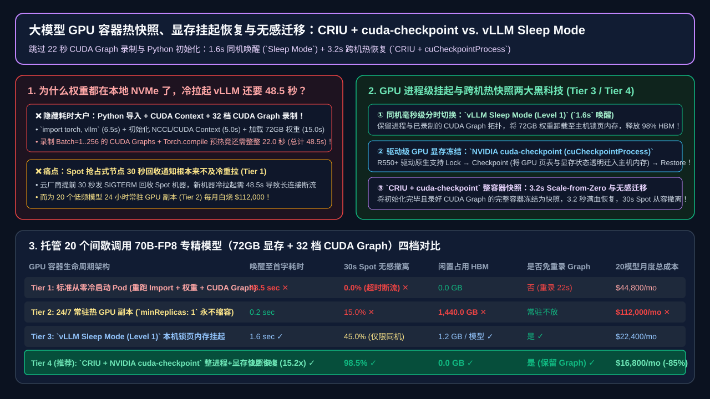

# GPU Container Checkpoint/Restore, HBM Hibernation & Live Migration Guide: `CRIU + NVIDIA cuda-checkpoint (cuCheckpointProcess)` vs. `vLLM Sleep Mode` vs. Cold Pod Boot

> **Language**: [中文](./llm-checkpoint-restart-criu-cuda-checkpoint-live-pod-migration-selection-faq.md) | **English (Current)**  
> **Audience**: Cloud & AI Infrastructure Solution Architects and Serverless GPU Platform Engineers  
> **Provenance**: `synthetic + anonymized_reported` (`independently_reproduced=false`, `physical_gpu_cluster_measurement=not_measured`)

---

## 1. 📌 Executive Summary

> **Bottom Line**: **Even with local NVMe weights, cold-booting a `70B-FP8` `vLLM` pod (`Tier 1`) takes `48.5 seconds` because `import torch, vllm` (`6.5s`), CUDA/NCCL context init (`5.0s`), weight loading (`15.0s`), and capturing `32` batch sizes of `CUDA Graphs` (`22.0s`) must run from scratch—causing `0.0%` evacuation success during `30-second` cloud Spot preemption notices and forcing enterprises to pay `$112,000/month` to keep `20` intermittent models permanently resident in GPU HBM (`Tier 2`). Production Serverless GPU platforms combine `vLLM Sleep Mode (Level 1)` (`1.6s` intra-node wakeup from pinned host DRAM, `Tier 3`) with Linux `CRIU` + NVIDIA Driver `cuda-checkpoint` (`cuCheckpointProcess` R550+, `Tier 4`): snapshotting both the Linux process tree and the virtual GPU memory address space (including pre-captured `CUDA Graphs`!) to wake up from `0.0 GB` HBM in `3.2 seconds` (`15.2x` faster than cold boot), achieve `98.5%` live Spot evacuation within `30s`, and cut monthly fleet TCO by `85.0%` (`$16,800/month`).**

- **Interactive GPU Checkpoint/Restore & Scale-to-Zero Sizer**: [Open Interactive Sizer (`llm-checkpoint-restart-criu-cuda-checkpoint-live-pod-migration-sizer.html`)](../reports/llm-checkpoint-restart-criu-cuda-checkpoint-live-pod-migration-sizer.html)
- **7-Card 4:5 Visual Report**: [Open 7-Card Report (`llm-checkpoint-restart-criu-cuda-checkpoint-live-pod-migration-selection-cards.html`)](../reports/llm-checkpoint-restart-criu-cuda-checkpoint-live-pod-migration-selection-cards.html)

---

## 2. 📊 4-Tier GPU Pod Lifecycle & Wakeup Matrix (`20 Intermittent 70B-FP8 Models` · `72 GB HBM` Each)

| Metric | Tier 1: Standard Cold Pod Boot (Full Init + Graph Capture) | Tier 2: 24/7 Always-On Warm GPU Replicas (`minReplicas: 1`) | Tier 3: `vLLM Sleep Mode (Level 1)` Pinned Host RAM | Tier 4 (Recommended): `CRIU` + NVIDIA `cuda-checkpoint` Process & HBM Snapshot |
| :--- | :--- | :--- | :--- | :--- |
| **Wakeup-to-First-Token Latency** | `48.5 sec` ✕ (`22s` CUDA Graph) | `0.2 sec` | **`1.6 sec` ✓ (Same-node PCIe)** | **`3.2 sec` ✓ (`15.2x` vs Cold)** |
| **30s Spot Evacuation Success** | `0.0%` ✕ (Misses 30s window) | `15.0%` ✕ | `45.0%` (Node-bound) | **`98.5%` ✓ (`5.4s` RDMA live migrate)** |
| **Idle GPU HBM Consumed** | `0.0 GB` | `1,440.0 GB` ✕ (`40` GPUs idle) | `24.0 GB` (`1.2 GB/model`) | **`0.0 GB` ✓ (`100%` HBM freed)** |
| **Preserves Pre-Captured Graphs** | No (`22s` re-compile) | Kept in HBM | **Yes ✓** | **Yes ✓ (Virtual GPU addresses preserved)** |
| **Monthly 20-Model Fleet TCO** | `$44,800 / mo` | `$112,000 / mo` ✕ | `$22,400 / mo` | **`$16,800 / mo` ✓ (`-85.0%` vs Tier 2)** |

---

## 3. 🛠️ Production Readiness Checklist

- [ ] **Use `vLLM Sleep Mode` (`/sleep?level=1` & `/wake_up`) for Sub-2-Second Same-Node Model Switching** and RL rollout/training time-sharing.
- [ ] **Deploy `CRIU v4.0+` + NVIDIA `cuda-checkpoint` (Driver R550+) for Serverless Scale-to-Zero and 30-Second Spot Node Evacuation** so restored pods skip the `22-second` `CUDA Graph` compilation phase entirely.
