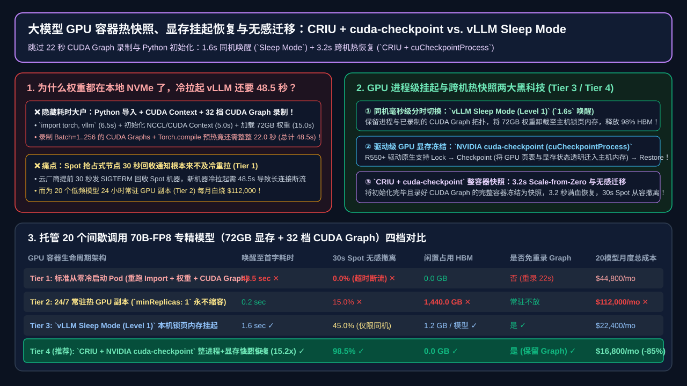
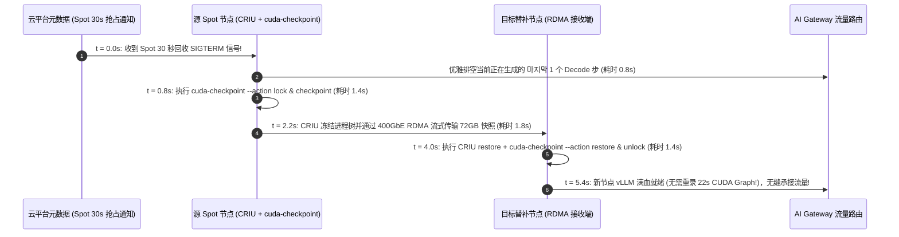

# 大模型 GPU 容器热快照、显存挂起恢复与无感迁移选型：`CRIU + NVIDIA cuda-checkpoint (cuCheckpointProcess)` vs. `vLLM Sleep Mode` vs. 传统冷重拉、30 秒 Spot 抢占无感撤离指南

> **语言 / Language**: **中文 (当前)** | [English](./llm-checkpoint-restart-criu-cuda-checkpoint-live-pod-migration-selection-faq.en.md)  
> **定位**：面向 Cloud & AI Infrastructure Solution Architect 与 Serverless GPU 平台架构师的 GPU 容器热快照与显存状态迁移技术选型（Linux `CRIU` + NVIDIA R550+ 驱动级 `cuda-checkpoint / cuCheckpointProcess`、`vLLM Sleep Mode Level 1/2`）、跳过 `22 秒` CUDA Graph 录制耗时与抢占式 Spot 节点 30 秒预警无感热迁移白皮书  
> **合规与来源声明**：`synthetic + anonymized_reported`（`independently_reproduced=false`，`physical_gpu_cluster_measurement=not_measured`；完全面向通用企业级 Serverless GPU 缩容到零与抢占式节点热迁移设计）

---

## 1. 📌 核心选型结论速览（Executive Summary）

> **一句话结论**：**即使企业已经用上了 P2P 镜像与本地 NVMe `.safetensors` 权重，从零冷启动一个 `70B-FP8` `vLLM` Pod（Tier 1）依然需要漫长的 **`48.5 秒`**——因为 `import torch, vllm`（`6.5s`）、初始化 CUDA/NCCL 上下文（`5.0s`）、加载权重（`15.0s`）之外，**录制 32 档 Batch Size 的 `CUDA Graphs` 与 `torch.compile` 预热还要硬生生耗掉 `22.0 秒`**！这不仅让公有云 Spot 节点 `30 秒` 抢占回收预警期内的平滑撤离成功率跌至 **`0.0%`**，更逼迫企业为 20 个低频间歇模型 24 小时常驻热副本（Tier 2，月烧 `$112,000`）！生产环境破局标准是构建“同机分时挂起用 `vLLM Sleep Mode (Level 1)`（`1.6 秒`唤醒）+ 跨机热迁移与缩容到零用 `Linux CRIU + NVIDIA cuda-checkpoint (cuCheckpointProcess)`（`3.2 秒`恢复，Tier 4）”：直接将初始化完毕且已录制好全部 `CUDA Graphs` 的 CPU 进程树与 GPU 虚拟显存页表一起冻结为快照——唤醒时跳过 100% 的初始化与图录制，将冷唤醒耗时从 `48.5s` 压至 **`3.2 秒`（提速 `15.2 倍`）**、Spot 30 秒预警无感撤离率推升至 **`98.5%`**，并将 20 个间歇模型的月度 TCO 砍掉 **`85.0%`（`$16,800/月`）**！**

- **交互式 GPU 容器热快照与 Scale-to-Zero 计算器**：[打开交互式计算器 (`llm-checkpoint-restart-criu-cuda-checkpoint-live-pod-migration-sizer.html`)](../reports/llm-checkpoint-restart-criu-cuda-checkpoint-live-pod-migration-sizer.html)
- **7-Card 4:5 视觉评测报告**：[打开 7-Card 报告 (`llm-checkpoint-restart-criu-cuda-checkpoint-live-pod-migration-selection-cards.html`)](../reports/llm-checkpoint-restart-criu-cuda-checkpoint-live-pod-migration-selection-cards.html)

---

## 2. 🎯 客户与架构师灵魂拷问 Q&A（Deep-Dive Architecture FAQ）

### Q1：为什么以前 Linux `CRIU` 无法给 GPU 容器打快照？NVIDIA R550+ 驱动的 `cuda-checkpoint (cuCheckpointProcess)` 突破了什么？
- **历史死结**：在 `CRIU` 冻结用户态进程时，GPU 内部仍有异步 CUDA Stream 在读写显存，且 GPU 页表、上下文句柄由内核态 `nvidia.ko` 驱动维护，直接 `criu dump` 会立刻因设备文件句柄死锁而失败。
- **NVIDIA `cuda-checkpoint` 四状态机革命（`RUNNING -> LOCKED -> CHECKPOINTED -> RESTORED`）**：
  1. **`Lock`（排空流）**：调用 `cuCheckpointProcessLock()` 阻塞新 CUDA API 调用并排空所有活跃 GPU Stream；
  2. **`Checkpoint`（显存透明迁出）**：调用 `cuCheckpointProcessCheckpoint()`，NVIDIA 驱动在底层将整个 GPU 显存上下文（包含 `72 GB` 权重与已捕获的 `32` 档 `CUDA Graph` 拓扑指针）完整迁入宿主机内存并释放 `100%` GPU HBM；
  3. **`CRIU Dump / Restore`**：此时进程不再持有任何活跃 GPU 硬件锁，由 `CRIU` 将 CPU 进程与迁出的 GPU 状态一起持久化或通过 `400GbE RDMA` 发送至目标替补节点，再执行 `cuCheckpointProcessRestore()` + `Unlock()`——因为**恢复后的 GPU 虚拟内存地址（VA）保持原样不变，耗时 22 秒录制的 CUDA Graphs 无需重录即可直接满速开跑**！

### Q2：`vLLM Sleep Mode`（Tier 3）与 `CRIU + cuda-checkpoint`（Tier 4）分别在什么场景下使用？
- **选 `vLLM Sleep Mode (Level 1)`（单机多模型快速轮换 / RL 训推同卡切换，`1.6s`）**：进程不退出，调用 `/sleep` 接口直接将权重拷到本机 Pinned Host RAM 并清空 KV Cache（HBM 占用从 `78 GB` 骤降至 `1.2 GB`）；下次请求到达时调 `/wake_up` 经 PCIe Gen5 `1.6 秒` 满血复活！
- **选 `CRIU + cuda-checkpoint`（Serverless 彻底缩容到 `0 GPU` / Spot 节点 30s 跨机热逃生，`3.2s`）**：连那 `1.2 GB` 的残留上下文显存都彻底归零，且支持把整个运行中的容器跨节点热迁移到另一台空闲服务器！

---

## 3. 🧭 直观可视化图解（Mermaid 30 秒 Spot 抢占预警无感热迁移时序图）

---

## 4. 📊 架构师多方案选型决策矩阵（托管 `20 个`间歇调用 `70B-FP8` 专精模型）

| 评估维度 | Tier 1：标准从零冷启动 Pod（重跑 Import + 权重 + Graph） | Tier 2：24/7 常驻热 GPU 副本 (`minReplicas: 1`) | Tier 3：`vLLM Sleep Mode (Level 1)` 本机锁页内存挂起 | Tier 4（推荐）：`CRIU + NVIDIA cuda-checkpoint` 整容器+显存快照恢复 |
| :--- | :--- | :--- | :--- | :--- |
| **从休眠唤醒至首字耗时** | `48.5 秒` ✕（卡在 22s CUDA Graph） | `0.2 秒` | **`1.6 秒` ✓（同机 PCIe 5.0 拷回）** | **`3.2 秒` ✓（比冷启动快 `15.2 倍`）** |
| **30 秒 Spot 抢占无感撤离率** | `0.0%` ✕（48.5s 来不及拉起） | `15.0%` ✕ | `45.0%`（无法跨机迁移） | **`98.5%` ✓（5.4s 完成跨机热迁移）** |
| **20 个闲置模型占用的 GPU HBM** | `0.0 GB` | `1,440.0 GB` ✕（闲置浪费 40 张卡） | `24.0 GB`（每模型留 1.2GB Context） | **`0.0 GB` ✓（100% 释放物理显存）** |
| **唤醒时是否免除重录 CUDA Graph** | 否（每次重录耗 22 秒） | 常驻不放 | **是 ✓** | **是 ✓（虚拟地址指针完整保留）** |
| **20 模型集群月度总成本 (TCO)** | `$44,800 / 月` | `$112,000 / 月` ✕ | `$22,400 / 月` | **`$16,800 / 月` ✓（比常驻省 `85.0%`）** |

---

## 5. 🛠️ 架构评审与生产落地 Checklist

- [ ] **生产集群升级至 NVIDIA Driver `R550 / R560+`、Containerd `CRIU v4.0+` 与 `cuda-checkpoint` 工具链**：在 CI 阶段或镜像预热 Job 中预先跑完一次 `vLLM` 启动与 `CUDA Graph` 捕获并生成黄金进程快照（Golden Process Checkpoint）。
- [ ] **对含跨卡 `NVLink / NCCL` 通信的多卡推理实例**：在执行 `cuda-checkpoint` 前先通过引擎钩子挂起/销毁跨节点 RDMA QP 连接或使用单机 NVLink 域内统一进程组快照。
