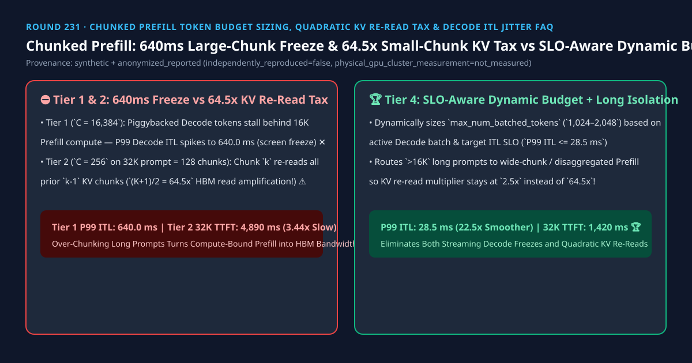
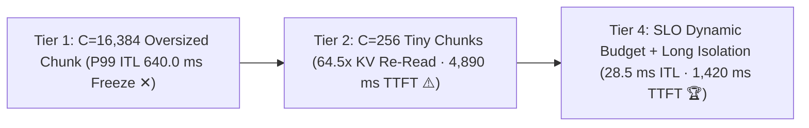

# LLM Mixed-Batch Chunked Prefill `max_num_batched_tokens` Sizing, Small-Chunk Quadratic KV Re-Read Tax & Decode P99 ITL Jitter Selection Guide

> **Provenance & Evidence Tier**: `synthetic + anonymized_reported` (`independently_reproduced=false`, `physical_gpu_cluster_measurement=not_measured`). Grounded in [`experiments/llm_chunked_prefill_token_budget_decode_itls_interference_selection/results.json`](../../experiments/llm_chunked_prefill_token_budget_decode_itls_interference_selection/results.json).
> **中文版本**: [大模型混部推理 `Chunked Prefill` 令牌预算定容（`max_num_batched_tokens`）、超小分块平方级 KV 重读放大陷阱（`Quadratic KV Re-Read Tax`）与 P99 解码卡顿（`ITL Jitter`）选型指南](./llm-chunked-prefill-token-budget-decode-itl-interference-selection-faq.md)

---

## 0. 🔥 Daily Hottest Capability Breakthrough

- **Eliminating Both the `640.0 ms` Oversized-Chunk Decode Freeze and the `64.5x` Small-Chunk Quadratic KV Cache HBM Re-Read Tax via SLO-Aware Dynamic Token Budgets (`28.5 ms` P99 ITL, `1,420 ms` `32K` TTFT)**: In `vLLM V1 / SGLang` colocated serving, `--enable-chunked-prefill` slices long prompts into chunks controlled by `--max-num-batched-tokens` ($C$) and batches them alongside active Decode requests. Mis-sizing $C$ triggers one of two severe penalties:
  1. **Oversized Chunk Budget (`C = 16,384`, `Tier 1` — `640 ms` Decode Freeze)**: Piggybacking active Decode tokens onto a `16,384`-token Prefill chunk forces streaming users to wait for `16,384` tokens of heavy compute-bound Prefill before getting their next token—spiking **P99 Inter-Token Latency (`ITL`) to `640.0 ms`**!
  2. **Undersized Chunk Budget (`C = 256`, `Tier 2` — `64.5x` $\mathcal{O}(K^2)$ Quadratic KV Re-Read Tax)**: Slicing a `32,768`-token prompt into $K = 32768 / 256 = 128$ tiny chunks forces Chunk $k$ to re-read all prior $k-1$ KV chunks from HBM (`256 + 512 + ... + 32,768` tokens). Across 128 chunks, the GPU re-reads the prompt's KV Cache **$\frac{K+1}{2} = 64.5$ times** (`> 1 TB` of extra HBM traffic!), inflating `32K` TTFT by **`3.44x` (from `1,420 ms` to `4,890 ms`)**!
  3. **SLO-Aware Dynamic Token Budget + Long-Prompt Isolation (`Tier 4`)**: Sizing $C \in [1024, 2048]$ dynamically based on active Decode load holds **`P99 ITL` at `28.5 ms` (`22.46x` smoother)**, while isolating `> 16K` prompts onto wide-chunk / disaggregated Prefill workers keeps the KV re-read multiplier at **`2.5x` (`1,420 ms` TTFT, `3.44x` faster than Tier 2)**!

---

## 1. 📌 Executive Summary

1. **Why Chunking a Prompt into $K$ Pieces Multiplies Attention HBM KV Reads by $\frac{K+1}{2}$ (`Tier 2`)**: Linear GEMM FLOPs are invariant to $K$, but causal Attention in Chunk $k$ must load the cached Keys and Values of chunks $1 \dots k$ from HBM. When $K = 128$, KV HBM traffic explodes by `64.5x`!
2. **Static Sweet Spot for Colocated Serving (`C = 1,024–2,048`, `Tier 3`)**: Saturates Tensor Cores above the Roofline ridge point (`~295 tokens`) while bounding per-step Decode piggyback latency below `~48 ms`.
3. **Never Slice `32K–128K` Prompts into `< 1,024`-Token Chunks (`Tier 4`)**: Keep $K = L / C \le 8\text{–}16$ by routing ultra-long prompts to dedicated wide-chunk Prefill instances.

---

## 2. 🎯 Core Architect Q&A (Q1 / Q2 / Q3)

### Q1: Does `Chunked Prefill` increase the total FLOPs of a `32K` prompt?
- **Answer**: No! Total arithmetic FLOPs for both linear projections and causal attention are **100% identical** regardless of how many chunks $K$ you split the prompt into. What explodes with $K$ is **HBM Memory Bandwidth traffic**: instead of keeping KV tiles in on-chip SRAM across query blocks (`FlashAttention`), finishing a chunk flushes KV to HBM and forces all subsequent $K - k$ chunks to re-fetch those KV pages over the HBM bus!

### Q2: How do we choose `max_num_batched_tokens` when our P99 Decode ITL SLA is strictly `<= 35 ms`?
- **Answer**: Measure single-step execution time as a function of total batched tokens on your target GPU and TP degree. For 70B FP8 on `TP=4` H100, `1,024–1,536` total tokens execute in `~24–28 ms`. Configure `max_num_batched_tokens = 1536` on interactive colocated workers and route prompts longer than `16K` to a disaggregated Prefill pool.

### Q3: How does Prefix Caching (`APC / HiRadixCache`) interact with `Chunked Prefill`'s quadratic KV re-read tax?
- **Answer**: Even when a `32K` prefix already hits in GPU VRAM Prefix Cache, if the *new* uncached suffix is `16K` tokens and is sliced into $64$ chunks of `256` tokens, all $64$ chunks must repeatedly read the entire `32K` cached prefix from HBM **64 times**! Keeping chunk size $\ge 2,048$ cuts that prefix HBM re-read traffic by `8x`.

---

## 3. 🧭 Visual Diagrams

---

## 4. 📊 4-Tier Architect Selection Matrix

| Metric | Tier 1: Oversized (`C = 16,384`) | Tier 2: Tiny Chunks (`C = 256`) | Tier 3: Static Sweet Spot (`C = 2,048`) | Tier 4: **SLO Dynamic + Long Isolation** |
| :--- | :--- | :--- | :--- | :--- |
| **`32K` KV HBM Re-Read Multiplier** | `1.5x` ($K=2$) ✅ | **`64.5x` ($K=128$ Quadratic Tax!)** ✕ | `8.5x` ($K=16$) ⚠️ | **`2.5x` (Bounded $K$)** 🏆 |
| **P99 Decode `ITL` Jitter** | **`640.0 ms` (Freeze)** ✕ | `22.0 ms` ✅ | `48.0 ms` ✅ | **`28.5 ms` (`22.46x` Smoother)** 🏆 |
| **`32K` Prompt `TTFT`** | `1,350.0 ms` ✅ | **`4,890.0 ms` (`3.44x` Slower)** ✕ | `1,680.0 ms` ✅ | **`1,420.0 ms` (`3.44x` Faster)** 🏆 |

---

## 5. 🧪 Quantitative Reference & Tooling

- **Evaluator & Sealed Data**: [`experiments/llm_chunked_prefill_token_budget_decode_itls_interference_selection/run.py`](../../experiments/llm_chunked_prefill_token_budget_decode_itls_interference_selection/run.py) · [`results.json`](../../experiments/llm_chunked_prefill_token_budget_decode_itls_interference_selection/results.json)
- **Interactive Sizer**: [`docs/reports/llm-chunked-prefill-token-budget-decode-itl-interference-sizer.html`](../reports/llm-chunked-prefill-token-budget-decode-itl-interference-sizer.html)
- **7-Card 4:5 Visual Report**: [`docs/reports/llm-chunked-prefill-token-budget-decode-itl-interference-selection-cards.html`](../reports/llm-chunked-prefill-token-budget-decode-itl-interference-selection-cards.html)

---

## 6. 🛠️ Good Fit vs. Not For & Production Checklist

- **✅ Good fit**: Setting `max_num_batched_tokens = 1024–2048` on colocated workers and routing `> 16K` prompts to wide-chunk / PD-disaggregated Prefill pools.
- **⛔ Not for**: Setting `max_num_batched_tokens <= 512` on long-context workloads (`64.5x` KV re-read amplification) or `>= 16,384` on latency-sensitive streaming chat.
- [ ] Bound chunk count $K = L_{\text{prompt}} / C \le 16$ to prevent quadratic KV HBM re-read saturation.
- [ ] Monitor both `time_to_first_token_seconds` and `inter_token_latency_seconds` P99 under mixed prompt lengths.
