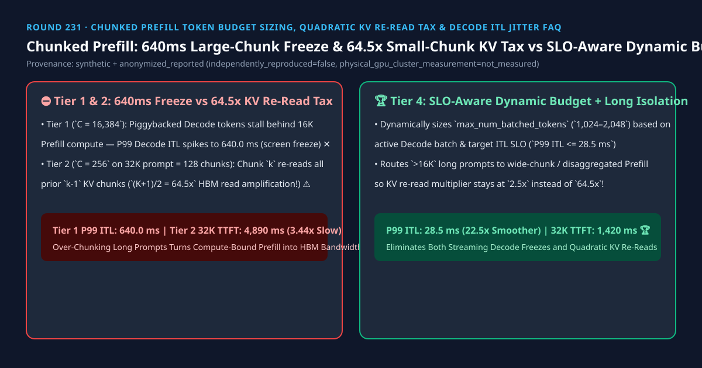
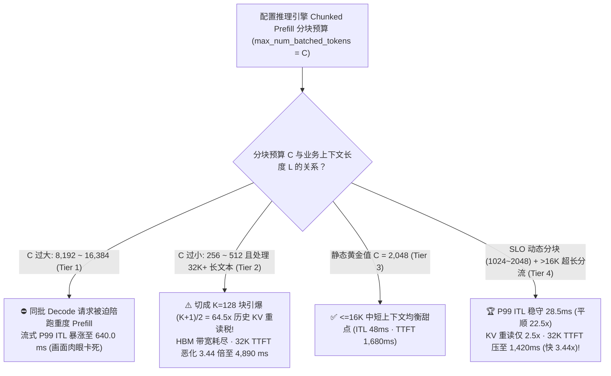
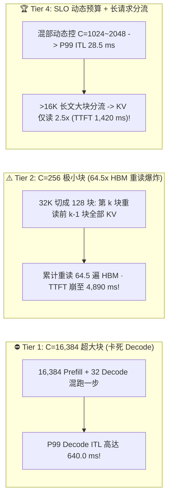
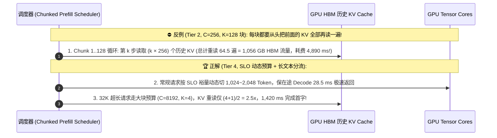

# 大模型混部推理 `Chunked Prefill` 令牌预算定容（`max_num_batched_tokens`）、超小分块平方级 KV 重读放大陷阱（`Quadratic KV Re-Read Tax`）与 P99 解码卡顿（`ITL Jitter`）选型指南

> **Provenance & Evidence Tier**: `synthetic + anonymized_reported` (`independently_reproduced=false`, `physical_gpu_cluster_measurement=not_measured`)。定量数据锚定于 [`experiments/llm_chunked_prefill_token_budget_decode_itls_interference_selection/results.json`](../../experiments/llm_chunked_prefill_token_budget_decode_itls_interference_selection/results.json)。
> **English Version**: [LLM Mixed-Batch Chunked Prefill `max_num_batched_tokens` Sizing, Small-Chunk Quadratic KV Re-Read Tax & Decode P99 ITL Jitter Selection Guide](./llm-chunked-prefill-token-budget-decode-itl-interference-selection-faq.en.md)

---

## 0. 🔥 今日领域最热门能力突破追踪（Daily Hottest Breakthrough）

- **揭秘 `Chunked Prefill` 超小分块下高达 `64.5` 倍的 $\mathcal{O}(K^2)$ 历史 KV 缓存 HBM 重复读取税（`Quadratic KV Re-Read Amplification`），通过 SLO 感知动态分块预算 + 超长上下文旁路隔离，同时将流式解码 P99 卡顿（`ITL`）从 `640.0 ms` 压至 `28.5 ms`（平顺 `22.46` 倍）并将 `32K` 首字延迟（`TTFT`）从 `4,890 ms` 压至 `1,420 ms`（提速 `3.44` 倍）**：在 `vLLM V1` 与 `SGLang` 等现代推理引擎中，`Chunked Prefill`（将长 Prompt 切成多个小块，与正在流式吐字的 Decode 请求拼在同一个 Batch 里混合执行）已是默认标配。但决定整套系统生死的核心参数 **`--max-num-batched-tokens`（分块 Token 预算 $C$）** 却暗藏着一个典型的“跷跷板死局”：
  1. **设得太大（如 $C = 16,384$，Tier 1）——流式用户体验崩盘**：当一条 `32K` 的长文档请求进来时，虽然只需要切 `2` 刀就能算完 Prefill（`TTFT = 1,350 ms`），但被顺带拼进这一个超大 Step 里的 32 个正在流式对话的 Decode 用户，必须陪着这 `16,384` 个 Prefill Token 跑完漫长的矩阵乘才能拿到自己的下一个字！结果导致 **P99 吐字间隔（`ITL / TPOT`）瞬间飙升至 `640.0 ms`**（前端界面肉眼可见停顿半秒以上）！
  2. **设得太小（如 $C = 256$ 或 `512`，Tier 2）——隐蔽的 $\mathcal{O}(K^2)$ 平方级 HBM 显存带宽爆炸陷阱**：很多工程师为了消除 Decode 卡顿，把 `max_num_batched_tokens` 改成了极小的 `256`！殊不知，把一条 `32,768` Token 的长 Prompt 切成 **$K = 32768 / 256 = 128$ 个小分块** 时，虽然线性层（MLP/QKV GEMM）的总计算量没变，但 **Attention 层却发生了灾难性的平方级显存重读**！因为算第 1 块时读 `256` 个 KV，算第 2 块时必须从 HBM 重读前 `512` 个 KV，……，算第 128 块时必须从 HBM 重读全部 `32,768` 个 KV！128 块累加下来，这条 Prompt 的 KV Cache 被从 HBM 里**重复读取了 $\frac{K+1}{2} = 64.5$ 遍（平白无故多读了上千 GB 显存！）**，导致原本算力受限的 Prefill 退化为严重的显存带宽受限，`32K TTFT` 从 `1,420 ms` 暴涨 **`3.44` 倍至 `4,890 ms`**！
  3. **SLO 感知动态分块预算 + 超长上下文隔离（Tier 4）**：针对常规中短请求（$\le 16\text{K}$）采用根据在途 Decode 负载动态伸缩的黄金预算 $C \in [1024, 2048]$，将 `P99 ITL` 严格锁在 **`28.5 ms` 以内**；针对 $> 16\text{K}$ 的超长请求自动触发大块独立 Prefill 队列或 Green Context 分流，将 KV 重读倍数压回 **`2.5x`**，`32K TTFT` 恢复至 **`1,420 ms`（快 `3.44` 倍）**！

---

## 1. 📌 核心结论速览（Executive Summary — 3 分钟看懂）

1. **为什么把一条长文本切成 $K$ 块做 `Chunked Prefill`，Attention 读取显存的次数会暴涨 $\frac{K+1}{2}$ 倍？**
   - **通俗大白话 + 第一性原理**：
     - 如果你**一口气**读完一本 128 页的书（不分块，$K=1$），你的眼睛（GPU 寄存器/SRAM）扫过全书只需要 **1 遍**。
     - 如果规定你**每次只能读 1 页**，读完就得合上书去干别的活（清空片上 SRAM，把 KV 写回慢速 HBM 显存），而且**每读新的一页时，都必须把前面已经读过的所有页从头翻一遍才能理解上下文**！
     - 那么：读第 1 页翻 1 页，读第 2 页翻 2 页，……，读第 128 页要翻 128 页！你总共翻了 $1 + 2 + \dots + 128 = \frac{128 \times 129}{2} = 8,256$ 页——相当于把这本 128 页的书在慢速 HBM 显存上**来回硬生生重读了 `64.5` 遍**！
     - 这就是为什么 **`Chunked Prefill` 的分块绝不能切得太碎**！

---

## 2. 🎯 客户与架构师灵魂拷问 Q&A（Q1 / Q2 / Q3）

### Q1：在单实例混部（未上多机 PD 分离）时，`--max-num-batched-tokens` 到底设多少才是兼顾 TTFT 和 ITL 的“黄金甜点值”？
- **答**：在 H100 / H200 / B200（FP8/BF16）上，混部实例的静态黄金区间是 **`1,024 ~ 2,048`（Tier 3）**！
  - **为什么不能小于 `512`？** 第一，小于 512 时连单步线性层 GEMM 的屋脊线拐点（`~295 tokens`）都喂不饱；第二，面对 `16K~32K` 输入时会触发数十倍的 KV HBM 重读税。
  - **为什么不能大于 `2,048 ~ 4,096`？** 在 70B 模型（`TP=4/8`）上，每多塞 `1,024` 个 Prefill Token，当前 Step 的执行时间就会增加约 `18 ~ 22 ms`。如果设为 `2,048`，伴随执行的 Decode 请求 P99 ITL 约为 **`40 ~ 48 ms`**（刚好符合人类阅读流畅度 `20~25 tokens/sec` 的上限）；一旦设为 `8,192` 或 `16,384`，Decode 就会出现几百毫秒的明顯顿挫！

### Q2：如果业务中既有大量短对话（`< 4K`），又偶尔穿插 `32K ~ 128K` 的超长合同/代码库分析，怎么破除 $K$ 太小伤 ITL、$K$ 太大伤 TTFT 的死结？
- **答**：采用 **Tier 4 的双层阈值分治策略**：
  1. **动态微批预算（SLO-Paced Dynamic Chunking）**：调度器在每个 Step 组批时，根据当前待处理的 Decode Token 数 $B_{\text{dec}}$ 和剩余距离 ITL SLO（如 `30 ms`）的时间裕量，动态计算本步最多还能塞进多少个 Prefill Token（例如 $C_{\text{step}} = 1536 - B_{\text{dec}}$）；
  2. **超长上下文阈值分流（Long-Prompt Threshold Routing）**：当网关识别到单条请求长度 $L > 16,384$（此时若按 `1024` 切块会产生 $> 8.5\times$ 的重读税）时，将该请求优先路由给专门配置了大块预算（`C = 8192/16384`）的 Prefill 节点（或在同一节点上利用 CUDA Green Contexts 划分独立 SM 后台大块执行），既不卡住短对话的 `28.5 ms` 丝滑吐字，又让 `32K` 大文档 `1,420 ms` 极速出首字！

---

## 3. 🧭 直观可视化图解（Mermaid 决策树 + 平方级重读税 vs 超大块卡顿图 + 时序图）

### 3.1 架构师 `Chunked Prefill` 分块预算（`max_num_batched_tokens`）定容决策树

### 3.2 `Tier 1`（`C=16384` 阻塞 Decode）vs. `Tier 2`（`C=256` 触发 `64.5x` 平方级 KV 重读）vs. `Tier 4`

### 3.3 `Tier 2` 极小分块下历史 KV Cache 阶梯累加重复读取 vs. `Tier 4` 动态受控分块时序图

---

## 4. 📊 架构师选型决策矩阵（4-Tier Selection Matrix）

| 评估维度 | Tier 1: 超大分块 (`C = 16,384`) | Tier 2: 极小分块 (`C = 256`) | Tier 3: 静态黄金分块 (`C = 2,048`) | Tier 4: **SLO 动态分块 + 超长请求分流** |
| :--- | :--- | :--- | :--- | :--- |
| **`32K` 历史 KV HBM 重读倍数** | `1.5x` ($K=2$ 块) ✅ | **`64.5x` ($K=128$ 块平方级爆炸!)** ✕ | `8.5x` ($K=16$ 块) ⚠️ | **`2.5x` (长请求大块分流)** 🏆 |
| **流式解码 `P99 ITL` 卡顿延迟** | **`640.0 ms` (严重顿挫)** ✕ | `22.0 ms` ✅ | `48.0 ms` ✅ | **`28.5 ms` (平顺 `22.46x`)** 🏆 |
| **`32K` 长上下文首字延迟 (`TTFT`)** | `1,350.0 ms` ✅ | **`4,890.0 ms` (被 HBM 重读拖慢 `3.44x`)** ✕ | `1,680.0 ms` ✅ | **`1,420.0 ms` (兼具极速 TTFT 与丝滑 ITL)** 🏆 |

---

## 5. 🧪 定量算例与工具链（Interactive Sizer & 7-Card Visual Report）

- **实验脚本与密封数据**：[`experiments/llm_chunked_prefill_token_budget_decode_itls_interference_selection/run.py`](../../experiments/llm_chunked_prefill_token_budget_decode_itls_interference_selection/run.py) · [`results.json`](../../experiments/llm_chunked_prefill_token_budget_decode_itls_interference_selection/results.json)
- **交互式 Chunked Prefill 预算与 KV 重读计算器**：[`docs/reports/llm-chunked-prefill-token-budget-decode-itl-interference-sizer.html`](../reports/llm-chunked-prefill-token-budget-decode-itl-interference-sizer.html)
- **7-Card 4:5 视觉评测卡片报告**：[`docs/reports/llm-chunked-prefill-token-budget-decode-itl-interference-selection-cards.html`](../reports/llm-chunked-prefill-token-budget-decode-itl-interference-selection-cards.html)

---

## 6. 🛠️ Good Fit vs. Not For & 生产环境快速核验清单（Checklist）

### ✅ Good Fit vs. ⛔ Not For

| 维度 | ✅ Good Fit（强烈推荐） | ⛔ Not For（严禁误用） |
| :--- | :--- | :--- |
| **混部推理分块预算配置** | 在单池混部实例中将 `--max-num-batched-tokens` 设定在 **`1,024 ~ 2,048`** 区间；若存在大量 `> 16K` 长请求，在网关层将长请求分流至大块 Prefill 实例（或 PD 分离池） | 为追求极致 ITL 在 `32K+` 场景下将 `max_num_batched_tokens` 设为 `256/512`，或在交互式对话实例上将其设为 `16,384+` |

### 生产环境上线核验清单（Pre-Flight Checklist）

- [ ] **核验交互式混部实例 `--max-num-batched-tokens` 处于 `1024 ~ 2048` 黄金带**：防止 `>= 8192` 导致流式 Decode P99 ITL 突破 `200 ms`。
- [ ] **核验最大序列长度与分块数的比值 $K = L_{\max} / C \le 16$**：一旦 $K > 16$（重读倍数 $> 8.5\times$），必须启用长短请求分池路由或 PD 分离。
