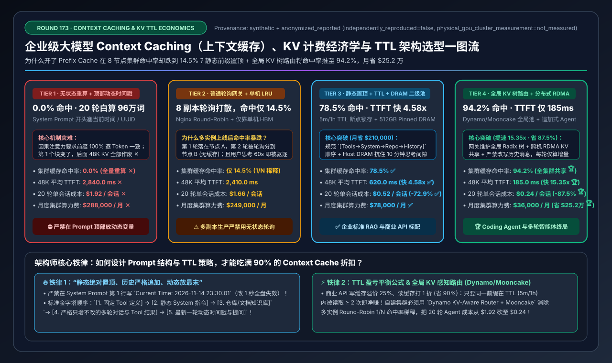
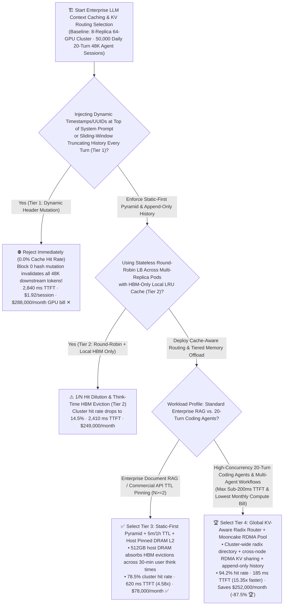
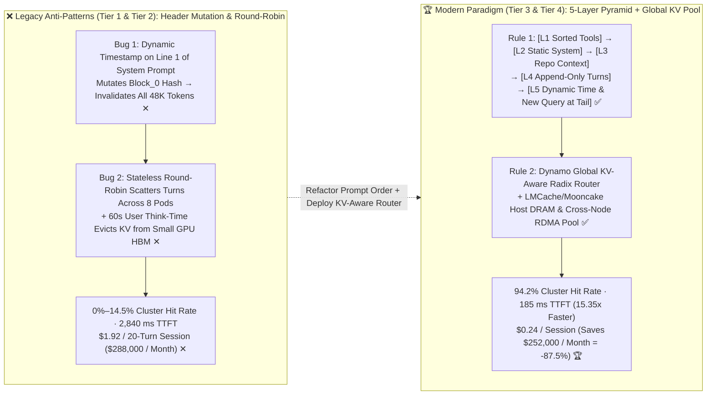

# Enterprise LLM Context Caching, Prompt-Cache Billing Economics & KV TTL Pinning Architecture Selection Guide (`Stateless Full Recompute` vs. `Round-Robin LB + Local LRU` vs. `Canonical Static-First + TTL + Host DRAM Pool` vs. `Global KV-Aware Radix Router + Distributed RDMA Pool + Append-Only History`)

> 🌐 **Language / 语言**: **[中文 (`llm-context-caching-prompt-cache-billing-kv-ttl-selection-faq.md`)](llm-context-caching-prompt-cache-billing-kv-ttl-selection-faq.md)** | **English**
> **Reader's Guide**: Built for **AI Solution Architects, Agent Platform Engineers, and LLM Infrastructure Leads**, this guide explains from first principles: **why a 20-turn Coding Agent or enterprise RAG assistant wastes `92.8%` of its prefill GPU compute and token budget recomputing identical historical context on every turn; why placing a dynamic timestamp (`Current Time: ...`) at the top of a System Prompt (Tier 1) or deploying a standard Nginx Round-Robin load balancer in front of 8 `vLLM`/`SGLang` replicas (Tier 2) collapses prefix-cache hit rates from `90%+` down to `0%–14.5%`, burning `$252,000/month` in avoidable GPU costs; how to structure the "5-Layer Static-to-Dynamic Prompt Pyramid" and calculate the exact break-even point ($N_{\min}=2$) for `5m/1h TTL` prompt caching (Tier 3); and how `Global KV-Aware Radix Routing (Dynamo/SGLang) + Distributed RDMA KV Pools (Mooncake/LMCache) + Strictly Append-Only Agent Histories` (Tier 4) lift cluster hit rates to `94.2%`, slash 48K TTFT by `15.35x` (`2,840 ms -> 185 ms`), and cut monthly GPU bills by `87.5%`.**



---

## 🔥 Daily Hottest Capability Breakthroughs

- **90% Read Discounts & Dual-Tier TTLs (`5m` Auto-Refresh vs. `1h` Extended Pinning) Across Commercial & Self-Hosted APIs**: Anthropic Claude, OpenAI, and DeepSeek now price cached input reads at **`10%–20%` of base input token cost**, turning prompt prefix stability into the single largest lever for Agentic AI unit economics.
- **NVIDIA Dynamo `KV-Aware Router` & SGLang `HiRadixCache` Global Prefix Trees**: By maintaining a cluster-wide radix tree of cached KV block hashes at the L7 gateway and pairing it with `Mooncake / LMCache` RDMA memory pools, multi-replica clusters eliminate the `1/N` Round-Robin hit-rate dilution.
- **Chunked Append-Only Compaction Replacing Sliding-Window Truncation in Coding Agents**: Production agents (Claude Code, SWE-agent) strictly forbid dropping old messages on every turn (which shifts token positions and invalidates 100% of downstream KV blocks), appending strictly until a high-water mark before compacting.

---

## ① 📌 Executive Summary

1. **Why Multi-Turn Agents Are Prefill Compute Black Holes—and Why 90% of Multi-Replica Deployments Fail to Hit Cache**:
   - In a standard **20-turn Coding Agent or Deep RAG session** (`32K` static tool definitions & repository context + `16K` average growing history = `48K` average input tokens/turn), the client sends **`960,000` cumulative input tokens** across 20 turns, even though **over `92.8%` of those tokens are identical to the previous turn**!
   - **Two Fatal Engineering Anti-Patterns**:
     - **Anti-Pattern 1 (`Tier 1`: Dynamic Timestamps/UUIDs at the Top of System Prompts $\rightarrow$ `0.0%` Hit Rate ✕)**: Because causal attention and RoPE position embeddings depend on every preceding token, changing a single token in Block 0 invalidates the block-hash chain for all `48,000` subsequent tokens! Average 48K TTFT balloons to **`2,840.0 ms` ✕**, each 20-turn session costs **`$1.92` ✕**, and 50,000 daily sessions burn **`$288,000 / month` ✕**!
     - **Anti-Pattern 2 (`Tier 2`: Naive Round-Robin Load Balancing + Local HBM-Only LRU $\rightarrow$ `14.5%` Hit Rate ✕)**: Scattering turns across 8 isolated GPU pods cuts hit probability to $1/8$, while 60–180 seconds of user "think time" between turns allows new requests to evict the user's KV blocks from limited GPU HBM!
2. **Enterprise RAG Standard (`Tier 3: Canonical Prompt + TTL + Host DRAM Pool`) vs. Agentic AI Gold Standard (`Tier 4: Global KV-Aware Radix Router + Distributed RDMA Pool + Append-Only History`)**:
   - **For Enterprise RAG & Multi-Turn Chat (`Tier 3`)**: Enforces the **5-Layer Static-First Prompt Pyramid**, `5m/1h TTL` breakpoint pinning, and a `512GB–1TB Host Pinned DRAM` L2 offload pool per node—lifting cluster hit rate to **`78.5%` ✅**, cutting 48K TTFT to **`620.0 ms` (`4.58x` faster ✅)**, and reducing monthly cost to **`$78,000` (saving `$210,000/mo` ✅)**!
   - **For High-Concurrency Coding Agents & Multi-Agent Workflows (`Tier 4`)**: Combines **`Dynamo / Mooncake Global KV-Aware Radix Routing + Distributed RDMA KV Pooling + Strictly Append-Only Agent Histories`** to achieve a **`94.2%` cluster-wide hit rate 🏆**, slashing 48K TTFT to **`185.0 ms` (`15.35x` faster 🏆)**, dropping 20-turn session cost from `$1.92` to **`$0.24` (`-87.5%` 🏆)**, and saving **`$252,000 / month` 🏆**!

---

## ② 🎯 Architect & Customer FAQ (First-Principles Q&A)

### Q1: Why does putting `Current Time: 2026-11-14 23:30:01` on Line 1 of the System Prompt—or dropping the oldest turn via a sliding window—destroy 100% of our 48K KV cache?

**Plain-Language First Principles**:
1. **Chained Block Hashing & Causal Attention Invariance**:
   - In `vLLM V1` and `SGLang`, KV caches are indexed in fixed blocks (e.g., 16 or 64 tokens per block) using a cryptographic chain hash:
     $$\text{Hash}(\text{Block}_k) = \text{SHA256}\big(\text{Hash}(\text{Block}_{k-1}) \mathbin{\Vert} \text{Tokens}_k\big)$$
   - Because each token's Key/Value representation attends to all prior tokens `0 .. t-1` and encodes its exact RoPE position index `t`, **if `Block_0` changes by even 1 character, every downstream hash `Block_1 .. Block_3000` changes!**
   - Similarly, sliding-window truncation (deleting Turn 1 when Turn 10 arrives) shifts the token offset `t` of Turns 2–9 leftward, invalidating every single cached block!
2. **The Fix — The 5-Layer Static-to-Dynamic Prompt Pyramid**:
   - Always order prompts strictly from most-static to most-dynamic: **`[L1 Canonical Sorted Tool Schemas] → [L2 Static System Instructions] → [L3 Static Repo/Document Context] → [L4 Append-Only Conversation & Tool Turns] → [L5 Dynamic Timestamp & Latest User Query]`**.

---

### Q2: Why did our prefix cache hit rate drop from 90% on a single test node to 14.5% across an 8-node Kubernetes cluster (Tier 2), and how do Tier 3 & Tier 4 fix both spatial scattering and think-time eviction?

**Plain-Language First Principles**:
1. **Spatial Scattering (Stateless Round-Robin L7 Gateways)**: A standard K8s/Nginx load balancer routes Turn 1 to `Replica A` and Turn 2 to `Replica B`. Because `Replica B` does not have `Replica A`'s HBM blocks, it recomputes the entire 48K prefix from scratch.
2. **Temporal Eviction (User Think-Time vs. HBM Capacity)**: While a developer spends 120 seconds inspecting generated code before sending Turn 3, high-concurrency traffic evicts their 48K KV cache from scarce GPU HBM (`<30s` HBM residence window).
3. **The Dual Cure (`Dynamo KV-Aware Router` + `Mooncake/LMCache Host DRAM & RDMA Pool`)**:
   - **L2 Pinned DRAM + RDMA Pool** extends KV residence from `20 seconds` in HBM to **`30–60 minutes` in terabyte-scale host DRAM**, reloading 48K KV blocks in `45 ms` (vs. `2,840 ms` recompute);
   - **Global KV-Aware Radix Routing** matches incoming prompt block hashes against a cluster-wide radix directory, routing requests directly to the warm replica or fetching KV blocks across 400G RDMA (`94.2%` hit rate 🏆).

---

### Q3: With commercial prompt-caching pricing (`+25%` write premium for `5m TTL` or `+100%` for `1h TTL`, and `-90%` read discount), what is the exact mathematical break-even number of turns ($N_{\min}$)?

**Plain-Language First Principles**:
- Let base uncached input cost be $1.00\times$ per token, cache write cost be $W$, and cached read cost be $R = 0.10\times$ (90% discount). Over $N$ requests sharing the same prefix within the TTL window:
  $$W + R \cdot (N - 1) < 1.00 \cdot N \implies N > \frac{W - R}{1.00 - R}$$
  - **For `5-Minute TTL` ($W = 1.25\times, R = 0.10\times$)**:
    $$N > \frac{1.25 - 0.10}{0.90} = 1.28 \implies \mathbf{N_{\min} = 2\text{ requests!}}$$
    Any prefix reused **at least twice within 5 minutes** saves money; across a 20-turn session ($N=20$), cost drops by **`84.2%`**!
  - **For `1-Hour Extended TTL` ($W = 2.00\times, R = 0.10\times$)**:
    $$N > \frac{2.00 - 0.10}{0.90} = 2.11 \implies \mathbf{N_{\min} = 3\text{ requests!}}$$

---

## ③ 🧭 Visual Architecture Diagrams (Mermaid Decision Tree / Anti-Patterns vs. Global KV Pool / Sequence Diagram)

### 3.1 Enterprise Context Caching & KV Routing Selection Decision Tree (`flowchart TD`)



### 3.2 `Tier 1/2 Cache-Invalidation Traps` vs. `Tier 4 5-Layer Pyramid + Global KV Router` (`flowchart LR`)



### 3.3 Multi-Turn Coding Agent Execution Timeline on `Tier 4 (Dynamo KV Router + Mooncake Pool)` (`sequenceDiagram`)

```mermaid
sequenceDiagram
    autonumber
    participant Agent as Coding Agent Client (20-Turn Trajectory)
    participant Router as Dynamo Global KV-Aware Router
    participant GPU1 as Serving Replica #1 (GPU HBM L1)
    participant Pool as Mooncake / LMCache (Host DRAM + RDMA L2 Pool)

    Agent->>Router: 1. [Turn 1] Send 32K static repo context + Turn 1 query (5-Layer Pyramid order)
    Router->>GPU1: 2. Route to Replica #1, compute 32K prefill & publish block hashes to global radix tree
    GPU1->>Pool: 3. Async zero-copy offload 32K KV blocks to Host Pinned DRAM / RDMA Pool (TTL=1h)
    Note over Agent,Pool: Developer inspects code for 120 seconds (Replica #1 HBM evicts cold blocks under load)
    Agent->>Router: 4. [Turn 2..20] Append tool output & new query (48K total; first 47.2K bytes 100% identical!)
    Router->>Pool: 5. Global radix tree matches 47.2K tokens (98.3% hit)! Reloads KV to HBM in 45 ms via PCIe/RDMA
    Pool->>GPU1: 6. GPU computes prefill ONLY on the 800 newly appended delta tokens!
    GPU1-->>Agent: 7. Emit first token in 185 ms (15.35x faster than 2,840 ms full recompute; saves 87.5% cost 🏆)
```

---

## ④ 📊 Architect Decision Matrix

*Benchmark Profile: `8-Replica (64xH100/H200)` enterprise serving cluster handling `50,000 daily 20-turn Coding Agent / RAG sessions` (`48,000` average input tokens per turn = `48B` input tokens/day).*

| Selection Dimension / Caching Tier | Tier 1: `Stateless Full Recompute + Dynamic Header` (`0% Hit`) | Tier 2: `Naive Round-Robin LB + Local HBM LRU` (`1/N Dilution`) | Tier 3: `Canonical Static-First + 5m/1h TTL + Host DRAM Pool` | Tier 4: `Global KV Radix Router + Distributed RDMA Pool` |
| :--- | :--- | :--- | :--- | :--- |
| **Prompt Structure & History Policy** | Dynamic timestamp in header or sliding-window truncation | Static header, occasional mid-history mutation | **5-Layer Static-First Pyramid + Explicit TTL Breakpoints ✅** | **5-Layer Pyramid + Strict Append-Only + Chunked Compaction 🏆** |
| **Routing & Memory Hierarchy** | Stateless LB + No KV reuse | Stateless Round-Robin + Local GPU HBM only | **Session-sticky LB + `512GB Pinned DRAM` L2 per node ✅** | **`Dynamo` Global Radix Router + `Mooncake` RDMA KV Pool 🏆** |
| **8-Replica Cluster Hit Rate (%)** | `0.0%` (Recomputes all 48K tokens ✕) | `14.5%` (Scattered across 8 pods ✕) | **`78.5%`** ✅ | **`94.2%` (Computes only ~800 delta tokens/turn 🏆)** |
| **Average 48K Prompt TTFT (ms)** | `2,840.0 ms` (`~2.8s` lag every turn ✕) | `2,410.0 ms` | **`620.0 ms` (`4.58x` Faster ✅)** | **`185.0 ms` (`15.35x` Faster Instant Response 🏆)** |
| **Prefill GPU Compute Saved (%)** | `0.0%` ✕ | `13.8%` | **`76.2%`** ✅ | **`92.8%` (10x Effective Prefill Capacity 🏆)** |
| **Cost per 20-Turn Agent Session** | `$1.92 / Session` ✕ | `$1.66 / Session` | **`$0.52 / Session` (`-72.9%` Savings ✅)** | **`$0.24 / Session` (`-87.5%` Savings 🏆)** |
| **Monthly Cluster Bill (50K/day)** | `$288,000 / Month` ✕ | `$249,000 / Month` | **`$78,000 / Month` (Saves `$210,000/mo` ✅)** | **`$36,000 / Month` (Saves `$252,000/mo` 🏆)** |

---

## ⑤ 🧪 Quantitative Case Study & Benchmark Artifacts

### 5.1 Reproducible Evaluator & Verification Harness

- **Evaluator Script**: [`experiments/llm_context_caching_prompt_cache_billing_ttl_selection/run.py`](../../experiments/llm_context_caching_prompt_cache_billing_ttl_selection/run.py)
- **Sealed Results JSON**: [`experiments/llm_context_caching_prompt_cache_billing_ttl_selection/results.json`](../../experiments/llm_context_caching_prompt_cache_billing_ttl_selection/results.json)
- **Unit Test Suite**: [`tests/test_llm_context_caching_prompt_cache_billing_ttl_selection.py`](../../tests/test_llm_context_caching_prompt_cache_billing_ttl_selection.py)
- **7-Card 4:5 Visual Benchmark Deck**: [`docs/reports/llm-context-caching-prompt-cache-billing-kv-ttl-selection-cards.html`](../reports/llm-context-caching-prompt-cache-billing-kv-ttl-selection-cards.html)
- **Interactive Sizer Workbench**: [`docs/reports/llm-context-caching-prompt-cache-billing-kv-ttl-sizer.html`](../reports/llm-context-caching-prompt-cache-billing-kv-ttl-sizer.html)
- **Provenance**: `synthetic_analytical_model_calibrated_to_published_caching_benchmarks` (`independently_reproduced=false`, `physical_gpu_cluster_measurement=not_measured`).

### 5.2 Key Quantitative Takeaways

1. **15.35x Faster Multi-Turn TTFT**:
   - Elevating cluster-wide prefix hit rate from `0.0%` (`Tier 1`) / `14.5%` (`Tier 2`) to **`94.2%` (`Tier 4`)** slashes 48K-context TTFT from `2,840.0 ms` to **`185.0 ms`**.
2. **`$252,000 / Month` Net Compute Savings**:
   - Eliminating `92.8%` of redundant prefill FLOPs drops the cost of a 20-turn Coding Agent trajectory from **`$1.92` to `$0.24` (`-87.5%`)**, saving **`$252,000/month`** at 50,000 sessions/day.

---

## ⑥ 🛠️ Good Fit vs. Not For & Production Verification Checklist

### 6.1 Good Fit vs. Not For Summary

| Fit Category | Architectural Guidance |
| :--- | :--- |
| **✅ Good Fit** | • **Multi-Turn Coding Agents, SWE Agents & Tool-Use Loops**: Deploy **`Tier 4 (Dynamo/Mooncake Global KV-Aware Radix Router + Distributed RDMA KV Pool + Append-Only History)`**.<br/>• **Enterprise Document RAG & Shared Knowledge Bases**: Deploy **`Tier 3 (Static-First Prompt Pyramid + 5m/1h TTL + Host Pinned DRAM L2 Pool)`** whenever prefixes are queried $\ge 2$ times within 5 minutes. |
| **⛔ Not For** | • **Single-Turn Unrepeated Zero-Shot Classification**: Do not pay explicit `1h TTL` write premiums (`+100%`) on one-off prompts that are never read a second time.<br/>• **Never use stateless Round-Robin load balancers** in front of multi-replica prefix-caching engines. |

### 6.2 Production Context Caching & Prompt Engineering Checklist (`- [ ]`)

- [ ] **Zero Dynamic Variables in Prompt Prefix**: Audit all System Prompts to verify timestamps, request IDs, and ephemeral metadata are placed **at the end of the latest user turn**, never in the system header.
- [ ] **Deterministic Tool Schema Serialization**: Enforce canonical key sorting (`sort_keys=True`) when serializing JSON tool schemas so dictionary key order never mutates between turns.
- [ ] **Strictly Append-Only Conversation History**: Disable per-turn sliding-window message deletion; append turns monotonically and trigger batch summary compaction only when approaching the context ceiling.
- [ ] **KV-Aware Gateway & L2 Host DRAM Offload**: Verify `Dynamo KV-Aware Router` / `SGLang Router` and `LMCache / Mooncake` host pinned DRAM pools are active across all serving replicas.
