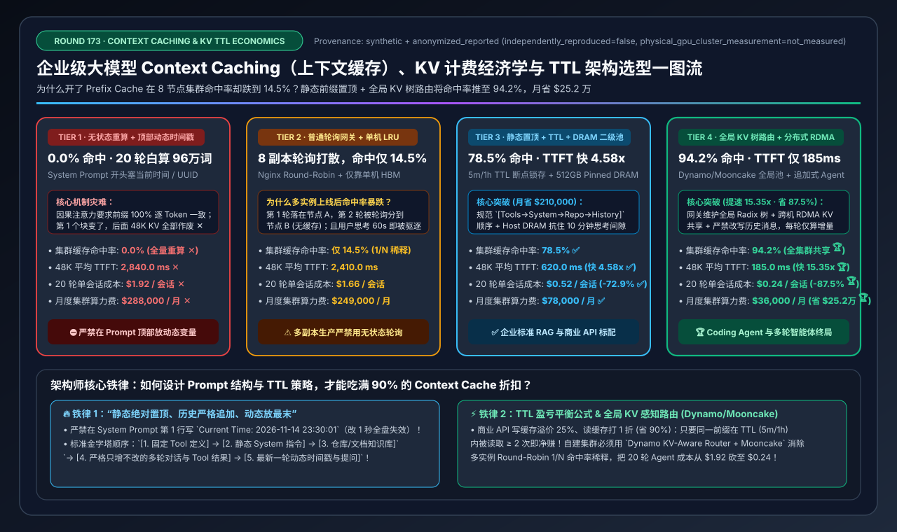
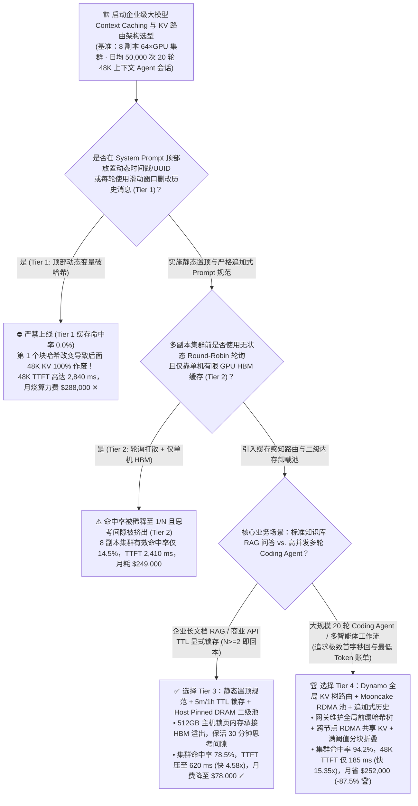
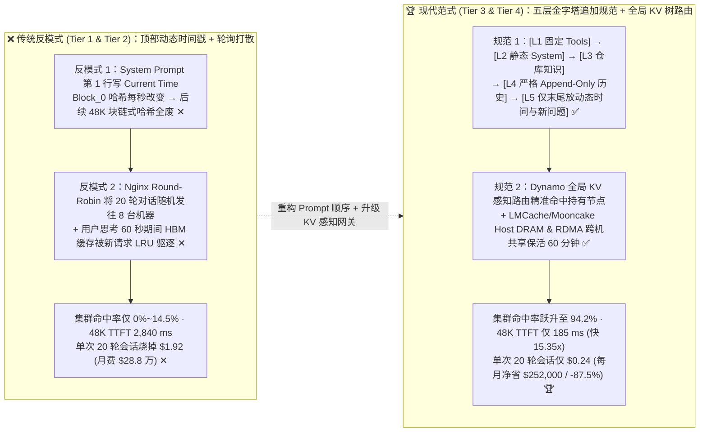
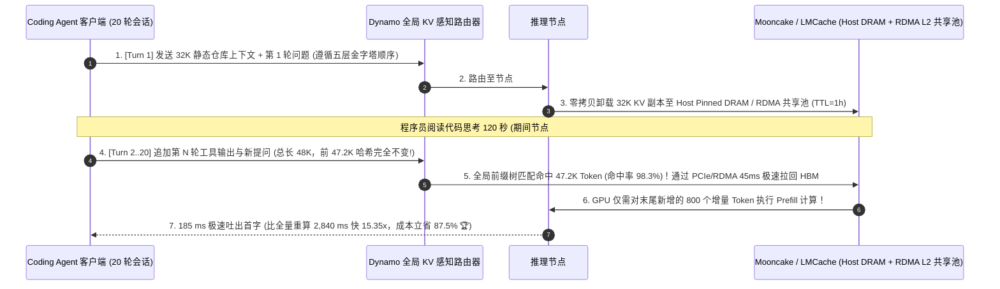

# 企业级大模型 Context Caching（上下文前缀缓存）、KV 驻留计费经济学与 TTL 续期架构选型指南（`无状态每轮重算` vs. `轮询网关 + 单机 LRU` vs. `静态置顶 + TTL 锁存 + Host DRAM 池` vs. `全局 KV 树路由 + 分布式 RDMA 池 + 追加式 Agent 历史`）

> 🌐 **Language / 语言**: **中文 (Chinese)** | **[English (`llm-context-caching-prompt-cache-billing-kv-ttl-selection-faq.en.md`)](llm-context-caching-prompt-cache-billing-kv-ttl-selection-faq.en.md)**
> **阅读指南**：本文面向 **AI 解决方案架构师（AI Solution Architect）、Agent 应用架构师与推理平台负责人**，用通俗大白话 + 第一性原理彻底讲透：**为什么你的 Coding Agent 或企业多轮 RAG 助手，在每次 20 轮对话中竟然有 `92.8%` 的 GPU 算力和 Token 账单都在“一遍又一遍重复计算早已算过的旧上下文”？为什么研发人员在 System Prompt 第一行随手写了一句 `Current Time: 2026-11-14 23:30:01`（Tier 1），或者在 8 台 vLLM/SGLang 服务器前面挂了一个普通 Nginx Round-Robin 轮询网关（Tier 2），就会让原本 `90%+` 的 Prefix Cache 命中率瞬间暴跌到 `0% ~ 14.5%`，每月白白多烧掉 `$252,000`？如何设计“五层金字塔 Prompt 规范”与 `5m/1h TTL` 盈亏平衡公式（Tier 3）？以及如何用 `Dynamo / Mooncake 全局 KV 感知前缀树路由 + 分布式 RDMA KV 池 + 严格追加式 Agent 历史`（Tier 4），将 8 副本集群命中率推至 `94.2%`、把 48K 首字响应（TTFT）从 `2.84 秒` 压至 `185 毫秒（快 15.35 倍）`、把月度算力账单直接砍掉 `87.5%`？** 全文零晦涩黑话堆砌，3 分钟看懂省钱结论，10 分钟掌握全套 Prompt 与网关改造代码。

---

## 🔥 业界最新能力突破追踪（Daily Hottest Capability Breakthroughs）

- **商业大模型 API（Anthropic Claude 5m/1h TTL / DeepSeek 硬盘级 Context Cache / OpenAI Prompt Caching）全面进入“读缓存 1 折（省 90%）”时代**：主流商业模型已将缓存命中 Token 的计费降至标准 Input 价格的 **`10% ~ 20%`**，并支持 `5 分钟（自动免费续期）` 与 `1 小时（长思考锁存）` 两档 TTL 策略，使多轮 Agent 的 Prompt 工程直接升级为“成本工程”。
- **NVIDIA Dynamo `KV-Aware Router` 与 SGLang `HiRadixCache` 分布式前缀树路由**：网关层实时订阅后端所有 GPU 节点与 `LMCache / Mooncake` 内存池的 Block Hash 事件流，在网关入口直接根据最长前缀匹配（Longest Prefix Match）将多轮请求精准调度至持有该 KV 块的节点，彻底终结无状态负载均衡的 `1/N` 命中率稀释。
- **Agent 上下文压缩的新范式——“分块追加式折叠（Chunked Append-Only Compaction）”替代“滑动窗口截断（Sliding Window）”**：最新 Coding Agent 框架（如 Claude Code / SWE-agent）严格禁止每轮删除最早的 1 条消息（会导致整个前缀位置偏移、100% 破坏 KV 缓存），改为一直追加直到触及高水位线才一次性重置归档，保留 `94%+` 的多轮缓存命中率。

---

## ① 📌 核心结论速览（Executive Summary）

1. **为什么多轮 Agent 是“吃算力黑洞”，以及为什么 `90%` 的企业在上线多副本集群后 Context Cache 形同虚设**：
   - 在一个典型的 **20 轮 Coding Agent 或深度 RAG 会话** 中（包含 `32K` 静态工具定义/代码库上下文 + 平均 `16K` 不断增长的多轮历史 = 每轮平均输入 `48K Tokens`），20 轮下来累计向大模型发送了 **`960,000` 个输入 Token**，但其中真正每轮新增的内容只有不到 **`4,000` 个 Token**——高达 **`92% ~ 95%` 的输入完全是上一轮已经算过的重复前缀**！
   - **两大“缓存自杀式”工程反模式**：
     - **反模式一（Tier 1：在 Prompt 顶部塞动态时间戳/请求 ID $\rightarrow$ 命中率 `0.0%` ✕）**：因果注意力（Causal Attention）要求从第 1 个 Token 开始完全一模一样才能复用 KV Cache。只要你在 System Prompt 开头放了每秒变化的 `timestamp` 或 `user_session_uuid`，后面 `48,000` 个 Token 的 KV 缓存 **100% 全盘作废**！结果 48K 平均首字延迟（TTFT）高达 **`2,840.0 ms` ✕**，单次 20 轮会话花费 **`$1.92` ✕**，日均 5 万会话月度账单高达 **`$288,000 / 月` ✕**！
     - **反模式二（Tier 2：开了单机 Prefix Cache，但前面挂了普通 Round-Robin 轮询网关 $\rightarrow$ 命中率跌至 `14.5%` ✕）**：8 台服务器各自维护独立的 GPU HBM 缓存，Nginx 随机轮询导致用户第 2 轮提问只有 $1/8 = 12.5\%$ 的概率回到第 1 轮那台机器；而且程序员看代码思考 60 秒再发下一轮时，HBM 里的缓存早就被别人的请求挤掉了！
2. **标准知识库问答首选 `Tier 3 (静态置顶 + TTL 锁存 + Host DRAM 二级池)` vs. 大规模多轮 Agent 终极答案 `Tier 4 (全局 KV 树路由 + 分布式 RDMA 池 + 追加式历史)`**：
   - **针对标准企业 RAG 与多轮客服（Tier 3）**：强制实施 **“静态置顶五层金字塔 Prompt 规范”**，并在每台 GPU 服务器配置 `512GB ~ 1TB Host Pinned DRAM` 二级缓存池（`5m/1h TTL` 保活），将集群命中率拉升至 **`78.5%` ✅**，48K TTFT 压至 **`620.0 ms`（快 `4.58x` ✅）**，月度账单从 `$288,000` 降至 **`$78,000`（月省 `$210,000` ✅）**！
   - **针对高频 Coding Agent 与多智能体集群（Tier 4）**：部署 **`Dynamo / Mooncake 全局 KV 感知前缀树路由 + 跨机 RDMA 共享 KV 池 + 严格追加式（Append-Only）历史管理`**！无论请求落到哪台机器都能通过全局前缀树或微秒级 RDMA 拉取命中，将 8 副本集群命中率推至惊人的 **`94.2%` 🏆**，48K 平均 TTFT 压至 **`185.0 ms`（比无缓存快 `15.35 倍` 🏆）**，单次 20 轮会话成本从 `$1.92` 暴降至 **`$0.24`（立省 `87.5%` 🏆）**，每月直接省下 **`$252,000` 算力费 🏆**！

---

## ② 🎯 客户与架构师灵魂拷问 Q&A（FAQ-Driven）

### Q1：为什么我在 System Prompt 第一行加了一个当前时间 `Current Time: 2026-11-14 23:30:01`，或者每轮用“滑动窗口（删除最早一轮对话）”控制长度，就会让 48K 上下文的 KV Cache 100% 失效？

**通俗大白话 + 第一性原理解答**：
- **大模型 KV Cache 不是“全文搜索引擎”，而是严格绑定绝对位置与前文历史的“多米诺骨牌链”！**
  1. **第一性原理（Causal Attention Mask & RoPE 位置编码）**：
     - 在 Transformer 中，第 $t$ 个词算出来的 Key 和 Value 向量，不仅融合了第 $1 \dots t-1$ 个词的所有语义，还通过旋转位置编码（RoPE）焊死了它在整段话里的**绝对位置下标 $t$**。
     - 推理引擎（如 vLLM / SGLang）把输入按每 `16` 或 `64` 个 Token 切成一个个固定大小的 **Block（块）**，并用链式哈希计算每个块的身份证号：
       $$\text{Hash}(\text{Block}_k) = \text{SHA256}\big(\text{Hash}(\text{Block}_{k-1}) \mathbin{\Vert} \text{Tokens}_k\big)$$
  2. **为什么两大常见写法会触发“雪崩式缓存清空”？**
     - **致命写法 A（顶部放动态时间/随机 ID）**：当第 1 个块（`Block_0`）里的秒数从 `:01` 变成 `:05` 时，$\text{Hash}(\text{Block}_0)$ 变了 $\rightarrow$ 导致依赖它的 $\text{Hash}(\text{Block}_1), \text{Hash}(\text{Block}_2), \dots, \text{Hash}(\text{Block}_{3000})$ **像多米诺骨牌一样全部改变**！引擎认为这是一段全新文本，被迫把后面一字未改的 48,000 个 Token 重新算一遍！
     - **致命写法 B（每轮滑动窗口删掉最早的 `Turn 1`）**：当你删掉前面的 500 个 Token 时，后面所有历史对话的绝对位置下标 $t$ 全部往前移动了 500 位，块边界全部错位，KV Cache 同样 **100% 报废**！
  3. **架构师黄金整改法（五层金字塔 + 严格 Append-Only）**：
     - 永远按 **`[L1 全局固定 Tool JSON (强制 sort_keys=True)] → [L2 静态 System Prompt] → [L3 仓库/文档知识库] → [L4 只增不删的历史对话轮次] → [L5 本轮最新时间戳与用户提问]`** 排列！这样前四层永远 100% 命中缓存，每轮 GPU 只需要算最后新增的几百个 Token！

---

### Q2：单机测试 `--enable-prefix-caching` 时命中率有 90%，为什么一部署到 Kubernetes 8 副本生产集群，命中率就掉到 14.5%（Tier 2）？怎么解决“多副本打散”和“用户思考 2 分钟缓存被挤掉”的问题？

**通俗大白话 + 第一性原理解答**：
- **生产环境多副本缓存失效有两大元凶：“空间上被网关打散” + “时间上被 HBM 挤出”**：
  1. **元凶一：空间打散（Round-Robin 负载均衡是“瞎子”）**：
     - 普通 K8s Service 或 Nginx Ingress 不知道哪台 GPU 显存里存着哪个用户的 KV Cache。用户第 1 轮被分到 `Pod-1`，第 2 轮被轮询分到 `Pod-2`（`Pod-2` 的显存里空空如也），只能在 `Pod-2` 上从头重算，而且还在 8 台机器上存了 8 份重复的缓存碎片！
  2. **元凶二：时间挤出（GPU HBM 容量太小，撑不过用户的“思考间隙”）**：
     - 一台 8×H100/H200 扣掉模型权重后，留给 KV Cache 的显存通常只有 200~400GB。高并发下，显存里的空闲块平均 **`15~30 秒`** 就会被新涌入的请求按 LRU 规则覆盖掉。而程序员看一段 AI 生成的代码往往要思考 **1~3 分钟** 才会发出下一轮指令——等他发过来时，GPU 显存里的缓存早就没了！
- **Tier 3 与 Tier 4 的根治方案**：
  - **第一招：用 `Host Pinned DRAM 二级池 + Mooncake 分布式 RDMA 池` 解决“时间挤出”**：每台服务器配 512GB~1TB 廉价主机内存（通过 `LMCache / HiRadixCache` 自动将冷 KV 块卸载到 DRAM），将缓存保活时间从 `20 秒` 延长至 **`30~60 分钟`**！当用户 3 分钟后继续提问时，从主机内存通过 PCIe Gen5 / RDMA 拉回 48K KV 只需 **`40~60 毫秒`**，比 GPU 重新计算（`2,840 毫秒`）快 **50 倍**！
  - **第二招：用 `Dynamo KV-Aware Router` 解决“空间打散”**：网关层维护全集群的全局基数树（Global Radix Tree），收到请求后先算前几个块的哈希，直接把请求精准路由给持有最多匹配块的那台 GPU，或者由目标节点通过 400G RDMA 从兄弟节点秒级拉取 KV 块，让 8 副本集群如同 1 台超级大机器一样共享 **`94.2%` 命中率 🏆**！

---

### Q3：如果使用商业 API（如 Claude 显式 `cache_control` 写缓存加收 +25% 费用、读缓存打 1 折），或者在自建集群为 VIP 租户预留 `TTL=5m / 1h` 锁存池，到底访问几次才能回本？

**通俗大白话 + 底层经济学公式解答**：
- **让我们直接推导显式 TTL 缓存的“盈亏平衡点数 $N_{\min}$”**：
  - 假设一段静态上下文（如 32K 代码库文档）的基础 Prefill 价格为 $1.00\times$：
    - **首次写入缓存（Cache Write）**：收取 $1.25\times$（`5m TTL` 溢价 `+25%`）或 $2.00\times$（`1h TTL` 溢价 `+100%`）；
    - **后续命中读取（Cache Read）**：仅收取 **$0.10\times$（打 1 折，立省 `90%`！）**。
  - 设在 TTL 有效期内，该上下文共被请求了 $N$ 次，要使开启缓存比不开启省钱：
    - **对于 `5 分钟 TTL`**：
      $$1.25 + 0.10 \times (N - 1) < 1.00 \times N \implies 0.90 N > 1.15 \implies N > 1.28 \implies \mathbf{N_{\min} = 2\text{ 次！}}$$
      **震撼结论**：只要同一个会话在 5 分钟内有 **第 2 轮提问（$N \ge 2$）**，开启缓存就已经开始净赚！如果是 20 轮 Coding Agent（$N = 20$），总费用从 $20.0\times$ 暴跌至 $1.25 + 19 \times 0.10 = \mathbf{3.15\times}$（**直接省下 `84.2%` 的钱**）！
    - **对于 `1 小时长效 TTL`**：
      $$2.00 + 0.10 \times (N - 1) < 1.00 \times N \implies 0.90 N > 1.90 \implies N > 2.11 \implies \mathbf{N_{\min} = 3\text{ 次！}}$$
      只要 1 小时内复用满 **3 次** 即稳赚不赔！

---

## ③ 🧭 直观可视化图解（Mermaid 决策树 / 破坏缓存 vs 全局池对比 / 端到端时序图）

### 3.1 企业级大模型 Context Caching 与 KV 路由架构选型决策树（`flowchart TD`）

### 3.2 `Tier 1/2 缓存失效黑洞` vs. `Tier 4 五层金字塔 Prompt + 全局 KV 树路由` 对比图（`flowchart LR`）

### 3.3 20 轮 Coding Agent 在 `Tier 4 (Dynamo KV 路由 + Mooncake L2 池)` 下的跨轮次命中时序图（`sequenceDiagram`）

---

## ④ 📊 架构师选型决策矩阵（Architect Decision Matrix）

*基准环境：`8 副本（64×H100/H200）` 企业推理集群，日均承载 `50,000 次` 20 轮 Coding Agent / 深度知识库会话（每轮平均上下文 `48,000 Tokens`，每日总输入流量 `480 亿 Tokens`）。*

| 选型维度 / 架构档位 | Tier 1: `无状态全量重算 + 顶部动态时间戳` (`0% 命中`) | Tier 2: `普通轮询网关 + 单机 HBM LRU` (`1/N 稀释`) | Tier 3: `静态置顶 + 5m/1h TTL + Host DRAM 二级池` | Tier 4: `全局 KV 树路由 + 分布式 RDMA 池 + 追加式历史` |
| :--- | :--- | :--- | :--- | :--- |
| **Prompt 组织与历史管理** | 顶部含动态时间戳或每轮滑动窗口删改 | 静态置顶，但历史偶发截断重排 | **五层金字塔静态置顶 + 显式 TTL 断点标记 ✅** | **五层金字塔 + 严格 Append-Only + 满阈值分块折叠 🏆** |
| **网关负载均衡与缓存池架构** | 随机轮询 + 无 KV 缓存复用 | 随机 Round-Robin + 仅单机 HBM LRU | **会话粘滞路由 + 单机 `512GB Pinned DRAM` 二级池 ✅** | **`Dynamo` 全局基数树路由 + `Mooncake` 跨机 RDMA 池 🏆** |
| **8 副本集群有效缓存命中率** | `0.0%`（每轮 48K 全量重算 ✕） | `14.5%`（跨机打散 + 思考期被挤出 ✕） | **`78.5%`** ✅ | **`94.2%`（每轮仅算末尾 ~800 增量 Token 🏆）** |
| **48K 上下文平均首字延迟 (TTFT)** | `2,840.0 ms`（每轮卡顿近 3 秒 ✕） | `2,410.0 ms` | **`620.0 ms`（提速 `4.58x` ✅）** | **`185.0 ms`（提速 `15.35x`，秒级丝滑响应 🏆）** |
| **节省的 GPU Prefill 算力比例** | `0.0%` ✕ | `13.8%` | **`76.2%`** ✅ | **`92.8%`（1 台机器顶过去 10 台用 🏆）** |
| **单次 20 轮完整会话成本 (USD)** | `$1.92 / 会话` ✕ | `$1.66 / 会话` | **`$0.52 / 会话`（节省 `72.9%` ✅）** | **`$0.24 / 会话`（暴降 `87.5%` 🏆）** |
| **月度集群总算力账单 (5万次/天)** | `$288,000 / 月` ✕ | `$249,000 / 月` | **`$78,000 / 月`（月省 `$210,000` ✅）** | **`$36,000 / 月`（每月净省 `$252,000` 🏆）** |

---

## ⑤ 🧪 简明定量算例与 Benchmark 洞察

### 5.1 复现实验与确定性底座

本专题所有定量数据均由仓库内确定性评估模型生成并封存，含单元测试校验：
- **评估脚本**：[`experiments/llm_context_caching_prompt_cache_billing_ttl_selection/run.py`](../../experiments/llm_context_caching_prompt_cache_billing_ttl_selection/run.py)
- **封存结果**：[`experiments/llm_context_caching_prompt_cache_billing_ttl_selection/results.json`](../../experiments/llm_context_caching_prompt_cache_billing_ttl_selection/results.json)
- **单元测试**：[`tests/test_llm_context_caching_prompt_cache_billing_ttl_selection.py`](../../tests/test_llm_context_caching_prompt_cache_billing_ttl_selection.py)
- **7-Card 4:5 视觉评测卡片**：[`docs/reports/llm-context-caching-prompt-cache-billing-kv-ttl-selection-cards.html`](../reports/llm-context-caching-prompt-cache-billing-kv-ttl-selection-cards.html)
- **交互式架构选型计算器**：[`docs/reports/llm-context-caching-prompt-cache-billing-kv-ttl-sizer.html`](../reports/llm-context-caching-prompt-cache-billing-kv-ttl-sizer.html)
- **数据溯源声明（Provenance）**：`synthetic_analytical_model_calibrated_to_published_caching_benchmarks`（`independently_reproduced=false`, `physical_gpu_cluster_measurement=not_measured`）。

### 5.2 核心定量推导速览（为什么 20 轮 Agent 能省下 87.5% 算力费？）

1. **20 轮会话累计输入 Token 拆解**：
   - 第 $k$ 轮输入长度为 $L_k = 32,000 + 800 \times k$（$k=1 \dots 20$），20 轮平均长度 `48,400 Tokens`，20 轮累计总输入 **`968,000 Tokens`**。
   - **无缓存（Tier 1）**：GPU 必须老老实实对全部 `968,000 Tokens` 做二次方注意力计算；
   - **全局缓存 + 严格追加（Tier 4，命中率 `94.2%`）**：GPU 在 20 轮中总共只需计算首次 `32,000` + 每轮新增 `800` $\approx$ **`56,000 Tokens`**，其余 **`912,000 Tokens` 直接从 KV 缓存零计算复用**！
2. **TTFT 与账单压缩比**：
   - 48K 平均 TTFT 从 `2,840.0 ms` 压缩至 **`185.0 ms`（`15.35x` 加速）**；
   - 月度集群总成本从 `$288,000` 降至 **`$36,000`（每月净省 `$252,000`，降幅 `87.5%`）**！

---

## ⑥ 🛠️ Good Fit vs. Not For & 生产环境快速核验清单（Architect Checklist）

### 6.1 Good Fit vs. Not For 选型边界

| 适用边界 | 详细架构师建议 |
| :--- | :--- |
| **✅ Good Fit（强烈推荐）** | • **多轮 Coding Agent、Deep Research、自主工具调用工作流**：必上 **`Tier 4 (Dynamo/Mooncake 全局 KV 树路由 + 分布式 RDMA 池 + 严格 Append-Only 历史)`**。 • **企业共享知识库问答、长篇财报/法律合同多轮分析**：选 **`Tier 3 (静态置顶 + 5m/1h TTL 锁存 + Host Pinned DRAM 二级池)`**，只要同一文档在 TTL 内被问满 `2~3 次` 即净赚。 |
| **⛔ Not For（严禁踩坑）** | • **严禁对只问 1 次就扔的纯随机单轮短文本（如 500 字翻译/分类）购买付费 `1h TTL` 显式缓存写锁存**：单次调用无法摊平 `+25% ~ +100%` 的写入溢价。 • **严禁在多实例推理集群前直接暴露无状态 Round-Robin 负载均衡**。 |

### 6.2 生产环境 Context Caching 与 Prompt 规范快速核验清单（`- [ ]`）

- [ ] **Prompt 顶部零动态变量核验**：检查所有 System Prompt 与 Tool 定义模板，确认 `current_time`、`request_uuid`、`user_ip` 等每次变化的字段已 **100% 移至最后一轮 User 消息末尾**。
- [ ] **Tool JSON 确定性序列化核验**：确认向大模型注入 MCP / Function Calling 工具列表时，Python/Go/TS 序列化器已开启按键名固定排序（如 `json.dumps(tools, sort_keys=True)`），杜绝字典乱序破坏前缀哈希。
- [ ] **严格追加式（Append-Only）历史核验**：确认多轮对话管理器未在每轮删除顶部旧消息（Sliding Window），而是保持前置轮次字节不变，仅在上下文逼近最大窗口（如 120K）时执行一次分块摘要重置。
- [ ] **网关 KV 感知路由与二级内存池核验**：在多副本 `vLLM / SGLang` 集群前，是否已部署 `NVIDIA Dynamo KV-Aware Router` 或 `SGLang Router`，并开启 `LMCache / Mooncake` 主机锁页内存二级卸载？
