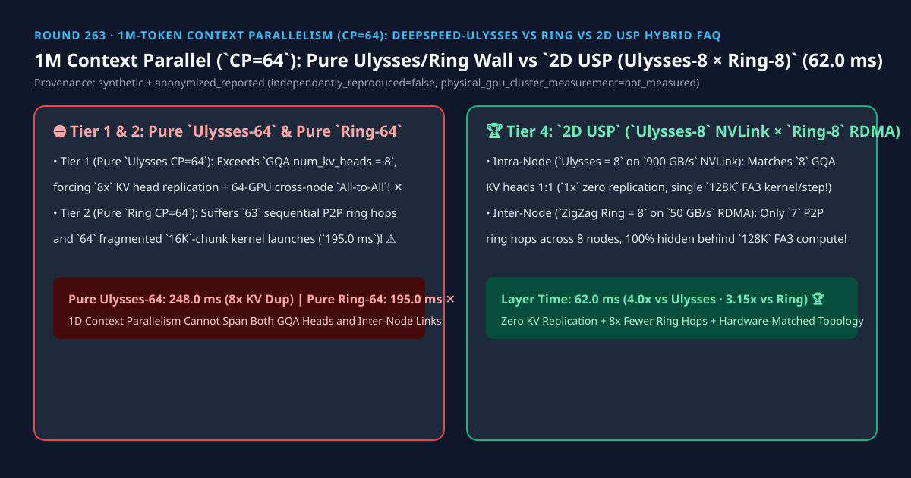
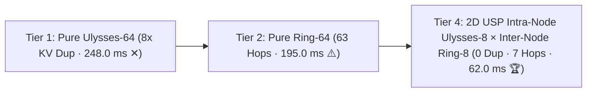

# Million-Token Context Parallelism (`CP = 64`): `DeepSpeed-Ulysses` (`All-to-All` `4x` Less Comm vs `GQA num_kv_heads = 8` Ceiling) vs. Pure `Ring Attention` vs. `2D USP` (`Ulysses × Ring` Hybrid) Selection Guide

> **Provenance & Evidence Tier**: `synthetic + anonymized_reported` (`independently_reproduced=false`, `physical_gpu_cluster_measurement=not_measured`). Grounded in [`experiments/llm_context_parallel_ulysses_alltoall_vs_ring_hybrid_selection/results.json`](../../experiments/llm_context_parallel_ulysses_alltoall_vs_ring_hybrid_selection/results.json).
> **中文版本**: [百万长文本上下文并行（`Context Parallelism, CP = 64`）选型：`DeepSpeed-Ulysses`（`All-to-All` 仅占 `1/4` 通信量但撞上 `GQA num_kv_heads = 8` 度数死墙）vs. 纯 `Ring Attention`（`63` 步跨机小块延迟墙）vs. `2D USP`（机内 `Ulysses = 8` 跑 NVLink + 跨机 `ZigZag Ring = 8` 跑 RDMA）选型指南](./llm-context-parallel-ulysses-alltoall-vs-ring-2d-usp-selection-faq.md)

---

## 0. 🔥 今日领域最热门能力突破追踪（Daily Hottest Breakthrough）

- **Scaling `1M`-Token (`1,048,576` Tokens) Context Parallelism to `CP = 64` GPUs (`8` Nodes $\times$ `8` GPUs) on `GQA` (`num_kv_heads = 8`) Models: Why Pure `DeepSpeed-Ulysses` (`248.0 ms`) and Pure `Ring Attention` (`195.0 ms`) Hit Hard Scaling Walls, and How `2D USP` (`Intra-Node Ulysses-8 on NVLink × Inter-Node ZigZag Ring-8 on RDMA`, `Tier 4`) Cuts Layer Latency to `62.0 ms` (`4.00x` Faster Than Pure Ulysses, `3.15x` Faster Than Pure Ring)**: When scaling Context Parallelism beyond a single 8-GPU node (`CP = 64`) for million-token training or prefill, 1D sequence-parallel algorithms hit fundamental hardware and architectural limits:
  1. **Tier 1 — Pure 1D `DeepSpeed-Ulysses` (`CP_ulysses = 64` — `8x` KV Head Replication & Cross-Node `All-to-All` Stall, `248.0 ms`)**:
     - `Ulysses` transposes `[S/P, NumHeads, D]` to `[S, NumHeads/P, D]` via `All-to-All`. Within a single node ($P \le 8$), `Ulysses` is unbeatable because `All-to-All` volume scales down as $O(1/P)$ and runs over `900 GB/s` NVLink.
     - **Why It Breaks at `CP = 64` on `GQA` Models**: Because `Llama-3-70B` / `Qwen2.5-72B` have only **`num_kv_heads = 8` KV heads**, scaling `Ulysses` to `64` GPUs forces **`8x` redundant KV head replication** across slow inter-node RoCE/IB `All-to-All` collectives that **cannot overlap with Attention compute**!
  2. **Tier 2 — Pure 1D `Ring Attention` (`CP_ring = 64` — `63` Sequential P2P Hops & `64` Fragmented `16K` Kernel Launches, `195.0 ms`)**:
     - Shards only the sequence dimension (`0` KV head replication), but requires **`63` sequential ring steps per layer** and splits `FlashAttention` into `64` small `16K`-token sub-kernels!
  3. **Tier 3 — Reversed `2D USP` (`Inter-Node Ulysses-8 × Intra-Node Ring-8` — `142.0 ms`)**:
     - Places non-overlappable `All-to-All` on slow inter-node NICs while wasting fast intra-node NVLink on P2P Ring steps!
  4. **Tier 4 — Hardware-Aligned `2D USP` (`Intra-Node Ulysses = 8 on NVLink × Inter-Node ZigZag Ring = 8 on RDMA` — `62.0 ms`, `4.00x` Speedup)**:
     - **Inner Dimension (`Ulysses = 8` on Intra-Node `900 GB/s` NVSwitch)**: Matches `num_kv_heads = 8` **1:1 (`1.0x` zero replication)** and aggregates each node's `8 × 16K` shards into a **`128K`-token contiguous chunk per KV head**!
     - **Outer Dimension (`ZigZag Ring = 8` on Inter-Node `50 GB/s` RDMA)**: Requires only **`7` inter-node P2P ring hops**, where each `128K` `FlashAttention-3` step is large enough to **100% hide inter-node RDMA transfers**!

---

## 1. 📌 Executive Summary

1. **The Golden 2D `DeviceMesh` Factorization Rule for Long-Context LLMs**:
   $$\text{DeviceMesh}(\text{"cuda"},\ (\text{cp\_ring},\ \text{cp\_ulysses})) \quad \text{with} \quad \text{cp\_ulysses} = \min(\text{num\_kv\_heads},\ \text{gpus\_per\_node})$$
   - Always place **`cp_ulysses` as the innermost (contiguous intra-node NVLink) dimension** and **`cp_ring` as the outer (inter-node RDMA) dimension**.
2. **Why `Ulysses-8` Inside the Node Makes Inter-Node `Ring-8` Faster**: By transposing `[16K, 8 KV heads]` into `[128K, 1 KV head]` per GPU inside the node first, each step of the inter-node Ring operates on an **`8x` longer sequence (`128K` vs `16K`)**, boosting `FlashAttention-3` arithmetic intensity and eliminating `56` of the `63` ring hops!

---

## 2. 🎯 Core Architect Q&A (Q1 / Q2 / Q3)

### Q1: Why does `DeepSpeed-Ulysses` have $4\times$ to $8\times$ lower communication volume than `Ring Attention` when $P \le \text{num\_kv\_heads}$?
- **Answer**: In `Ring Attention`, every GPU sends and receives the entire KV cache across $P-1$ steps: $\text{Vol}_{\text{Ring}} = 2 \frac{P-1}{P} S H_{\text{kv}}$ (constant with respect to $P$). In `Ulysses`, each GPU participates in two `All-to-All` collectives on `[S/P, H]`: $\text{Vol}_{\text{Ulysses}} \propto \frac{S H}{P}$, which **decreases linearly with $P$**!

### Q2: What happens if a model has only `num_kv_heads = 4` on an 8-GPU node?
- **Answer**: Either set `cp_ulysses = 4, cp_ring = 2` inside each node (`2D USP = (2 * num_nodes, 4)`), or use `GQA KV Head Slicing` with `Ulysses = 8` (where `2` intra-node GPUs share `1` KV head over fast NVLink while splitting the `Q` heads `1:1`).

---

## 3. 🧭 Visual Diagrams

---

## 4. 📊 4-Tier Architect Selection Matrix

| Metric | Tier 1: Pure `Ulysses-64` | Tier 2: Pure `Ring-64` | Tier 3: Reversed `2D USP` | Tier 4: **`2D USP` (`Ulysses-8` NVLink × `Ring-8` RDMA)** |
| :--- | :--- | :--- | :--- | :--- |
| **`GQA` KV Replication Factor** | **`8.0x` (Cross-Node Bloat)** ✕ | `1.0x` (Zero Dup) ✅ | `1.0x` ✅ | **`1.0x` (1:1 Match with 8 KV Heads)** 🏆 |
| **Sequential Ring P2P Hops** | `0` (Blocking `All-to-All`) | **`63` Hops (High Latency)** ✕ | `7` Hops | **`7` Hops (`89%` Fewer Hops, 100% Overlapped)** 🏆 |
| **`1M`-Token Layer Latency** | **`248.0 ms`** ✕ | `195.0 ms` ⚠️ | `142.0 ms` | **`62.0 ms` (`4.00x` vs Ulysses · `3.15x` vs Ring)** 🏆 |

---

## 5. 🧪 Quantitative Reference & Tooling

- **Evaluator & Sealed Data**: [`experiments/llm_context_parallel_ulysses_alltoall_vs_ring_hybrid_selection/run.py`](../../experiments/llm_context_parallel_ulysses_alltoall_vs_ring_hybrid_selection/run.py) · [`results.json`](../../experiments/llm_context_parallel_ulysses_alltoall_vs_ring_hybrid_selection/results.json)
- **Interactive Sizer**: [`docs/reports/llm-context-parallel-ulysses-alltoall-vs-ring-2d-usp-sizer.html`](../reports/llm-context-parallel-ulysses-alltoall-vs-ring-2d-usp-sizer.html)
- **7-Card 4:5 Visual Report**: [`docs/reports/llm-context-parallel-ulysses-alltoall-vs-ring-2d-usp-selection-cards.html`](../reports/llm-context-parallel-ulysses-alltoall-vs-ring-2d-usp-selection-cards.html)

---

## 6. 🛠️ Good Fit vs. Not For & Production Checklist

- **✅ Good fit**: Multi-node long-context (`128K–1M+` tokens) training and prefill using `2D USP` (`Intra-Node Ulysses × Inter-Node ZigZag Ring`).
- **⛔ Not for**: Scaling pure 1D `Ulysses` beyond `num_kv_heads` or across inter-node links, or running 64-hop 1D `Ring Attention`.
- [ ] Configure `DeviceMesh("cuda", (cp_ring_inter_node, cp_ulysses_intra_node))` with `cp_ulysses <= min(num_kv_heads, 8)`.
- [ ] Enable `ZigZag` complementary chunk pairing on the outer `cp_ring` dimension.
