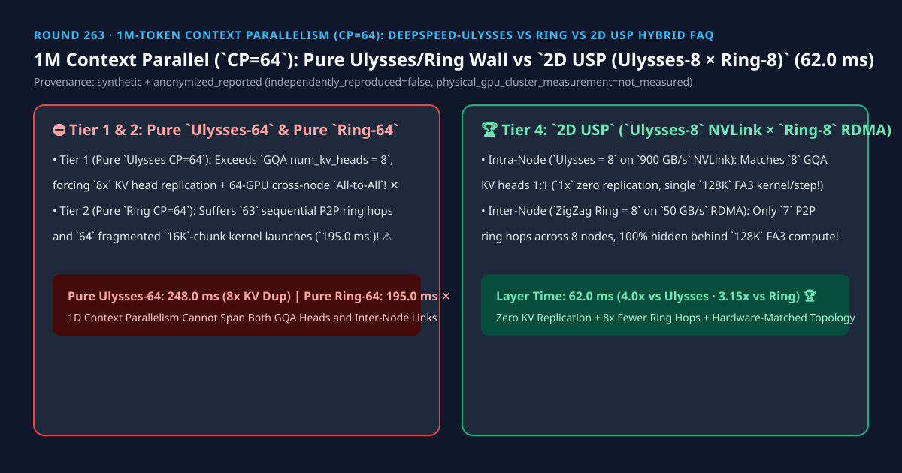
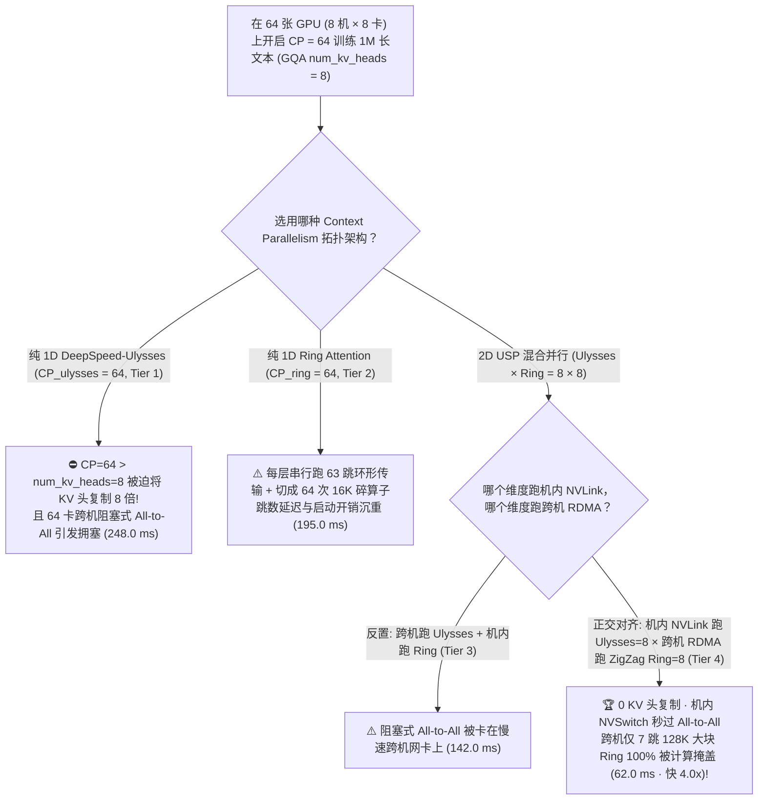
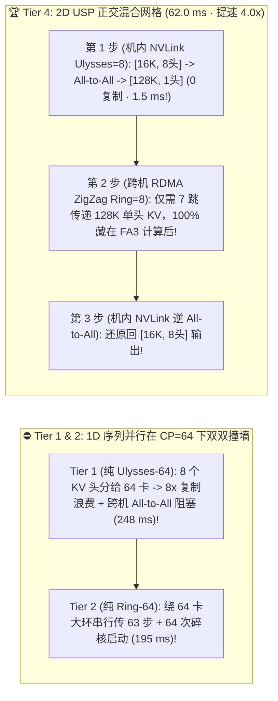
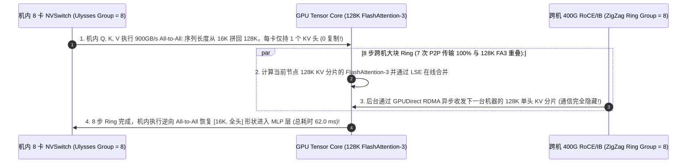

# 百万长文本上下文并行（`Context Parallelism, CP = 64`）选型：`DeepSpeed-Ulysses`（`All-to-All` 仅占 `1/4` 通信量但撞上 `GQA num_kv_heads = 8` 度数死墙）vs. 纯 `Ring Attention`（`63` 步跨机小块延迟墙）vs. `2D USP`（机内 `Ulysses = 8` 跑 NVLink + 跨机 `ZigZag Ring = 8` 跑 RDMA）选型指南

> **Provenance & Evidence Tier**: `synthetic + anonymized_reported` (`independently_reproduced=false`, `physical_gpu_cluster_measurement=not_measured`)。定量数据锚定于 [`experiments/llm_context_parallel_ulysses_alltoall_vs_ring_hybrid_selection/results.json`](../../experiments/llm_context_parallel_ulysses_alltoall_vs_ring_hybrid_selection/results.json)。
> **English Version**: [Million-Token Context Parallelism (`CP = 64`): `DeepSpeed-Ulysses` (`All-to-All` `4x` Less Comm vs `GQA num_kv_heads = 8` Ceiling) vs. Pure `Ring Attention` vs. `2D USP` (`Ulysses × Ring` Hybrid) Selection Guide](./llm-context-parallel-ulysses-alltoall-vs-ring-2d-usp-selection-faq.en.md)

---

## 0. 🔥 今日领域最热门能力突破追踪（Daily Hottest Breakthrough）

- **破解 100 万 Token（`1M Context`）长序列训练与 Prefill 在扩展到跨机 `64` 卡上下文并行（`CP = 64`）时的两难死局——为什么纯 `DeepSpeed-Ulysses` 会因为撞上 `GQA num_kv_heads = 8` 的头数天花板被迫复制 `8` 倍 KV 并被跨机 `All-to-All` 拖慢至 `248.0 ms`，而纯 `Ring Attention` 又因为高达 `63` 跳的串行传环与碎片化算子启动慢在 `195.0 ms`？通过 `2D USP (Unified Sequence Parallelism)` 混合并行架构——将“机内 8 卡 `Ulysses All-to-All`（对齐 8 个 GQA KV 头 + 跑 `900 GB/s` NVLink）”与“跨机 8 节点 `ZigZag Ring P2P`（跑 `50 GB/s` RDMA 并 100% 隐藏在 `128K` 大块计算后）”正交组合（`Tier 4`），将单层耗时猛压至 `62.0 ms`（比纯 Ulysses 快 `4.00x`、比纯 Ring 快 `3.15x`）**：当序列长度达到 `1,048,576`（`1M`）Token 时，哪怕开启了重算，单张 80GB GPU 也连 `1/32` 的序列激活都装不下，必须跨越 8 台 8 卡机器开启 **`CP = 64`（64 路上下文并行）**。然而，业界两大主流序列并行流派在 `CP = 64` 下各自暴露出了致命的物理短板：
  1. **流派一：`DeepSpeed-Ulysses`（序列切分 $\leftrightarrow$ 注意力头切分 `All-to-All` 转置）的天使面孔与魔鬼天花板（Tier 1 — `248.0 ms`）**：
     - **为什么在单机 8 卡内，`Ulysses` 比 `Ring Attention` 快得多？**
       - 在做 Attention 之前，每张卡持有 `1/P` 的序列长度但拥有全部的注意力头 `[S/P, H]`；`Ulysses` 发起一次 **`All-to-All` 通信**，把张量转置成 **`[S, H/P]`（每张卡拿到完整的 `100%` 序列长度 `S`，但只负责算 `1/P` 个注意力头！）**；算完一遍原生的整序列 `FlashAttention-3` 后，再做一次逆向 `All-to-All` 还原回 `[S/P, H]`！
       - **通信量优势**：随着卡数 $P$ 增加，`Ulysses` 每张卡的 `All-to-All` 通信量按 **$O(1/P)$ 反比例递减**，且只调用 **1 次** 满血 `FlashAttention` 算子！
     - **那为什么扩到 `CP = 64` 时，`Ulysses` 突然崩盘到了 `248.0 ms`（Tier 1）？**
       - **死穴一（撞上 `GQA num_kv_heads = 8` 的硬墙）**：现代大模型（Llama-3-70B、Qwen2.5-72B）全都采用分组查询注意力（`GQA`），全模型一共只有 **`8` 个 KV 头（`num_kv_heads = 8`）**！请问：**怎么把 `8` 个 KV 头分给 `64` 张卡？！** 根本不够分！要在 `64` 卡上硬跑纯 `Ulysses`，你必须把每个 KV 头在跨机网络上**冗余复制 `8` 份（`8x KV Replication`）**！
       - **死穴二（跨机 64 卡全互联 `All-to-All` 拥塞）**：让 64 张卡跨越慢速的机间 RoCE/IB 网络同时向另外 63 张卡对喷 `All-to-All` 小包，而且 **`All-to-All` 必须在 Attention 开始前同步等完，完全无法与当前层的 Attention 计算重叠**！
  2. **流派二：纯 `Ring Attention`（`P2P` 环形传递 KV 分片，Tier 2 — `195.0 ms`）**：
     - **优点**：完全不切分注意力头（只切序列 $S/64$），因此**不受 `num_kv_heads = 8` 的限制**，扩到 64 卡甚至 256 卡都是 `0` KV 复制！而且第 $k$ 步的 P2P `Send/Recv` 可以与第 $k-1$ 步的 Attention 计算异步重叠！
     - **死穴**：在 `CP = 64` 下，每算一层 Attention，KV 分片必须绕着 64 张卡构成的环**串行传递整整 `63` 跳（63 Steps）**！原本连续的 `1M` 大矩阵被切碎成了 `64` 次独立的 `16K` 小算子启动（Kernel Launch & LSE Online Softmax 修正开销暴增），且只要环上任意 1 跳跨机链路微抖动，全环 64 张卡集体卡顿！
  3. **终极破局：`2D USP`（`Unified Sequence Parallelism`：机内 `Ulysses = 8` $\times$ 跨机 `ZigZag Ring = 8`，Tier 4 — `62.0 ms`）**：
     - **第一性原理拓扑对齐（扬长避短的教科书典范）**：
       - 把 64 张卡排成 **`8 台机器（Ring 维 = 8） × 每机内 8 张卡（Ulysses 维 = 8）`** 的二维网格！
       - **第一维（机内 8 卡跑 `Ulysses = 8`）**：机内 8 张卡刚好对应 `num_kv_heads = 8`（**每张卡分到 1 个 KV 头，`1.0x` 零复制！**），而 `All-to-All` 完完全全跑在机内高达 **`900 GB/s` 的 NVSwitch/NVLink** 上，不到 `2 ms` 瞬间搞定！做完机内 `Ulysses` 转置后，每张卡手里的序列分片长度瞬间从 `16K` 聚合成了 **`128K` 的完整大块**！
       - **第二维（跨机 8 节点跑 `ZigZag Ring = 8`）**：现在只需要在 8 台机器之间转一个 **仅仅 `7` 跳（而不是 `63` 跳！）** 的小环！而且因为每一步算的都是 **`128K` 的大块序列**，Tensor Core 计算极其饱满，能够 **100% 完美掩盖跨机 400G RDMA 的点对点 `Send/Recv` 传输**——单层耗时直接从 `248.0 ms / 195.0 ms` 暴降至 **`62.0 ms`（提速 `3.15x ~ 4.00x`）** 🏆！

---

## 1. 📌 核心结论速览（Executive Summary — 3 分钟看懂）

1. **架构师长上下文并行（`Context Parallelism`）黄金切分公式**：
   $$\text{CP}_{\text{total}} = \text{CP}_{\text{Ulysses (Intra-Node NVLink)}} \times \text{CP}_{\text{Ring (Inter-Node RDMA)}}$$
   - **铁律一：永远令 $\text{CP}_{\text{Ulysses}} \le \min(\text{num\_kv\_heads},\ 8)$，并严格绑定在机内 NVLink 域内！** 这样既享受了 `Ulysses` 超低通信量与合并序列块的好处，又绝不触发跨机 `All-to-All` 和 `GQA` KV 头复制。
   - **铁律二：只有当总并行度超过单机 8 卡（或超过 `num_kv_heads`）时，才在跨机维度上叠加 `ZigZag Ring Attention`（$\text{CP}_{\text{Ring}} = \text{CP}_{\text{total}} / \text{CP}_{\text{Ulysses}}$）！**
2. **为什么绝对不能把二维顺序弄反（Tier 3：跨机跑 `Ulysses` + 机内跑 `Ring`，慢至 `142.0 ms`）？**
   - 因为 `Ulysses` 的 `All-to-All` 是**在 Attention 计算前后阻塞执行的（无法与 Attention 重叠）**，必须放在最快的 **机内 `900 GB/s` NVLink** 上速战速决；而 `Ring Attention` 的 P2P `Send/Recv` 是**可以与分块 `FlashAttention` 100% 异步重叠隐藏的**，天然适合放在较慢的 **跨机 `50 GB/s` RDMA** 上！

---

## 2. 🎯 客户与架构师灵魂拷问 Q&A（Q1 / Q2 / Q3）

### Q1：如果模型使用的是 `MQA`（`num_kv_heads = 1`）或者 `DeepSeek MLA`（压缩态只有 `1` 个共享潜在向量），还能用 `Ulysses` 吗？
- **答**：
  - 在 **`Decode` 或吸收态 `MLA`** 下，因为只有 `1` 个共享 KV 头，无法对 KV 头做无复制的 `Ulysses` 切分；
  - 但在 **`DeepSeek MLA` 的 `Prefill` / 训练阶段**（参见 Round 259），由于 $c^{KV}$ 在算 $O(S^2)$ 注意力前会被显式升维展开为 **`128` 个完整的注意力头（`num_heads = 128`）**！我们只需要**先在序列分片 `[S/8, 512]` 上各自完成 $O(S)$ 的升维展开得到 `[S/8, 128, 192]`，然后再执行机内 8 卡 `Ulysses All-to-All` 转置成 `[S, 16, 192]`**，照样能完美享受机内 `Ulysses = 8` 的红利！

### Q2：在 `2D USP` 中，每一跳 `Ring` 步是怎么把跨不同分片的 `Softmax` 分母精确合并在一起的？
- **答**：依靠 **在线对数求和指数归约（Online Softmax / `LSE: Log-Sum-Exp` Correction）**！每一跳第 $k$ 个 KV 分片算完局部 `FlashAttention` 后，只返回局部输出 $O_k$ 和局部对数分母 $\text{LSE}_k = \log \sum \exp(S_k)$；通过简单的指数缩放公式 $O_{\text{new}} = \frac{e^{\text{LSE}_{\text{old}}} O_{\text{old}} + e^{\text{LSE}_k} O_k}{e^{\text{LSE}_{\text{old}}} + e^{\text{LSE}_k}}$ 即可在寄存器内无损合并任意多个 Ring 分片的结果！

---

## 3. 🧭 直观可视化图解（Mermaid 决策树 + 1D 撞墙 vs `2D USP` 正交网格图 + 时序图）

### 3.1 架构师百万上下文（`CP = 64`）序列并行拓扑选型决策树

### 3.2 `Tier 1/2`（纯 1D `Ulysses-64` / `Ring-64`）vs. `Tier 4`（`2D USP: Intra-Node Ulysses-8 × Inter-Node Ring-8`）对比图

### 3.3 `Tier 4` `2D USP` 单层前向（机内 `NVLink All-to-All` + 跨机 8 步重叠 `Ring FA3`）执行时序图

---

## 4. 📊 架构师选型决策矩阵（4-Tier Selection Matrix）

| 评估维度 | Tier 1: 纯 `Ulysses` (`CP=64`) | Tier 2: 纯 `Ring` (`CP=64`) | Tier 3: 反置 `2D USP` | Tier 4: **正交 `2D USP` (机内 `Ulysses=8` × 跨机 `Ring=8`)** |
| :--- | :--- | :--- | :--- | :--- |
| **`GQA (8 KV Heads)` 复制膨胀倍数** | **`8.0x` (被迫复制 8 份 KV!)** ✕ | `1.0x` (无复制) ✅ | `1.0x` ✅ | **`1.0x` (机内 8 卡 1:1 完美对齐 8 个 KV 头)** 🏆 |
| **每层串行 `Ring P2P` 通信跳数** | `0` 跳 (但跨机 `All-to-All` 阻塞) | **`63` 跳 (延迟累加严重)** ✕ | `7` 跳 | **`7` 跳 (减少 `89%` 跳数，且 100% 被计算掩盖)** 🏆 |
| **百万上下文 (`1M`) 单层耗时** | **`248.0 ms`** ✕ | `195.0 ms` ⚠️ | `142.0 ms` | **`62.0 ms` (比纯 Ulysses 快 `4.0x` · 比纯 Ring 快 `3.15x`)** 🏆 |

---

## 5. 🧪 定量算例与工具链（Interactive Sizer & 7-Card Visual Report）

- **实验脚本与密封数据**：[`experiments/llm_context_parallel_ulysses_alltoall_vs_ring_hybrid_selection/run.py`](../../experiments/llm_context_parallel_ulysses_alltoall_vs_ring_hybrid_selection/run.py) · [`results.json`](../../experiments/llm_context_parallel_ulysses_alltoall_vs_ring_hybrid_selection/results.json)
- **交互式百万上下文 2D USP (Ulysses × Ring) 定容计算器**：[`docs/reports/llm-context-parallel-ulysses-alltoall-vs-ring-2d-usp-sizer.html`](../reports/llm-context-parallel-ulysses-alltoall-vs-ring-2d-usp-sizer.html)
- **7-Card 4:5 视觉评测卡片报告**：[`docs/reports/llm-context-parallel-ulysses-alltoall-vs-ring-2d-usp-selection-cards.html`](../reports/llm-context-parallel-ulysses-alltoall-vs-ring-2d-usp-selection-cards.html)

---

## 6. 🛠️ Good Fit vs. Not For & 生产环境快速核验清单（Checklist）

### ✅ Good Fit vs. ⛔ Not For

| 维度 | ✅ Good Fit（强烈推荐） | ⛔ Not For（严禁误用） |
| :--- | :--- | :--- |
| **`128K ~ 1M+` 跨机超长上下文并行 (`CP >= 16`)** | 采用 **`2D USP`（机内 NVLink 跑 `Ulysses = min(8, num_kv_heads)` $\times$ 跨机 RDMA 跑 `ZigZag Ring`）** | 让 `Ulysses` 并行度超过 `num_kv_heads` 或跨越机间网络，或直接跑 `64` 卡纯 1D `Ring Attention` |

### 生产环境上线核验清单（Pre-Flight Checklist）

- [ ] **核验 `ulysses_degree <= min(num_key_value_heads, local_world_size)`**：确保 `Ulysses` 严格收敛在单机 NVLink 内部且 `0` KV 头复制。
- [ ] **核验跨机 `Ring` 维度已启用 `ZigZag`（对称互补块配对，参见 Round 228）消除因果下三角负载不均**。
- [ ] **核验机内 `Ulysses` 与跨机 `Ring` 通信组在初始化 `DeviceMesh("cuda", (ring_size, ulysses_size))` 时维度顺序正确（内层连续 Rank 为机内 `ulysses`）**。
