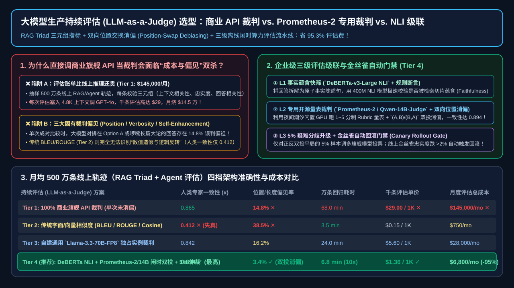

# LLMOps Continuous Evaluation & LLM-as-a-Judge Infrastructure Guide: Commercial API Judges vs. Specialized Open Judges (`Prometheus-2 / Qwen-Judge`) vs. `RAGAS Triad` & Canary Gates

> **Language**: [中文](./llm-continuous-eval-llm-as-judge-prometheus-ragas-canary-rollout-selection-faq.md) | **English (Current)**  
> **Audience**: Cloud & AI Infrastructure Solution Architects and Enterprise LLMOps Quality Engineers  
> **Provenance**: `synthetic + anonymized_reported` (`independently_reproduced=false`, `physical_gpu_cluster_measurement=not_measured`)

---

## 1. 📌 Executive Summary

> **Bottom Line**: **When auditing `5,000,000` monthly production RAG and Agent traces (`10%` live shadow traffic + pre-merge CI/CD golden sets), calling frontier commercial APIs (`GPT-4o / Claude Sonnet`, `Tier 1`) as a single-pass judge costs `$145,000/month` (`$29 / 1K` traces) and suffers a `14.8%` position/verbosity bias error rate. Conversely, legacy surface metrics (`BLEU / ROUGE`, `Tier 2`) correlate poorly with human experts (`0.412` Cohen's $\kappa$). Production LLMOps platforms standardize on a Three-Tier Evaluation Cascade (`Tier 4`): (1) `DeBERTa-v3-Large NLI` atomic claim entailment for fast faithfulness scoring, (2) specialized `14B` Rubric Judges (`Prometheus-2 / Qwen-14B-Judge` running on off-peak/spot `vLLM` GPUs with Symmetric Position-Swap Debiasing), and (3) a `5%` escalation path to cross-family frontier judges on ties—achieving `0.894` human agreement $\kappa$, cutting bias error to `3.4%`, accelerating `10K` CI/CD regression suites by `10x` (`6.8 min`), and slashing monthly evaluation TCO by `95.3%` (`$6,800/month`).**

- **Interactive LLM-as-a-Judge Cost & Accuracy Sizer**: [Open Interactive Sizer (`llm-continuous-eval-llm-as-judge-prometheus-ragas-canary-rollout-sizer.html`)](../reports/llm-continuous-eval-llm-as-judge-prometheus-ragas-canary-rollout-sizer.html)
- **7-Card 4:5 Visual Report**: [Open 7-Card Report (`llm-continuous-eval-llm-as-judge-prometheus-ragas-canary-rollout-selection-cards.html`)](../reports/llm-continuous-eval-llm-as-judge-prometheus-ragas-canary-rollout-selection-cards.html)

---

## 2. 📊 4-Tier Continuous Evaluation & LLM-as-a-Judge Matrix (`5M Traces / Month`)

| Metric | Tier 1: 100% Frontier Commercial API Judge | Tier 2: Lexical / Cosine (`BLEU / ROUGE`) | Tier 3: Dedicated General `70B-FP8` Judge | Tier 4 (Recommended): `DeBERTa NLI` + `Prometheus-2/14B` Dual-Swap + `5%` Frontier Arbitration |
| :--- | :--- | :--- | :--- | :--- |
| **Human Expert Agreement ($\kappa$)** | `0.865` | `0.412` ✕ | `0.842` | **`0.894` ✓** |
| **Position / Verbosity Bias Error** | `14.8%` ✕ | `38.5%` ✕ | `16.2%` | **`3.4%` ✓ (Symmetric swap)** |
| **10K CI/CD Golden Run Time** | `68.0 min` ✕ | `3.5 min` | `24.0 min` | **`6.8 min` ✓ (`10x` faster)** |
| **Cost per 1K Evaluated Traces** | `$29.00 / 1K` ✕ | `$0.15 / 1K` | `$5.60 / 1K` | **`$1.36 / 1K` ✓ (`-95.3%`)** |
| **Monthly Eval Infra TCO** | `$145,000 / mo` ✕ | `$750 / mo` | `$28,000 / mo` | **`$6,800 / mo` ✓ (`-95.3%`)** |

---

## 3. 🛠️ Production Readiness Checklist

- [ ] **Decompose Every RAG Trace into the Orthogonal `RAG Triad`** (`Context Relevance`, `Groundedness / Claim Entailment`, and `Answer Relevance`) and wire automatic Canary rollback gates when Groundedness drops by `>2.0%`.
- [ ] **Enforce Symmetric Position Swapping (`Judge(A,B)` + `Judge(B,A)`) and Cross-Family Judges** with explicit 1–5 scoring rubrics to eliminate position, verbosity, and self-preference biases.
