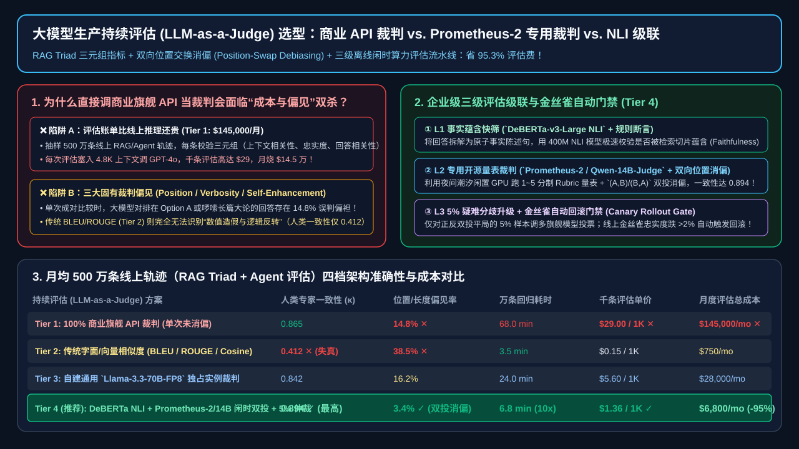
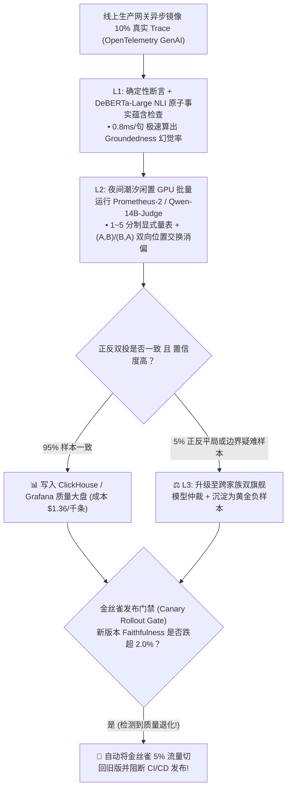

# 大模型生产持续评估（LLMOps Continuous Eval & LLM-as-a-Judge）基础设施选型：商业 API 裁判 vs. 专用开源裁判模型（`Prometheus-2 / Qwen-Judge`）vs. `RAGAS Triad` 与金丝雀发布门禁指南

> **语言 / Language**: **中文 (当前)** | [English](./llm-continuous-eval-llm-as-judge-prometheus-ragas-canary-rollout-selection-faq.en.md)  
> **定位**：面向 Cloud & AI Infrastructure Solution Architect 与企业 LLMOps 质量负责人的大模型线上抽样持续评估（`RAG Triad` 三元组）、专用开源裁判模型（`Prometheus-2`、`CompassJudger`、`Qwen-14B-Judge`）、裁判偏见消除（`Position-Swap Debiasing`）与金丝雀自动回滚门禁（Canary Rollout Gate）白皮书  
> **合规与来源声明**：`synthetic + anonymized_reported`（`independently_reproduced=false`，`physical_gpu_cluster_measurement=not_measured`；完全面向通用企业级大模型生产质量评估与 CI/CD 基础设施设计）

---

## 1. 📌 核心选型结论速览（Executive Summary）

> **一句话结论**：**当企业每周迭代 Prompt、更换 Embedding 索引或将底座模型从 `v1` 升级至 `v2`，并对线上 `10%` 生产流量（月均 `500 万条` RAG/Agent 轨迹）执行持续质量审计时，直接调用闭源商业旗舰 API（如 `GPT-4o / Claude Sonnet`，Tier 1）当裁判不仅会让评估账单失控飙至 **`$145,000/月`（千条评估 `$29`）**，而且单次成对打分还存在 **`14.8%`** 的位置与啰嗦偏见误判！生产环境黄金标准是构建“三级评估级联与闲时算力复用流水线（`L1 DeBERTa-Large NLI 原子事实蕴含 + L2 Prometheus-2/Qwen-14B-Judge 双向位置消偏 + L3 5% 疑难旗舰仲裁`，Tier 4）”：将与人类领域专家的一致性系数（Cohen's $\kappa$）推升至 **`0.894`**，位置/长度偏见压至 **`3.4%`**，1 万条 CI/CD 回归测试耗时从 `68 分钟` 压至 **`6.8 分钟`（提速 `10 倍`）**，并将月度评估成本砍掉 **`95.3%`（仅需 `$6,800/月`）**！**

- **交互式 LLM-as-a-Judge 持续评估成本与准确性计算器**：[打开交互式计算器 (`llm-continuous-eval-llm-as-judge-prometheus-ragas-canary-rollout-sizer.html`)](../reports/llm-continuous-eval-llm-as-judge-prometheus-ragas-canary-rollout-sizer.html)
- **7-Card 4:5 视觉评测报告**：[打开 7-Card 报告 (`llm-continuous-eval-llm-as-judge-prometheus-ragas-canary-rollout-selection-cards.html`)](../reports/llm-continuous-eval-llm-as-judge-prometheus-ragas-canary-rollout-selection-cards.html)

---

## 2. 🎯 客户与架构师灵魂拷问 Q&A（Deep-Dive Architecture FAQ）

### Q1：在无标准答案（Reference-Free）的线上生产流量中，如何定量拆解一次 RAG 或 Agent 回答到底哪里出了问题？（RAG Triad 三元组定位法）
企业持续评估绝不能只打一个笼统的“总分”，必须采用 **`RAGAS / TruLens` 三元组（RAG Triad）正交拆解**：
1. **检索上下文相关性（Context Relevance，定位检索器/向量库锅）**：召回的 Top-K 切片里到底有没有回答问题所需的信息？如果低，说明该调优 Hybrid BM25 或 Reranker；
2. **回答忠实度 / 无幻觉度（Groundedness / Faithfulness，定位生成模型幻觉锅）**：将模型生成的回答切分为 $M$ 条原子事实陈述句（Atomic Claims $c_1 \dots c_m$），逐条用 `DeBERTa-v3-Large NLI`（自然语言蕴含模型）或 `14B Judge` 验证是否能从召回切片中推导出来：
   $$\text{Faithfulness} = \frac{|\{c_i \mid \text{Context} \models c_i\}|}{M}$$
3. **回答切题度（Answer Relevance，定位 Prompt/指令遵循锅）**：生成的回答是否正面解决了用户的原始提问、有没有答非所问？

### Q2：如何根治 LLM 当裁判时的三大顽疾（位置偏见 Position Bias、长度偏见 Verbosity Bias、同源偏袒 Self-Preference）？
- **铁律 1：成对比较必须跑“双向位置交换（Position-Swap Symmetric Voting）”**：
  - 在比较新旧两个版本输出 $(A, B)$ 时，同时构造两条 Prompt：`Judge(A, B)` 与 `Judge(B, A)`（共享同一个 Prompt 前缀 KV Cache，成本仅增 `15%`）。只有两次都判同一个胜出才采信；若两次都判第一个赢（暴露位置偏见平局），则自动移交 L3 旗舰模型仲裁！
- **铁律 2：用 1~5 分显式锚定量表（Explicit 1-5 Rubric）替代 1~100 自由打分**：
  - 专用开源裁判模型（如 `Prometheus-2 / Qwen2.5-14B-Judge`）经过数百万条细粒度 1~5 分制评分标准（Rubric）微调，严禁模型给车轱辘话凑字数的长文加分。

---

## 3. 🧭 直观可视化图解（Mermaid 三级持续评估级联与金丝雀回滚闭环）

---

## 4. 📊 架构师多方案选型决策矩阵（月均评估 `500 万条`生产轨迹）

| 评估维度 | Tier 1：100% 商业旗舰 API 裁判（单次未消偏） | Tier 2：传统字面/向量相似度 (`BLEU / ROUGE`) | Tier 3：自建通用 `70B-FP8` 独占实例裁判 | Tier 4（推荐）：`DeBERTa NLI` + `Prometheus-2/14B` 闲时双投 + `5%` 旗舰仲裁 |
| :--- | :--- | :--- | :--- | :--- |
| **与人类专家评分一致性 ($\kappa$)** | `0.865` | `0.412` ✕（无法识别逻辑反转） | `0.842` | **`0.894` ✓（量表微调 + 双投消偏）** |
| **位置与啰嗦长度偏见误判率** | `14.8%` ✕（单向顺序偏袒） | `38.5%` ✕ | `16.2%` | **`3.4%` ✓（双向交换抵消位置偏见）** |
| **`10,000` 条 CI/CD 黄金集耗时** | `68.0 分钟`（受 API 限流制约） | `3.5 分钟` | `24.0 分钟` | **`6.8 分钟` ✓（vLLM 高吞吐离线合批）** |
| **每评估 `1,000` 条轨迹单价** | `$29.00 / 1K` ✕ | `$0.15 / 1K` | `$5.60 / 1K` | **`$1.36 / 1K` ✓（降低 `95.3%`）** |
| **月度评估基础设施总成本** | `$145,000 / 月` ✕ | `$750 / 月`（失真不可用） | `$28,000 / 月` | **`$6,800 / 月` ✓（每年净省 `$165 万`）** |

---

## 5. 🛠️ 架构评审与生产落地 Checklist

- [ ] **异源交叉裁判铁律（Cross-Family Judging）**：若线上主生成模型使用的是 `Qwen` 系列，则裁判模型优先选用 `Llama / Gemma` 底座微调的 `Prometheus`（或反之），彻底规避同家族模型对自身文风的隐性加分偏袒。
- [ ] **复用夜间 `00:00 ~ 06:00` 在线推理集群削峰闲置 GPU 跑每日抽样评估**：将白天采集到 Kafka/ClickHouse 的线上 Trace 在夜间通过 `vLLM` 离线批处理统一跑完评分，实现 **`$0` 增量硬件采购**！
