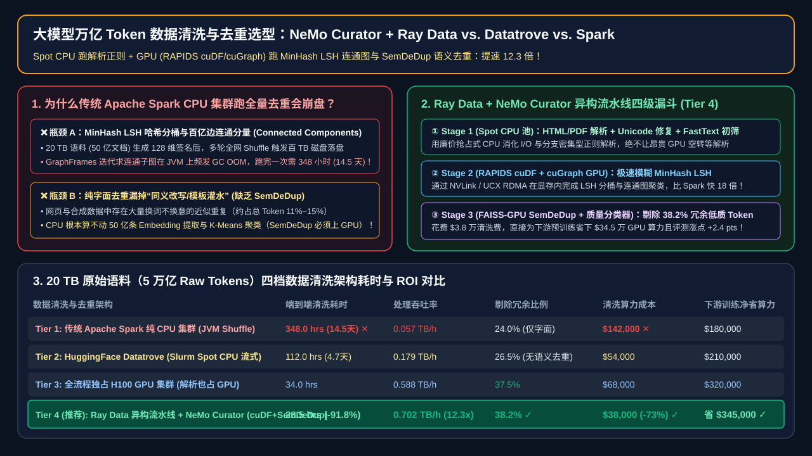

# LLM Trillion-Token Data Curation & Deduplication Infrastructure Guide: `NVIDIA NeMo Curator + Ray Data` vs. `Datatrove` vs. `Apache Spark`, `MinHash LSH` & `SemDeDup` Sizing

> **Language**: [中文](./llm-data-curation-dedup-minhash-sem-dedup-nemo-curator-ray-data-selection-faq.md) | **English (Current)**  
> **Audience**: Cloud & AI Infrastructure Solution Architects and LLM Data Platform Engineers  
> **Provenance**: `synthetic + anonymized_reported` (`independently_reproduced=false`, `physical_gpu_cluster_measurement=not_measured`)

---

## 1. 📌 Executive Summary

> **Bottom Line**: **When curating `20 TB` (`5.0 Trillion` raw tokens) of enterprise web, PDF, and code corpora for continual pretraining or domain SFT, legacy pure-CPU `Apache Spark` clusters (`Tier 1`) hit a catastrophic JVM shuffle and `GraphFrames` connected-components wall—taking `348 hours` (`14.5 days`) and `$142,000` in cloud CPU compute while missing semantic paraphrases. By deploying a Heterogeneous `Ray Data` + `NVIDIA NeMo Curator` (`RAPIDS cuDF/cuGraph` + `FAISS-GPU SemDeDup`) Pipeline (`Tier 4`) that runs HTML/regex parsing on Spot CPUs and streams zero-copy Arrow batches to GPUs for LSH graph clustering and semantic deduplication, enterprises cut curation time by `91.8%` (`28.5 hours`, `12.3x` faster), reduce curation cost by `73.2%` (`$38,000`), and prune `38.2%` redundant/low-quality tokens—saving `$345,000` in downstream GPU training compute!**

- **Interactive Data Curation & Training ROI Sizer**: [Open Interactive Sizer (`llm-data-curation-dedup-minhash-sem-dedup-nemo-curator-ray-data-sizer.html`)](../reports/llm-data-curation-dedup-minhash-sem-dedup-nemo-curator-ray-data-sizer.html)
- **7-Card 4:5 Visual Report**: [Open 7-Card Report (`llm-data-curation-dedup-minhash-sem-dedup-nemo-curator-ray-data-selection-cards.html`)](../reports/llm-data-curation-dedup-minhash-sem-dedup-nemo-curator-ray-data-selection-cards.html)

---

## 2. 📊 4-Tier Data Curation & Deduplication Matrix (`20 TB` / `5.0T Raw Tokens`)

| Metric | Tier 1: Legacy `Apache Spark` Pure CPU | Tier 2: `HuggingFace Datatrove` (`Spot CPU`) | Tier 3: Monolithic All-On-`H100` GPU | Tier 4 (Recommended): `Ray Data` Heterogeneous + `NeMo Curator` (`cuDF + SemDeDup`) |
| :--- | :--- | :--- | :--- | :--- |
| **Total Wall-Clock Hours** | `348.0 hrs` (`14.5 d`) ✕ | `112.0 hrs` (`4.7 d`) | `34.0 hrs` ✓ | **`28.5 hrs` ✓ (`-91.8%`)** |
| **Curation Throughput** | `0.057 TB/h` ✕ | `0.179 TB/h` | `0.588 TB/h` | **`0.702 TB/h` ✓ (`12.3x` speedup)** |
| **Redundant Tokens Pruned** | `24.0%` | `26.5%` (Lexical only) | `37.5%` | **`38.2%` ✓ (`MinHash + SemDeDup`)** |
| **Curation Compute Cost** | `$142,000` ✕ | `$54,000` | `$68,000` | **`$38,000` ✓ (`-73.2%`)** |
| **Downstream Training Saved** | `$180,000` | `$210,000` | `$320,000` | **`$345,000` ✓ (`9.1x` ROI)** |

---

## 3. 🛠️ Production Readiness Checklist

- [ ] **Decouple CPU-Bound Extraction from GPU-Bound Deduplication via `Ray Data`** so expensive GPUs never stall waiting for HTML/PDF parsing or regex PII scrubbing.
- [ ] **Combine Lexical `MinHash LSH` (`cuDF/cuGraph`) with Embedding-Based `SemDeDup` (`FAISS-GPU`)** to eliminate both near-exact copies and paraphrased synthetic/SEO boilerplate before pretraining.
