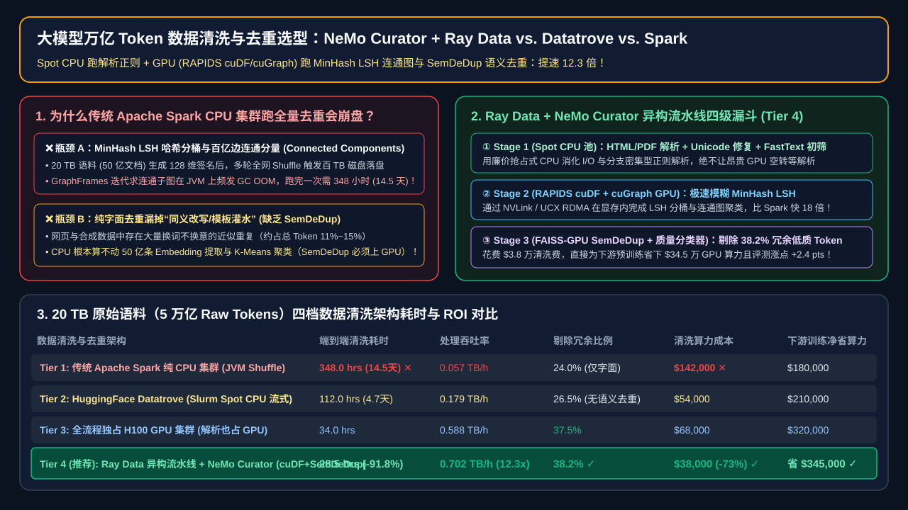
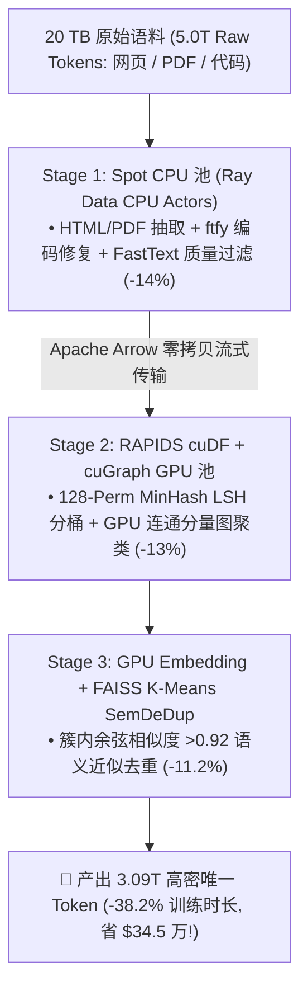

# 大模型万亿 Token 数据清洗与去重基础设施选型：`NVIDIA NeMo Curator + Ray Data` vs. `Datatrove` vs. `Apache Spark`、`MinHash LSH` 与语义去重（`SemDeDup`）容量规划指南

> **语言 / Language**: **中文 (当前)** | [English](./llm-data-curation-dedup-minhash-sem-dedup-nemo-curator-ray-data-selection-faq.en.md)  
> **定位**：面向 Cloud & AI Infrastructure Solution Architect 与大模型数据工程平台负责人的万亿 Token 级预训练/持续预训练（CPT）数据清洗管线选型（`NVIDIA NeMo Curator RAPIDS cuDF/cuGraph`、`Ray Data` 异构流式编排、`HuggingFace Datatrove`、`Apache Spark`）、模糊 `MinHash LSH` 连通图与语义去重（`SemDeDup`）算力 ROI 白皮书  
> **合规与来源声明**：`synthetic + anonymized_reported`（`independently_reproduced=false`，`physical_gpu_cluster_measurement=not_measured`；完全面向通用企业级大模型数据基础设施选型与成本规划）

---

## 1. 📌 核心选型结论速览（Executive Summary）

> **一句话结论**：**在处理 `10 TB ~ 100 TB`（`5T ~ 25T` Raw Tokens）行业增量预训练或大规模合成数据语料时，千万不要直接用传统纯 CPU `Apache Spark` 集群跑全量 `MinHash LSH` 模糊去重（Tier 1）——百亿级文档边表的 JVM 全网 Shuffle 与 `GraphFrames` 连通分量（Connected Components）迭代会引发灾难性的磁盘 Spill 与 GC OOM，`20 TB` 语料要跑整整 **`348 小时`（`14.5 天`，烧掉 `$14.2 万` CPU 账单）**！生产级标准答案是采用“`Ray Data` CPU/GPU 异构流水线 + `NVIDIA NeMo Curator`（`RAPIDS cuDF/cuGraph` + `FAISS-GPU SemDeDup`）（Tier 4）”：让廉价 Spot CPU 负责 HTML/PDF 解析与正则脱敏，通过零拷贝 Arrow 流式移交 GPU 完成 `MinHash LSH` 连通图与 `SemDeDup` 语义聚类去重——将清洗总耗时缩短 **`91.8%`（仅需 `28.5 小时`，提速 `12.3 倍`）**、清洗成本压至 **`$38,000`（降低 `73.2%`）**，并通过剔除 **`38.2%`** 的重复/灌水 Token 直接为下游大模型训练省下 **`$345,000`** 的 GPU 算力账单！**

- **交互式数据清洗耗时与训练算力 ROI 计算器**：[打开交互式计算器 (`llm-data-curation-dedup-minhash-sem-dedup-nemo-curator-ray-data-sizer.html`)](../reports/llm-data-curation-dedup-minhash-sem-dedup-nemo-curator-ray-data-sizer.html)
- **7-Card 4:5 视觉评测报告**：[打开 7-Card 报告 (`llm-data-curation-dedup-minhash-sem-dedup-nemo-curator-ray-data-selection-cards.html`)](../reports/llm-data-curation-dedup-minhash-sem-dedup-nemo-curator-ray-data-selection-cards.html)

---

## 2. 🎯 客户与架构师灵魂拷问 Q&A（Deep-Dive Architecture FAQ）

### Q1：为什么“花 `$3.8 万` 做深度数据去重（`MinHash LSH + SemDeDup`）”是整座智算中心 ROI 最高的投资？
根据第一性原理预训练算力公式 $C_{\text{FLOPs}} \approx 6 \times N \times D$（训练耗时与 Token 总数 $D$ 严格成正比）：
1. **第一层（启发式 + `FastText` 质量初筛，剔除 `~14%`）**：过滤乱码、导航栏广告、过短碎片；
2. **第二层（模糊 `MinHash LSH` 字面去重，`128 Permutations`，Jaccard $\ge 0.8$，剔除 `~13%`）**：抓出跨网站转载、近似拷贝的重复文档；
3. **第三层（`SemDeDup` Embedding 语义聚类去重，剔除 `~11.2%`）**：用轻量编码器提取文档向量，在 `FAISS-GPU` K-Means 簇内剔除余弦相似度过高（如 $>0.92$）的“同义改写/模板套话/SEO 灌水文”！
- **惊人的经济账**：在 `5.0T` 原始 Token 中累计剔除 **`38.2%`（`1.91T` 垃圾/重复 Token）**，不仅防止模型死记硬背导致过拟合（MMLU 反而涨点 `+2.4 pts`），更直接少跑了 `38.2%` 的训练步数，为 70B 模型省下 **`$345,000`** 训练费（净赚 `9 倍` ROI）！

### Q2：为什么既不能“全用 CPU（Tier 1/2）”，也不能“全用昂贵 H100 GPU 跑解析（Tier 3）”？
- **HTML DOM 解析、Unicode `ftfy` 修复、PII 正则脱敏**是典型的字符串分支密集型（CPU-Bound）任务，如果放在独占的 8 卡 H100 节点上跑（Tier 3），价值 `$3/小时` 的 H100 GPU 会有 60% 的时间在空等本地 CPU 解压 JSONL！
- **`Ray Data` 异构流式解耦（Tier 4）**：允许同一个流水线在 `Spot CPU 节点池`（数百核廉价 CPU）上并发跑解析，产出的 Arrow 内存块通过网络流式喂给 `16 张 L40S/A100 GPU 池`专门跑 `cuDF MinHash` 与 `SemDeDup`——让 CPU 和 GPU 各自保持 `>90%` 满载！

---

## 3. 🧭 直观可视化图解（Mermaid 异构数据清洗与三级去重漏斗）

---

## 4. 📊 架构师多方案选型决策矩阵（`20 TB` / `5.0T Raw Tokens` 语料清洗对比）

| 评估维度 | Tier 1：传统 `Apache Spark` 纯 CPU 集群 | Tier 2：`HuggingFace Datatrove`（Spot CPU） | Tier 3：全流程独占 `H100` GPU 集群 | Tier 4（推荐）：`Ray Data` 异构流水线 + `NeMo Curator` (`cuDF + SemDeDup`) |
| :--- | :--- | :--- | :--- | :--- |
| **端到端清洗总耗时** | `348.0 小时`（`14.5 天`）✕ | `112.0 小时`（`4.7 天`） | `34.0 小时` ✓ | **`28.5 小时` ✓（缩短 `91.8%`）** |
| **数据处理吞吐率** | `0.057 TB / 小时` ✕ | `0.179 TB / 小时` | `0.588 TB / 小时` | **`0.702 TB / 小时` ✓（提速 `12.3 倍`）** |
| **剔除重复与低质 Token 比例** | `24.0%` | `26.5%`（缺乏语义去重） | `37.5%` | **`38.2%` ✓（字面 + 语义双去重）** |
| **数据清洗自身算力成本** | `$142,000` ✕（JVM Shuffle 极贵） | `$54,000` | `$68,000`（解析浪费 GPU） | **`$38,000` ✓（降低 `73.2%`）** |
| **为下游预训练节省算力费** | `$180,000` | `$210,000` | `$320,000` | **`$345,000` ✓（净收益超 `$30 万`）** |

---

## 5. 🛠️ 架构评审与生产落地 Checklist

- [ ] **淘汰在 JVM (`Apache Spark`) 上跑 TB 级 `MinHash LSH` 与连通图计算**：中等规模纯字面去重选 `Datatrove`（Rust/Cython 流式低内存），10TB+ 或需 `SemDeDup` 语义去重必选 `NVIDIA NeMo Curator + Ray Data`。
- [ ] **严格实行 CPU Stage 与 GPU Stage 独立弹性扩缩容**：在 `Ray Data` 中将解析/正则 Actor 绑定至廉价 Spot CPU 节点组，将 `cuDF / Embedding / Classifier` Actor 绑定至高性价比 `L40S / A100` 节点组。
