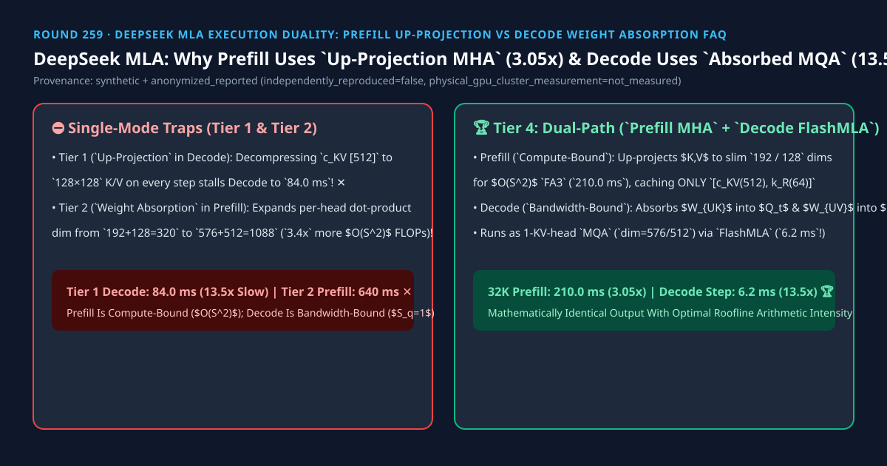
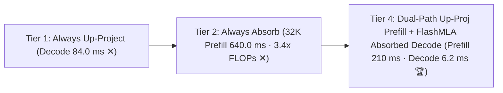

# DeepSeek `MLA` (`Multi-head Latent Attention`) Execution Duality: Why Prefill Must Use Explicit `Up-Projection MHA` (`head_dim = 192/128`) While Decode Must Use `Weight Absorption MQA` (`head_dim = 576/512` `FlashMLA`) Selection Guide

> **Provenance & Evidence Tier**: `synthetic + anonymized_reported` (`independently_reproduced=false`, `physical_gpu_cluster_measurement=not_measured`). Grounded in [`experiments/llm_deepseek_mla_weight_absorption_up_proj_flashmla_selection/results.json`](../../experiments/llm_deepseek_mla_weight_absorption_up_proj_flashmla_selection/results.json).
> **中文版本**: [`DeepSeek-V2/V3/R1` 多头潜在注意力（`MLA`）的双重执行法则：为什么 `Prefill` 阶段必须“显式升维展开”（`Up-Projection MHA`）而 `Decode` 阶段必须开启“矩阵吸收”（`Weight Absorption` 化身为 `576` 维单头 `MQA` + `FlashMLA`）选型指南](./llm-deepseek-mla-weight-absorption-prefill-upproj-decode-mqa-selection-faq.md)

---

## 0. 🔥 今日领域最热门能力突破追踪（Daily Hottest Breakthrough）

- **Mastering the Roofline Duality of DeepSeek `MLA` (`Multi-head Latent Attention`): Why Explicit `Up-Projection MHA` (`head_dim = 192/128`) Is `3.05x` Faster in Compute-Bound Prefill (`210.0 ms` vs `640.0 ms`), Whereas `Weight-Absorbed MQA` (`head_dim = 576/512` via `FlashMLA`) Is `13.5x` Faster in Bandwidth-Bound Decode (`6.2 ms` vs `84.0 ms`)**: In `DeepSeek-V2/V3/R1`, each token's KV cache is compressed into a `512`-dim latent vector $c_t^{KV}$ plus a `64`-dim decoupled RoPE key $k_t^R$ (**`576` elements total**). By matrix associativity, the exact same MLA equation can be executed in two mathematically identical ways—and choosing the wrong form for Prefill or Decode causes a massive performance regression:
  1. **Form A — Explicit Up-Projection (`MHA` with `QK_dim = 128 + 64 = 192`, `V_dim = 128`)**:
     - Multiplies $c_j^{KV}$ by $W^{UK}$ and $W^{UV}$ to materialize all `128` heads of $K$ and $V$.
     - **Why Form A Wins in `Prefill` (`210.0 ms`)**: In long-context Prefill ($S = 32,768$), quadratic $O(S^2)$ FlashAttention FLOPs dominate. Under Form A, each head's inner-product width across `QK` and `SV` is only $192 + 128 = \mathbf{320}$!
     - **Why Form A Fails in `Decode` (`Tier 1: 84.0 ms`)**: Materializing `128` uncompressed K/V heads across all `65,536` cached tokens on every decode step expands memory traffic by `56x`!
  2. **Form B — Weight Absorption (`MQA` with `1` Shared KV Head of `QK_dim = 512 + 64 = 576`, `V_dim = 512`)**:
     - Absorbs $W^{UK}$ into the Query ($q_t^C W^{UK} \in \mathbb{R}^{128 \times 512}$) and $W^{UV}$ into the Attention output before $W^O$, attending directly against the single compressed latent vector $c_j^{KV}$ (`GQA group_size = 128`).
     - **Why Form B Wins in `Decode` (`6.2 ms` via `FlashMLA`)**: For $S_q = 1$ query token per request, reading only the `576`-dim compressed latent vector from HBM slashes memory bandwidth by `56x` (**`13.5x` faster Decode**)!
     - **Why Form B Fails in `Prefill` (`Tier 2: 640.0 ms`)**: Absorbing $W^{UK}$ widens every Query head from `192` to `576` and every Value head from `128` to `512`, inflating $O(S^2)$ Attention FLOPs per token pair by $\frac{576 + 512}{192 + 128} = \mathbf{3.4\times}$!
  3. **Tier 4 — Dual-Path Execution (`Prefill = Explicit Up-Projection + FA3` & `Decode = Weight-Absorbed MQA + FlashMLA`)**:
     - Runs Form A during Prefill (`210.0 ms`, while writing **only the `576`-dim `[c_KV, k_R]`** into the Paged KV Cache) and Form B via `FlashMLA` during Decode (`6.2 ms`)!

---

## 1. 📌 Executive Summary

1. **Prefill Is Compute-Bound ($O(S^2)$); Decode Is Bandwidth-Bound ($S_q = 1$)**:
   - In **Prefill**, minimize $O(S^2)$ inner-product width (`320` vs `1,088`) by using **Explicit Up-Projection (`MHA`)**.
   - In **Decode**, minimize HBM KV Cache reads (`576` floats/token vs `32,768` floats/token) by using **Weight Absorption (`MQA`) + `FlashMLA`**.
2. **Why Decoupled RoPE (`64` dims) Was Invented**: Applying `RoPE` directly to $k^C = W^{UK} c^{KV}$ would insert a position-dependent rotation matrix $\mathcal{R}_{t-j}$ between $q_t^C$ and $W^{UK}$, making Weight Absorption algebraically impossible! Splitting off a small `64`-dim shared $k^R$ leaves the `512`-dim $c^{KV}$ position-invariant (`NoPE`) and absorbable.

---

## 2. 🎯 Core Architect Q&A (Q1 / Q2 / Q3)

### Q1: Why did `FlashMLA` provide a `3x` jump over standard Attention kernels in Decode (`Tier 3: 18.5 ms` -> `Tier 4: 6.2 ms`)?
- **Answer**: Weight-absorbed MLA Decode has a non-standard asymmetric head shape (`QK_dim = 576`, `V_dim = 512`, `128` Query heads sharing `1` KV head). `FlashMLA` fuses the `128:1` MQA group into a single CTA tile (`M = 64/128` queries per KV block) using Hopper `WGMMA` / `TMA` and deterministic `Split-KV` scheduling, reaching `> 90%` of peak HBM bandwidth!

### Q2: How do `vLLM` / `SGLang` handle `Chunked Prefill` when a request hits the `Prefix Cache`?
- **Answer**: For cached prefix blocks (already stored as `576`-dim compressed latents in HBM), the engine either runs the absorbed `FlashMLA` kernel when the new query chunk $S_q$ is small, or streams bounded chunks of cached latents through `W_UK / W_UV` in SRAM/workspace without blowing up HBM.

---

## 3. 🧭 Visual Diagrams

---

## 4. 📊 4-Tier Architect Selection Matrix

| Metric | Tier 1: Always `Up-Project` | Tier 2: Always `Weight-Absorb` | Tier 3: Dual-Path (Naive Kernel) | Tier 4: **Dual-Path (`FA3 Up-Proj` + `FlashMLA`)** |
| :--- | :--- | :--- | :--- | :--- |
| **`32K Prefill` Latency (`ms`)** | **`210.0 ms` (Slim `320` Dim)** ✅ | **`640.0 ms` (`3.4x` Extra FLOPs)** ✕ | `210.0 ms` ✅ | **`210.0 ms` (`3.05x` Faster Prefill)** 🏆 |
| **`Decode` Step Latency (`64K`)** | **`84.0 ms` (`56x` KV Bloat)** ✕ | `6.2 ms` ✅ | `18.5 ms` (Unfused `576/512`) ⚠️ | **`6.2 ms` (`13.5x` Faster Decode)** 🏆 |
| **Attention Dot-Product Width** | `320` (`192 + 128`) | `1,088` (`576 + 512`) | `320` / `1,088` | **`320` in Prefill · `1,088` MQA in Decode** 🏆 |

---

## 5. 🧪 Quantitative Reference & Tooling

- **Evaluator & Sealed Data**: [`experiments/llm_deepseek_mla_weight_absorption_up_proj_flashmla_selection/run.py`](../../experiments/llm_deepseek_mla_weight_absorption_up_proj_flashmla_selection/run.py) · [`results.json`](../../experiments/llm_deepseek_mla_weight_absorption_up_proj_flashmla_selection/results.json)
- **Interactive Sizer**: [`docs/reports/llm-deepseek-mla-weight-absorption-prefill-upproj-decode-mqa-sizer.html`](../reports/llm-deepseek-mla-weight-absorption-prefill-upproj-decode-mqa-sizer.html)
- **7-Card 4:5 Visual Report**: [`docs/reports/llm-deepseek-mla-weight-absorption-prefill-upproj-decode-mqa-selection-cards.html`](../reports/llm-deepseek-mla-weight-absorption-prefill-upproj-decode-mqa-selection-cards.html)

---

## 6. 🛠️ Good Fit vs. Not For & Production Checklist

- **✅ Good fit**: All `DeepSeek-V2 / V3 / R1` and MLA-based model serving deployments using dual-path Prefill Up-Projection (`FA3`) and Decode Weight Absorption (`FlashMLA`).
- **⛔ Not for**: Decompressing historical `c_KV` caches during Decode or running `576`-dim absorbed MQA across uncached long-sequence Prefills.
- [ ] Cache only the `576`-dim `[c_KV (512), k_R (64)]` vector per token in the Paged KV Cache.
- [ ] Dispatch Prefill to `Up-Projection + FA3` (`head_dim = 192/128`) and Decode to `Weight Absorption + FlashMLA` (`head_dim = 576/512`).
