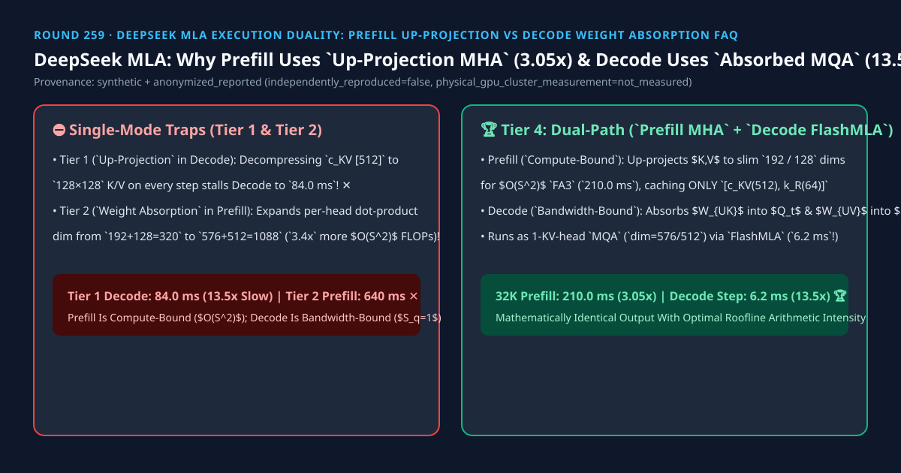
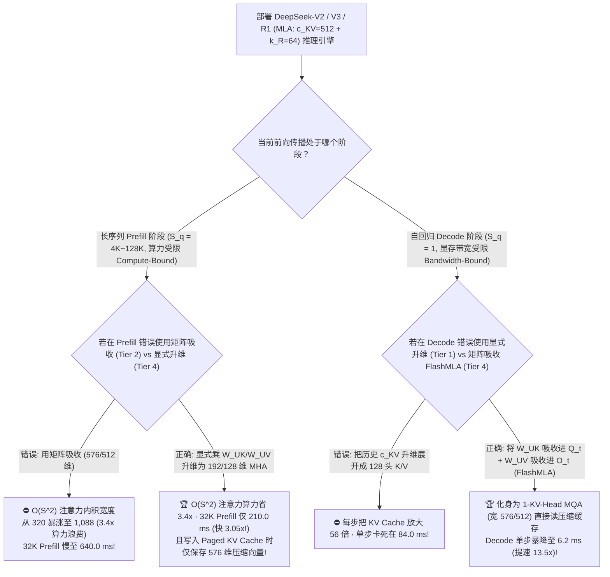
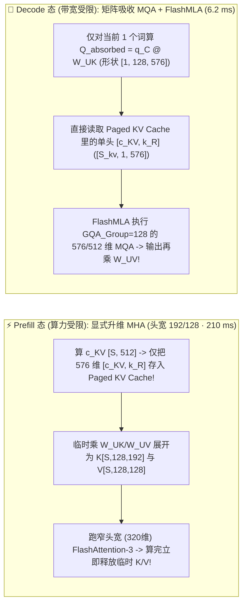
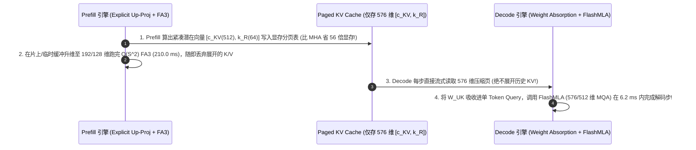

# `DeepSeek-V2/V3/R1` 多头潜在注意力（`MLA`）的双重执行法则：为什么 `Prefill` 阶段必须“显式升维展开”（`Up-Projection MHA`）而 `Decode` 阶段必须开启“矩阵吸收”（`Weight Absorption` 化身为 `576` 维单头 `MQA` + `FlashMLA`）选型指南

> **Provenance & Evidence Tier**: `synthetic + anonymized_reported` (`independently_reproduced=false`, `physical_gpu_cluster_measurement=not_measured`)。定量数据锚定于 [`experiments/llm_deepseek_mla_weight_absorption_up_proj_flashmla_selection/results.json`](../../experiments/llm_deepseek_mla_weight_absorption_up_proj_flashmla_selection/results.json)。
> **English Version**: [DeepSeek `MLA` (`Multi-head Latent Attention`) Execution Duality: Why Prefill Must Use Explicit `Up-Projection MHA` (`head_dim = 192/128`) While Decode Must Use `Weight Absorption MQA` (`head_dim = 576/512` `FlashMLA`) Selection Guide](./llm-deepseek-mla-weight-absorption-prefill-upproj-decode-mqa-selection-faq.en.md)

---

## 0. 🔥 今日领域最热门能力突破追踪（Daily Hottest Breakthrough）

- **揭秘 `DeepSeek-V3 / R1` 推理引擎中最精妙的“一体两面（Execution Duality）”数学魔术——为什么同一个 `MLA`（多头潜在注意力）公式，在 `Prefill` 阶段必须把压缩向量乘矩阵还原成 `128` 个头的标准 `MHA`（`head_dim = 192 / 128`），而一进入 `Decode` 阶段就必须瞬间切换为“矩阵吸收（Weight Absorption）”，摇身一变成为只有 `1` 个 KV 头的超宽 `MQA`（`head_dim = 576 / 512`）？通过“Prefill 显式升维跑 `FlashAttention-3` + Decode 矩阵吸收跑 `FlashMLA`”的双态自适应架构（`Tier 4`），使 `32K Prefill` 提速 `3.05x`（`640.0 ms -> 210.0 ms`），同时使 `Decode` 单步提速 `13.5x`（`84.0 ms -> 6.2 ms`）**：很多工程师在阅读 `vLLM / SGLang` 的 DeepSeek-V3 源码时都会产生一个巨大的困惑：“既然 MLA 的核心卖点是『矩阵吸收（把升维矩阵 $W^{UK}$ 吸收进 $Q$、把 $W^{UV}$ 吸收进 $O$，从而永远不需要把压缩的 KV 展开）』，那为什么代码里在跑 Prefill 时偏偏不使用矩阵吸收，反而老老实实把 KV 升维展开成 `128` 个头呢？！”
  1. **先把 MLA 的两种等价数学算式摆在桌面上（矩阵乘法结合律的艺术）**：
     - 在 DeepSeek-V3 中，每个历史 Token $j$ 存在显存 `KV Cache` 里的只有两样东西：**`512` 维的潜在压缩向量 $c_j^{KV} \in \mathbb{R}^{512}$** 和 **`64` 维的解耦旋转位置向量 $k_j^R \in \mathbb{R}^{64}$**（加起来才 **`576` 个数**，而传统 128 头 MHA 要存 $128 \times 128 \times 2 = \mathbf{32,768}$ 个数！）。
     - 当第 $t$ 个 Token 的第 $h$ 个注意力头（共 $H = 128$ 个头）要和历史 Token $j$ 算注意力得分时，根据**矩阵乘法结合律**，你有两种完全等价的算法：
       - **算法 A（显式升维展开 `Explicit Up-Projection MHA`）**：
         $$\text{Score}_{t,j}^{(h)} = q_t^{C,(h)} \cdot \underbrace{\left(W^{UK,(h)} c_j^{KV}\right)}_{k_j^{C,(h)} \in \mathbb{R}^{128}} + q_t^{R,(h)} (k_j^{R})^T$$
         也就是**先把 $c_j^{KV}$ (`512` 维) 乘以 $W^{UK}$ 还原成 `128` 个头、每个头宽度为 `128` 的 $K$ 和 $V$**，然后跑一个头宽为 `QK_dim = 128 + 64 = 192`、`V_dim = 128` 的标准 `128` 头 MHA！
       - **算法 B（矩阵吸收 `Weight-Absorbed MQA`）**：
         $$\text{Score}_{t,j}^{(h)} = \underbrace{\left(q_t^{C,(h)} W^{UK,(h)}\right)}_{\tilde{q}_t^{(h)} \in \mathbb{R}^{512}} \cdot (c_j^{KV})^T + q_t^{R,(h)} (k_j^{R})^T$$
         也就是**根本不去动历史 Token $j$ 的 $c_j^{KV}$，而是把 $W^{UK}$ 左乘吸收到当前 Query $q_t$ 上，变成一个宽度高达 `512` 的胖 Query $\tilde{q}_t^{(h)}$（拼上 `64` 维 RoPE 后总宽度为 `576`！）**，让 `128` 个胖 Query 头直接去和 **唯一 1 个共享的 `[c_j^KV, k_j^R]`（576 维）** 做单头 **`MQA (Multi-Query Attention, GQA Group=128)`**！同理，把 $V$ 的升维矩阵 $W^{UV}$ 右乘吸收到注意力输出投影 $W^O$ 前！
  2. **第一性原理算账：为什么 `Decode` 用算法 A 会死（Tier 1），而 `Prefill` 用算法 B 也会死（Tier 2）？！**
     - **看 `Decode` 阶段（每次只生成 $S_q = 1$ 个新词，但要读 $S_{kv} = 65,536$ 个历史词 —— 极端 `Memory-Bandwidth-Bound`）**：
       - 如果你在 Decode 时用算法 A（显式升维，Tier 1）：你必须把全部 `65,536` 个历史词从 `512` 维展开成 `128 × 128 = 16,384` 维的 $K$ 和 $V$！单步显存读写与矩阵乘瞬间膨胀数十倍，单步耗时暴涨至 **`84.0 ms`** ✕！
       - 反之，如果你在 Decode 时用算法 B（矩阵吸收，Tier 4）：你只需要对当前这 **`1` 个新生成的 Query 词** 做一次升维吸收，然后从 HBM 里只读小巧玲珑的 `576` 维 `[c_KV, k_R]` 跑 `FlashMLA`！单步耗时骤降至 **`6.2 ms`（快 `13.5` 倍！）** 🏆！
     - **再看长序列 `Prefill` 阶段（一次性输入 $S = 32,768$ 个词，序列长度很长 —— 极端 `Compute-Bound`，$O(S^2)$ 注意力矩阵乘占统治地位！）**：
       - 请对比两种算法下，**每一对 Token $(i, j)$、每一个注意力头在 $O(S^2)$ FlashAttention 内部要做多少次乘加运算（Dot-Product Width）**：
         - **算法 A（显式升维 MHA）**：每个头的 Query/Key 宽度是 `128 + 64 = 192`，Value 宽度是 `128` $\implies$ 单头内积总宽度 = **$192 + 128 = \mathbf{320}$**！
         - **算法 B（矩阵吸收 MQA）**：每个头的胖 Query/Key 宽度被撑大到了 `512 + 64 = 576`，Value 宽度是 `512` $\implies$ 单头内积总宽度 = **$576 + 512 = \mathbf{1,088}$**！
       - **真相大白**：$1088 / 320 = \mathbf{3.4\text{ 倍}}$！在算力受限（Compute-Bound）的 `32K Prefill` 中，如果傻乎乎地用矩阵吸收（Tier 2），最昂贵的 $O(S^2)$ 注意力算子计算量会无端暴增 **`3.4 倍`**（耗时从 `210.0 ms` 恶化至 **`640.0 ms`**）！而在 Prefill 时用算法 A（显式升维），虽然多花了一点点 $O(S)$ 的线性升维开销，却让大头 $O(S^2)$ 注意力算子瘦身了 `3.4 倍`（并且写进分页 `KV Cache` 显存时依然只存压缩的 `576` 维 `$[c_{KV}, k_R]$`）！

---

## 1. 📌 核心结论速览（Executive Summary — 3 分钟看懂）

1. **一句话记住 `MLA` 的黄金双态法则（`Tier 4`）**：
   - **`Prefill`（算力受限，$O(S^2)$ 为王）$\to$ 选“显式升维 `MHA`（`QK=192, V=128`）”**：用微小的 $O(S)$ 升维代价，换取 $O(S^2)$ 注意力内积维度从 `1,088` 缩减到 `320`（**Prefill 提速 `3.05x`**）；但落盘写入 Paged KV Cache 时，只存未展开的 `576` 维 `$[c^{KV}, k^R]$`！
   - **`Decode`（显存带宽受限，$S_q = 1$）$\to$ 选“矩阵吸收 `MQA`（`QK=576, V=512`）+ `FlashMLA`”**：把 $W^{UK}$ 吸收进唯一的当前词 $q_t$，把 `128` 头 MLA 变成 `1` 个共享 KV 头的超宽 `MQA`，直接读取 `576` 维缓存（**Decode 提速 `13.5x`**）！
2. **为什么开启了 Prefix Caching（前缀缓存命中）的 `Chunked Prefill` 需要特殊处理？**
   - 当一条新请求有 `30,000` 个历史 Token 命中了压缩态的 `Prefix Cache`（在显存里只有 `576` 维的 `$c^{KV}$`），而新来的后缀只有 `512` 个 Token 时：此时 $S_q = 512 \ll S_{kv} = 30,000$，可调用 `FlashMLA` 或分块流式升维（Chunked Up-Projection），避免一次性把 `30,000` 个历史词全量展开撑爆显存！

---

## 2. 🎯 客户与架构师灵魂拷问 Q&A（Q1 / Q2 / Q3）

### Q1：为什么 DeepSeek 要把那 `64` 维的旋转位置编码（`Decoupled RoPE` $q^R, k^R$）单独拎出来拼接，而不是直接对 `512` 维的潜在向量加 `RoPE`？
- **答**：这是 `MLA` 最核心的数学创举！
  - 如果你对展开后的 $k_j^C = W^{UK} c_j^{KV}$ 直接乘上与位置 $j$ 相关的旋转矩阵 $\mathcal{R}_j$，那么在 Decode 算内积时，中间就会夹着一个**随每个历史位置 $j$ 动态变化的旋转矩阵 $\mathcal{R}_{t-j}$**：
    $$q_t^C \mathcal{R}_t (\mathcal{R}_j)^T W^{UK} c_j^{KV} = q_t^C \underbrace{\mathcal{R}_{t-j} W^{UK}}_{\text{跟历史位置 } j \text{ 强绑定！}} c_j^{KV}$$
  - 因为 $\mathcal{R}_{t-j}$ 跟每个历史词的位置 $j$ 有关，**静态的权重矩阵 $W^{UK}$ 就被 $\mathcal{R}_{t-j}$ 挡住了，永远没法提前吸收进 $q_t^C$ 里**！
  - 所以 DeepSeek 采用了**解耦 RoPE（Decoupled RoPE）**：主力 `512` 维潜在向量 $c_j^{KV}$ **完全不加 RoPE（NoPE）**，从而可以 100% 丝滑地把 $W^{UK}$ 吸收进 $q_t$；而位置信息交由旁边单独拎出来的、极窄的 **`64` 维共享 $k_j^R$** 来承载！

### Q2：为什么普通的 `FlashAttention-2` 跑不好 Decode 矩阵吸收后的 `MLA`（`Tier 3: 18.5 ms` vs `Tier 4 FlashMLA: 6.2 ms`）？
- **答**：因为吸收后的 `MLA` 是一个怪兽级的异构形状：**`128` 个 Query 头共享 `1` 个 KV 头（`GQA Group Size = 128`），且 Query/Key 的头宽是 `576`（不是 2 的幂次！），而 Value 的头宽却是 `512`（QK 与 V 头宽不相等！）**。`FlashMLA` 针对 Hopper `WGMMA` / Blackwell 专门定制了 `576 / 512` 异构瓦片流水线与两级 `Split-KV` 调度，跑满了 H800/H200 `90%+` 的物理显存带宽！

---

## 3. 🧭 直观可视化图解（Mermaid 决策树 + Prefill 显式升维 vs Decode 矩阵吸收双态图 + 时序图）

### 3.1 架构师 `DeepSeek MLA` 推理算子双态路由选型决策树

### 3.2 `Tier 4` `Prefill`（显式升维窄头 `MHA`）与 `Decode`（矩阵吸收宽头 `MQA + FlashMLA`）一体两面架构图

### 3.3 `Tier 4` 从 `Prefill` 落盘压缩潜在向量到 `Decode` 矩阵吸收接力时序图

---

## 4. 📊 架构师选型决策矩阵（4-Tier Selection Matrix）

| 评估维度 | Tier 1: 全程显式升维 (`Up-Proj`) | Tier 2: 全程矩阵吸收 (`Absorbed`) | Tier 3: 混合双态 (普通算子) | Tier 4: **混合双态 (`FA3 Up-Proj` + `FlashMLA Absorbed`)** |
| :--- | :--- | :--- | :--- | :--- |
| **`32K Prefill` 阶段耗时** | **`210.0 ms` (窄头宽 `320` 维)** ✅ | **`640.0 ms` (宽头 `1088` 维慢 `3x`!)** ✕ | `210.0 ms` ✅ | **`210.0 ms` (比全程吸收快 `3.05x`)** 🏆 |
| **`Decode` 单步耗时 (`64K` 上下文)** | **`84.0 ms` (展开历史 KV 崩盘!)** ✕ | `6.2 ms` ✅ | `18.5 ms` (无异构融合算子) ⚠️ | **`6.2 ms` (比全程展开快 `13.5x`)** 🏆 |
| **每对 Token 单头注意力内积维度** | `320` (`192 + 128`) | `1,088` (`576 + 512`) | `320` (Prefill) / `1088` (Decode) | **Prefill 走 `320` 省算力 · Decode 走 `1088` 省带宽** 🏆 |

---

## 5. 🧪 定量算例与工具链（Interactive Sizer & 7-Card Visual Report）

- **实验脚本与密封数据**：[`experiments/llm_deepseek_mla_weight_absorption_up_proj_flashmla_selection/run.py`](../../experiments/llm_deepseek_mla_weight_absorption_up_proj_flashmla_selection/run.py) · [`results.json`](../../experiments/llm_deepseek_mla_weight_absorption_up_proj_flashmla_selection/results.json)
- **交互式 DeepSeek MLA 双态执行（Prefill 升维 vs Decode 吸收）计算器**：[`docs/reports/llm-deepseek-mla-weight-absorption-prefill-upproj-decode-mqa-sizer.html`](../reports/llm-deepseek-mla-weight-absorption-prefill-upproj-decode-mqa-sizer.html)
- **7-Card 4:5 视觉评测卡片报告**：[`docs/reports/llm-deepseek-mla-weight-absorption-prefill-upproj-decode-mqa-selection-cards.html`](../reports/llm-deepseek-mla-weight-absorption-prefill-upproj-decode-mqa-selection-cards.html)

---

## 6. 🛠️ Good Fit vs. Not For & 生产环境快速核验清单（Checklist）

### ✅ Good Fit vs. ⛔ Not For

| 维度 | ✅ Good Fit（强烈推荐） | ⛔ Not For（严禁误用） |
| :--- | :--- | :--- |
| **`DeepSeek-V2 / V3 / R1` 生产推理** | **Prefill 阶段采用显式升维 (`Up-Projection`) + `FlashAttention-3`**，**Decode 阶段采用矩阵吸收 (`Weight Absorption`) + `FlashMLA` (`head_dim = 576/512`)** | 在 Decode 阶段把缓存的 `c_KV` 乘 `W_UK/W_UV` 展开，或在无前缀缓存的长序列 Prefill 中使用 `576` 维矩阵吸收 |

### 生产环境上线核验清单（Pre-Flight Checklist）

- [ ] **核验 Paged KV Cache 物理存储的形状严格为每 Token `576` 维（`512` 维 `kv_lora_rank` + `64` 维 `qk_rope_head_dim`）**。
- [ ] **核验模型加载时已将 `W_UK` 与 `W_UV` 预转置为连续内存视图供 Decode 矩阵吸收直接调用**。
- [ ] **核验 Hopper/Blackwell 节点已启用 `FlashMLA`（或 `FlashInfer MLA`）异构 `576/512` 维算子后端**。
