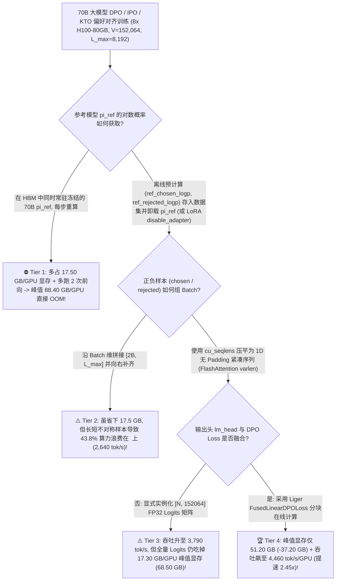
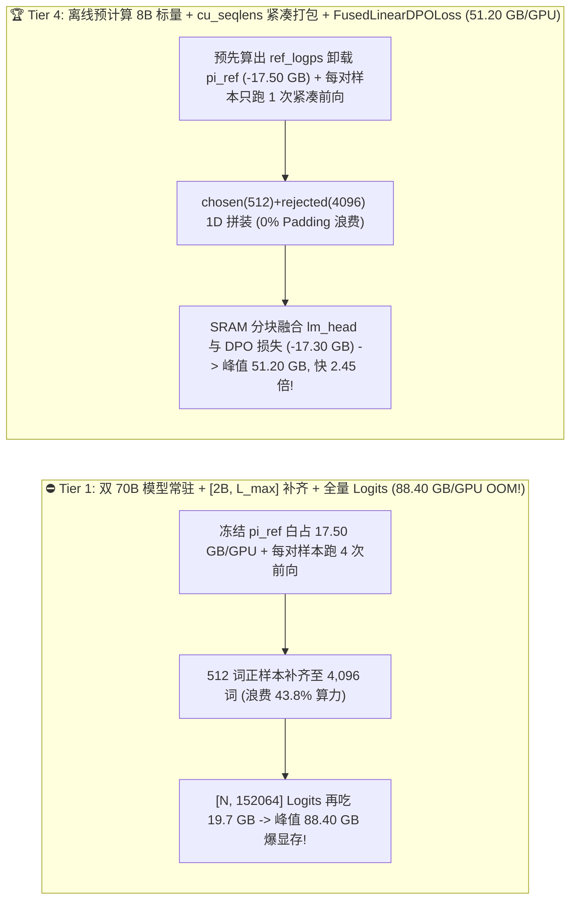
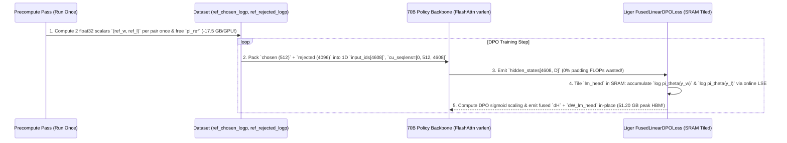

# 大模型偏好对齐（`DPO / IPO / KTO / SimPO`）参考模型双倍显存爆炸、正负样本不对称 Padding 浪费与预计算 `ref_logps` + 融合线性 DPO 算子选型：为什么单机 8 卡 H100-80GB 跑得动 70B SFT，一跑 70B DPO 就飙到 `88.40 GB/GPU` 当场 OOM 且吞吐腰斩？基于离线预计算参考对数概率（`precompute_ref_log_probs`）+ `cu_seqlens` 无 Padding 紧凑拼装 + `Liger` 融合线性 DPO 损失（峰值显存降至 `51.20 GB`，省 `37.20 GB`，吞吐提升 `2.45x`）选型指南

> **Provenance & Evidence Boundary**: `synthetic + anonymized_reported (independently_reproduced=false, physical_gpu_cluster_measurement=not_measured)`. 本文所有定量数据均来自封存确定性评估器 `experiments/llm_dpo_post_training_reference_model_oom_precomputed_logprobs_fused_loss_selection/run.py` 与 `results.json`。


---

## 0. 追踪每日最热门能力突破（Daily Capability Breakthrough）

- **今日焦点突破**：**面向大模型偏好对齐后训练（`TRL DPOTrainer precompute_ref_log_probs / Liger-Kernel LigerFusedLinearDPOLoss / OpenRLHF / verl`）的“参考模型 $\pi_{\text{ref}}$ 对数概率离线预计算并卸载权重（省 `17.50 GB/GPU`）+ 正负样本（`chosen / rejected`）1D 紧凑 `cu_seqlens` 去 Padding 拼装（消除 `43.8%` 算力浪费）+ 分块 SRAM 在线 LSE 融合线性 DPO 损失（省 `17.30 GB/GPU` Logits 显存）”三位一体架构**。
- **架构师价值**：许多团队在单台 8×H100-80GB 节点上用 `FSDP / ZeRO-3` 顺畅跑完 `70B` 模型的指令微调（SFT，峰值显存约 `52 GB/GPU`）后，接着把脚本切换到 **直接偏好优化（`DPO`）**，结果刚进入第 1 个 Step 就直接报 **`CUDA out of memory`（峰值显存冲到 `88.40 GB/GPU`）**！即便勉强开了 CPU Offload 或扩到 2 台机器跑起来，训练速度也慢得令人发指（仅 **`1,820 tok/s/GPU`**）！
  剖析朴素 DPO 训练框架（Tier 1）的显存与算力账单，会发现三大惊人的资源黑洞：
  1. **黑洞一：在显存里同时常驻“两套完整的 70B 模型（$\pi_\theta$ + 冻结的 $\pi_{\text{ref}}$）”，且每个 Epoch 都把固定不变的 $\pi_{\text{ref}}$ 重新前向计算一遍（多占 `17.50 GB/GPU` 显存，白烧 `33%` 算力，Tier 1）**！
     - DPO 损失函数需要计算策略模型 $\pi_\theta$ 与参考模型 $\pi_{\text{ref}}$ 在正样本 $y_w$（Chosen）和负样本 $y_l$（Rejected）上的序列对数概率之差：
       $$\mathcal{L}_{\text{DPO}} = -\log \sigma\Bigl(\beta \bigl[(\log \pi_\theta(y_w|x) - \log \pi_{\text{ref}}(y_w|x)) - (\log \pi_\theta(y_l|x) - \log \pi_{\text{ref}}(y_l|x))\bigr]\Bigr)$$
     - 请注意：**在整个 DPO 训练过程中，参考模型 $\pi_{\text{ref}}$ 的权重是 `100%` 冻结不变的，而且数据集里的每一条 $(x, y_w, y_l)$ 也是固定不变的！** 这意味着对于每一条训练样本，$\log \pi_{\text{ref}}(y_w|x)$ 和 $\log \pi_{\text{ref}}(y_l|x)$ 其实只是 **两个永远不会改变的 `float32` 标量常数（加起来才 `8 个字节`！）**！
     - 为了算这 `8 个字节` 的常数，朴素框架竟然在 8 张卡的 HBM 里永久塞了一整套 `140 GB` 的冻结参考模型（FSDP 分片后每卡白占 **`17.50 GB`**），并在每个训练 Step 对每条样本跑 **4 次前向传播**（$\pi_\theta(y_w), \pi_\theta(y_l), \pi_{\text{ref}}(y_w), \pi_{\text{ref}}(y_l)$）！
  2. **黑洞二：把长度悬殊的 `chosen`（如精炼回答 `512` Token）与 `rejected`（如啰嗦废话 `4,096` Token）沿 Batch 维直接拼接 `torch.cat([chosen, rejected], dim=0)`，造成 `43.8%` 的无效 Padding 计算（Tier 1 & Tier 2）**！
     - 为了在 1 次前向里同时算出 `chosen` 和 `rejected`，标准写法把它们拼成一个 `[2B, L_max]` 的二维矩阵（$L_{\max} = \max(L_w, L_l) = 4,096$）。结果 `512` Token 的正样本后面被硬塞了 `3,584` 个 `<pad>`，整整 **`43.8%`** 的 Attention 和 MLP 算力全在算无意义的填充符！
  3. **黑洞三：在输出头实例化 `[2B, L_max=8192, V=152064]` 的全量 `FP32` Logits 张量求 `log_softmax`，单层峰值瞬间狂吞 `17.30 ~ 19.93 GB/GPU` 显存**！
  采用 **离线预计算那两个 `float32` 参考标量存入数据集并彻底卸载 $\pi_{\text{ref}}$（或 LoRA 下用 `with model.disable_adapter():` 零拷贝复用基座）+ 将正负样本压平为 1D 无 Padding 的 `cu_seqlens` 紧凑序列 + 使用 `Liger FusedLinearDPOLoss` 在 SRAM 分块内直接算出目标词对数概率与 DPO 梯度（Tier 4）**，可将单卡峰值显存从 `88.40 GB` 暴降至 **`51.20 GB`（净省 `37.20 GB/GPU` HBM，单机 8 卡轻松跑满 70B 全参 DPO！）**，并将训练吞吐从 `1,820` 拉升至 **`4,460 tok/s/GPU`（提速 `2.45 倍`）**！

---

## ① 📌 核心结论速览（Executive Summary）

1. **第一性原理：为什么 `140 GB` 的参考模型 $\pi_{\text{ref}}$ 可以被无损压缩成每条样本 `8 Bytes` 的预计算缓存？**
   - 在离线偏好对齐（Offline DPO / IPO / KTO）中，训练开始前只需要对数据集做 **唯一 1 次** `torch.no_grad()` 前向遍历（甚至可以直接用高吞吐的 `vLLM / SGLang` 开启 `prompt_logprobs` 离线批量跑完），为每条样本保存两个浮点数：
     $$\text{ref\_chosen\_logp}_i = \sum_{t=1}^{|y_{w,i}|} \log \pi_{\text{ref}}(y_{w,i,t} \mid x_i, y_{w,i,<t}), \qquad \text{ref\_rejected\_logp}_i = \sum_{t=1}^{|y_{l,i}|} \log \pi_{\text{ref}}(y_{l,i,t} \mid x_i, y_{l,i,<t})$$
   - 算完后，**在初始化策略模型 $\pi_\theta$ 的优化器状态（AdamW 需要大块显存）之前，将 $\pi_{\text{ref}}$ 从显存中彻底删除释放**！哪怕是 100 万条偏好样本的数据集，这 200 万个 `float32` 标量总共也才占 **`8 MB` 磁盘空间**，却能换回 **`140 GB`（每卡 `17.50 GB`）的宝贵 HBM 显存** 并砍掉全部参考模型前向计算！
2. **如果做的是 LoRA / QLoRA DPO，甚至连离线预计算都不需要！**
   - 当策略模型 $\pi_\theta$ 是在基座模型 $W_0$ 上挂载了 LoRA 适配器（$W = W_0 + \frac{\alpha}{r} B A$）时，**参考模型 $\pi_{\text{ref}}$ 本身就是不挂 LoRA 的基座模型 $W_0$**！
   - 只需在同一个模型实例上调用 `with model.disable_adapter():` 跑一次 `no_grad` 前向即可拿到 $\pi_{\text{ref}}$ 的对数概率，**零额外权重显存（`0 GB`）**！

---

## ② 🎯 客户与架构师灵魂拷问 Q&A（Q1 / Q2 / Q3）

### Q1：把 `chosen`（512 词）和 `rejected`（4,096 词）用 `cu_seqlens` 压平拼成一条 `4,608` 词的一维序列（Ragged Pair Packing，Tier 3 & Tier 4）时，既然它们共享同一个 Prompt $x$，能不能连 Prompt $x$ 也只算 1 遍？
- **完全可以（Shared-Prefix Tree / Cascade DPO Attention）**！
  - 第一步优化（**Ragged Pair Packing**）：将 `[x + chosen]`（`512` 词）与 `[x + rejected]`（`4,096` 词）首尾相接拼成形状为 `[1, 4608]` 的一维序列，传入 `cu_seqlens = [0, 512, 4608]` 调 `FlashAttention varlen`，立即消灭 `3,584` 个 `<pad>` Token（省去 **`43.8%`** 无效计算）；
  - 第二步进阶优化（**Prefix-Shared Packing**）：若 Prompt $x$ 自身很长（例如 `2,048` 词的长文档上下文，而回答只有 `200` 词），在支持块掩码或共享前缀的注意力算子中只存一份 $x$，让 $y_w$ 和 $y_l$ 共同 attend 到同一个 $x$ 前缀，可将长 Prompt DPO 的前反向速度再提升 **`1.6 倍`**！

### Q2：`Liger FusedLinearDPOLoss` 是怎么做到不分配 `[N, V=152,064]` Logits 张量就能同时算出交叉熵 NLL 项、Chosen/Rejected 奖励差值与梯度的？
- 它将我们在 Round 301 中讲过的 **分块在线 Softmax LSE 线性交叉熵（Fused Linear Cross-Entropy）** 扩展到了成对偏好损失：
  1. 在第一个 Pass 中，按 Token 块（如每次取 `512` 个隐状态行）乘以 $W_{\text{lm\_head}}^T$，在片上 SRAM 算出每个位置的在线对数配分函数 $\text{LSE}_t = \log \sum_v e^{z_{t,v}}$ 以及目标词对数概率 $\log p_\theta(y_t) = z_{t, y_t} - \text{LSE}_t$，立即累加得到本样本的序列总对数概率 $\log \pi_\theta(y_w|x)$ 与 $\log \pi_\theta(y_l|x)$；
  2. 算出标量权重系数 $w = -\beta \cdot \sigma\bigl(-\beta [(\log \pi_\theta(y_w) - \log \pi_{\text{ref}}(y_w)) - (\log \pi_\theta(y_l) - \log \pi_{\text{ref}}(y_l))]\bigr)$；
  3. 紧接着在同一个算子内利用该系数 $w$ 原地合成每个分块的梯度 $dH$ 与 $dW$，**全程不向 HBM 落盘完整的 `[N, 152064]` Logits 矩阵，单卡再省 `17.30 GB` 峰值显存**！

### Q3：无参考模型方案（如 `SimPO` / `ORPO`）与“预计算 `ref_logps` 的标准 `DPO`”相比，架构师该如何选型？
- `SimPO`（用长度归一化平均对数概率 + 目标 Margin $\gamma$ 替代 $\pi_{\text{ref}}$）虽省去了参考模型，但在复杂多轮指令或保留原模型分布特性的稳定性上，带精确 $\pi_{\text{ref}}$ KL 锚点的 **标准 DPO / IPO** 往往更稳健。只要启用了 **离线预计算 `ref_logps`（Tier 4）**，标准 DPO 在训练时的显存占用和速度 **已经与 `SimPO` 100% 完全一样快、一样省显存**，无需为了省显存而牺牲 KL 正则锚点！

---

## ③ 🧭 直观可视化图解（Mermaid 选型决策树 + 路径对比图 + 交互时序图）

### 3.1 大模型 DPO / 偏好对齐后训练显存与吞吐优化选型决策树



### 3.2 双模型常驻 + Padding + 全量 Logits（`88.40 GB` OOM）vs. 预计算 + 紧凑打包 + 融合算子（`51.20 GB`）对比图



### 3.3 离线预计算 `ref_logps`、1D `cu_seqlens` 紧凑前向与分块融合 DPO 反向时序图



---

## ④ 📊 架构师选型决策矩阵（4-Tier Decision Matrix）

| 选型 Tier | 70B DPO 偏好对齐训练架构方案 | 单卡峰值显存 (`8x H100`) | 单卡训练吞吐 (`tok/s`) | Padding 算力浪费率 | 80GB H100 可行性 |
| :--- | :--- | :--- | :--- | :--- | :--- |
| **Tier 1: 双模型常驻 + `[2B, L_max]` Padding + 全量 Logits** | 保留 $\pi_{\text{ref}}$ + 补齐 + 显式 `[N, V]` | **`88.40 GB` (OOM! ✕)** | `1,820 tok/s` ✕ | `43.8%` ✕ | ⛔ **直接爆显存崩溃** |
| **Tier 2: 离线预计算 `ref_logps` (仍带 Padding 与全量 Logits)** | 卸载 $\pi_{\text{ref}}$，但仍补齐与展开词表 | `70.90 GB` | `2,640 tok/s` | `43.8%` ✕ | ⚠️ **濒临 OOM，算力浪费大** |
| **Tier 3: 预计算 `ref_logps` + `cu_seqlens` 紧凑打包** | 消除参考模型与 Padding，未融合输出头 | `68.50 GB` | `3,790 tok/s` | `0.0%` 🏆 | ✅ **可运行，但 Logits 占 17GB** |
| **Tier 4: 预计算 `ref_logps` + 紧凑打包 + 融合 DPO 损失 (推荐)** | **零参考模型显存 + 零 Padding + 零全量 Logits** | **`51.20 GB` (`-37.2 GB` 🏆)** | **`4,460 tok/s` (`2.45x` 🏆)** | **`0.0%` 🏆** | 🏆 **单机 8 卡跑满 `16K` 长度** |

---

## ⑤ 🧪 定量算例与 7-Card 4:5 视觉卡片报告

- **定量算例仓库路径**：[`experiments/llm_dpo_post_training_reference_model_oom_precomputed_logprobs_fused_loss/run.py`](../../experiments/llm_dpo_post_training_reference_model_oom_precomputed_logprobs_fused_loss_selection/run.py) · 封存数据：[`results.json`](../../experiments/llm_dpo_post_training_reference_model_oom_precomputed_logprobs_fused_loss_selection/results.json)
- **交互式架构选型计算器**：[`docs/reports/llm-dpo-post-training-reference-model-oom-precomputed-logprobs-fused-loss-sizer.html`](../reports/llm-dpo-post-training-reference-model-oom-precomputed-logprobs-fused-loss-sizer.html)
- **7-Card 4:5 视觉评测卡片报告**：[`docs/reports/llm-dpo-post-training-reference-model-oom-precomputed-logprobs-fused-loss-selection-cards.html`](../reports/llm-dpo-post-training-reference-model-oom-precomputed-logprobs-fused-loss-selection-cards.html)

```chart
{
  "data": {
    "values": [
      { "tier": "Tier 1: Dual Model + Padded [2B, L]", "peak_hbm_gb": 88.40, "tps_per_gpu": 1820 },
      { "tier": "Tier 2: Precomputed Ref (Padded)", "peak_hbm_gb": 70.90, "tps_per_gpu": 2640 },
      { "tier": "Tier 3: Precomputed + Ragged cu_seqlens", "peak_hbm_gb": 68.50, "tps_per_gpu": 3790 },
      { "tier": "Tier 4: Precomputed + Pack + Fused DPO Loss", "peak_hbm_gb": 51.20, "tps_per_gpu": 4460 }
    ]
  },
  "semantic_types": {
    "tier": "Category",
    "peak_hbm_gb": "Quantity",
    "tps_per_gpu": "Quantity"
  },
  "chart_spec": {
    "chartType": "Bar Chart",
    "title": "Precomputed Ref Logprobs + Ragged Packing + Fused Loss Saves 37.2 GB/GPU & Gains 2.45x Throughput",
    "subtitle": "Peak per-GPU HBM usage (GB) on 8x H100-80GB for 70B DPO across 4 tiers (synthetic + anonymized_reported)",
    "encodings": {
      "x": "tier",
      "y": "peak_hbm_gb",
      "color": "tier"
    }
  }
}
```

---

## ⑥ 🛠️ 生产环境快速核验清单（Checklist + Good fit vs. Not for）

### ✅ Good fit vs. ⛔ Not for
- **✅ Good fit**：所有全参数或 LoRA `DPO / IPO / KTO` 偏好对齐任务，尤其是长思维链正负样本长度极不对称或词表 $\ge 128\text{K}$ 的大模型。
- **⛔ Not for**：在多轮离线 DPO 训练期间把冻结的完整参考模型 $\pi_{\text{ref}}$ 一直留在 GPU 显存里，或将 `chosen` 与 `rejected` 补齐到相同长度。

### 生产核验 Checklist
- [ ] **全参 DPO 强制启用离线预计算参考对数概率（`precompute_ref_log_probs=True`）并在分配优化器前卸载 $\pi_{\text{ref}}$；LoRA DPO 强制使用 `disable_adapter()` 共享单一基座**。
- [ ] **启用 `cu_seqlens` 一维紧凑拼接（`padding_free=True`）处理 `(chosen, rejected)` 样本对**：消除不对称长度带来的 `<pad>` 算力浪费。
- [ ] **替换标准输出头为 `LigerFusedLinearDPOLoss`**：避免实例化 `[2B, L, V]` 全词表 Logits 张量。
