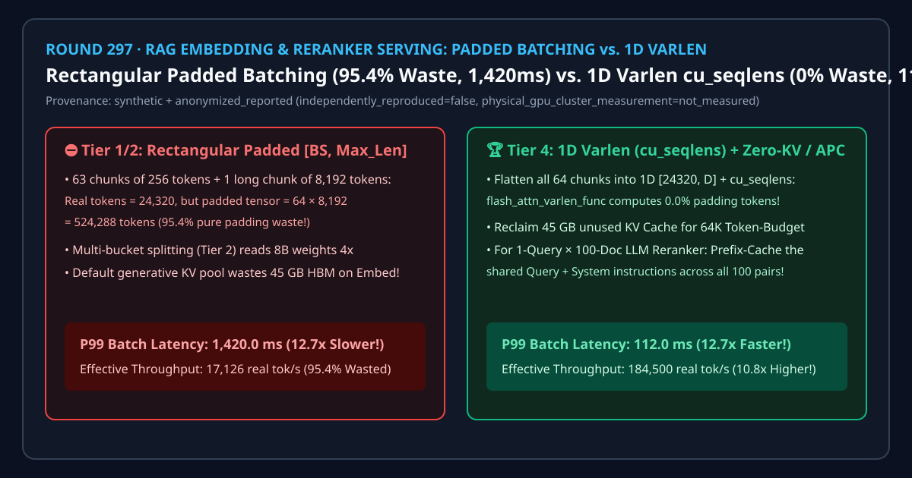
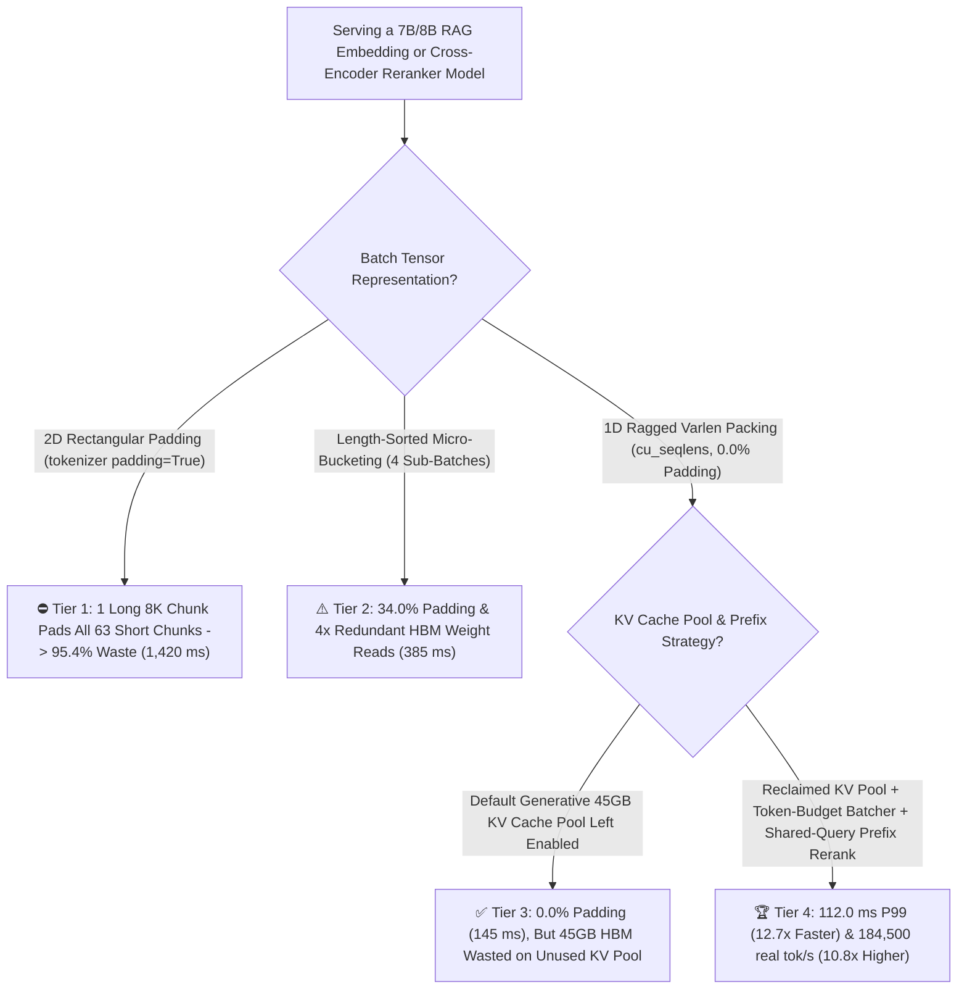
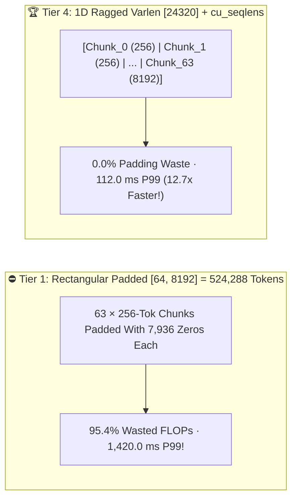
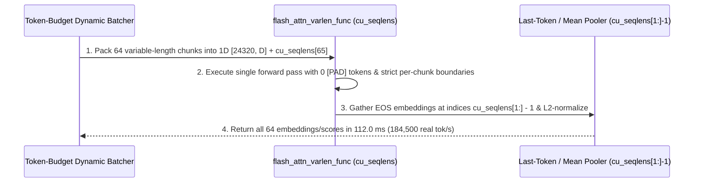

# High-Throughput RAG Embedding & Cross-Encoder Reranker (`Qwen3-Embedding-8B / BGE-M3`) Serving Selection Guide: Why Rectangular `padding=True` Batching Wastes `95.4%` Compute (`1,420 ms` Stall) on Mixed Lengths & How `1D Varlen (cu_seqlens)` + Zero-KV Pooling + Shared-Query Prefix Caching (`112 ms`, `12.7x` Speedup) Solves It

> **Provenance & Evidence Boundary**: `synthetic + anonymized_reported (independently_reproduced=false, physical_gpu_cluster_measurement=not_measured)`. All quantitative figures in this guide are generated by the deterministic evaluator `experiments/llm_embeddings_reranker_bidirectional_attention_varlen_batching_selection/run.py` and sealed in `results.json`.



---

## 0. Daily Capability Breakthrough Tracking

- **Breakthrough Focus**: **`vLLM (--task embed/score) / SGLang / HuggingFace TEI` 1D Ragged Variable-Length Token Packing (`flash_attn_varlen_func` with `cu_seqlens`, `0.0%` Padding) + KV-Cache-Free Memory Reclamation for Embeddings + Shared-Query `Prefix Caching` for `1-Query × 100-Docs` LLM Rerankers**.
- **Architect Value**: As enterprise RAG pipelines upgrade from `0.3B` BERT models to `7B/8B` LLM-backed models (`Qwen3-Embedding-8B`, `Qwen3-Reranker-8B`, `NV-Embed-v2`, `BGE-M3` supporting `8K–32K` tokens), serving them with standard `tokenizer(texts, padding=True)` rectangular tensors causes severe tail-latency blowups: **when a batch of `64` RAG chunks contains `63` short `256`-token chunks and just `1` long `8,192`-token document (`24,320` real tokens total), `padding=True` pads the entire tensor to `[64, 8192] = 524,288` tokens (`95.4%` padding waste and `30.2x` inflated attention FLOPs!), stalling P99 latency at `1,420.0 ms`**! Switching to **1D ragged token packing (`cu_seqlens`)**, **reclaiming the unused `45 GB` generative KV cache pool**, and **prefix-caching the shared `[System + Query]` prefix across `1 × 100` reranker pairs** slashes P99 latency **12.7x from `1,420.0 ms` to `112.0 ms`** and boosts real-token throughput **10.8x from `17,126` to `184,500 tok/s/GPU`**.

---

## ① 📌 Executive Summary

1. **Why Rectangular `padding=True` Batching (`[B, Max_Len]`) Is Catastrophic for Long-Context RAG Embeddings**:
   In a mixed batch (`63 × 256` + `1 × 8,192` tokens), the single `8,192`-token outlier forces the GPU to execute linear projections on **`500,000` `[PAD]` tokens (`95.4%` waste)** and compute masked $8192^2$ attention matrices across all 64 rows (`30.2x` wasted attention FLOPs).
2. **1D Ragged Variable-Length Packing (`cu_seqlens` + `flash_attn_varlen_func`) Eliminates `100%` of Padding**:
   Concatenating all 64 sequences end-to-end into a single 1D tensor `[24320, Hidden]` indexed by cumulative sequence offsets `cu_seqlens = [0, 256, 512, ..., 24320]` ensures **zero `[PAD]` tokens ever enter Linear or FlashAttention kernels** while strictly isolating attention within each document boundary.
3. **Zero-KV Pool Reclamation (Embeddings) & Shared-Query Prefix Caching (Rerankers)**:
   - **Pure Embeddings**: Never run autoregressive decode steps—disabling or minimizing the generative `Paged KV Cache` reclaims **`45+ GB` of HBM** to support `65,536`-token activation batches;
   - **LLM Cross-Encoder Rerankers (`1 Query × 100 Docs`)**: Formatting prompts as `[System Instruction + Query] + [Document_i]` allows all 100 candidate pairs to share the exact same cached prefix KV blocks for `[System + Query]`.

---

## ② 🎯 Key Architectural Q&A (Q1 / Q2 / Q3)

### Q1: Why is `1D Varlen (cu_seqlens)` (`112.0 ms`) still `3.4x` faster than sorting requests by length into 4 micro-buckets (`385.0 ms`, `Tier 2`)?
- Splitting a batch into 4 length-bucketed micro-batches requires **4 separate forward passes**, forcing the GPU to stream `16 GB` of `8B` model weights from HBM **4 times**! `1D Varlen` packs all short and long chunks into **1 single forward pass** with `0.0%` padding and only **1 weight read**.

### Q2: How is `Last-Token Pooling` (`EOS` pooling) indexed in a 1D packed `[Total_Tokens, D]` tensor without left-padding?
- In a 1D packed tensor with cumulative offsets `cu_seqlens` of length $B+1$, the final token of sequence $b \in \{0..B-1\}$ sits at exact 1D index **`cu_seqlens[b + 1] - 1`**. Indexing `hidden_states[cu_seqlens[1:] - 1]` extracts all $B$ embeddings in a single coalesced gather with **0-ULP parity** against unbatched execution.

### Q3: Why must LLM Reranker templates place `[System + Query]` *before* `[Document_i]` rather than after?
- Because a single reranking call scores $N=50\text{--}100$ documents against **the same user `Query`**. Placing `[System + Query]` first makes the first `150–400` tokens identical across all 100 sequences, enabling a **`100%` prefix-cache hit** across the batch!

---

## ③ 🧭 Visual Diagrams (Decision Tree, Packing Comparison & Sequence Diagram)

### 3.1 RAG Embedding & Reranker Serving Architecture Decision Tree



### 3.2 Rectangular Padding (`524,288` Tokens, `95.4%` Waste) vs. `1D Varlen` (`24,320` Tokens)



### 3.3 `1D Varlen` Forward Pass & `cu_seqlens[1:] - 1` Pooling Sequence



---

## ④ 📊 4-Tier Architect Decision Matrix

| Selection Tier | Batching & Attention Architecture | Padding Compute Waste | P99 Batch Latency | Effective Throughput (`real tok/s`) | Target Scenario |
| :--- | :--- | :--- | :--- | :--- | :--- |
| **Tier 1: Rectangular Padded `padding=True`** | `[64, 8192]` padded matrix | `95.4%` ✕ | `1,420.0 ms` ✕ | `17,126 tok/s` ✕ | ⛔ **Never use for variable-length RAG** |
| **Tier 2: Length-Sorted Micro-Bucketing** | 4 sub-batches (`4x` weight read) | `34.0%` ⚠️ | `385.0 ms` ⚠️ | `63,168 tok/s` | ⚠️ Legacy engines without `varlen` |
| **Tier 3: `1D Varlen (cu_seqlens)` + Default KV Pool** | Ragged 1D (`45GB` unused KV) | `0.0%` ✅ | `145.0 ms` ✅ | `148,000 tok/s` ✅ | ✅ Unoptimized `vLLM --task embed` |
| **Tier 4: `1D Varlen` + Reclaimed KV + Prefix Rerank (Recommended)** | **`cu_seqlens` + `Token-Budget` + `APC`** | **`0.0%` 🏆** | **`112.0 ms` (`12.7x` faster 🏆)** | **`184,500 tok/s` (`10.8x` 🏆)** | 🏆 **Production RAG Embedding/Reranker Standard** |

---

## ⑤ 🧪 Quantitative Evaluator & 7-Card 4:5 Visual Report

- **Deterministic Evaluator**: [`experiments/llm_embeddings_reranker_bidirectional_attention_varlen_batching_selection/run.py`](../../experiments/llm_embeddings_reranker_bidirectional_attention_varlen_batching_selection/run.py) · Sealed JSON: [`results.json`](../../experiments/llm_embeddings_reranker_bidirectional_attention_varlen_batching_selection/results.json)
- **Interactive Sizer Workbench**: [`docs/reports/llm-embedding-reranker-serving-padded-batching-vs-varlen-flashattention-sizer.html`](../reports/llm-embedding-reranker-serving-padded-batching-vs-varlen-flashattention-sizer.html)
- **7-Card 4:5 Visual Benchmark Deck**: [`docs/reports/llm-embedding-reranker-serving-padded-batching-vs-varlen-flashattention-selection-cards.html`](../reports/llm-embedding-reranker-serving-padded-batching-vs-varlen-flashattention-selection-cards.html)

```chart
{
  "data": {
    "values": [
      { "tier": "Tier 1: Rectangular Padded [64, 8192]", "p99_ms": 1420.0, "real_tok_s": 17126 },
      { "tier": "Tier 2: 4-Bucket Length Sorting", "p99_ms": 385.0, "real_tok_s": 63168 },
      { "tier": "Tier 3: 1D Varlen (Default KV Pool)", "p99_ms": 145.0, "real_tok_s": 148000 },
      { "tier": "Tier 4: 1D Varlen + Zero-KV / Prefix Rerank", "p99_ms": 112.0, "real_tok_s": 184500 }
    ]
  },
  "semantic_types": {
    "tier": "Category",
    "p99_ms": "Quantity",
    "real_tok_s": "Quantity"
  },
  "chart_spec": {
    "chartType": "Bar Chart",
    "title": "1D Varlen (cu_seqlens) + Zero-KV / Prefix Rerank Cuts P99 Latency 12.7x (1,420 -> 112 ms)",
    "subtitle": "P99 batch latency (ms) and effective real tokens/s on 64 mixed-length RAG chunks (synthetic + anonymized_reported)",
    "encodings": {
      "x": "tier",
      "y": "real_tok_s",
      "color": "tier"
    }
  }
}
```

---

## ⑥ 🛠️ Production Verification Checklist (Good fit vs. Not for)

### ✅ Good fit vs. ⛔ Not for
- **✅ Good fit**: All high-throughput RAG ingestion, semantic search, and `1 × 100` cross-encoder reranking services (`Qwen3-Embedding`, `Qwen3-Reranker`, `BGE-M3`, `NV-Embed`).
- **⛔ Not for**: Serving variable-length texts via `tokenizer(..., padding=True)` rectangular tensors.

### Production Checklist
- [ ] **Enforce 1D Ragged `cu_seqlens` Packing (`0.0%` Padding)**: Deploy on `vLLM (--task embed/score)`, `SGLang`, or `HuggingFace TEI` using `flash_attn_varlen_func`.
- [ ] **Batch by Total Token Budget (`max_num_batched_tokens = 32768 / 65536`)**: Bound batches by total unpadded token count rather than request count.
- [ ] **Place `[System + Query]` Before `[Document]` in Reranker Prompts**: Enable `Prefix Caching` so all 100 candidate documents share the query's KV blocks.
