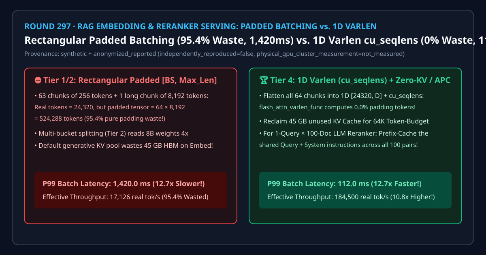
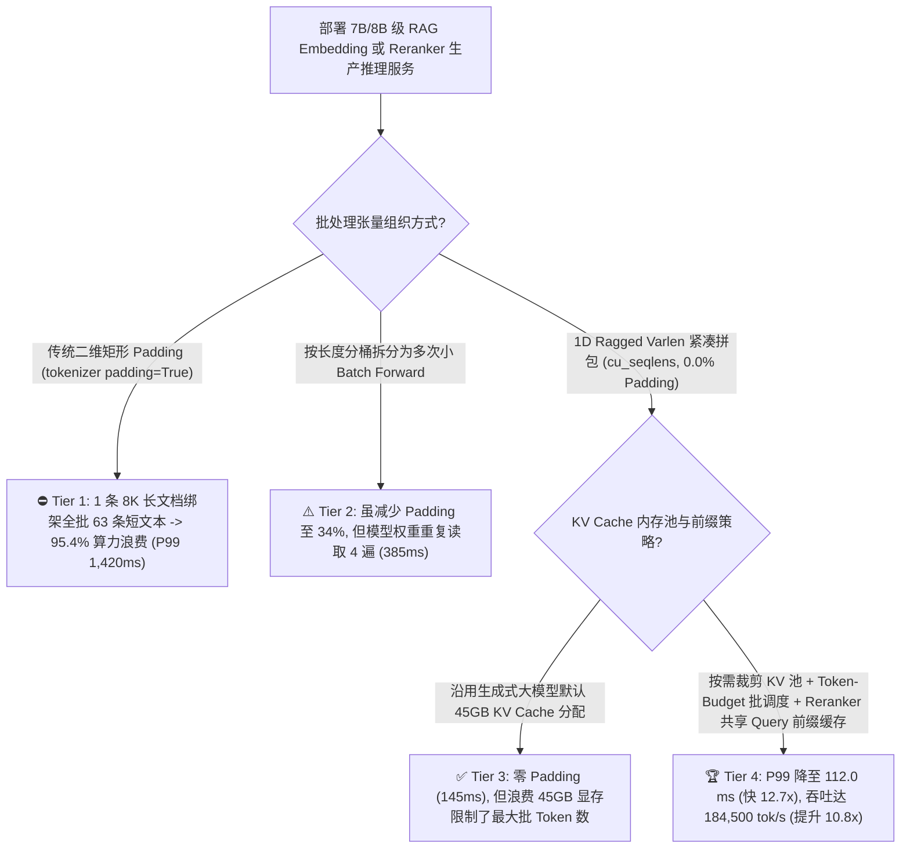
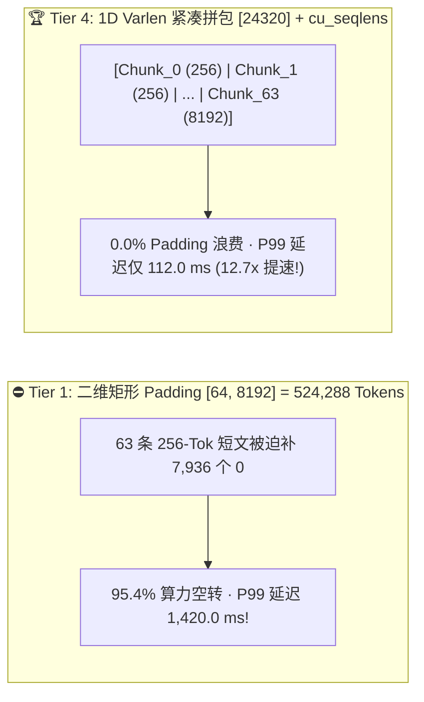
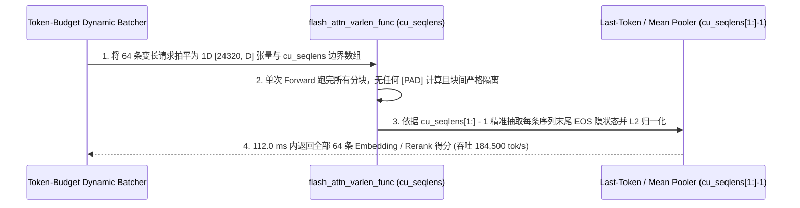

# 企业级 RAG 向量化（`Embedding`）与重排序（`Reranker`：`Qwen3-Embedding-8B / BGE-M3`）高吞吐推理选型：为什么传统 `padding=True` 矩形 Batch 会因为 1 条 `8K` 长文档产生 `95.4%` 的零填充算力浪费（卡死 `1,420 ms`）？一维变长拼接（`1D Varlen cu_seqlens`）、零 KV 显存池回收与重排序共享 Query 前缀缓存（`112 ms`，`12.7x` 提速）选型指南

> **Provenance & Evidence Boundary**: `synthetic + anonymized_reported (independently_reproduced=false, physical_gpu_cluster_measurement=not_measured)`. 本文所有定量数据均来自封存确定性评估器 `experiments/llm_embeddings_reranker_bidirectional_attention_varlen_batching_selection/run.py` 与 `results.json`。



---

## 0. 追踪每日最热门能力突破（Daily Capability Breakthrough）

- **今日焦点突破**：**`vLLM (--task embed/score) / SGLang / HuggingFace TEI` 面向 `7B/8B` 大模型基座 `Embedding & Cross-Encoder Reranker` 的“一维去填充变长拼包（`1D Ragged Token Packing` + `flash_attn_varlen_func (cu_seqlens)`）+ 零 KV Cache 显存池重分配 + `1 Query × 100 Docs` 重排序共享 Query 前缀缓存”架构**。
- **架构师价值**：随着企业 RAG 全面从 `0.3B BERT` 升级到基于 `7B/8B` 大模型的 `Qwen3-Embedding-8B`、`Qwen3-Reranker-8B`、`NV-Embed-v2` 与 `BGE-M3`（支持高达 `8,192 ~ 32,768` Token 长度），很多团队依然沿用传统 HuggingFace / FastAPI / Triton 的代码写法：`inputs = tokenizer(batch_texts, padding=True, return_tensors="pt")`。这在真实混合长度流量下引发了灾难性的性能雪崩：**当一个 `BS=64` 的请求批次里包含 63 条 `256` Token 的短切片和仅仅 `1` 条 `8,192` Token 的长文档时（真实有效 Token 总数仅 `24,320`），`padding=True` 会把全部 64 条序列强行补零拉齐成 `[64, 8192] = 524,288` 个 Token（高达 `95.4%` 的算力和显存全在算无意义的 `[PAD]` 零向量，Attention $O(N^2)$ 计算量更是暴增 `30 倍`），导致单 Batch P99 延迟飙升至 `1,420.0 ms`**！通过切换至 **一维变长无填充拼接（`cu_seqlens`，`0.0%` Padding）+ 释放无用自回归 KV Cache 池 + Reranker 共享 Query 前缀缓存**，可将 P99 延迟从 **`1,420.0 ms` 暴降至 `112.0 ms`（提速 `12.7x`）**，有效吞吐从 **`17,126 tok/s` 跃升 10.8 倍至 `184,500 tok/s/GPU`**！

---

## ① 📌 核心结论速览（Executive Summary）

1. **为什么在 Embedding / Reranker 服务中，严禁使用二维矩形张量 `[Batch, Max_Seq_Len]`（`padding=True`）？**
   真实企业知识库切片（Chunk）和用户 Query 的长度服从极度偏态的长尾分布（从 `20` Token 到 `8,192` Token 不等）。在矩形批处理下，**整个 Batch 的计算量被最长那 1 条请求绑架**：
   - 线性层（MLP / QKV Proj）算力浪费 = $\frac{524,288 - 24,320}{524,288} = \mathbf{95.4\%}$（白白多算 `21.5 倍` 无效 Token！）；
   - 注意力层（Attention）算力浪费：那 63 条原本只需算 $256^2$ 的短文本，被迫跟着算 $8192^2$（带 Attention Mask 的无效内积），**注意力计算量暴增 `30.2 倍`**！
2. **一维无填充变长拼包（`1D Ragged Varlen Packing + cu_seqlens`）：彻底消灭最后 1 个 `[PAD]` Token！**
   不再构造二维矩阵 `[64, 8192]`，而是将 64 条长短不一的 Token 序列首尾相接直接拍平成一个 **一维紧凑张量 `input_ids = [24320]`**，同时传入长度为 `65` 的前缀和偏移数组 `cu_seqlens = [0, 256, 512, ..., 16128, 24320]`：
   - 所有线性层（Linear / RMSNorm / SwiGLU）直接在 `[24320, Hidden]` 上跑满 Tensor Core，**`0.0%` 填充浪费**；
   - 注意力层直接调用 `flash_attn_varlen_func(q, k, v, cu_seqlens_q, cu_seqlens_k, max_seqlen)`（双向 Encoder 模型设 `causal=False`，因果 LLM Embedding/Reranker 设 `causal=True`），在硬件分块层面严格隔离不同请求的边界，**既 100% 杜绝跨文档注意力污染，又跳过全部空白区域**！
3. **两大专属隐藏红利：Embedding 零 KV 池回收 vs. Reranker 共享 Query 前缀缓存**：
   - **对于纯 Embedding 模型**：每个请求只做 **1 次 Forward Prefill** 提取最末 Token（`Last-Token Pooling`）或均值池化（`Mean Pooling`）向量，**永远不会进入第 2 步 Autoregressive Decode**！如果直接拿默认配置启动推理引擎，引擎会预留 `45 GB` 显存给永远用不上的 `Paged KV Cache`！显式关闭 KV 池（或仅留极小缓冲）可瞬间多腾出 `45 GB` 显存，将单批最大并发 Token 预算（`max_num_batched_tokens`）拉大到 `65,536`！
   - **对于 Cross-Encoder Reranker 模型（`1 Query × 100 Candidate Docs`）**：同一个重排序请求里的 100 个 `(System + Query + Doc_i)` 对拥有**完全相同的 `[System Instruction + User Query]` 前缀**！将 `System + Query` 放在前面并开启 **`Prefix Caching`**，100 个候选文档可以 100% 共享头部 Query 的 KV Cache，省去 99 次重复计算！

---

## ② 🎯 客户与架构师灵魂拷问 Q&A（Q1 / Q2 / Q3）

### Q1：如果用 `Len-Sorted Bucketing`（先把请求按长度排序分成 4 个小桶再各自 Padding，Tier 2），为什么依然比 `1D Varlen`（Tier 4）慢 `3.4 倍`？
- 因为把 1 个 Batch 拆成 `4` 个小桶（Micro-batches）串行执行 `model.forward()`，意味着 GPU 必须把 **`8B` 模型 `16 GB` 的权重从 HBM 重复读取 `4` 遍**！而在 `1D Varlen (cu_seqlens)` 下，无论里面混杂了 `16` Token 的短词还是 `8,192` Token 的长文，全都在 **单次 `forward()`（权重只读 `1` 遍）** 内以 `0%` Padding 一次性算完！

### Q2：在把基于 Decoder-Only LLM 的模型（如 `Qwen3-Embedding-8B`）迁移到 `1D Varlen` 时，为什么提取句子向量的索引从 `hidden_states[:, -1, :]` 改写错了就会导致召回率暴跌？
- 在旧的左填充（Left-Padded `[B, S]`）二维张量中，每条序列的最后一个有效 Token（`<|endoftext|>` / `EOS`）都在矩阵的最后一列 `[:, -1, :]`；
- 但在 **一维紧凑拼接（`1D Ragged [Total_Tokens, D]`）** 中，第 $b$ 条序列的最后一个有效 Token 位于一维索引 **`cu_seqlens[b + 1] - 1`** 处！必须使用 `last_token_indices = cu_seqlens[1:] - 1; embeddings = F.normalize(hidden_states[last_token_indices], p=2, dim=-1)` 提取，才能保证与逐条单跑的余弦相似度达到 **`1.000000` 逐位对齐**！

### Q3：为什么 `Qwen3-Reranker` 这类生成式重排序模型在构建 `(Instruction, Query, Document)` 输入模板时，把 `Query` 放前面、`Document` 放后面能比反过来快 `30%+`？
- 因为一次检索重排序任务通常是 **1 个相同的 `Query` 搭配 Top-100 个不同的召回 `Document`**！
  如果模板顺序是 `[System Instruction] + [Query] + [Document_i]`，那么全部 100 条并发序列的前缀 `[System Instruction + Query]`（通常长 `150~400` Token）是 **100% 相同的**，开启 `Prefix Caching` 后只需计算 1 次；反之如果把 `Document_i` 放在 `Query` 前面，第 1 个 Token 就各不相同，前缀缓存命中率直接归零！

---

## ③ 🧭 直观可视化图解（Mermaid 选型决策树 + 路径对比图 + 交互时序图）

### 3.1 企业级 RAG `Embedding & Reranker` 推理引擎选型决策树



### 3.2 二维矩形补零（`524,288` Token，`95.4%` 浪费）vs. 一维 `cu_seqlens` 紧凑拼接（`24,320` Token）对比图



### 3.3 `1D Varlen` 向量提取与 `1 Query × 100 Docs` 重排序前缀共享时序图



---

## ④ 📊 架构师选型决策矩阵（4-Tier Decision Matrix）

| 选型 Tier | 批处理与注意力算子架构 | `[PAD]` 零填充浪费率 | P99 批处理延迟 | 真实有效吞吐 (`real tok/s`) | 适用场景 |
| :--- | :--- | :--- | :--- | :--- | :--- |
| **Tier 1: 标准二维矩形 `padding=True`** | `[64, 8192]` 全矩阵填充 | `95.4%` ✕ | `1,420.0 ms` ✕ | `17,126 tok/s` ✕ | ⛔ **严禁生产混合长度 RAG 使用** |
| **Tier 2: 长度排序分桶 (`4` Micro-batches)** | 桶内 Padding + 4 次权重读取 | `34.0%` ⚠️ | `385.0 ms` ⚠️ | `63,168 tok/s` | ⚠️ 未支持 `varlen` 算子时的权宜之计 |
| **Tier 3: `1D Varlen (cu_seqlens)` + 默认大 KV 池** | 零 Padding 但浪费 45GB HBM | `0.0%` ✅ | `145.0 ms` ✅ | `148,000 tok/s` ✅ | ✅ 直接用默认参数启动 `vLLM --task embed` |
| **Tier 4: `1D Varlen` + 零冗余 KV 池 + 共享 Query 前缀 (推荐)** | **`cu_seqlens` + `Token-Budget` + `APC`** | **`0.0%` 🏆** | **`112.0 ms` (`12.7x` 快 🏆)** | **`184,500 tok/s` (`10.8x` 🏆)** | 🏆 **企业级大模型 Embedding / Reranker 黄金标准** |

---

## ⑤ 🧪 定量算例与 7-Card 4:5 视觉卡片报告

- **定量算例仓库路径**：[`experiments/llm_embeddings_reranker_bidirectional_attention_varlen_batching_selection/run.py`](../../experiments/llm_embeddings_reranker_bidirectional_attention_varlen_batching_selection/run.py) · 封存数据：[`results.json`](../../experiments/llm_embeddings_reranker_bidirectional_attention_varlen_batching_selection/results.json)
- **交互式架构选型计算器**：[`docs/reports/llm-embedding-reranker-serving-padded-batching-vs-varlen-flashattention-sizer.html`](../reports/llm-embedding-reranker-serving-padded-batching-vs-varlen-flashattention-sizer.html)
- **7-Card 4:5 视觉评测卡片报告**：[`docs/reports/llm-embedding-reranker-serving-padded-batching-vs-varlen-flashattention-selection-cards.html`](../reports/llm-embedding-reranker-serving-padded-batching-vs-varlen-flashattention-selection-cards.html)

```chart
{
  "data": {
    "values": [
      { "tier": "Tier 1: Rectangular Padded [64, 8192]", "p99_ms": 1420.0, "real_tok_s": 17126 },
      { "tier": "Tier 2: 4-Bucket Length Sorting", "p99_ms": 385.0, "real_tok_s": 63168 },
      { "tier": "Tier 3: 1D Varlen (Default KV Pool)", "p99_ms": 145.0, "real_tok_s": 148000 },
      { "tier": "Tier 4: 1D Varlen + Zero-KV / Prefix Rerank", "p99_ms": 112.0, "real_tok_s": 184500 }
    ]
  },
  "semantic_types": {
    "tier": "Category",
    "p99_ms": "Quantity",
    "real_tok_s": "Quantity"
  },
  "chart_spec": {
    "chartType": "Bar Chart",
    "title": "1D Varlen (cu_seqlens) + Zero-KV / Prefix Rerank Cuts P99 Latency 12.7x (1,420 -> 112 ms)",
    "subtitle": "P99 batch latency (ms) and effective real tokens/s on 64 mixed-length RAG chunks (synthetic + anonymized_reported)",
    "encodings": {
      "x": "tier",
      "y": "real_tok_s",
      "color": "tier"
    }
  }
}
```

---

## ⑥ 🛠️ 生产环境快速核验清单（Checklist + Good fit vs. Not for）

### ✅ Good fit vs. ⛔ Not for
- **✅ Good fit**：所有部署 `Qwen3-Embedding`、`Qwen3-Reranker`、`BGE-M3`、`NV-Embed`、`Jina-v3` 等多语言长文本向量化与重排序服务的 RAG 平台。
- **⛔ Not for**：直接用原生 PyTorch `AutoModel` + `tokenizer(..., padding=True)` 裸跑在线 HTTP 服务。

### 生产核验 Checklist
- [ ] **淘汰 `padding=True` 二维输入，全面切换至 `flash_attn_varlen_func (cu_seqlens)`**：确保 `padding_compute_waste == 0.0%`（直接使用 `vLLM --task embed`、`SGLang` 或 `HuggingFace TEI`）。
- [ ] **按总有效 Token 数（`max_batch_tokens = 32768 / 65536`）而非请求条数（`max_batch_size`）做动态批处理**：防止全长文 Batch OOM 或全短文 Batch 吃不饱 GPU。
- [ ] **Reranker 模板保持 `[Instruction + Query]` 在前、`[Document]` 在后并开启 `Prefix Caching`**：让 Top-100 重排序候选文档 `100%` 复用同一个 Query 的前缀 KV Cache。
