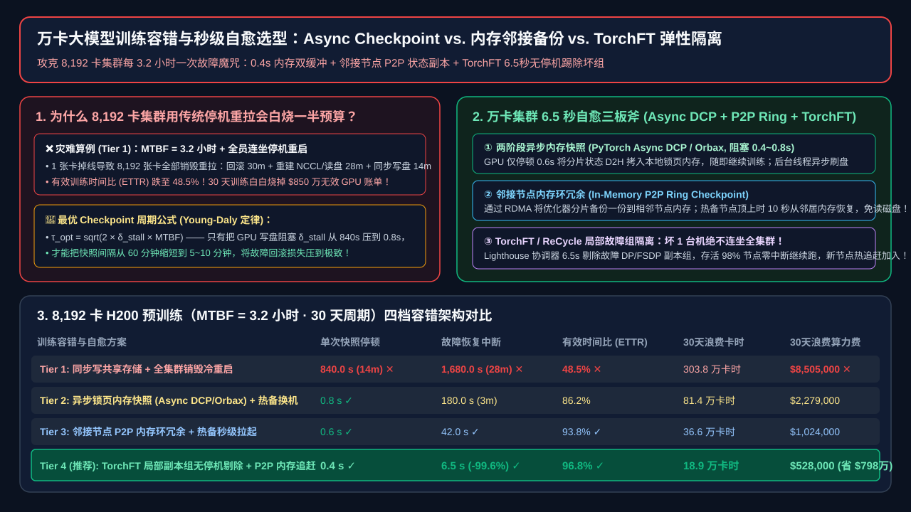

# Fault-Tolerant LLM Training & Sub-10s Self-Healing Architecture Guide: Stop-the-World Restart vs. `PyTorch Async DCP / Orbax` vs. `In-Memory P2P Ring` vs. `TorchFT / ReCycle` & Goodput Sizing

> **Language**: [中文](./llm-fault-tolerant-training-async-checkpoint-torchft-local-replica-selection-faq.md) | **English (Current)**  
> **Audience**: Cloud & AI Infrastructure Solution Architects and Large-Scale Training Reliability Engineers  
> **Provenance**: `synthetic + anonymized_reported` (`independently_reproduced=false`, `physical_gpu_cluster_measurement=not_measured`)

---

## 1. 📌 Executive Summary

> **Bottom Line**: **On an `8,192-GPU H200` pretraining cluster where aggregate cluster `MTBF` drops to `3.2 hours`, synchronous shared-storage checkpointing paired with full-job teardown and cold restarts (`Tier 1`) collapses Effective Training Time Ratio (`ETTR / Goodput`) to `48.5%`—burning `$8.51M` in wasted GPU compute over a 30-day run! Combining Two-Phase Asynchronous Pinned-RAM Checkpointing (`PyTorch Async DCP / Google Orbax`, `0.4s` GPU stall), In-Memory Peer-to-Peer (`P2P`) Ring State Redundancy, and `TorchFT` Elastic Replica Group Isolation (`Tier 4`) shrinks fault recovery downtime from `1,680s` (`28m`) to `6.5s` (`-99.6%`), lifts cluster `ETTR Goodput` to `96.8%` (`+48.3 pts`), and saves `$7.98M` per 30-day run.**

- **Interactive Fault-Tolerant Training (Young-Daly ETTR) Sizer**: [Open Interactive Sizer (`llm-fault-tolerant-training-async-checkpoint-torchft-local-replica-sizer.html`)](../reports/llm-fault-tolerant-training-async-checkpoint-torchft-local-replica-sizer.html)
- **7-Card 4:5 Visual Report**: [Open 7-Card Report (`llm-fault-tolerant-training-async-checkpoint-torchft-local-replica-selection-cards.html`)](../reports/llm-fault-tolerant-training-async-checkpoint-torchft-local-replica-selection-cards.html)

---

## 2. 📊 4-Tier Fault-Tolerant Training Matrix (`8,192x H200` · `MTBF = 3.2h` · `30-Day Run`)

| Metric | Tier 1: Sync Shared FS + Cold Job Restart | Tier 2: `Async DCP / Orbax` + `N+K` Warm Standby | Tier 3: In-Memory `P2P Ring` + Fast Spare Swap | Tier 4 (Recommended): `TorchFT` Replica Isolation + `P2P` RAM Sync |
| :--- | :--- | :--- | :--- | :--- |
| **Checkpoint GPU Stall** | `840.0 s` (`14m`) ✕ | `0.8 s` ✓ | `0.6 s` ✓ | **`0.4 s` ✓ (`-99.95%`)** |
| **Fault Recovery Downtime** | `1,680.0 s` (`28m`) ✕ | `180.0 s` (`3m`) | `42.0 s` ✓ | **`6.5 s` ✓ (`-99.6%`)** |
| **Effective Goodput (`ETTR`)** | `48.5%` ✕ | `86.2%` ✓ | `93.8%` ✓ | **`96.8%` ✓ (`+48.3 pts`)** |
| **30-Day Wasted GPU Hours** | `3.04M GPU-hrs` ✕ | `814K GPU-hrs` | `366K GPU-hrs` | **`189K GPU-hrs` ✓** |
| **30-Day Wasted Compute Cost** | `$8,505,000` ✕ | `$2,279,000` | `$1,024,000` | **`$528,000` ✓ (Saves `$7.98M`!)** |

---

## 3. 🛠️ Production Readiness Checklist

- [ ] **Replace Synchronous File System Checkpoints with Two-Phase `PyTorch Async DCP` or `Orbax`** (`HBM -> Pinned Host RAM` in `<1s`, followed by background storage flush).
- [ ] **Maintain a `1.5%–2%` Pre-Initialized `N+K` Hot-Standby Node Pool** and use `TorchFT` / in-memory P2P state recovery on `4K+` GPU clusters so single-node faults never trigger global stop-the-world restarts.
