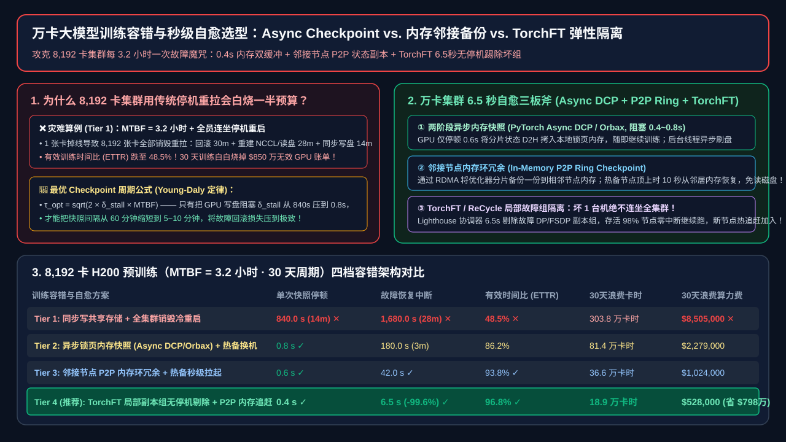
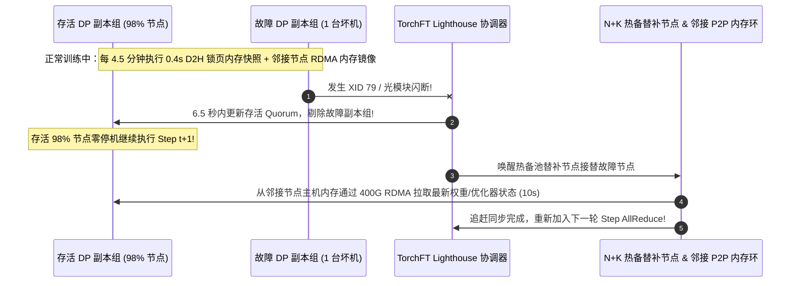

# 万卡大模型训练容错与秒级自愈选型：传统停机重拉 vs. `PyTorch Async DCP / Orbax 内存双缓冲` vs. `邻接节点 P2P 内存环` vs. `TorchFT / ReCycle 无断点隔离` 与 Goodput 手算指南

> **语言 / Language**: **中文 (当前)** | [English](./llm-fault-tolerant-training-async-checkpoint-torchft-local-replica-selection-faq.en.md)  
> **定位**：面向 Cloud & AI Infrastructure Solution Architect 与万卡智算集群稳定性负责人的大规模预训练容错自愈架构（Young-Daly 最优 Checkpoint 周期公式、`PyTorch Async DCP / Google Orbax` 内存双缓冲、邻接节点 `In-Memory P2P Ring Checkpoint`、`TorchFT / ReCycle` 局部故障组无停机剔除）与有效训练时间比（`ETTR / Goodput`）精确测算白皮书  
> **合规与来源声明**：`synthetic + anonymized_reported`（`independently_reproduced=false`，`physical_gpu_cluster_measurement=not_measured`；完全面向通用企业级千卡/万卡训练集群高可用与容错工程规划）

---

## 1. 📌 核心选型结论速览（Executive Summary）

> **一句话结论**：**在 `8,192 张 H200` 规模的大模型预训练集群中，即便单张 GPU 与光模块的年化可靠性极高，全集群平均无故障时间（`MTBF`）也会暴跌至 **`3.2 小时`**（每天发生 7~8 次硬件/网络中断）！若仍采用传统的“每 60 分钟同步阻塞写盘 + 故障后全员销毁重拉（Stop-the-World Cold Restart，Tier 1）”，有效训练时间比（`ETTR / Goodput`）将跌至惨烈至极的 **`48.5%`**——30 天训练周期白白烧掉 **`$850.5 万`** 无效算力账单！生产环境终极自愈架构是采用“`PyTorch Async DCP / Orbax` 两阶段内存双缓冲（GPU 停顿仅 `0.4s`）+ 邻接节点 `In-Memory P2P Ring` 状态冗余 + `TorchFT` 局部 DP 副本组 `6.5 秒` 无停机隔离（Tier 4）”：将集群 `ETTR Goodput` 从 `48.5%` 推升至 **`96.8%`（提升 `+48.3 pts`）**，单次 30 天训练直接为企业挽回 **`$797.7 万`** 的算力损失！**

- **交互式万卡训练容错 (ETTR / Young-Daly) 计算器**：[打开交互式计算器 (`llm-fault-tolerant-training-async-checkpoint-torchft-local-replica-sizer.html`)](../reports/llm-fault-tolerant-training-async-checkpoint-torchft-local-replica-sizer.html)
- **7-Card 4:5 视觉评测报告**：[打开 7-Card 报告 (`llm-fault-tolerant-training-async-checkpoint-torchft-local-replica-selection-cards.html`)](../reports/llm-fault-tolerant-training-async-checkpoint-torchft-local-replica-selection-cards.html)

---

## 2. 🎯 客户与架构师灵魂拷问 Q&A（Deep-Dive Architecture FAQ）

### Q1：架构师如何用第一性原理（Young-Daly 公式）算出最优 Checkpoint 间隔 $\tau_{\text{opt}}$ 与有效训练时间比（`ETTR`）？
设集群总卡数为 $N$，单卡平均无故障时间为 $M_{\text{gpu}}$（如 `26,000 小时`），则集群整体无故障间隔为：
$$\text{MTBF}_{\text{cluster}} = \frac{M_{\text{gpu}}}{N} = \frac{26,214}{8,192} = \mathbf{3.2\text{ 小时}} \ (192\text{ 分钟})$$
设每次保存 Checkpoint 阻塞 GPU 的时间为 $\delta_{\text{stall}}$，故障发生后的恢复耗时为 $R$，根据 **Young-Daly 定律**，最优 Checkpoint 间隔为：
$$\tau_{\text{opt}} \approx \sqrt{2 \times \delta_{\text{stall}} \times \text{MTBF}_{\text{cluster}}}$$
- **传统同步写盘（Tier 1，$\delta_{\text{stall}} = 14\text{ min}$，$R = 28\text{ min}$）**：
  - $\tau_{\text{opt}} = \sqrt{2 \times 14 \times 192} \approx 73\text{ min}$；每次故障平均丢失 $\tau/2 \approx 30\text{ min}$ 进度 + 重启 `28 min` + 写盘停顿，`ETTR` 仅剩 **`48.5%`**！
- **两阶段异步内存快照（Tier 2/3，`PyTorch Async DCP / Orbax`）**：
  - **第一阶段（同步 D2H，仅需 `0.4 ~ 0.8 秒`）**：通过 `cudaMemcpyAsync` 将每张卡分片的优化器与权重（约 `12 GB/GPU`）瞬间拷入本机锁页内存（Pinned Host DRAM），GPU 立即恢复下一轮训练 step；
  - **第二阶段（后台全异步）**：后台进程从主机内存慢慢刷入并行文件系统或通过 RDMA 发给邻居节点内存；此时 $\delta_{\text{stall}} = 0.4\text{ s}$，每 `4.5 分钟` 存一次快照对吞吐影响 `< 0.2%`！

### Q2：为什么万卡以上集群必须引入“邻接节点内存环备份（P2P Ring）”与 `TorchFT` 局部副本隔离？
1. **免除共享存储读风暴（In-Memory P2P Ring Checkpoint）**：在 ZeRO-3 / FSDP2 中，每个节点把自己的优化器分片通过 RDMA 额外镜像一份到环形邻居节点的空闲主机内存中。一旦 Node-k 宕机，`N+K` 热备池中的替补节点顶上后，直接通过 `400GbE RDMA` 从邻居节点内存中 **10 秒拉回状态**，完全不读远端 Lustre/3FS 磁盘！
2. **`TorchFT` 消灭“全员连坐（Stop-the-World）”**：将 `8,192` 张卡划分为多个独立的容错 DP/FSDP 副本域（Replica Groups）；当某台机器掉卡时，`TorchFT Lighthouse` 在 **`6.5 秒`** 内将该故障副本组踢出 AllReduce 仲裁圈，其余 `98%+` 的健康节点**一秒都不停机继续训练**，等替补节点在后台修好后再通过 P2P 内存同步无缝重新加入！

---

## 3. 🧭 直观可视化图解（Mermaid 万卡秒级自愈三层防御流水线）

---

## 4. 📊 架构师多方案选型决策矩阵（`8,192 x H200` · `MTBF = 3.2 小时` · `30 天`周期）

| 评估维度 | Tier 1：同步写共享存储 + 全集群销毁冷重启 | Tier 2：异步锁页内存快照 (`Async DCP/Orbax`) + 热备换机 | Tier 3：邻接节点 `P2P` 内存环冗余 + 热备秒级拉起 | Tier 4（推荐）：`TorchFT` 局部副本组无停机隔离 + `P2P` 内存追赶 |
| :--- | :--- | :--- | :--- | :--- |
| **单次 Checkpoint GPU 停顿** | `840.0 秒`（`14 分钟`）✕ | `0.8 秒` ✓ | `0.6 秒` ✓ | **`0.4 秒` ✓（降低 `99.95%`）** |
| **单次故障全集群中断时间** | `1,680.0 秒`（`28 分钟`）✕ | `180.0 秒`（`3 分钟`） | `42.0 秒` ✓ | **`6.5 秒` ✓（降低 `99.6%`）** |
| **有效训练时间比 (`ETTR`)** | `48.5%` ✕（超一半算力白烧） | `86.2%` ✓ | `93.8%` ✓ | **`96.8%` ✓（提升 `+48.3 pts`）** |
| **30 天周期浪费 GPU 卡时** | `303.8 万 GPU 小时` ✕ | `81.4 万 GPU 小时` | `36.6 万 GPU 小时` | **`18.9 万 GPU 小时` ✓** |
| **30 天周期无效算力浪费金额** | `$8,505,000` ✕ | `$2,279,000` | `$1,024,000` | **`$528,000` ✓（净省 `$797.7 万`！）** |

---

## 5. 🛠️ 架构评审与生产落地 Checklist

- [ ] **严禁在百卡以上集群使用单点同步 `torch.save()`**：强制切换至分片异步 `torch.distributed.checkpoint (Async DCP)`、Megatron `Async Save` 或 Google `Orbax`。
- [ ] **常备 `1.5% ~ 2%` 的 `N+K` 热备节点池（Hot-Standby Pool）**：热备节点预先完成容器镜像拉取、CUDA 上下文初始化与健康自检，确保故障节点被 Cordon 后 `10 秒` 内原地顶替。
