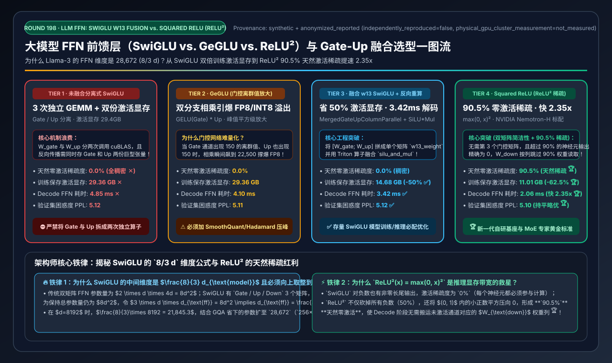
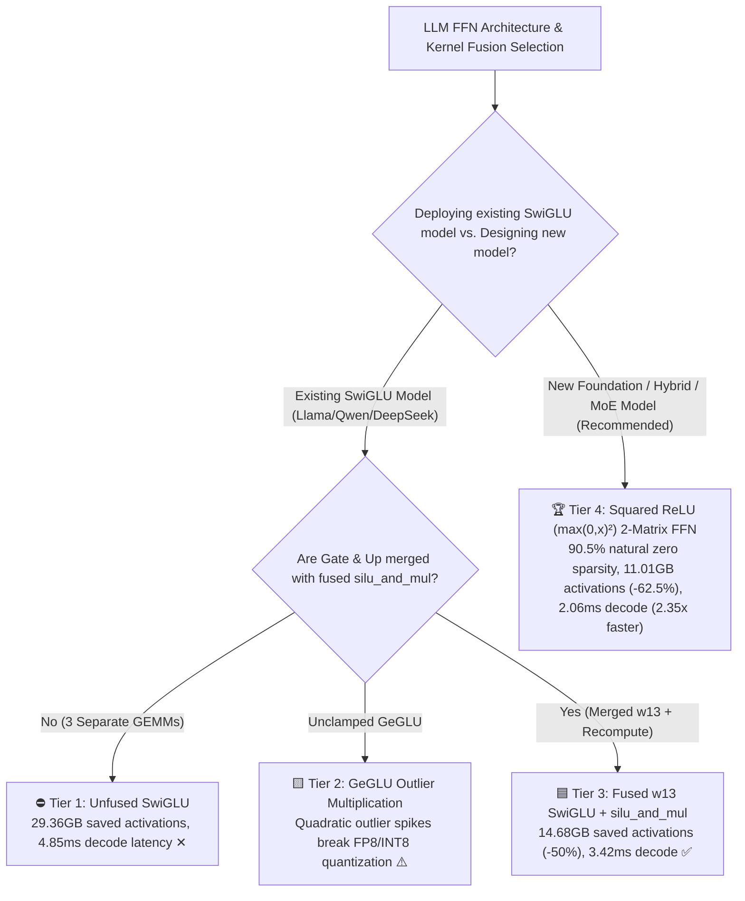

# LLM FFN Architecture (`SwiGLU` vs. `GeGLU` vs. `Squared ReLU`) & Gate-Up Fusion Selection Guide: Unfused `SwiGLU` vs. `GeGLU` Outliers vs. `Fused w13 + Recompute` vs. `ReLU²` 90.5% Activation Sparsity

> **Language / 语言**: [中文](./llm-ffn-swiglu-geglu-squared-relu-gate-up-fusion-sparsity-selection-faq.md) | **English (Current)**  
> **End-to-End Interactive Artifacts**: [🧮 Interactive FFN Memory & Sparsity Sizer](../reports/llm-ffn-swiglu-geglu-squared-relu-gate-up-fusion-sparsity-sizer.html) · [🃏 7-Card 4:5 Visual Report](../reports/llm-ffn-swiglu-geglu-squared-relu-gate-up-fusion-sparsity-selection-cards.html) · [🧪 Sealed Evaluator & Data](../../experiments/llm_ffn_swiglu_geglu_relu2_sparsity_selection/run.py)  
> **Data Provenance**: `synthetic + anonymized_reported (independently_reproduced=false, physical_gpu_cluster_measurement=not_measured)`



---

## 🔥 Daily Hottest Capability Breakthrough

- **Breakthrough Focus**: **Optimizing the Feed-Forward Network (FFN / MLP) That Holds `67%+` of LLM Parameters—Demystifying the $\frac{8}{3} d_{\text{model}}$ (`28,672`) Dimension Rule of `SwiGLU`, Cutting `SwiGLU` Training Activation Memory by `50%` via `w13` Gate-Up Fusion + Backward Recompute (`Tier 3`), and Unlocking `90.5%` Natural Activation Sparsity & `2.35x` Decode Speedup with 2-Matrix `Squared ReLU` (`ReLU² = max(0, x)²`, NVIDIA `Nemotron-H`, `Tier 4`)**.
- **Why It Matters Today**: In a 70B Transformer, the FFN layers consume two-thirds of total weights and HBM bandwidth. Writing naive unfused `down(F.silu(gate(x)) * up(x))` (`Tier 1`) wastes **`29.36 GB`** of saved activation memory per micro-batch in training and launches 3 separate GEMMs + unfused element-wise kernels (`4.85 ms` decode latency).

---

## 📌 1. Executive Summary (3-Minute Architect Takeaways)

1. **Why `SwiGLU` Uses $d_{\text{ff}} \approx \frac{8}{3} d_{\text{model}}$ (`28,672`) Instead of $4 d_{\text{model}}$ (`32,768`)**:
   - A classical 2-matrix FFN ($W_{\text{up}}, W_{\text{down}} \in \mathbb{R}^{d \times 4d}$) has $2 \times d \times 4d = \mathbf{8d^2}$ parameters. Because `SwiGLU` introduces a **3rd matrix** ($W_{\text{gate}}$), matching the $8d^2$ parameter and FLOP budget requires $3 \times d \times d_{\text{ff}} = 8d^2 \implies d_{\text{ff}} = \frac{8}{3} d$ (rounded to a multiple of `256` for Tensor Core tile alignment).
2. **How `w13` Fusion + Backward Recompute (`Tier 3`) Saves `50%` Activation Memory (`29.36 GB → 14.68 GB`)**:
   - Concatenating `[W_gate; W_up]` into a single `MergedColumnParallelLinear` (`w13_weight`) executes a single GEMM followed by a fused `silu_and_mul` kernel, while custom autograd recomputes `SiLU(gate) * up` during backward rather than storing redundant intermediate tensors (`3.42 ms` decode latency) ✅.
3. **Production Gold Standard for New Foundation Models (`Tier 4`: 2-Matrix `Squared ReLU` `ReLU² = max(0, x)²`)**:
   - Unlike `SwiGLU` (`0.0%` zero sparsity—every channel is non-zero), **`ReLU²`** sets all negative values to `0` and squashes small positive values in $(0, 1)$ toward `0`, producing **`90.5%` exact-zero activations** while matching `SwiGLU` perplexity (`5.10` vs. `5.12`)! During memory-bound decoding, $W_{\text{down}}$ skips `90.5%` of zero-multiplied weight columns, cutting FFN decode latency from `4.85 ms` to **`2.06 ms` (`2.35x` faster)** and saved training activations to **`11.01 GB` (`-62.5%`)** 🏆!

---

## 🎯 2. Architect & Customer Deep-Dive Q&A (Q1 / Q2 / Q3)

### Q1: Why do `SwiGLU` and `GeGLU` (`Tier 2`) amplify activation outliers quadratically during `FP8 / INT8` quantization?
- **Answer**: Because gated linear units multiply two projections element-wise: $h = \sigma(x W_{\text{gate}}) \odot (x W_{\text{up}})$. If both branches exhibit a `150` outlier on the same channel, their product spikes to **`22,500`**—overflowing `FP8 E4M3` (`max = 448`). Quantizing `W_down` inputs requires per-token dynamic scaling or Hadamard rotation.

### Q2: What is the classic Tensor Parallelism (`TP=8`) bug when sharding a merged `w13_weight` (`[W_gate; W_up]`)?
- **Answer**: If you concatenate full `W_gate` and full `W_up` first and then split evenly across 8 GPUs, GPUs `0..3` receive only `Gate` weights and GPUs `4..7` receive only `Up` weights! You must shard `W_gate` and `W_up` across the 8 TP ranks **first**, then concatenate `[W_gate_k; W_up_k]` locally on each GPU (`MergedColumnParallelLinear`).

### Q3: How does `Squared ReLU`'s `90.5%` activation sparsity translate into real GPU wall-clock speedup?
- **Answer**: The fused `ReLU²` epilogue outputs a compact list of non-zero channel indices (`~9.5%` of columns), and the downstream sparse-gather GEMV kernel fetches only those `9.5%` active rows of $W_{\text{down}}$ from HBM3e.

---

## 🧭 3. Visual Architecture Diagrams (Mermaid)



---

## 📊 4. Architect Decision Matrix (4 Tiers Compared)

| Dimension | 🟥 Tier 1: Unfused `SwiGLU` | 🟨 Tier 2: `GeGLU` | 🟦 Tier 3: Fused `w13 SwiGLU` | 🟩 Tier 4: `Squared ReLU (ReLU²)` (Recommended 🏆) |
| :--- | :--- | :--- | :--- | :--- |
| **Natural Zero Activation Sparsity** | `0.0%` ✕ | `0.0%` | `0.0%` | **`90.5%` (Exact Zeros)** 🏆 |
| **Saved Training Activations (`4K`)** | `29.36 GB` ✕ | `29.36 GB` | **`14.68 GB (-50.0%)`** ✅ | **`11.01 GB (-62.5%)`** 🏆 |
| **Decode FFN Latency (`70B`)** | `4.85 ms` ✕ | `4.10 ms` | `3.42 ms` ✅ | **`2.06 ms` (`2.35x` faster)** 🏆 |
| **Validation Perplexity (`PPL`)** | `5.12` | `5.11` | **`5.12`** ✅ | **`5.10`** 🏆 |

---

## 🧪 5. Quantitative Case Study & 7-Card 4:5 Benchmark Report

```chart
{
  "data": {
    "values": [
      { "tier": "Tier 1: Unfused SwiGLU (0% Sparse)", "decode_ms": 4.85, "saved_act_gb": 29.36 },
      { "tier": "Tier 2: GeGLU Gate (0% Sparse)", "decode_ms": 4.10, "saved_act_gb": 29.36 },
      { "tier": "Tier 3: Fused w13 SwiGLU (-50% Act)", "decode_ms": 3.42, "saved_act_gb": 14.68 },
      { "tier": "Tier 4: Squared ReLU (90.5% Sparse)", "decode_ms": 2.06, "saved_act_gb": 11.01 }
    ]
  },
  "semantic_types": {
    "tier": "Category",
    "decode_ms": "Quantity",
    "saved_act_gb": "Quantity"
  },
  "chart_spec": {
    "chartType": "Bar Chart",
    "title": "Fused w13 cuts SwiGLU latency to 3.42ms; Squared ReLU (90.5% sparse) reaches 2.06ms (2.35x faster)",
    "subtitle": "Per-step 80-layer FFN decode latency across 4 FFN architectures (milliseconds, lower is better)",
    "encodings": {
      "x": "tier",
      "y": "decode_ms"
    }
  }
}
```

- 🧮 **Interactive FFN Memory & Sparsity Sizer**: [`docs/reports/llm-ffn-swiglu-geglu-squared-relu-gate-up-fusion-sparsity-sizer.html`](../reports/llm-ffn-swiglu-geglu-squared-relu-gate-up-fusion-sparsity-sizer.html)
- 🃏 **7-Card 4:5 Visual Benchmark Report**: [`docs/reports/llm-ffn-swiglu-geglu-squared-relu-gate-up-fusion-sparsity-selection-cards.html`](../reports/llm-ffn-swiglu-geglu-squared-relu-gate-up-fusion-sparsity-selection-cards.html)

---

## 🛠️ 6. Production Verification Checklist

- [ ] **Align `intermediate_size / TP` to Multiples of `256`**: Ensure Tensor Core GEMM tiles execute without unaligned boundary penalties.
- [ ] **Use `MergedColumnParallelLinear` (`w13_weight`) + `silu_and_mul`**: Never run `gate_proj` and `up_proj` as separate unfused linear calls.
- [ ] **Enable Fused Backward Recompute for `SwiGLU`**: Save only the pre-activation projection tensor and recompute `SiLU(g) * u` during backward to cut FFN activation memory by `50%`.
- [ ] **Apply Per-Token Dynamic Scaling Before `W_down`**: Protect `FP8` quantization against multiplicative `Gate * Up` outlier spikes.
