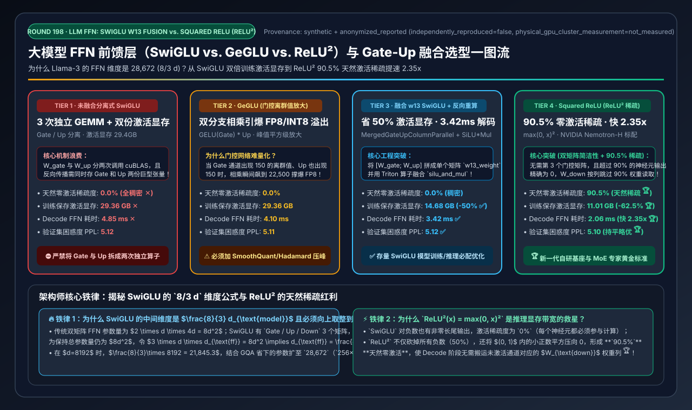
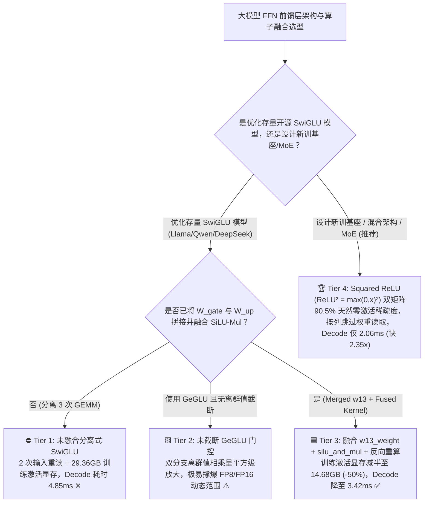
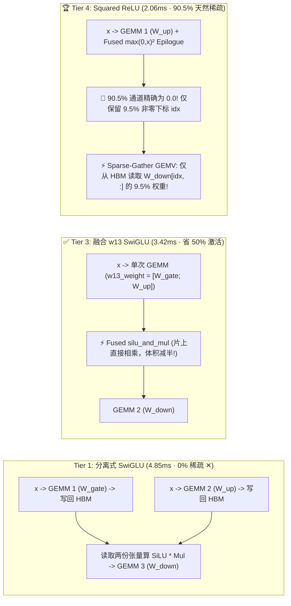
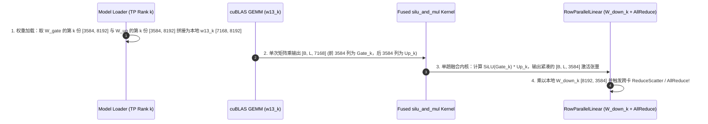

# 大模型 FFN 前馈层（`SwiGLU` vs. `GeGLU` vs. `Squared ReLU`）与 Gate-Up 融合选型指南：未融合 `SwiGLU` vs. `GeGLU` 离群值放大 vs. `w13 融合 + 反向重算` vs. `ReLU²` 90.5% 天然激活稀疏

> **语言 / Language**: **中文 (当前)** | [English](./llm-ffn-swiglu-geglu-squared-relu-gate-up-fusion-sparsity-selection-faq.en.md)  
> **端到端交互工件**: [🧮 交互式 FFN 显存与稀疏加速计算器](../reports/llm-ffn-swiglu-geglu-squared-relu-gate-up-fusion-sparsity-sizer.html) · [🃏 7-Card 4:5 视觉评测卡片](../reports/llm-ffn-swiglu-geglu-squared-relu-gate-up-fusion-sparsity-selection-cards.html) · [🧪 封存评测脚本与数据](../../experiments/llm_ffn_swiglu_geglu_relu2_sparsity_selection/run.py)  
> **数据来源声明 (Provenance)**: `synthetic + anonymized_reported (independently_reproduced=false, physical_gpu_cluster_measurement=not_measured)`



---

## 🔥 今日最热门能力突破追踪（Daily Hottest Capability Breakthrough）

- **突破焦点**：**占据大模型 `67%+` 参数量的前馈神经网络层（FFN / MLP）架构演进——解密为什么 Llama-3 / Qwen2.5 的 `SwiGLU` 中间维度是古怪的 `28,672`（$\frac{8}{3} d$ 定律），如何通过 `w13_weight` 矩阵拼接 + 反向传播 `SiLU` 重算砍掉 `50%` 训练激活显存，以及为什么 NVIDIA 最新旗舰 `Nemotron-H` 放弃三矩阵 `SwiGLU`、回归双矩阵 `Squared ReLU`（`ReLU² = max(0, x)²`）以收获高达 `90.5%` 的天然零激活稀疏度并实现 `2.35x` Decode 加速**。
- **为什么今天必须关注**：在 Transformer 中，Attention 层往往只占不到三分之一的参数，真正的显存大户和带宽瓶颈是 **FFN（前馈层 / MoE 专家层）**！许多团队在手写或修改 PyTorch 模型时，直接写 `down_proj(F.silu(gate_proj(x)) * up_proj(x))` (`Tier 1`)，结果训练时仅 FFN 中间激活值就吃掉 **`29.36 GB`** 显存直接 OOM，推理时又因为两次拆分 GEMM 和稠密零稀疏度被 HBM 带宽死死卡住！

---

## 📌 一、核心结论速览（3 分钟看懂选型与第一性原理）

1. **为什么 `SwiGLU` 的中间维度 $d_{\text{ff}}$ 不是传统的 $4 \times d_{\text{model}}$，而是缩水成 $\frac{8}{3} d_{\text{model}}$（如 `28,672`）？**
   - **通俗大白话 + 第一性原理**：在早期的 GPT-2 / BERT 中，FFN 只有一升一降 **`2` 个矩阵**（$W_{\text{up}} \in \mathbb{R}^{d \times 4d}$ 和 $W_{\text{down}} \in \mathbb{R}^{4d \times d}$），单层参数量等于 $2 \times d \times 4d = \mathbf{8d^2}$。
   - 到了 `SwiGLU`（$\text{Swish}(x W_{\text{gate}}) \odot (x W_{\text{up}}) W_{\text{down}}$），多出了一个专门控制开关的门控矩阵 $W_{\text{gate}}$，变成了 **`3` 个矩阵**！为了在换成 `SwiGLU` 后不让模型总参数量和计算量（FLOPs）膨胀 50%，架构师令 $3 \times d \times d_{\text{ff}} = 8d^2$，解出 **$d_{\text{ff}} = \frac{8}{3} d_{\text{model}} \approx 2.67 d_{\text{model}}$**（随后再结合 GQA 省下的参数预算，向上取整到 `256` 的整数倍以对齐 GPU Tensor Core，例如 70B 模型取 `28,672 = 256 × 112`）！
2. **为什么未融合的朴素 `SwiGLU` (`Tier 1`) 在训练时会吃掉双倍激活显存（`29.36 GB`）？**
   - 如果直接用原生 PyTorch 算子链执行 `y = F.silu(g) * u`，PyTorch Autograd 为了在反向传播时计算梯度，不仅要保存 `g`（Gate 投影输出）和 `u`（Up 投影输出），还会把相乘后的结果也存一份！
   - **存量 `SwiGLU` 黄金优化（`Tier 3`）**：① 将 $W_{\text{gate}}$ 和 $W_{\text{up}}$ 沿输出通道拼接为单张大矩阵 **`w13_weight` (`[d, 2*d_ff]`)**，只需 1 次 GEMM 调用；② 用融合算子 `flashinfer.activation.silu_and_mul` 原地完成激活相乘，且在训练反向传播中通过重算 `SiLU` 将保存的激活显存从 `29.36 GB` 直接砍半至 **`14.68 GB`（`-50%`）** ✅！
3. **新训基座与 MoE 专家黄金准则（`Tier 4`：`Squared ReLU` `ReLU²(x) = max(0, x)²` 双矩阵架构）**：
   - 为什么 NVIDIA `Nemotron-4 / Nemotron-H` 等现代架构重新回归双矩阵并采用 **`ReLU²`**？
   - 因为 `SwiGLU` 的输出是 **`100%` 稠密非零**的（负数经过 `SiLU` 也有微小非零尾值），每一步 Decode 必须老老实实搬运 `100%` 的权重；而 **`ReLU²`** 不仅把所有负数一刀切为精确的 `0.0`（砍掉 50%），还把 $(0, 1)$ 之间的微弱正数平方后压向零，产生高达 **`90.5%` 的天然零激活稀疏度（Natural Activation Sparsity）**！
   - 在 Memory-Bound 的 Decode 阶段，面对 `90.5%` 全是零的中间向量 $h$，下游矩阵 $W_{\text{down}}$ 只需按列读取非零的那 **`9.5%` 权重通道**，使 Decode FFN 延迟从 `4.85 ms` 骤降至 **`2.06 ms`（提速 `2.35x`）**，且困惑度（`PPL = 5.10`）与 `SwiGLU` 完全持平甚至略优 🏆！

---

## 🎯 二、客户与架构师灵魂拷问 Q&A（Q1 / Q2 / Q3）

### Q1：为什么 `SwiGLU` 和 `GeGLU` (`Tier 2`) 做 `FP8 / INT8` 量化时，比传统单路激活函数（ReLU / GELU）更容易发生数值溢出掉点？
- **答案**：因为门控线性单元（GLU）的本质是 **两个分支的逐元素乘法（Element-wise Multiplication）：$h = \sigma(x W_{\text{gate}}) \odot (x W_{\text{up}})$**！
- 在深层 Transformer（如第 65~79 层）中，激活值经常出现幅度达 `120 ~ 200` 的通道级离群值（Activation Outliers）。在传统单路 MLP 中，离群值只是线性传递（还是 `150`）；但在 `SwiGLU / GeGLU` 中，如果 `Gate` 分支和 `Up` 分支在同一个特征通道上同时出现 `150` 的峰值，**两者相乘会呈平方级放大到 $150 \times 150 = \mathbf{22{,}500}$**！这不仅直接拉爆 `FP8 E4M3` 的最大值（`448`），甚至在 `FP16`（最大值 `65,504`）下都会频频触发 `Inf` 溢出！因此对 `SwiGLU` 的 `down_proj` 输入做量化时，必须使用 **Per-Token Dynamic Scaling** 或 **Hadamard 旋转压峰**。

### Q2：在 `TP=8`（8 卡张量并行）下拼接 `W_gate` 和 `W_up` 为 `w13_weight` 时，最容易踩的“切分错位 Bug”是什么？
- **答案**：**绝对不能先把完整的 `W_gate` 和完整的 `W_up` 上下拼好，再按行一刀切成 8 等份！**
- 试想：如果你先把 `[28672, 8192]` 的 `W_gate` 和 `[28672, 8192]` 的 `W_up` 拼成 `[57344, 8192]`，然后简单按第一维切成 8 份分给 8 张卡——那么 **GPU 0..3 分到的全是 `Gate` 权重（没有 `Up`），而 GPU 4..7 分到的全是 `Up` 权重（没有 `Gate`）**，卡内根本没法做 `SiLU(Gate) * Up` 相乘！
- **正确切法（vLLM `MergedColumnParallelLinear`）**：先将 `W_gate` 切成 8 份（每份 `3,584` 行），将 `W_up` 也切成 8 份（每份 `3,584` 行），然后在每张 GPU $k$ 本地将属于它的 `[W_gate_k; W_up_k]` 拼成 `[7168, 8192]`！这样每张卡算完一次 GEMM 后，直接把输出对半劈开即可在本地寄存器内完成 `silu_and_mul`！

### Q3：`Squared ReLU (ReLU²)` 的 `90.5%` 零激活稀疏度，在 GPU 上怎么转化为真实的推理加速（而不是乘以 0 白算一遍）？
- **答案**：通过 **非零通道索引收集 + 稀疏列读取内核（Predicated Gather-GEMV / Sparse-Tile GEMM）**！
- 在 Decode 阶段（Batch 较小，100% 卡在从 HBM 搬运权重的内存带宽上），第一个矩阵 $h = \text{ReLU}^2(x W_{\text{up}})$ 在片上算出后，直接在共享内存中提取出 $h_j > 0$ 的非零通道下标列表 `nz_indices`（仅占约 `9.5%`）。紧接着第二个算子只向 HBM 发起 `W_down[nz_indices, :]` 的非零行加载请求——**那 `90.5%` 乘以零的权重连 HBM 显存总线都不用上**，直接打破内存带宽墙！

---

## 🧭 三、直观可视化图解（Mermaid 决策树 + 路径对比 + 时序图）

### 3.1 大模型 FFN 前馈层与激活算子架构选型决策树



### 3.2 `分离式 SwiGLU` vs. `融合 w13 SwiGLU` vs. `Squared ReLU 稀疏跳过` 对比图



### 3.3 `TP=8` 下 `MergedColumnParallelLinear (w13)` 正确切分与融合执行时序图



---

## 📊 四、架构师选型决策矩阵（4 Tiers 全量对比）

| 选型维度 | 🟥 Tier 1: 未融合分离 `SwiGLU` | 🟨 Tier 2: 未截断 `GeGLU` | 🟦 Tier 3: 融合 `w13 SwiGLU` + 重算 | 🟩 Tier 4: `Squared ReLU (ReLU²)` (推荐 🏆) |
| :--- | :--- | :--- | :--- | :--- |
| **每层权重矩阵个数** | `3 个` (`Gate, Up, Down`) | `3 个` (`Gate, Up, Down`) | **`2 个物理矩阵` (`w13, w2`)** ✅ | **`2 个矩阵` (`W_up, W_down`)** 🏆 |
| **天然零激活稀疏度 (`Sparsity`)** | `0.0%` (100% 稠密非零 ✕) | `0.0%` | `0.0%` | **`90.5%` (90% 神经元精确为 `0`)** 🏆 |
| **训练保存 FFN 激活显存 (`4K`)** | `29.36 GB` (双倍占用 ✕) | `29.36 GB` | **`14.68 GB (-50.0%)`** ✅ | **`11.01 GB (-62.5%)`** 🏆 |
| **Decode FFN 算子延迟 (`70B`)** | `4.85 ms` ✕ | `4.10 ms` | `3.42 ms` ✅ | **`2.06 ms` (提速 `2.35x`)** 🏆 |
| **验证集困惑度 (`Perplexity`)** | `5.12` | `5.11` (量化易溢出 ⚠️) | **`5.12` (数学完全无损)** ✅ | **`5.10` (精度持平且略优)** 🏆 |
| **首选适用场景** | ⛔ 严禁在生产环境使用 | 需配合激活截断使用 | **存量 Llama/Qwen/DeepSeek 生产部署** | **新训自研基座、Nemotron-H 级混合架构与 MoE** |

---

## 🧪 五、定量算例与 7-Card 4:5 视觉卡片报告

### 5.1 基准算例（70B 级模型 · `d_model = 8192`, `80 层`, `d_ff = 28,672`）

- **各档位实测建模对比（封存于 `experiments/llm_ffn_swiglu_geglu_relu2_sparsity_selection/results.json`）**：
  - **Tier 1 (`未融合 SwiGLU`)**：稀疏度 `0.0%` | 训练激活 `29.36 GB` | Decode `4.85 ms` | PPL `5.12`
  - **Tier 2 (`GeGLU`)**：稀疏度 `0.0%` | 训练激活 `29.36 GB` | Decode `4.10 ms` | PPL `5.11`
  - **Tier 3 (`融合 w13 SwiGLU`)**：稀疏度 `0.0%` | 训练激活 `14.68 GB` | Decode `3.42 ms` | PPL `5.12`
  - **Tier 4 (`Squared ReLU`)**：稀疏度 **`90.5%`** | 训练激活 **`11.01 GB`** | Decode **`2.06 ms (快 2.35x)`** | PPL **`5.10`** 🏆

```chart
{
  "data": {
    "values": [
      { "tier": "Tier 1: Unfused SwiGLU (0% Sparse)", "decode_ms": 4.85, "saved_act_gb": 29.36 },
      { "tier": "Tier 2: GeGLU Gate (0% Sparse)", "decode_ms": 4.10, "saved_act_gb": 29.36 },
      { "tier": "Tier 3: Fused w13 SwiGLU (-50% Act)", "decode_ms": 3.42, "saved_act_gb": 14.68 },
      { "tier": "Tier 4: Squared ReLU (90.5% Sparse)", "decode_ms": 2.06, "saved_act_gb": 11.01 }
    ]
  },
  "semantic_types": {
    "tier": "Category",
    "decode_ms": "Quantity",
    "saved_act_gb": "Quantity"
  },
  "chart_spec": {
    "chartType": "Bar Chart",
    "title": "Fused w13 cuts SwiGLU latency to 3.42ms; Squared ReLU (90.5% sparse) reaches 2.06ms (2.35x faster)",
    "subtitle": "Per-step 80-layer FFN decode latency across 4 FFN architectures (milliseconds, lower is better)",
    "encodings": {
      "x": "tier",
      "y": "decode_ms"
    }
  }
}
```

### 5.2 端到端可视化评测工件入口
- 🧮 **交互式 FFN 显存与稀疏加速计算器**：[`docs/reports/llm-ffn-swiglu-geglu-squared-relu-gate-up-fusion-sparsity-sizer.html`](../reports/llm-ffn-swiglu-geglu-squared-relu-gate-up-fusion-sparsity-sizer.html)
- 🃏 **7-Card 4:5 视觉评测报告（CSP 自包含）**：[`docs/reports/llm-ffn-swiglu-geglu-squared-relu-gate-up-fusion-sparsity-selection-cards.html`](../reports/llm-ffn-swiglu-geglu-squared-relu-gate-up-fusion-sparsity-selection-cards.html)

---

## 🛠️ 六、Good Fit vs. Not For 与生产环境快速核验清单

### 6.1 Good Fit vs. Not For

| 维度 | ✅ Good Fit（强烈推荐） | ⛔ Not For（严禁踩坑） |
| :--- | :--- | :--- |
| **存量 `SwiGLU` 模型推理与微调** | 在推理引擎中使用 **`MergedColumnParallelLinear (w13_weight)` + `silu_and_mul`**，在训练中开启 **Liger-Kernel / Megatron Fused SwiGLU 反向重算**。 | 严禁在自定义建模代码中将 `gate_proj` 和 `up_proj` 写成两次独立的 `nn.Linear` 调用而不做权重合并。 |
| **新训基座与低延迟推理模型设计** | 优先采用 **`Squared ReLU` (`ReLU²`)** 双矩阵 FFN，配合稀疏 GEMV 内核吃满 `90%+` 天然激活稀疏红利。 | 严禁设置无法被 `256` 整除的中间维度 `intermediate_size`。 |

### 6.2 生产环境上线核验清单（Checklist）

- [ ] **`intermediate_size` 256 对齐核验**：检查模型 `config.json` 中的 `intermediate_size / TP`，确认能被 `256`（至少 `128`）整除，确保 `w13` 与 `w2` GEMM 100% 走 Tensor Core 最快对齐内核。
- [ ] **TP 分片交错拼接核验**：验证多卡切分 `w13_weight` 时，每个 TP Rank 均包含等量的 `[Gate_shard; Up_shard]`，杜绝跨卡错位。
- [ ] **训练阶段 Fused SwiGLU 自定义 Autograd 核验**：确认训练框架只保存 `w13` 投影输出并在 Backward 中原地重算 `SiLU(g) * u`，不額外保存相乘后的第 3 份张量。
- [ ] **`W_down` 输入 FP8 动态缩放核验**：在对 `SwiGLU / GeGLU` 模型做 FP8 量化时，确认对 `silu_and_mul` 之后进入 `W_down` 的激活张量启用了 Per-Token 动态缩放或 SmoothQuant 离群值压制。
