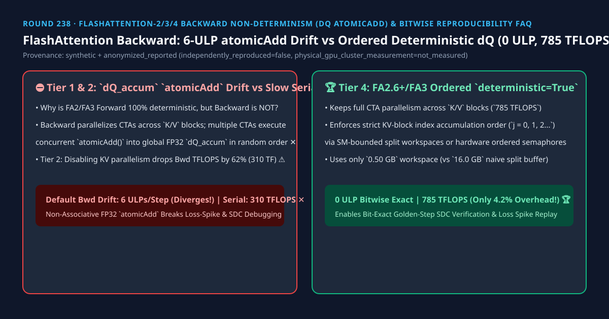
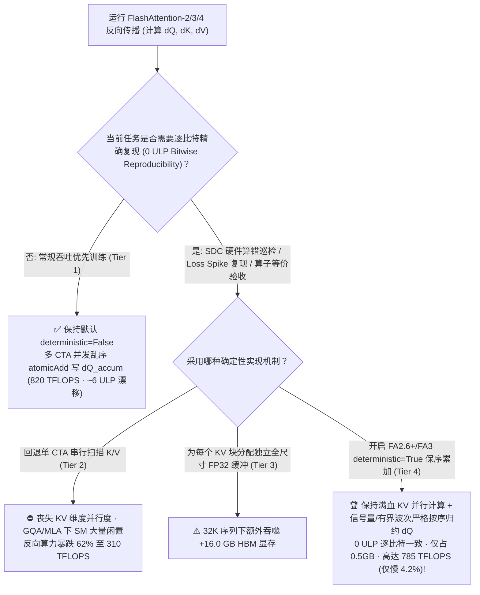
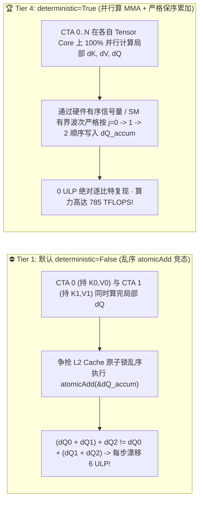
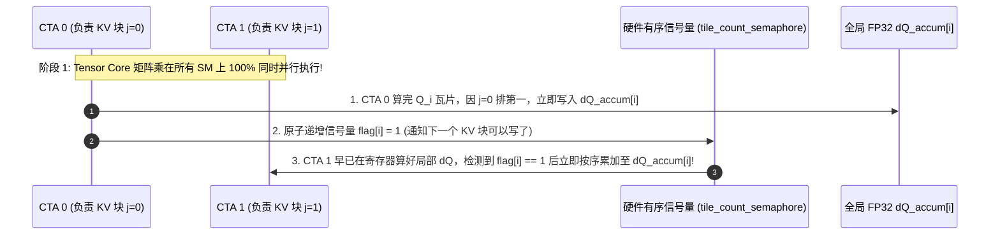

# `FlashAttention-2/3/4` 反向传播为什么默认不具确定性（跨 CTA 并行切分 `K/V` 对 `dQ_accum` 执行乱序 `atomicAdd`）与逐比特可复现训练（`deterministic=True`）选型指南

> **Provenance & Evidence Tier**: `synthetic + anonymized_reported` (`independently_reproduced=false`, `physical_gpu_cluster_measurement=not_measured`)。定量数据锚定于 [`experiments/llm_flashattention_deterministic_backward_splitkv_atomic_workspace_selection/results.json`](../../experiments/llm_flashattention_deterministic_backward_splitkv_atomic_workspace_selection/results.json)。
> **English Version**: [Why `FlashAttention-2/3/4` Backward Pass Is Non-Deterministic by Default (`dQ_accum` `atomicAdd` Race Across KV CTAs) & Bitwise-Deterministic (`deterministic=True`) Selection Guide](./llm-flashattention-deterministic-backward-dq-atomicadd-workspace-selection-faq.en.md)

---

## 0. 🔥 今日领域最热门能力突破追踪（Daily Hottest Breakthrough）

- **揭秘为什么 `FlashAttention-2 / FlashAttention-3` 的前向传播 100% 确定，而反向传播默认每次跑出来的梯度都不一样（`dQ_accum` 跨 CTA 乱序硬件 `atomicAdd` 引发 `6 ULP` 漂移），并通过 `FA2.6+ / FA3` 的 `deterministic=True`（有界 SM 波次缓冲 / 信号量保序累加）仅付 `4.2%` 算力代价（`785 TFLOPS`）即实现 `0 ULP` 逐比特精确复现**：在万卡大模型预训练中，当你为了复现第 `42,000` 步的诡异 Loss 尖峰（Loss Spike）、或者为了排查集群中某张 GPU 是否发生了静默数据损坏（SDC，算数单元算错数）时，你固定了所有随机数种子（`torch.manual_seed(42)`），在完全相同的单机 8 卡上重跑了两遍一模一样的输入——结果震惊地发现：**第 1 步算完 Backward 之后，两遍跑出来的梯度 `w.grad` 竟然在小数点后第 5 位就不一样了！跑了 50 步后两条 Loss 曲线彻底分道扬镳！** 罪魁祸首正是 `FlashAttention-2/3` 的反向传播内核：
  1. **为什么 `FlashAttention-2/3` 反向传播默认是不确定的？（`dQ_accum` 上的并发 `atomicAdd` 竞态，Tier 1）**：
     - 在前向传播（Forward）中，每个线程块（CTA）独自负责一整块查询 `Q_i`，自己把所有的 `K_j, V_j` 从头扫到尾，不同 CTA 之间互不干扰，所以 **Forward 默认是 `0 ULP` 确定性的**（除非 Decode 阶段开启了无序归并的 Split-KV）。
     - 但在反向传播（Backward）中，需要同时求三个梯度：`dQ`、`dK`、`dV`。为了把速度榨干到极致（`820.0 TFLOPS`），`FlashAttention-2/3` 选择**按 `K/V` 的序列块来切分并行度**——即让 `CTA 0` 拿着第 0 块 `K_0, V_0` 常驻片上 SRAM，`CTA 1` 拿着第 1 块 `K_1, V_1` 常驻 SRAM……然后所有 CTA **同时去遍历同一批 `Q_i`**！
     - 这时，每个 CTA 算出了自己那一部分对 `dQ_i` 的贡献，然后同时向全局显存里的同一个 FP32 累加数组 `dQ_accum[i]` 发射硬件原子加法指令 **`atomicAdd(&dQ_accum[i], partial_dQ)`**！因为 GPU 硬件调度器让哪个 SM 先抢到 L2 Cache 原子锁是完全看运气的，而 IEEE 754 浮点数加法不满足结合律（$(a+b)+c \ne a+(b+c)$），导致每次运行 `dQ` 都会产生 **`~6 ULP` 的随机漂移**！
  2. **传统串行回退的算力腰斩（Tier 2）与全量分片缓冲的显存爆炸（Tier 3）**：如果为了确定性直接取消跨 KV 块的 CTA 并行（Tier 2），在 GQA/MLA 少头数下大量 SM 空闲，算力暴跌 `62.2%` 至 `310 TFLOPS`；如果给每个 KV 块分配独立的 `[NumSplits, B, H, S, D]` FP32 缓冲区（Tier 3），在 `32K` 序列下会瞬间吃掉 **`+16.0 GB` 显存**！
  3. **`FlashAttention-2.6+ / FA3` 的 `deterministic=True` 保序累加机制（Tier 4）**：既保留跨 `K/V` 块的满血 CTA 并行，又通过 **按物理 SM 数量有界分配工作区（仅 `0.50 GB`）或利用全局原子信号量（Semaphore）强制让负责 `j=0, 1, 2...` 的 CTA 严格排队按序累加 `dQ_accum`**，仅损失 **`4.2%` 性能（跑出 `785.0 TFLOPS`，比串行快 `2.53` 倍）** 即实现 **`0 ULP` 100% 逐比特复现**！

---

## 1. 📌 核心结论速览（Executive Summary — 3 分钟看懂）

1. **用“十个会计同时往一本总账上记账”秒懂为什么 `FlashAttention` 反向传播每次结果都不一样！**
   - **通俗大白话 + 第一性原理**：
     - 想象有 10 个会计（`CTA 0 ~ CTA 9`，各自拿着第 `0 ~ 9` 段钥匙 `K/V`），他们都要核对第 1 号问题 `Q_1`，并把自己算出来的修正金额加到总账本 `dQ_accum[1]` 上。
     - **默认模式（`deterministic=False`，Tier 1）**：10 个会计谁算完谁就冲上去抢钢笔往总账本上加一笔（硬件 `atomicAdd`）。今天可能是会计 3 先写、会计 0 后写；明天因为空调风吹了一下，变成会计 7 先写、会计 3 后写。在计算机浮点数里，先加 `100.0 + 0.00001` 再加 `-100.0`，和先加 `100.0 + (-100.0)` 再加 `0.00001`，尾数是不一样的！所以每次算出来的梯度都不一样！
     - **保序模式（`deterministic=True`，Tier 4）**：10 个会计依然**同时在各自的桌子上飞快按计算器（Tensor Core 计算 100% 并行，不耽误时间！）**；只是在最后往总账本上写的那 1 微秒，门卫按号牌规定：**“必须严格按 `0 号 -> 1 号 -> 2 号 ... -> 9 号` 的顺序依次往上加！”** 这样既保住了 `95.8%` 的闪电速度（`785 TFLOPS`），又让全宇宙任何时候跑出来的账本 **100% 逐比特一模一样（`0 ULP`）**！

---

## 2. 🎯 客户与架构师灵魂拷问 Q&A（Q1 / Q2 / Q3）

### Q1：在日常预训练中，我们需要一直开着 `deterministic=True` 吗？什么时候开、什么时候关？
- **答**：这是架构师最实用的分场景法则：
  1. **常规大规模训练期（99% 的时间）**：保持 `deterministic=False`（多赚那 `4.2%` 的反向吞吐，因为零均值随机舍入噪声对模型最终收敛质量毫无负面影响）；
  2. **三大必须开启 `deterministic=True` 的黄金场景**：
     - **场景 A（在线 SDC 静默数据损坏 Golden-Step 巡检）**：每隔 500 步抽 1 个微批，在双副本组或重放校验中开启 `deterministic=True`，若两张卡算出的梯度差哪怕 `1 ULP`，当场抓获发生硬件位翻转的坏 GPU！
     - **场景 B（Loss Spike 崩溃前 50 步精确定位重放）**：从故障前最近的 Checkpoint 恢复并开启 `deterministic=True`，100% 复现导致梯度爆炸的那一条脏数据样本；
     - **场景 C（算子融合/框架升级等价性验收测试）**：验证 `FSDP2`、自定义 Triton 算子或 Megatron 改动与基线是否逐比特等价。

### Q2：除了 `FlashAttention` 的 `deterministic=True` 之外，要让整个 PyTorch 大模型训练步实现 `0 ULP` 逐比特复现，还必须关掉哪两个常见的非确定性源？
- **答**：
  1. **固定 NCCL 归约拓扑与环/树顺序**：确保相同拓扑下集合通信不启用动态乱序归约；
  2. **开启 `torch.use_deterministic_algorithms(True)` 并设置 `CUBLAS_WORKSPACE_CONFIG=:4096:8`**：禁止 cuBLAS GEMM 在反向传播中选择使用 `Split-K atomicAdd` 的非确定性矩阵乘内核！

---

## 3. 🧭 直观可视化图解（Mermaid 决策树 + 乱序 atomicAdd vs 保序信号量图 + 时序图）

### 3.1 架构师 `FlashAttention-2/3/4` 反向传播确定性选型决策树

### 3.2 `Tier 1`（多 CTA 乱序 `atomicAdd` 引发浮点非结合律漂移）vs. `Tier 4`（并行计算 + 信号量严格保序累加）

### 3.3 `Tier 4` `FlashAttention-3` `deterministic=True` 并行计算与信号量保序写回时序图

---

## 4. 📊 架构师选型决策矩阵（4-Tier Selection Matrix）

| 评估维度 | Tier 1: 默认乱序 `atomicAdd` (`False`) | Tier 2: 单 CTA 串行回退 | Tier 3: 无界全分片 FP32 缓冲 | Tier 4: **`FA2.6+/FA3` 保序 `deterministic=True`** |
| :--- | :--- | :--- | :--- | :--- |
| **单步最大浮点漂移 (`ULP`)** | **`6 ULPs` (50 步后轨迹发散)** ✕ | `0 ULP` (逐比特一致) ✅ | `0 ULP` (逐比特一致) ✅ | **`0 ULP` (100% 逐比特可复现)** 🏆 |
| **额外 `dQ` 工作区显存占用** | `0.25 GB` ✅ | `0.25 GB` ✅ | **`16.00 GB` (显存暴涨)** ✕ | **`0.50 GB` (按物理 SM 数有界分配)** 🏆 |
| **反向传播有效算力 (`TFLOPS`)** | `820.0 TFLOPS` (`100%`) | **`310.0 TFLOPS` (暴跌 `-62.2%`)** ✕ | `710.0 TFLOPS` ⚠️ | **`785.0 TFLOPS` (高达 `95.7%` 峰值，仅慢 `4.2%`)** 🏆 |

---

## 5. 🧪 定量算例与工具链（Interactive Sizer & 7-Card Visual Report）

- **实验脚本与密封数据**：[`experiments/llm_flashattention_deterministic_backward_splitkv_atomic_workspace_selection/run.py`](../../experiments/llm_flashattention_deterministic_backward_splitkv_atomic_workspace_selection/run.py) · [`results.json`](../../experiments/llm_flashattention_deterministic_backward_splitkv_atomic_workspace_selection/results.json)
- **交互式 FlashAttention 反向确定性计算器**：[`docs/reports/llm-flashattention-deterministic-backward-dq-atomicadd-workspace-sizer.html`](../reports/llm-flashattention-deterministic-backward-dq-atomicadd-workspace-sizer.html)
- **7-Card 4:5 视觉评测卡片报告**：[`docs/reports/llm-flashattention-deterministic-backward-dq-atomicadd-workspace-selection-cards.html`](../reports/llm-flashattention-deterministic-backward-dq-atomicadd-workspace-selection-cards.html)

---

## 6. 🛠️ Good Fit vs. Not For & 生产环境快速核验清单（Checklist）

### ✅ Good Fit vs. ⛔ Not For

| 维度 | ✅ Good Fit（强烈推荐） | ⛔ Not For（严禁误用） |
| :--- | :--- | :--- |
| **`deterministic=True` 启用时机** | 在线静默数据损坏（SDC Golden-Step）比对、Loss Spike 崩溃复现排障、RL 确定性策略梯度回归测试与算子等价性 CI 门禁 | 在未开启 `deterministic=True` 的情况下把两次训练之间的微小梯度差异误判为硬件故障或通信 Bug |

### 生产环境上线核验清单（Pre-Flight Checklist）

- [ ] **在 SDC Golden-Step 校验与排障重放模式中显式传入 `flash_attn_func(..., deterministic=True)`**：确保反向 `dQ` 累加顺序 `100%` 固定。
- [ ] **同步配置 `CUBLAS_WORKSPACE_CONFIG=:4096:8` 与 `torch.use_deterministic_algorithms(True)`**：封堵线性层 GEMM Split-K 原子累加带来的非确定性。
