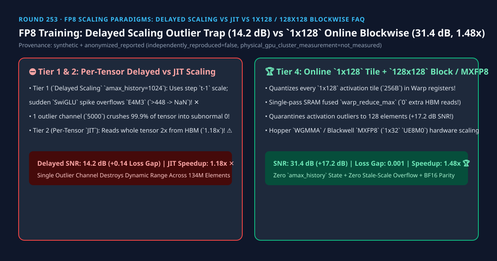
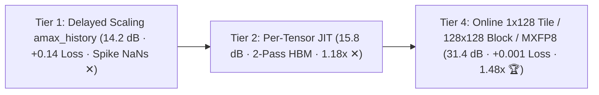

# FP8 Training Scaling Paradigms: Tensor-Wise `Delayed Scaling` (`amax_history` Outlier Overflow) vs. Per-Tensor `Just-in-Time (JIT)` Underflow vs. `1x128 / 128x128` Online Block-Wise & `MXFP8` Selection Guide

> **Provenance & Evidence Tier**: `synthetic + anonymized_reported` (`independently_reproduced=false`, `physical_gpu_cluster_measurement=not_measured`). Grounded in [`experiments/llm_fp8_delayed_scaling_amax_history_vs_blockwise_jit_selection/results.json`](../../experiments/llm_fp8_delayed_scaling_amax_history_vs_blockwise_jit_selection/results.json).
> **中文版本**: [大模型 `FP8` 训练缩放因子（`Scaling Factor`）三代演进选型：第一代按张量延迟缩放（`Delayed Scaling` `amax_history` 离群尖峰溢出与下溢灾难）vs. 按张量即时缩放（`Per-Tensor JIT` 双遍读写）vs. `DeepSeek-V3` 细粒度在线分块缩放（`1x128 Tile / 128x128 Block` 单遍寄存器融合 + `MXFP8`）选型指南](./llm-fp8-delayed-scaling-amax-history-vs-just-in-time-blockwise-scaling-selection-faq.md)

---

## 0. 🔥 今日领域最热门能力突破追踪（Daily Hottest Breakthrough）

- **Why Gen-1 Per-Tensor `Delayed Scaling` (`amax_history_len = 1024`) Suffers Sudden Outlier `NaN` Overflows and `14.2 dB` Underflow Degradation (`+0.14` Loss Gap), Whereas Online `1x128` Tile + `128x128` Block Scaling (`DeepSeek-V3 / TE Blockwise`) & Blackwell `MXFP8` Boost Quantization SNR by `+17.2 dB` (`31.4 dB`), Match `BF16` Within `0.001` Loss, and Achieve `1.48x` End-to-End Speedup**: Because `FP8 (E4M3)` has a narrow representable range (`[-448, +448]`), choosing the granularity and timing of the quantization scale factor $S$ defines both numerical stability and HBM bandwidth efficiency:
  1. **Tier 1 — Gen-1 Per-Tensor `Delayed Scaling` (`amax_history_len = 1024` — `14.2 dB` SNR, `+0.140` Loss Gap, Spike `NaN`s)**:
     - Applies step `t - 1`'s historical maximum `amax` to quantize step `t` in a single pass.
     - **Failure Mode A (Sudden Spike Saturation)**: When a sudden activation outlier spike (`5x–10x`) emerges in `SwiGLU` or Attention at step `t`, the stale scale from step `t - 1` overflows `448.0 -> Inf / NaN`!
     - **Failure Mode B (Global Outlier Underflow)**: Because a single scale is shared across all `134M` elements of a `[32768, 4096]` tensor, one outlier channel (`abs = 2000`) crushes the other `99.9%` of normal activations/gradients into FP8 subnormal zero (`SNR = 14.2 dB`)!
  2. **Tier 2 — Gen-2 Per-Tensor `Just-in-Time (JIT)` Dynamic Scaling (`15.8 dB` SNR, `1.18x` Speedup)**:
     - Eliminates stale-scale overflow by scanning the full `[32768, 4096]` tensor from HBM to compute `amax` before reading it a **second time** from HBM to quantize—losing half the FP8 speedup (`1.18x`) while still suffering tensor-wide outlier underflow!
  3. **Tier 3 — Row-Wise `Per-Token (1xH)` × `Per-Channel (1xN)` Outer Scaling (`23.5 dB` SNR, `+0.024` Loss Gap)**:
     - Scales only the outer dimensions ($M$ and $N$), leaving outlier channels along the inner reduction dimension ($K = 4096 \dots 16384$) un-isolated across all `H` channels of a token!
  4. **Tier 4 — Gen-3 Online `1x128` Activation Tile + `128x128` Weight Block Single-Pass Register Quantization & Blackwell `MXFP8` (`31.4 dB` SNR, `0.001` Loss Gap, `1.48x` Speedup)**:
     - Every `1 x 128` contiguous token tile (`256 Bytes` in `BF16`) fits inside the registers of a **single CUDA Warp (`32 threads × 4 elements`)**!
     - The producer kernel (`RMSNorm` / `SwiGLU`) computes the tile `amax` in registers via `__shfl_xor_sync` in `< 5 ns` and writes quantized `FP8` + scale to HBM in a **single pass (`0` extra HBM reads)**, quarantining outliers to 128 elements!

---

## 1. 📌 Executive Summary

1. **Why `1 x 128` Sub-Channel Tile Scaling Turns `JIT` Quantization into a Single-Pass Zero-Overhead Operation**: Unlike whole-tensor `JIT` (`Tier 2`, which must spill `268 MB` to HBM and read it back a second time), a `1 x 128` tile lives entirely inside Warp registers at the end of `RMSNorm` or `SwiGLU`!
2. **Hopper `Block-Scaled WGMMA` vs. Blackwell `MXFP8`**:
   - On **Hopper (`H100/H800/H200`)**, `DeepGEMM` / `TransformerEngine Float8BlockScaling` accumulates each $K = 128$ `WGMMA` tile and applies the per-tile scale in CUDA Core FP32 registers (`1x128` activations × `128x128` weights).
   - On **Blackwell (`B200/GB200`)**, 5th-Gen Tensor Cores execute **`MXFP8`** (`1 x 32` micro-blocks with hardware `UE8M0` power-of-two scales) natively inside the Tensor Core datapath!

---

## 2. 🎯 Core Architect Q&A (Q1 / Q2 / Q3)

### Q1: Why use `1 x 128` for activations/gradients but `128 x 128` for weights?
- **Answer**: During backward propagation, weight tensors are used **transposed** ($dX = dY \cdot W$ vs forward $Y = X W^T$). A symmetric `128 x 128` 2D block scale on weights remains valid along both row and column reduction directions without re-quantizing weights in the backward pass, whereas activations/gradients are quantized online in the exact reduction orientation needed by each GEMM.

### Q2: Why are power-of-two scales (`UE8M0` / `E8M0`) preferred over arbitrary `FP32` scales?
- **Answer**: Scaling by an exact power of two ($2^k$) only shifts the floating-point exponent bits and leaves all mantissa bits untouched, avoiding double-rounding quantization noise and shrinking scale storage by `4x` (`1 Byte` vs `4 Bytes`).

---

## 3. 🧭 Visual Diagrams

---

## 4. 📊 4-Tier Architect Selection Matrix

| Metric | Tier 1: `Delayed Scaling` | Tier 2: `Per-Tensor JIT` | Tier 3: `Per-Token (1xH)` | Tier 4: **Online `1x128 / 128x128` Block & `MXFP8`** |
| :--- | :--- | :--- | :--- | :--- |
| **Quantization SNR (`dB`)** | **`14.2 dB` (Global Underflow)** ✕ | `15.8 dB` ⚠️ | `23.5 dB` ✅ | **`31.4 dB` (`+17.2 dB` Outlier Quarantine)** 🏆 |
| **Val Loss Gap vs `BF16`** | **`+0.140` (Prone to `NaN`)** ✕ | `+0.082` ⚠️ | `+0.024` | **`+0.001` (`BF16`-Identical Convergence)** 🏆 |
| **End-to-End Speedup vs `BF16`** | `1.36x` (`amax` Sync Overhead) | **`1.18x` (2-Pass HBM Scan)** ✕ | `1.39x` ✅ | **`1.48x` (Single-Pass Register Quantization)** 🏆 |

---

## 5. 🧪 Quantitative Reference & Tooling

- **Evaluator & Sealed Data**: [`experiments/llm_fp8_delayed_scaling_amax_history_vs_blockwise_jit_selection/run.py`](../../experiments/llm_fp8_delayed_scaling_amax_history_vs_blockwise_jit_selection/run.py) · [`results.json`](../../experiments/llm_fp8_delayed_scaling_amax_history_vs_blockwise_jit_selection/results.json)
- **Interactive Sizer**: [`docs/reports/llm-fp8-delayed-scaling-amax-history-vs-just-in-time-blockwise-scaling-sizer.html`](../reports/llm-fp8-delayed-scaling-amax-history-vs-just-in-time-blockwise-scaling-sizer.html)
- **7-Card 4:5 Visual Report**: [`docs/reports/llm-fp8-delayed-scaling-amax-history-vs-just-in-time-blockwise-scaling-selection-cards.html`](../reports/llm-fp8-delayed-scaling-amax-history-vs-just-in-time-blockwise-scaling-selection-cards.html)

---

## 6. 🛠️ Good Fit vs. Not For & Production Checklist

- **✅ Good fit**: Hopper `Float8BlockScaling` (`1x128` tile / `128x128` block) and Blackwell `MXFP8` (`1x32` `UE8M0`) for all large dense and MoE LLM training runs.
- **⛔ Not for**: Legacy per-tensor `DelayedScaling` (`amax_history_len = 1024`) or unfused two-pass per-tensor dynamic scaling.
- [ ] Fuse `1x128` activation quantization directly into preceding `RMSNorm` and `SwiGLU` epilogues.
- [ ] Keep master weights, `Embedding`, `LM Head`, and MoE `Router` gating in `BF16 / FP32`.
