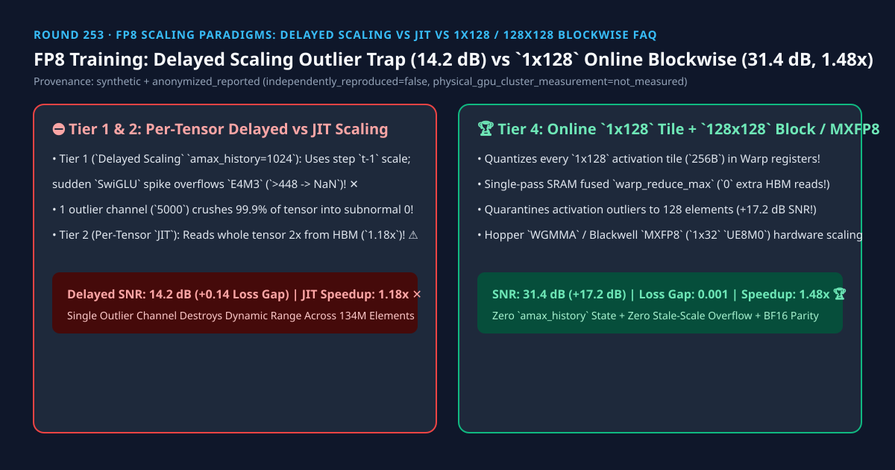
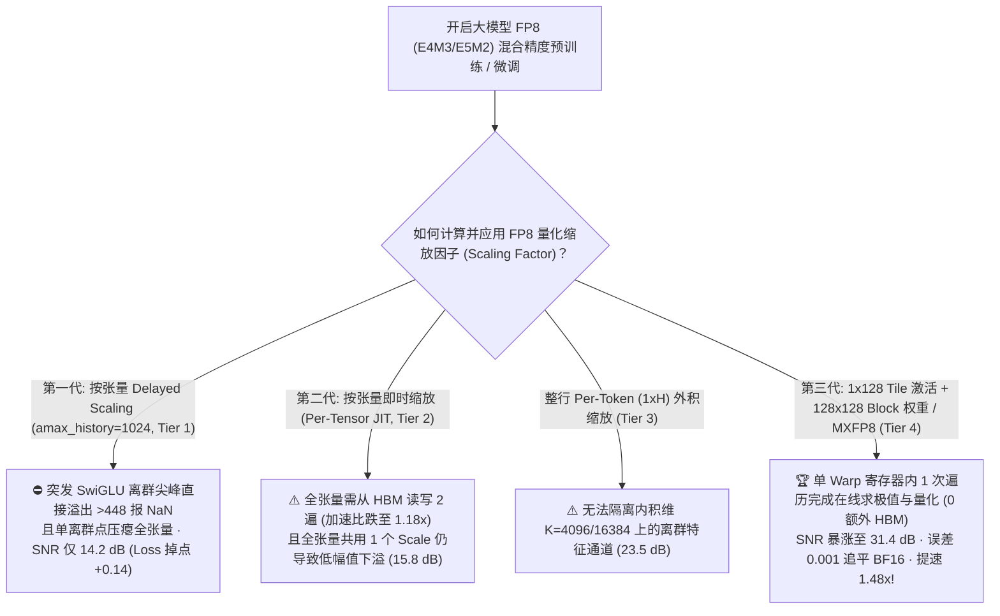
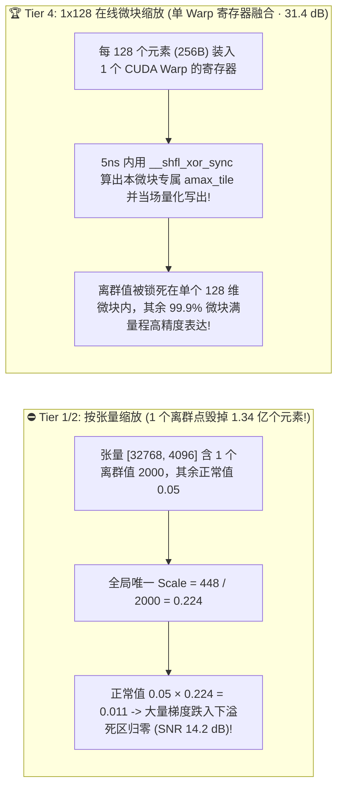
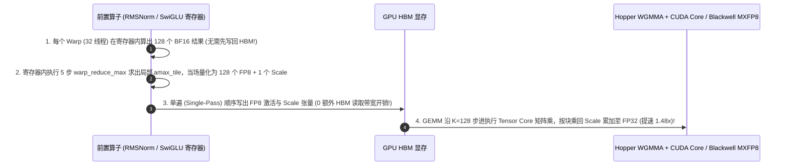

# 大模型 `FP8` 训练缩放因子（`Scaling Factor`）三代演进选型：第一代按张量延迟缩放（`Delayed Scaling` `amax_history` 离群尖峰溢出与下溢灾难）vs. 按张量即时缩放（`Per-Tensor JIT` 双遍读写）vs. `DeepSeek-V3` 细粒度在线分块缩放（`1x128 Tile / 128x128 Block` 单遍寄存器融合 + `MXFP8`）选型指南

> **Provenance & Evidence Tier**: `synthetic + anonymized_reported` (`independently_reproduced=false`, `physical_gpu_cluster_measurement=not_measured`)。定量数据锚定于 [`experiments/llm_fp8_delayed_scaling_amax_history_vs_blockwise_jit_selection/results.json`](../../experiments/llm_fp8_delayed_scaling_amax_history_vs_blockwise_jit_selection/results.json)。
> **English Version**: [FP8 Training Scaling Paradigms: Tensor-Wise `Delayed Scaling` (`amax_history` Outlier Overflow) vs. Per-Tensor `Just-in-Time (JIT)` Underflow vs. `1x128 / 128x128` Online Block-Wise & `MXFP8` Selection Guide](./llm-fp8-delayed-scaling-amax-history-vs-just-in-time-blockwise-scaling-selection-faq.en.md)

---

## 0. 🔥 今日领域最热门能力突破追踪（Daily Hottest Breakthrough）

- **揭秘为什么第一代 `FP8` 训练方案（`Per-Tensor Delayed Scaling`，维护 `amax_history_len = 1024`）在大参数 MoE 与长序列训练到中后期频频突发 `NaN` 崩溃或比 `BF16` 掉点 `+0.14` Loss，而 `DeepSeek-V3` 开创的 `1x128 Tile + 128x128 Block` 在线细粒度分块缩放（及 Blackwell `MXFP8`）能把量化信噪比从 `14.2 dB` 暴拉至 `31.4 dB`（`+17.2 dB`），实现与 `BF16` 误差仅 `0.001` 的无损收敛并提速 `1.48x`**：`FP8 (E4M3)` 只有 4 位指数和 3 位尾数，能表示的最大正数仅为 **`448.0`**！因此必须把 `BF16` 张量乘上一个缩放系数 $S = \frac{448}{\max(|X|)}$ 塞进 `[-448, +448]` 区间。过去三年，业界在“怎么算这个 $\max(|X|)$”上经历了三代生死演进：
  1. **第一代：按张量延迟缩放（`Per-Tensor Delayed Scaling`，`amax_history_len = 1024`，Tier 1 — 突发尖峰溢出 `NaN` + 单颗老鼠屎坏一锅粥）**：
     - **为什么当年要搞“延迟缩放（用上一步 `t-1` 的极值去缩放当前步 `t`）”？** 因为如果对整张 `[32768, 4096]`（1.34 亿个元素，占 `268 MB`）求全局最大值，GPU 必须先把 `268 MB` 从 HBM 读进算子求完 `amax`，再重新读一遍 `268 MB` 做除法量化——这多出来的 **第 2 遍 HBM 读写** 会吃掉一半的 FP8 加速红利！于是早期 `TransformerEngine` 妥协了：直接拿前 1024 步的历史最大值的记忆来缩放当前步！
     - **两大定时炸弹**：
       1. **突发激活尖峰直接撑爆 `448` 溢出 `NaN`**：大模型在训练中后期（尤其是 `SwiGLU` 门控相乘后），某一层的激活极值会突然在某一步跳变 `5x ~ 10x`！用上一步的旧缩放因子一乘，瞬间超过 `448.0` 变成 `Inf / NaN`！
       2. **“一颗老鼠屎压瘪 1.34 亿个正常值”的下溢灾难（`SNR = 14.2 dB`）**：Transformer 存在著名的 **离群特征通道（Outlier Channels，某几个固定维度的数值高达 `2,000`，而其余 `99.9%` 的正常元素只有 `0.05`）**！如果整张 `268 MB` 大张量共用 **1 个** 缩放因子，为了迁就那 1 个 `2,000` 的离群值，其余 1.34 亿个正常值和梯度被缩小几万倍后**全部跌入 FP8 下溢死区变成 `0.0`**！导致最终验证集 Loss 比 `BF16` 恶化 **`+0.140`**！
  2. **第二代：按张量即时动态缩放（`Per-Tensor Just-in-Time / Dynamic Scaling`，Tier 2 — 双遍 HBM 读写降速至 `1.18x`，且依然下溢）**：
     - 放弃历史窗口，当场对全张量求完 `amax` 再量化：虽然不再溢出 `NaN`，但不仅付出了两遍扫描 HBM 的带宽税（加速比从 `1.36x` 跌至 **`1.18x`**），而且因为还是整张张量共用 1 个 Scale，离群通道照样把正常值压成 `0`（`SNR = 15.8 dB`，Loss 仍差 `+0.082`）⚠️！
  3. **第三代（工业界终极答案）：在线寄存器单遍融合的 `1x128 Tile`（激活）+ `128x128 Block`（权重）细粒度分块缩放与 Blackwell `MXFP8`（Tier 4 — `SNR = 31.4 dB`，`1.48x` 加速）**：
     - **第一性原理洞察：为什么切成 `1 x 128` 微瓦片后，“即时缩放（JIT）”反而不需要读两遍 HBM 了？！**
     - 请算一下：`1 x 128` 个 `BF16` 元素一共才 **`256 Bytes`**！
     - 一个 CUDA Warp 有 `32` 个线程，**每个线程手里的寄存器刚好拿着 `4` 个元素（$32 \times 4 = 128$）**！
     - 当上一个算子（比如 `RMSNorm` 或 `SwiGLU`）在寄存器里算出这 `128` 个数时，**根本不需要写回 HBM**！直接在寄存器里执行 5 条硬件蝶形指令 `__shfl_xor_sync`（耗时不到 **`5 纳秒`**！）就能当场求出这 `128` 个数的局部最大值 `amax_tile`，当场除以 `amax_tile` 转成 `FP8` 写出到 HBM！
     - **一箭三雕的奇迹**：
       1. **真正单遍 HBM 读写（Single-Pass Online JIT）**：完全消灭了 `amax_history` 状态表与跨卡 `amax` 同步，加速比飙升至 **`1.48x`**；
       2. **离群值原地隔离（Outlier Quarantine）**：某一个通道出现 `2,000` 的离群值，最多只影响它自己所在的那个 `128` 元素微块，另外 `99.9%` 的微块各自拥有自己的高精度缩放因子！量化信噪比从 `14.2 dB` 暴涨至 **`31.4 dB`（`+17.2 dB`）**，收敛曲线与 `BF16` 完全重合（差距仅 **`0.001`**）🏆！

---

## 1. 📌 核心结论速览（Executive Summary — 3 分钟看懂）

1. **为什么 `Tier 3`（整行 `Per-Token 1xH` × 整列 `Per-Channel 1xN` 外积缩放）依然不够完美，必须像 `DeepSeek-V3` 那样沿着内积收缩维 $K$ 切成 `1 x 128`？**
   - 矩阵乘法 $C_{M \times N} = A_{M \times K} \times B_{K \times N}$ 中，如果只在行 $M$ 和列 $N$ 上做缩放（Tier 3），缩放因子可以直接提到矩阵乘最外面：$C_{i,j} = s_i^{(A)} s_j^{(B)} \sum_{k=1}^K \hat{A}_{i,k} \hat{B}_{k,j}$。
   - **但是**：大模型的离群值恰恰是**沿着隐层特征维度 $K$（例如 `K = 4,096` 或 `16,384`）分布的**！一个 Token 的 `4,096` 维特征里只要有 1 个离群维，整行 `Per-Token` 缩放就会把该 Token 的其余 `4,095` 个维度全部压垮！
   - 因此，**必须把内积维度 $K$ 也以 `128` 为步长切开（`1 x 128`）**！在 Hopper GPU 上，每算完 `WGMMA (K=128)` 的部分和，就在 CUDA Core 寄存器里乘上当前块的 $s_{\text{tile}}$ 累加到 FP32 主累加器；而在 **Blackwell (B200/GB200) `MXFP8`** 上，Tensor Core 硬件内部直接原生支持每 `32` 个元素（`1 x 32`）带一个 8-bit `UE8M0`（2 的幂次）指数缩放因子，连 CUDA Core 二次累加都省了！

---

## 2. 🎯 客户与架构师灵魂拷问 Q&A（Q1 / Q2 / Q3）

### Q1：为什么权重（Weights）用二维块 `128 x 128` 缩放，而激活值（Activations）和梯度（Gradients）要用一维条带 `1 x 128` 缩放？
- **答**：这是为了适配 **反向传播时的矩阵转置（Transpose）需求**！
  - 前向传播算 $Y = X W^T$，反向算输入梯度 $dX = dY \cdot W$（此时权重 $W$ 不转置，内积方向换成了输出通道维！）。
  - 因为权重 $W$ 采用对称的 **`128 x 128` 正方形块缩放**，无论是前向按行读还是反向按列（转置）读，每一块在两个方向上的跨度都是 `128`！无需在反向传播时重新对权重求极值量化！

### Q2：在 `UE8M0`（无符号 8 位纯指数缩放因子，即只取 $2^k$ 幂次）下，相比 `FP32` 任意浮点缩放因子有什么独特优势？
- **答**：如果缩放因子强制向上取整为 **2 的整数次幂（Power-of-Two / `UE8M0`）**，那么在量化与反量化时，原本需要改变尾数并可能引入二次舍入误差（Rounding Error）的浮点乘除法，直接退化为**只给指数位加减一个整数偏移量（尾数比特 100% 原封不动保留）**！不仅彻底消除了缩放舍入噪声，还把缩放因子存储体积再砍 `4` 倍（`4 Bytes -> 1 Byte`）！

---

## 3. 🧭 直观可视化图解（Mermaid 决策树 + 全张量压瘪 vs `1x128` 寄存器融合图 + 时序图）

### 3.1 架构师大模型 `FP8` 训练缩放策略选型决策树

### 3.2 `Tier 1/2`（全张量共用 1 个 Scale 被离群点压垮）vs. `Tier 4`（`1x128` 寄存器单遍在线微块隔离）对比图

### 3.3 `Tier 4` 前置算子寄存器融合 `1x128` 在线量化与 `Block-Scaled GEMM` 执行时序图

---

## 4. 📊 架构师选型决策矩阵（4-Tier Selection Matrix）

| 评估维度 | Tier 1: `Delayed Scaling` (`amax_history`) | Tier 2: `Per-Tensor JIT` (双遍 HBM) | Tier 3: `Per-Token (1xH)` 外积缩放 | Tier 4: **在线 `1x128 Tile / 128x128 Block` / `MXFP8`** |
| :--- | :--- | :--- | :--- | :--- |
| **量化信噪比 (`Quantization SNR`)** | **`14.2 dB` (全局下溢严重)** ✕ | `15.8 dB` ⚠️ | `23.5 dB` ✅ | **`31.4 dB` (`+17.2 dB`，离群点微块隔离)** 🏆 |
| **相比 `BF16` 的验证集 Loss 退化** | **`+0.140` (且易突发 `NaN`)** ✕ | `+0.082` ⚠️ | `+0.024` | **`+0.001` (与 `BF16` 收敛曲线完全重合)** 🏆 |
| **端到端训练加速比 (`vs BF16`)** | `1.36x` (需维护历史表与同步) | **`1.18x` (全张量读 2 遍 HBM)** ✕ | `1.39x` ✅ | **`1.48x` (寄存器单遍在线量化，0 历史状态)** 🏆 |

---

## 5. 🧪 定量算例与工具链（Interactive Sizer & 7-Card Visual Report）

- **实验脚本与密封数据**：[`experiments/llm_fp8_delayed_scaling_amax_history_vs_blockwise_jit_selection/run.py`](../../experiments/llm_fp8_delayed_scaling_amax_history_vs_blockwise_jit_selection/run.py) · [`results.json`](../../experiments/llm_fp8_delayed_scaling_amax_history_vs_blockwise_jit_selection/results.json)
- **交互式 FP8 缩放范式信噪比与加速比计算器**：[`docs/reports/llm-fp8-delayed-scaling-amax-history-vs-just-in-time-blockwise-scaling-sizer.html`](../reports/llm-fp8-delayed-scaling-amax-history-vs-just-in-time-blockwise-scaling-sizer.html)
- **7-Card 4:5 视觉评测卡片报告**：[`docs/reports/llm-fp8-delayed-scaling-amax-history-vs-just-in-time-blockwise-scaling-selection-cards.html`](../reports/llm-fp8-delayed-scaling-amax-history-vs-just-in-time-blockwise-scaling-selection-cards.html)

---

## 6. 🛠️ Good Fit vs. Not For & 生产环境快速核验清单（Checklist）

### ✅ Good Fit vs. ⛔ Not For

| 维度 | ✅ Good Fit（强烈推荐） | ⛔ Not For（严禁误用） |
| :--- | :--- | :--- |
| **Hopper (`H100/H800/H200`) 与 Blackwell (`B200/GB200`) `FP8` 训练** | Hopper 采用 **`1x128` 激活 Tile + `128x128` 权重 Block 在线单遍量化**（`DeepGEMM / TransformerEngine Float8BlockScaling`）；Blackwell 采用原生 **`MXFP8 (1x32 UE8M0)`** | 在含巨型离群值的 MoE 或长序列模型上继续使用第一代 `Per-Tensor Delayed Scaling (amax_history_len=1024)` |

### 生产环境上线核验清单（Pre-Flight Checklist）

- [ ] **淘汰 `Per-Tensor Delayed Scaling`，切换至 `Float8BlockScaling`（`1x128` / `128x128`）或 Blackwell `MXFP8Recipe`**：彻底移除 `amax_history` 显存状态与跨步溢出风险。
- [ ] **核验激活值量化算子已与前置 `RMSNorm / SwiGLU` 算子融合（Single-Pass Register Quantization）**：严禁对全张量执行独立的 `torch.amax()` + 除法两遍 HBM 扫描。
- [ ] **保持 `Embedding`、`LM Head`、MoE `Router Gate` 与主累加器为 `BF16 / FP32` 高精度**。
