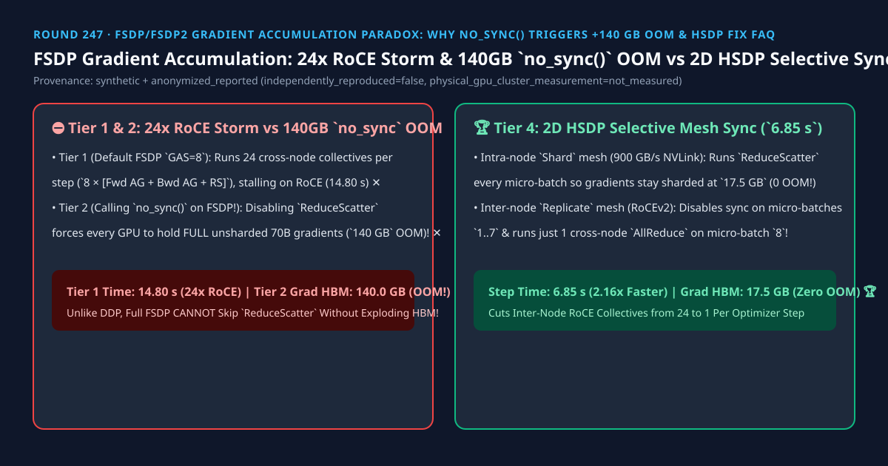
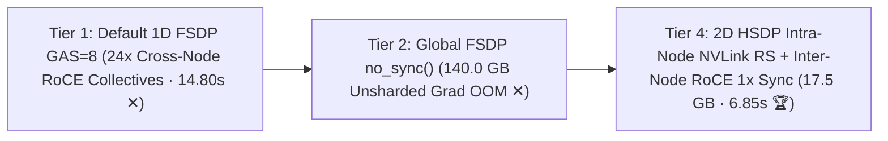

# `FSDP / FSDP2` Gradient Accumulation (`GAS = 8`) Paradox: Why Copying `DDP`'s `model.no_sync()` Triggers Instant `+140 GB` Unsharded Gradient OOM & `2D HSDP` Selective Sync Selection Guide

> **Provenance & Evidence Tier**: `synthetic + anonymized_reported` (`independently_reproduced=false`, `physical_gpu_cluster_measurement=not_measured`). Grounded in [`experiments/llm_ddp_fsdp_gradient_accumulation_no_sync_bucket_cap_selection/results.json`](../../experiments/llm_ddp_fsdp_gradient_accumulation_no_sync_bucket_cap_selection/results.json).
> **中文版本**: [`FSDP / FSDP2` 梯度累积（`Gradient Accumulation = 8`）的反直觉死锁：为什么照搬 `DDP` 的 `model.no_sync()` 会当场引爆 `+140 GB` 全量梯度 OOM？每微批通信风暴 vs. `2D HSDP` 分层同步选型指南](./llm-fsdp-gradient-accumulation-no-sync-oom-vs-comm-storm-selection-faq.md)

---

## 0. 🔥 Daily Hottest Capability Breakthrough

- **Resolving the `FSDP` Gradient Accumulation (`GAS = 8`) Paradox: Why `model.no_sync()` Explodes Gradient HBM from `17.5 GB` to `140.0 GB` (Instant OOM), and How `2D HSDP` Selective Sync Cuts Cross-Node RoCE Collectives from `24` to `1` (`14.80 s -> 6.85 s`, `2.16x` Speedup)**: When migrating training scripts from `DDP` to `FSDP / FSDP2` with gradient accumulation (`GAS = 8`), wrapping micro-batches `1..7` in `with model.no_sync():` causes an unexpected catastrophe:
  1. **The `FSDP no_sync()` `+140 GB` Unsharded Gradient OOM Trap (`Tier 2`)**: In `DDP`, `no_sync()` simply skips `AllReduce` at zero memory cost because each GPU already holds full gradients. In **`FSDP / ZeRO-3`**, however, gradient memory is reduced to $1/N$ (`17.5 GB` on 8 GPUs for a 70B model) **only because FSDP runs `ReduceScatter` immediately after each layer's backward pass and frees the other $7/8$ of the gradient**! Calling `no_sync()` disables `ReduceScatter`, forcing every GPU to accumulate **full, unsharded `140.0 GB` gradients in HBM across all 80 layers**—triggering instant `CUDA out of memory`!
  2. **The Default `1D FSDP` `24x` Cross-Node Collective Storm (`Tier 1` — `14.80 s/step`)**: Running full `FSDP` without `no_sync()` executes 3 global cross-node collectives (`Fwd AllGather + Bwd AllGather + Bwd ReduceScatter`) on every micro-batch ($8 \times 3 = 24$ slow RoCEv2 collectives per step).
  3. **`reshard_after_forward=False` Across Micro-Batches (`Tier 3` — `9.40 s/step`)**: Keeps weights unsharded across micro-batches while still running `ReduceScatter` on gradients (`17.5 GB` gradient HBM, `9` collectives).
  4. **`2D HSDP` Selective Mesh Sync (`Intra-Node NVLink ReduceScatter Every Micro-Batch` + `Inter-Node RoCE AllReduce Only on Micro-Batch 8`, `Tier 4` — `6.85 s/step`, `2.16x` Faster)**: Runs `ReduceScatter` over fast `900 GB/s` intra-node NVLink on every micro-batch to keep gradients sharded at **`17.5 GB` (`0` OOM)**, while skipping slow inter-node RoCEv2 sync on micro-batches `1..7` and running **just `1` inter-node `AllReduce` on micro-batch `8`**!

---

## 1. 📌 Executive Summary

1. **Why `model.no_sync()` Works in `DDP` But Crashes `FSDP` (`Tier 2`)**: In `FSDP`, `ReduceScatter` is not just a communication collective—it is the **memory deallocation mechanism** that shards and frees $7/8$ of each layer's gradient! Disabling it accumulates full unsharded model gradients (`2 bytes × Ψ = 140 GB`) in HBM.
2. **Use `2D HSDP` (`dp_replicate × dp_shard`) for Multi-Node Gradient Accumulation (`Tier 4`)**: Shard gradients every micro-batch inside the node over NVLink (`17.5 GB`), and synchronize across nodes over RoCEv2 only once per optimizer step (`1` collective instead of `24`).

---

## 2. 🎯 Core Architect Q&A (Q1 / Q2 / Q3)

### Q1: Why did our 70B FSDP training job run fine at `gradient_accumulation_steps = 1`, but immediately crash with `CUDA out of memory` when we increased `gradient_accumulation_steps = 8` with `no_sync()`?
- **Answer**: At `GAS = 1`, `no_sync()` is never entered, so FSDP runs `ReduceScatter` after every Transformer block during backward and immediately frees the unsharded block gradient (peak gradient memory = `17.5 GB` sharded + 1 block unsharded). At `GAS = 8`, entering `no_sync()` on Micro-Batch 1 tells FSDP not to run `ReduceScatter`, so every single layer's full `[D_out, D_in]` gradient tensor remains allocated in HBM (`140.0 GB` total)!

### Q2: How does `2D HSDP` (`Hybrid Sharded Data Parallel`) get the communication savings of `no_sync()` without the `140 GB` memory explosion?
- **Answer**: `HSDP` splits the data-parallel world into two orthogonal meshes: an 8-GPU **intra-node `shard` mesh** (connected via `900 GB/s` NVSwitch) and an $M$-node **inter-node `replicate` mesh** (connected via `50 GB/s` RoCEv2). During Micro-Batches `1..7`, `HSDP` executes `ReduceScatter` strictly inside the fast intra-node `shard` mesh (so each GPU only ever holds $1/8$ of the gradients = `17.5 GB`), while suppressing `AllReduce` across the slow inter-node `replicate` mesh until Micro-Batch 8!

### Q3: What if our model is so huge (e.g., 405B) that even weights + gradients must be sharded across 2 or 4 nodes (`shard_size = 16` or `32`)?
- **Answer**: Set the inner `shard` mesh size to the minimum number of GPUs needed to fit sharded states in HBM (e.g., `shard_size = 16` across 2 rail-local nodes), and put all remaining nodes in the outer `replicate` mesh with inter-step `no_sync`.

---

## 3. 🧭 Visual Diagrams

---

## 4. 📊 4-Tier Architect Selection Matrix

| Metric | Tier 1: Default `1D FSDP` (`GAS=8`) | Tier 2: Global `FSDP no_sync()` | Tier 3: `reshard_after_forward=False` | Tier 4: **`2D HSDP` Selective Mesh Sync** |
| :--- | :--- | :--- | :--- | :--- |
| **Peak Gradient HBM (`70B`)** | `17.5 GB` ($1/8$ Sharded) ✅ | **`140.0 GB` (Unsharded -> OOM!)** ✕ | `17.5 GB` ✅ | **`17.5 GB` (NVLink Sharded)** 🏆 |
| **Inter-Node RoCE Collectives** | **`24 / step` (Comm Storm)** ✕ | `17` (Crashes on MB 1) ✕ | `9 / step` ⚠️ | **`1 / step` (`-95.8%` RoCE Traffic)** 🏆 |
| **Optimizer Step Time (`GAS=8`)** | **`14.80 s`** ✕ | `OOM Crash` ✕ | `9.40 s` ✅ | **`6.85 s` (`2.16x` Faster)** 🏆 |

---

## 5. 🧪 Quantitative Reference & Tooling

- **Evaluator & Sealed Data**: [`experiments/llm_ddp_fsdp_gradient_accumulation_no_sync_bucket_cap_selection/run.py`](../../experiments/llm_ddp_fsdp_gradient_accumulation_no_sync_bucket_cap_selection/run.py) · [`results.json`](../../experiments/llm_ddp_fsdp_gradient_accumulation_no_sync_bucket_cap_selection/results.json)
- **Interactive Sizer**: [`docs/reports/llm-fsdp-gradient-accumulation-no-sync-oom-vs-comm-storm-sizer.html`](../reports/llm-fsdp-gradient-accumulation-no-sync-oom-vs-comm-storm-sizer.html)
- **7-Card 4:5 Visual Report**: [`docs/reports/llm-fsdp-gradient-accumulation-no-sync-oom-vs-comm-storm-selection-cards.html`](../reports/llm-fsdp-gradient-accumulation-no-sync-oom-vs-comm-storm-selection-cards.html)

---

## 6. 🛠️ Good Fit vs. Not For & Production Checklist

- **✅ Good fit**: All multi-node LLM training jobs with `gradient_accumulation_steps > 1` using `2D HSDP` (`dp_replicate × dp_shard`) to keep per-micro-batch sharding inside NVLink while syncing across nodes once per step.
- **⛔ Not for**: Wrapping full `FSDP` (`FULL_SHARD`) inside `with model.no_sync():` on memory-constrained GPUs.
- [ ] Replace global `1D FSDP + no_sync()` with `2D HSDP` (`mesh_2d = init_device_mesh("cuda", (replicate_degree, shard_degree))`).
- [ ] Keep intra-node `ReduceScatter` active on all micro-batches and trigger inter-node `AllReduce` only on `micro_batch == GAS - 1`.
