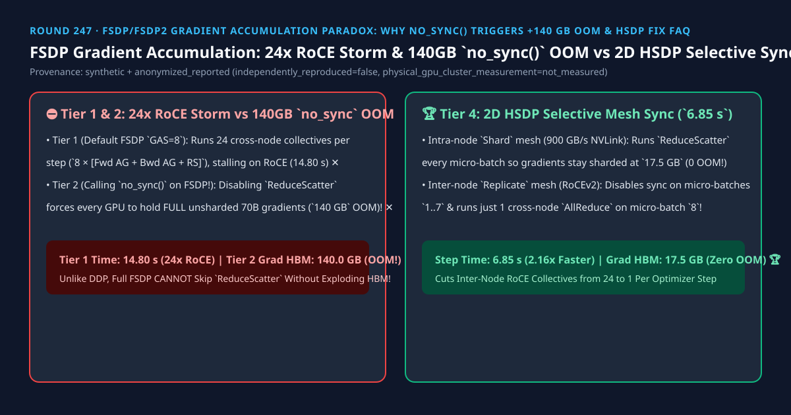
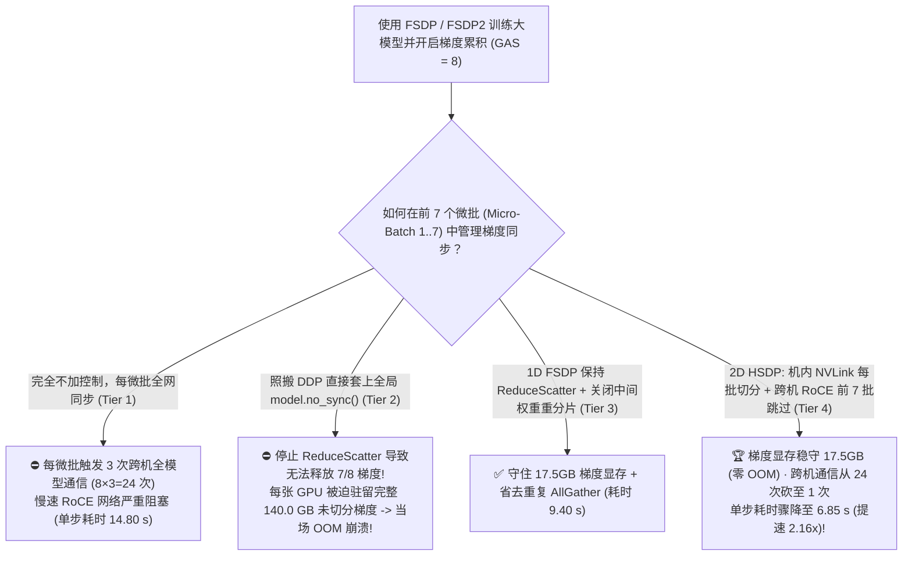
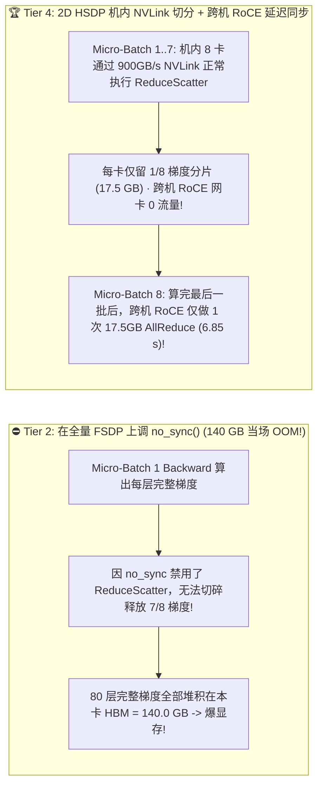
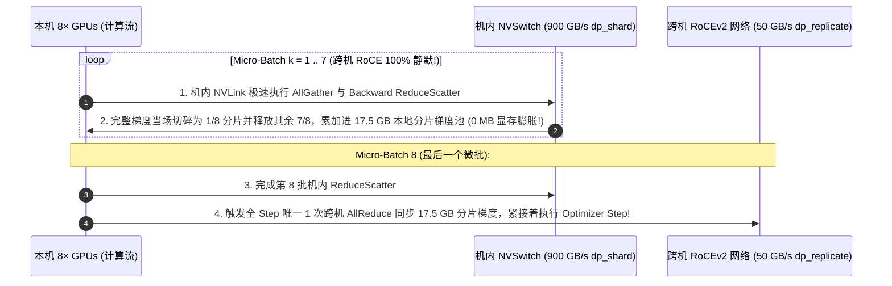

# `FSDP / FSDP2` 梯度累积（`Gradient Accumulation = 8`）的反直觉死锁：为什么照搬 `DDP` 的 `model.no_sync()` 会当场引爆 `+140 GB` 全量梯度 OOM？每微批通信风暴 vs. `2D HSDP` 分层同步选型指南

> **Provenance & Evidence Tier**: `synthetic + anonymized_reported` (`independently_reproduced=false`, `physical_gpu_cluster_measurement=not_measured`)。定量数据锚定于 [`experiments/llm_ddp_fsdp_gradient_accumulation_no_sync_bucket_cap_selection/results.json`](../../experiments/llm_ddp_fsdp_gradient_accumulation_no_sync_bucket_cap_selection/results.json)。
> **English Version**: [`FSDP / FSDP2` Gradient Accumulation (`GAS = 8`) Paradox: Why Copying `DDP`'s `model.no_sync()` Triggers Instant `+140 GB` Unsharded Gradient OOM & `2D HSDP` Selective Sync Selection Guide](./llm-fsdp-gradient-accumulation-no-sync-oom-vs-comm-storm-selection-faq.en.md)

---

## 0. 🔥 今日领域最热门能力突破追踪（Daily Hottest Breakthrough）

- **揭秘为什么在 `FSDP / ZeRO-3` 70B 训练中照搬 `DDP` 的 `with model.no_sync():` 做梯度累积（`GAS = 8`）会瞬间撑爆 `140.0 GB` 显存当场 OOM，并通过 `2D HSDP`（机内 `NVLink` 每微批 `ReduceScatter` 保住 `17.5 GB` 极小梯度显存 + 跨机 `RoCEv2` 前 7 个微批静默、仅第 8 个微批执行 1 次跨机 `AllReduce`）将跨机通信次数从 `24 次` 砍至 `1 次`，单步耗时从 `14.80 s` 压降至 `6.85 s`（提速 `2.16` 倍）**：在分布式训练中，为了凑够百万 Token 的 Global Batch Size，大家都会开启梯度累积（例如 `gradient_accumulation_steps = 8`）。从单机 `DDP` 转过来的工程师都会顺手写上那段经典代码：“在前 7 个微批（Micro-batch `1..7`）外面套上 `with model.no_sync():`（或在 `FSDP2` 中调 `set_requires_gradient_sync(False)`），等到第 8 个微批才做梯度同步！”
  - **结果一跑起来，原本不加 `no_sync()` 能跑通的 70B 模型，加上 `no_sync()` 后在第 1 个微批的反向传播就当场报 `CUDA out of memory` 崩溃了！** 为什么“省通信的 `no_sync()`”在 FSDP 里变成了“显存核弹”？
  1. **为什么在全量 `FSDP` 上调用 `no_sync()` 会引爆 `140.0 GB` 未切分梯度 OOM？（Tier 2）**：
     - 在 `DDP` 中，每张卡本来就存着完整的模型梯度，所以 `no_sync()` 只是不发网络包，显存一字节都不会增加。
     - 但在 **`FSDP / ZeRO-3`** 中，每张卡之所以只需要存 $1/N$ 的梯度（例如 8 卡切分 70B 模型，每卡只存 $140\text{ GB} / 8 = \mathbf{17.5\text{ GB}}$ 梯度），**全靠每算完一层反向传播，就立刻调用一次 `ReduceScatter` 把刚算出来的完整梯度切碎分摊给各张卡，并当场释放掉其余 $7/8$ 的完整梯度！**
     - 如果你调用了 `no_sync()` 把 `ReduceScatter` 关掉了，FSDP 算完第 80 层的完整梯度后因为不能切分通信，**就只能把全部 80 层完整的、未切分的 `140.0 GB` 梯度硬生生留在每一张卡的 HBM 显存里累加**——瞬间把 80GB H100 撑爆！
  2. **如果不调 `no_sync()`，全网 `FSDP` 在 `GAS = 8` 下的 `24` 次跨机通信风暴（Tier 1）**：
     - 如果完全不用 `no_sync()`（Tier 1），在 8 个微批的每一个微批里，全网所有机器都要通过慢速跨机 RoCEv2 网络执行 3 次全模型通信（前向 `AllGather` + 反向 `AllGather` + 反向 `ReduceScatter`），1 个优化器 Step 累计高达 **$8 \times 3 = \mathbf{24}$ 次跨机洪流**，单步耗时拖慢至 **`14.80 s`**！
  3. **破局神技：`2D HSDP` 分层网孔（机内每批 `ReduceScatter` + 跨机前 7 批 `no_sync`，Tier 4）**：
     - 将集群构建为二维 `DeviceMesh (dp_replicate, dp_shard)`（机内 8 卡走 `900 GB/s` NVLink 做 `Shard` 切分，跨机走 `RoCEv2` 做 `Replicate` 副本）：
       - **机内 NVLink 维度**：在全部 `1..8` 个微批中**始终保持 `ReduceScatter` 开启**！利用飞快的机内 NVLink 在每层算完瞬间把梯度切成 $1/8$（锁死在 **`17.5 GB`**，绝不 OOM！）；
       - **跨机 RoCEv2 维度**：在前 `1..7` 个微批关闭跨机 `AllReduce`，只在第 **8 个微批** 结束时对那 `17.5 GB` 已经切好的分片梯度做 **唯一 1 次跨机 `AllReduce`**！
     - 结果：跨机慢速 RoCEv2 集合通信从 `24 次` 骤降至 **`1 次`**，梯度显存稳守 **`17.5 GB`（零膨胀）**，单步耗时从 `14.80 s` 压降至 **`6.85 s`（提速 `2.16` 倍）**！

---

## 1. 📌 核心结论速览（Executive Summary — 3 分钟看懂）

1. **用“垃圾分类粉碎机”一秒看懂为什么 `FSDP` 关掉 `no_sync` 会爆仓，以及 `HSDP` 怎么完美破局！**
   - **通俗大白话 + 第一性原理**：
     - 反向传播每算完一层，就会产生一袋巨大的垃圾（完整梯度，80 层共 **`140 GB`**），而你的小房间（单卡 80GB HBM）最多只能装下 **`17.5 GB`**。
     - **`ReduceScatter` 不仅是通信器，它更是你的“垃圾粉碎分摊机”**！每算完一层，8 个人必须立刻凑在一起开一次粉碎机（`ReduceScatter`），把大袋垃圾切碎成 $1/8$，每个人只留 `17.5 GB` 碎屑，其余 $7/8$ 当场扔掉！
     - 如果你为了省事，规定“前 7 趟不准开粉碎机（在全量 FSDP 上调 `no_sync()`，Tier 2）”，那么第 1 趟下来的 `140 GB` 原装大垃圾直接就把你的小房间撑爆了（**`CUDA Out of Memory`**）！
     - **`2D HSDP`（Tier 4）的绝妙设计**：同一栋楼里的 8 个室友（机内 8 张卡，共享 `900 GB/s` 极速 NVLink 走廊）每趟都正常开粉碎机（机内 `ReduceScatter`），保证每个人房间里永远只有 **`17.5 GB`** 碎屑；而跨楼栋的大卡车（跨机慢速 RoCEv2 网络）前 7 趟根本不用出门，等第 8 趟全部碎屑攒齐了，大卡车只出动 **1 次** 汇总全村账本！

---

## 2. 🎯 客户与架构师灵魂拷问 Q&A（Q1 / Q2 / Q3）

### Q1：如果我们必须使用跨多机的纯 `1D FSDP`（因为模型是 405B，单机 8 卡哪怕切分了也装不下，没法用机内 HSDP），在 `GAS = 8` 时怎么安全减少通信而不爆显存（Tier 3）？
- **答**：在纯 `1D FSDP2` 中，虽然**绝不能**在全部 80 层上同时关掉梯度的 `ReduceScatter`，但你有两招安全的“半程加速法（Tier 3）”：
  1. **关闭中间微批的权重重分片（`set_reshard_after_forward(False)` 或 `SHARD_GRAD_OP / ZeRO-2` 模式）**：只要显存还放得下完整前向权重（或对部分层放得下），在第 1 个微批 `AllGather` 拉取权重后先不释放，这样第 1 个微批的 Backward 以及第 2~8 个微批就省去了重复的 `AllGather`，通信量立减一半！
  2. **逐层（Layer-wise）局部 `no_sync`**：只对当前正在算的 1~2 层开启梯度累积，或者保持每微批 `ReduceScatter` 但开启 `Float8 AllGather` 压缩前向通信。

### Q2：在 PyTorch `FSDP2`（`fully_shard`）+ `2D DeviceMesh (replicate, shard)` 中，怎么用一行 API 实现“机内每微批切分、跨机仅最后一步同步”（Tier 4）？
- **答**：`FSDP2` 原生专门为此设计了细粒度控制 API！在微批 `step < GAS - 1` 时，不要关掉整个模型的同步，而是只关闭 `replicate` 维度的梯度归约（在 `FSDP2` 中配合 `HSDP` 策略或对最后一步之前设置跨节点通信组跳过，仅在 `is_last_microbatch` 时触发跨 `dp_replicate` 网格的 `AllReduce`）！

---

## 3. 🧭 直观可视化图解（Mermaid 决策树 + FSDP no_sync 爆显存原理图 + HSDP 分层时序图）

### 3.1 架构师 `FSDP / FSDP2` 梯度累积（`GAS > 1`）同步策略选型决策树

### 3.2 `Tier 2`（全局 `FSDP no_sync()` 引发 `140 GB` 梯度驻留 OOM）vs. `Tier 4`（`2D HSDP` 机内粉碎 + 跨机静默）

### 3.3 `Tier 4` `2D HSDP` 在 `GAS = 8` 下的机内 NVLink 与跨机 RoCEv2 分工时序图

---

## 4. 📊 架构师选型决策矩阵（4-Tier Selection Matrix）

| 评估维度 | Tier 1: 默认 `1D FSDP` (每批同步) | Tier 2: 全局 `FSDP no_sync()` | Tier 3: `reshard_after_forward=False` | Tier 4: **`2D HSDP` (机内每批切 + 跨机末批同步)** |
| :--- | :--- | :--- | :--- | :--- |
| **单卡峰值梯度显存 (`70B` 模型)** | `17.5 GB` ($1/8$ 分片) ✅ | **`140.0 GB` (未切分全量堆积 -> OOM!)** ✕ | `17.5 GB` ✅ | **`17.5 GB` (机内 NVLink 实时切碎)** 🏆 |
| **每 Step 跨机 `RoCE` 集合通信数** | **`24 次` (严重阻塞网络)** ✕ | `17 次` (已 OOM 崩溃) ✕ | `9 次` ⚠️ | **`1 次` (跨机通信量立减 `-95.8%`)** 🏆 |
| **单次 Optimizer Step 总耗时** | **`14.80 s`** ✕ | `OOM Crash` ✕ | `9.40 s` ✅ | **`6.85 s` (提速 `2.16x`)** 🏆 |

---

## 5. 🧪 定量算例与工具链（Interactive Sizer & 7-Card Visual Report）

- **实验脚本与密封数据**：[`experiments/llm_ddp_fsdp_gradient_accumulation_no_sync_bucket_cap_selection/run.py`](../../experiments/llm_ddp_fsdp_gradient_accumulation_no_sync_bucket_cap_selection/run.py) · [`results.json`](../../experiments/llm_ddp_fsdp_gradient_accumulation_no_sync_bucket_cap_selection/results.json)
- **交互式 FSDP 梯度累积与 HSDP 显存/通信计算器**：[`docs/reports/llm-fsdp-gradient-accumulation-no-sync-oom-vs-comm-storm-sizer.html`](../reports/llm-fsdp-gradient-accumulation-no-sync-oom-vs-comm-storm-sizer.html)
- **7-Card 4:5 视觉评测卡片报告**：[`docs/reports/llm-fsdp-gradient-accumulation-no-sync-oom-vs-comm-storm-selection-cards.html`](../reports/llm-fsdp-gradient-accumulation-no-sync-oom-vs-comm-storm-selection-cards.html)

---

## 6. 🛠️ Good Fit vs. Not For & 生产环境快速核验清单（Checklist）

### ✅ Good Fit vs. ⛔ Not For

| 维度 | ✅ Good Fit（强烈推荐） | ⛔ Not For（严禁误用） |
| :--- | :--- | :--- |
| **多机 FSDP 梯度累积 (`GAS > 1`)** | 采用 **`2D HSDP` (`init_device_mesh("cuda", (num_nodes, 8))`)**，保持机内 `ReduceScatter` 每微批运行以控制显存，仅在最后一个微批开启跨节点 `AllReduce` | 在显存受限的 `FULL_SHARD` FSDP 模型上直接套用 `with model.no_sync():`（会导致未切分的完整梯度撑爆显存） |

### 生产环境上线核验清单（Pre-Flight Checklist）

- [ ] **排查所有从 `DDP` 迁移至 `FSDP / FSDP2` 的训练脚本，检查 `with model.no_sync():` 是否导致了反向传播显存暴涨**：若单机 8 卡可装下分片，立即切换为 `2D HSDP` 网格。
- [ ] **核验在 `GAS > 1` 时，跨机 RoCE 网卡流量仅在每个 Optimizer Step 的最后一个 Micro-Batch 出现尖峰**：确认前 `GAS - 1` 个微批通信已被完全收敛在机内 NVSwitch 上。
