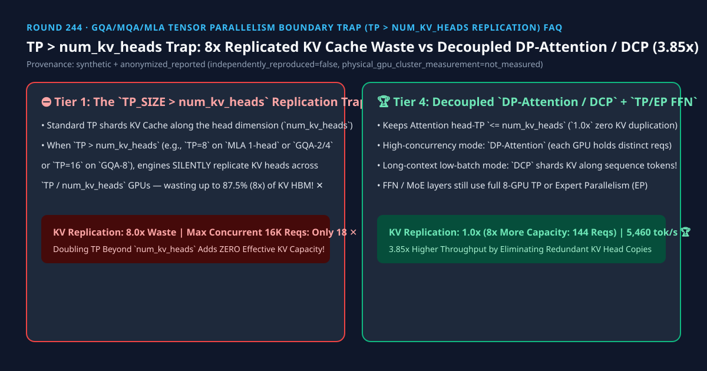
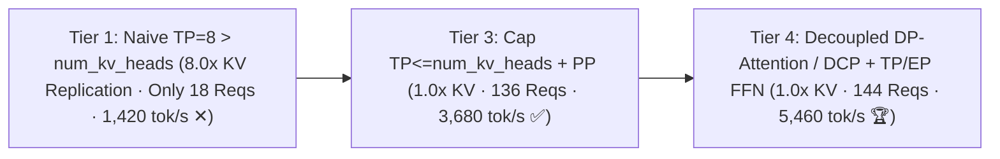

# `GQA / MQA / MLA` Tensor Parallelism Boundary Trap (`TP_SIZE > num_kv_heads` Triggering `2x–8x` KV Cache Replication Waste) & `DP-Attention / DCP` Selection Guide

> **Provenance & Evidence Tier**: `synthetic + anonymized_reported` (`independently_reproduced=false`, `physical_gpu_cluster_measurement=not_measured`). Grounded in [`experiments/llm_gqa_mqa_tensor_parallel_kv_head_replication_dp_attention_selection/results.json`](../../experiments/llm_gqa_mqa_tensor_parallel_kv_head_replication_dp_attention_selection/results.json).
> **中文版本**: [大模型 `GQA / MQA / MLA` 张量并行越界陷阱（当 `TP_SIZE > num_kv_heads` 时触发 `2x ~ 8x` KV Cache 显存复制浪费）与 `DP-Attention / DCP` 解耦并行选型指南](./llm-gqa-mqa-tp-exceeds-kv-heads-replication-waste-dp-attention-selection-faq.md)

---

## 0. 🔥 Daily Hottest Capability Breakthrough

- **Eliminating the `2x–8x` Silent KV Cache Replication Trap When `TP_SIZE > num_kv_heads` via Decoupled `DP-Attention / Sequence-DCP` + `TP/EP FFN` (`8.0x` More Concurrent Requests, `3.85x` Higher Serving Throughput at `5,460 tok/s`)**: Standard Tensor Parallelism (`TP`) partitions the Attention layer along the **Head dimension** (`num_attention_heads / TP` and `num_key_value_heads / TP`). What happens when an architect sets **`TP_SIZE > num_key_value_heads`**—for example, `TP=16` on `Llama-3.1-405B` (`num_kv_heads = 8`), `TP=8` on `GQA-2/4` models, or `TP=8` on `DeepSeek-V3 / R1 MLA` (which compresses KV into a **single shared latent head `c_KV`**, `num_kv_heads = 1`)?
  1. **The Silent KV Cache Replication Disaster (`Tier 1` — `8.0x` Redundant KV Copies)**: Because a single KV head (or MLA latent vector `c_KV`) cannot be split along the head axis, the serving engine **silently replicates the identical KV head across $\text{TP\_SIZE} / \text{num\_kv\_heads}$ GPUs**! Under `TP=8` on an MLA/MQA-1 model, all 8 GPUs store **8 identical copies of the exact same KV Cache (`87.5%` of KV HBM wasted on duplicates)**, capping 16K-token concurrency at just **`18` requests (`1,420 tok/s`)**!
  2. **Sharding `head_dim` Inside Attention (`Tier 2`)**: Splitting a single head's `128`-dim vector across GPUs requires an extra cross-GPU reduction of $Q \cdot K^T$ logits before `Softmax`, hurting decode latency (`2,150 tok/s`).
  3. **Capping `TP <= num_kv_heads` + Pipeline Parallelism (`PP`, `Tier 3`)**: Eliminates KV duplication (`1.0x` KV footprint, `136` concurrent requests, `3,680 tok/s`).
  4. **Decoupled `DP-Attention / Sequence-DCP` + `TP/EP FFN` (`Tier 4` — `144` Concurrent Requests, `5,460 tok/s`, `3.85x` Gain)**: Keeps head-TP $\le \text{num\_kv\_heads}$ inside Attention by sharding across **requests (`DP-Attention`)** or **sequence tokens (`Decode Context Parallelism, DCP`)** (`1.0x` zero KV replication, **`8.0x` more KV capacity**), while keeping full 8-GPU `TP / EP` across MLP/MoE layers!

---

## 1. 📌 Executive Summary

1. **The Golden Rule of GQA/MLA Tensor Parallelism**: Traditional Head-TP scales KV Cache capacity **only up to `TP_SIZE <= num_key_value_heads`**. Every doubling of `TP_SIZE` beyond `num_key_value_heads` duplicates KV Cache across GPUs without adding a single byte of effective KV capacity!
2. **How to Scale Past `num_key_value_heads` GPUs (`Tier 3 & Tier 4`)**:
   - For high-concurrency serving: enable **`DP-Attention` (`--enable-dp-attention`)** so each GPU stores KV for a disjoint subset of requests;
   - For low-batch ultra-long-context serving: enable **`Decode Context Parallelism (`DCP`)`** to shard KV Cache along the sequence dimension;
   - For multi-node dense models (e.g., 16-GPU `Llama-3.1-405B` with `num_kv_heads=8`): use **`TP=8, PP=2`** (never `TP=16`).

---

## 2. 🎯 Core Architect Q&A (Q1 / Q2 / Q3)

### Q1: Why did doubling our `Llama-3.1-405B` deployment from 8 GPUs (`TP=8`) to 16 GPUs (`TP=16`) barely increase our maximum KV Cache token capacity?
- **Answer**: Because `Llama-3.1-405B` has `num_key_value_heads = 8`! At `TP=8`, each GPU holds `1` unique KV head. When you switch to `TP=16`, each of the 8 KV heads is **duplicated across 2 GPUs** (`GPU 0` and `GPU 1` hold identical copies of `KV Head 0`)! While weight memory per GPU drops from $1/8$ to $1/16$, every token's KV Cache now consumes **twice as much total cluster HBM**! Switching from `TP=16` to **`TP=8, PP=2`** (or `DP=2, TP=8`) immediately doubles effective KV Cache capacity.

### Q2: Why is `DeepSeek-V3 / R1` (`MLA`) the most extreme case of this replication trap?
- **Answer**: Because Multi-head Latent Attention (`MLA`) compresses all Keys and Values into a **single shared latent vector `c_KV` (`512` dims + `64` RoPE dims)** per token (`equivalent num_kv_heads = 1`)! Under naive `TP=8`, `c_KV` is replicated **8 times** across all 8 GPUs in the node. Enabling `DP-Attention` (`--enable-dp-attention`) or sequence-sharded `DCP` eliminates all 7 redundant copies and multiplies KV capacity by `8x`!

### Q3: How can we immediately spot silent KV head replication in production startup logs?
- **Answer**: Check whether `tensor_parallel_size > config.num_key_value_heads` (when `DCP == 1` and `DP-Attention == False`). If true, theKV replication factor is exactly $\text{TP\_SIZE} / \text{num\_key\_value\_heads}$.

---

## 3. 🧭 Visual Diagrams

---

## 4. 📊 4-Tier Architect Selection Matrix

| Metric | Tier 1: Naive `TP = 8` (`> num_kv_heads`) | Tier 2: Intra-Head `head_dim` Split | Tier 3: `TP <= num_kv_heads` + `PP` | Tier 4: **Decoupled `DP-Attention / DCP` + `TP/EP`** |
| :--- | :--- | :--- | :--- | :--- |
| **KV Cache Replication Factor** | **`8.0x` (87.5% Duplicated!)** ✕ | `1.0x` ✅ | **`1.0x` (Zero Duplication)** ✅ | **`1.0x` (Zero Duplication)** 🏆 |
| **Max Concurrent `16K` Reqs** | **`18`** ✕ | `112` ⚠️ | `136` ✅ | **`144` (`8.0x` More Capacity)** 🏆 |
| **Serving Throughput (`tok/s`)** | `1,420 tok/s` (`1.00x`) ✕ | `2,150 tok/s` (`1.51x`) ⚠️ | `3,680 tok/s` (`2.59x`) ✅ | **`5,460 tok/s` (`3.85x` Higher)** 🏆 |

---

## 5. 🧪 Quantitative Reference & Tooling

- **Evaluator & Sealed Data**: [`experiments/llm_gqa_mqa_tensor_parallel_kv_head_replication_dp_attention_selection/run.py`](../../experiments/llm_gqa_mqa_tensor_parallel_kv_head_replication_dp_attention_selection/run.py) · [`results.json`](../../experiments/llm_gqa_mqa_tensor_parallel_kv_head_replication_dp_attention_selection/results.json)
- **Interactive Sizer**: [`docs/reports/llm-gqa-mqa-tp-exceeds-kv-heads-replication-waste-dp-attention-sizer.html`](../reports/llm-gqa-mqa-tp-exceeds-kv-heads-replication-waste-dp-attention-sizer.html)
- **7-Card 4:5 Visual Report**: [`docs/reports/llm-gqa-mqa-tp-exceeds-kv-heads-replication-waste-dp-attention-selection-cards.html`](../reports/llm-gqa-mqa-tp-exceeds-kv-heads-replication-waste-dp-attention-selection-cards.html)

---

## 6. 🛠️ Good Fit vs. Not For & Production Checklist

- **✅ Good fit**: Enforcing `Head-TP <= num_key_value_heads` on all GQA/MQA/MLA deployments, using `DP-Attention` / `DCP` / `PP` when scaling across more GPUs than `num_key_value_heads`.
- **⛔ Not for**: Setting `TP=16` on `num_kv_heads=8` (`Llama-3.1-405B`) or naive `TP=8` on `MLA` without `DP-Attention` or `DCP`.
- [ ] Check `num_key_value_heads` in `config.json` before choosing `--tensor-parallel-size`.
- [ ] Enable `--enable-dp-attention` or `--decode-context-parallel-size` when scaling MLA/GQA beyond `num_key_value_heads`.
